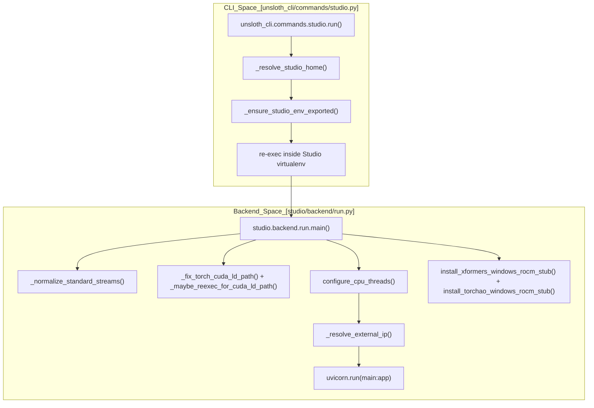
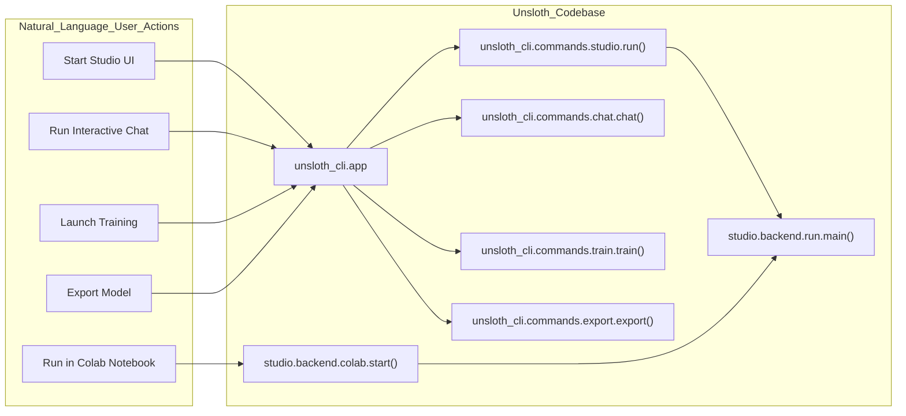

<!-- source: DeepWiki mcp.deepwiki.com · repo unslothai/unsloth · page 2.3 Quick Start: Studio and CLI · fetched 2026-10-21 -->

# Quick Start: Studio and CLI

<details>
<summary>Relevant source files</summary>

The following files were used as context for generating this wiki page:

- [studio/Unsloth_Studio_Colab.ipynb](studio/Unsloth_Studio_Colab.ipynb)
- [studio/backend/auth/terminal_prompt.py](studio/backend/auth/terminal_prompt.py)
- [studio/backend/colab.py](studio/backend/colab.py)
- [studio/backend/core/inference/runtime_context.py](studio/backend/core/inference/runtime_context.py)
- [studio/backend/run.py](studio/backend/run.py)
- [studio/backend/state/tool_policy.py](studio/backend/state/tool_policy.py)
- [studio/backend/tests/test_change_password_policy.py](studio/backend/tests/test_change_password_policy.py)
- [studio/backend/tests/test_colab_embed.py](studio/backend/tests/test_colab_embed.py)
- [studio/backend/tests/test_conversation_search_safetensors_loop.py](studio/backend/tests/test_conversation_search_safetensors_loop.py)
- [studio/backend/tests/test_generation_budget.py](studio/backend/tests/test_generation_budget.py)
- [studio/backend/tests/test_password_prompt.py](studio/backend/tests/test_password_prompt.py)
- [studio/backend/tests/test_password_prompt_backstop.py](studio/backend/tests/test_password_prompt_backstop.py)
- [studio/backend/tests/test_secure_tunnel_gate.py](studio/backend/tests/test_secure_tunnel_gate.py)
- [studio/backend/tests/test_server_disk_logging_outstream.py](studio/backend/tests/test_server_disk_logging_outstream.py)
- [studio/backend/tests/test_tool_policy_gates.py](studio/backend/tests/test_tool_policy_gates.py)
- [studio/backend/tests/test_wildcard_prompt_compatibility.py](studio/backend/tests/test_wildcard_prompt_compatibility.py)
- [studio/frontend/src/features/settings/components/change-password-dialog.tsx](studio/frontend/src/features/settings/components/change-password-dialog.tsx)
- [tests/python/test_unsloth_run_tool_policy_resolver.py](tests/python/test_unsloth_run_tool_policy_resolver.py)
- [unsloth_cli/_inference.py](unsloth_cli/_inference.py)
- [unsloth_cli/_model_catalog.py](unsloth_cli/_model_catalog.py)
- [unsloth_cli/_tool_policy.py](unsloth_cli/_tool_policy.py)
- [unsloth_cli/commands/_password_prompt.py](unsloth_cli/commands/_password_prompt.py)
- [unsloth_cli/commands/chat.py](unsloth_cli/commands/chat.py)
- [unsloth_cli/commands/inference.py](unsloth_cli/commands/inference.py)
- [unsloth_cli/commands/studio.py](unsloth_cli/commands/studio.py)
- [unsloth_cli/tests/conftest.py](unsloth_cli/tests/conftest.py)
- [unsloth_cli/tests/test_inference_chat.py](unsloth_cli/tests/test_inference_chat.py)
- [unsloth_cli/tests/test_studio_cloudflare_flag.py](unsloth_cli/tests/test_studio_cloudflare_flag.py)
- [unsloth_cli/tests/test_studio_password_prompt.py](unsloth_cli/tests/test_studio_password_prompt.py)
- [unsloth_cli/tests/test_studio_run_parallel_flag.py](unsloth_cli/tests/test_studio_run_parallel_flag.py)
- [unsloth_cli/tests/test_studio_secure_flag.py](unsloth_cli/tests/test_studio_secure_flag.py)

</details>


This page provides technical guidance for launching Unsloth via the **Studio web UI** and the **Command Line Interface (CLI)**. It details the sequence for starting the Studio backend server, running inference or training commands from the CLI, and describes key implementation points in this workflow.

---

## Studio Web UI

The Studio web UI is an AGPL-3.0 licensed, rich browser interface built on React with a FastAPI backend. It enables training, inference, and model export workflows with isolated subprocesses for robust environment control.

### Setup and Installation

To install and prepare the Studio environment, run the setup script in the repository root:

```bash
chmod +x studio/setup.sh && ./studio/setup.sh
```

This script performs:

- Detect operating system (Linux/WSL vs Windows) for tailored installs.
- Node.js LTS + npm installation for frontend build.
- Creation of an isolated Python virtual environment at `~/.unsloth/studio/unsloth_studio` where backend dependencies are installed.
- Compiles React frontend assets into `frontend/dist`.
- Downloads and installs the `llama.cpp` binary backend for GGUF model support.

The environment structure and managed paths are resolved primarily via `_resolve_studio_home()` inside `unsloth_cli/commands/studio.py` [unsloth_cli/commands/studio.py:43-91]().

### Launching the Studio Server

Start the Studio backend server using the CLI:

```bash
unsloth studio run
# or equivalently:
unsloth run
```

The `studio` command first ensures it runs inside the dedicated Studio venv (re-executes inside the venv if needed), facilitated by `_ensure_studio_env_exported()` and re-execution logic [unsloth_cli/commands/studio.py:90-114]().

Inside the Studio backend, entrypoint logic is inside `studio/backend/run.py`, which performs critical system preparation before launching the FastAPI application:

- **Standard Stream Normalization:** Ensures `sys.stdin/stdout/stderr` are not `None` (which occurs in detached Windows launches) by redirecting them to null devices [studio/backend/run.py:11-32]().
- **CUDA LD_LIBRARY_PATH Fix:** On Linux, prepends PyTorch’s bundled CUDA libraries to `LD_LIBRARY_PATH` to avoid symbol loading conflicts with system CUDA installs, followed by a re-exec for the dynamic linker to reload correctly [studio/backend/run.py:34-77]() and [studio/backend/run.py:83-94]() for re-exec.
- **CPU Thread Configuration:** Adjusts OpenMP/BLAS thread counts to prevent resource oversubscription [studio/backend/run.py:104-111]().
- **Windows ROCm Compatibility Stubs:** Installs import-time stubs to avoid import errors for `torchao` and CUDA-only `xformers` when running on Windows ROCm [studio/backend/run.py:113-121]().

The backend attempts to resolve network interfaces and public IP information to display shareable URLs and configure network access policies [studio/backend/run.py:152-193]().

---

**Diagram: Studio Launch Process and Environment Flow**



*Sources: [unsloth_cli/commands/studio.py:35-114](), [studio/backend/run.py:10-198]()*

---

## Cloud Colab Integration

Unsloth Studio supports running inside Google Colab notebooks through `studio/backend/colab.py`, facilitating a seamless cloud experience:

- Detects if running in a Colab runtime.
- Automatically requests a Cloudflare tunnel if enabled or running on Colab since in-notebook iframes often fail [studio/backend/colab.py:63-148]().
- Persists a temporary admin bootstrap password locally in `.colab_notebook_login` to allow re-runs without resetting credentials [studio/backend/colab.py:79-130]().
- Provides convenience functions to get the publicly accessible Colab proxy URL for the backend port [studio/backend/colab.py:22-50]().

Typical usage in a notebook is as shown in `studio/Unsloth_Studio_Colab.ipynb`:

```python
!git clone --depth 1 --branch main https://github.com/unslothai/unsloth.git
%cd /content/unsloth
!chmod +x studio/setup.sh && ./studio/setup.sh --local

import sys
sys.path.insert(0, "/content/unsloth/studio/backend")
from colab import start

# start() auto-opens Cloudflare URL and prints admin credentials.
start()

# To skip Cloudflare tunnel, call:
# start(cloudflare=False)
```

*Sources: [studio/backend/colab.py:17-149](), [studio/Unsloth_Studio_Colab.ipynb:59-95]()*

---

## CLI Commands

Unsloth's CLI commands provide terminal access for training, inference, exporting models, and launching the Studio UI.

### Running Studio UI via CLI

Run:

```bash
unsloth studio
# or
unsloth studio run
```

This command:

- Invokes the CLI entrypoint in `unsloth_cli/commands/studio.py` registered under `studio` command group.
- Performs environment detection and activation (re-execs into the Studio venv if necessary).
- Starts the FastAPI backend server that serves the Studio frontend and provides REST API endpoints.

### Training

Use the `unsloth train` command (defined elsewhere in the CLI) for fine-tuning models. The training command wraps core functionalities like `UnslothTrainer` to prepare datasets, start training jobs, and stream progress.

### Inference and Chat

- The `unsloth inference` and `unsloth chat` commands run model inference interactively or script-driven.
- Support speculative decoding modes configurable with `--speculative-type` and `--spec-draft-n-max` [unsloth_cli/_inference.py:17-22]() and [unsloth_cli/tests/test_studio_run_parallel_flag.py:82-95]().
- Parallel inference is controlled by the `--parallel` flag on these commands (default 4, range 1-64) [unsloth_cli/tests/test_studio_run_parallel_flag.py:38-117]().

### Exporting Models

`unsloth export` exports trained weights into GGUF or merges weights, facilitating downstream deployment outside of Unsloth.

---

## Security and Authentication

The Studio includes a local-first authentication system designed to guard access, especially for public/exposed instances.

- On startup, if the default bootstrap password is active and a public tunnel is enabled (e.g., Cloudflare tunnel or binding to a non-loopback interface), the server prompts for an admin password change interactively in the terminal before exposing the UI [studio/backend/auth/terminal_prompt.py:4-195]() and [studio/backend/tests/test_password_prompt_backstop.py:30-140]().
- This "password gate" is enforced prior to publishing public URLs, preventing unwanted default password exposure.
- Desktop integration uses securely managed desktop secrets for authentication [studio/backend/tests/test_desktop_auth.py:89-115]().
- The CLI command ensures secure environment launching and prevents execution in dangerous Windows system folders that cause runtime errors [unsloth_cli/__init__.py:35-65]().

---

**Diagram: Mapping User Actions to Code Entities**



*Sources: [unsloth_cli/commands/studio.py:30-115](), [studio/backend/run.py:4-50](), [unsloth_cli/commands/chat.py:3-196]()*

---

## Summary Table: Studio vs CLI

| Feature                        | Studio Web UI                          | CLI                                        |
|-------------------------------|--------------------------------------|--------------------------------------------|
| License                       | AGPL-3.0 (Studio backend & frontend) | Apache 2.0 core; AGPL CLI & Studio tools   |
| Execution Isolation           | Subprocesses for training/inference   | Single process; commands invoke core APIs  |
| User Interface                | React SPA + FastAPI                    | Terminal (Typer & Rich) CLI                 |
| Parallel Execution            | `--parallel` slots, managed server    | Command-level parallel flags                |
| Network Exposure              | Host binding + Cloudflare tunnel      | Local terminal or scripted HTTP calls       |
| Authentication & Security    | Bootstrap password, JWT, Desktop Secrets | CLI tokens and environment guards           |
| Model Serving                | Full backend with GGUF, Transformers  | Ad-hoc runs or chat sessions via CLI        |

---

This quick start demonstrates how to use both the Studio web interface and the CLI commands effectively by leveraging the core Unsloth backend capabilities with environment management and security considerations.

# End of Page

**Sources:**  
- [studio/backend/run.py:1-198]()  
- [unsloth_cli/commands/studio.py:20-137]()  
- [studio/backend/colab.py:10-150]()  
- [studio/backend/auth/terminal_prompt.py:1-195]()  
- [unsloth_cli/commands/chat.py:3-196]()  
- [unsloth_cli/tests/test_studio_run_parallel_flag.py:10-117]()  
- [unsloth_cli/tests/test_studio_secure_flag.py:30-190]()

---

