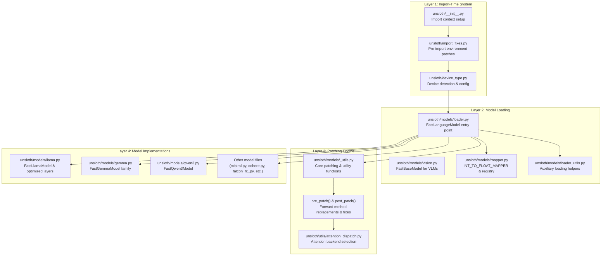
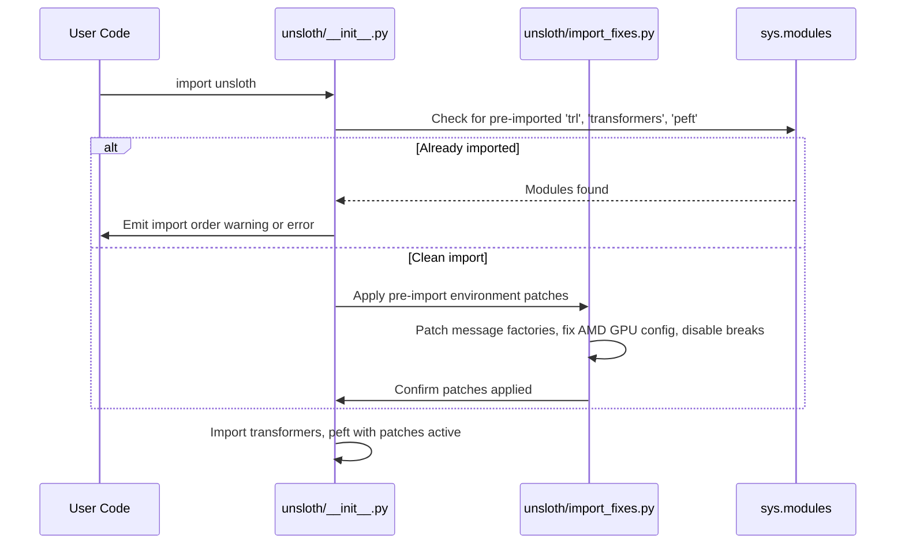
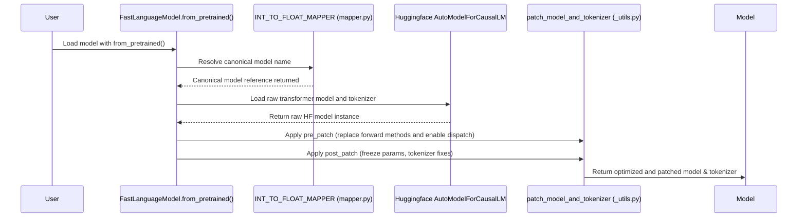

<!-- source: DeepWiki mcp.deepwiki.com · repo unslothai/unsloth · page 3 Core Library Architecture · fetched 2026-10-21 -->

# Core Library Architecture

Relevant source files

The following files were used as context for generating this wiki page:

- [README.md](README.md)
- [pyproject.toml](pyproject.toml)
- [tests/python/test_construct_chat_template_validation.py](tests/python/test_construct_chat_template_validation.py)
- [tests/test_fp8_pre_sm89_dequant_fallback.py](tests/test_fp8_pre_sm89_dequant_fallback.py)
- [tests/test_import_fixes_drift.py](tests/test_import_fixes_drift.py)
- [unsloth/__init__.py](unsloth/__init__.py)
- [unsloth/_gpu_init.py](unsloth/_gpu_init.py)
- [unsloth/chat_templates.py](unsloth/chat_templates.py)
- [unsloth/import_fixes.py](unsloth/import_fixes.py)
- [unsloth/kernels/fp8.py](unsloth/kernels/fp8.py)
- [unsloth/models/_utils.py](unsloth/models/_utils.py)
- [unsloth/models/llama.py](unsloth/models/llama.py)
- [unsloth/models/loader.py](unsloth/models/loader.py)
- [unsloth/models/loader_utils.py](unsloth/models/loader_utils.py)
- [unsloth/models/mapper.py](unsloth/models/mapper.py)
- [unsloth/models/mistral.py](unsloth/models/mistral.py)
- [unsloth/models/rl.py](unsloth/models/rl.py)
- [unsloth/models/rl_replacements.py](unsloth/models/rl_replacements.py)
- [unsloth/models/vision.py](unsloth/models/vision.py)
- [unsloth/save.py](unsloth/save.py)
- [unsloth/tokenizer_utils.py](unsloth/tokenizer_utils.py)

This page documents the internal architecture of Unsloth's core library (Apache 2.0 licensed), focusing on the patching system, initialization mechanisms, model loading pipeline, and runtime optimization strategies. For model-specific implementation details, see [Model Architecture Support](#4). For custom kernel implementations and speed optimizations, see [Performance Optimizations](#5). To understand Studio backend orchestration, see [Studio Backend](#9).

## Architecture Overview

Unsloth’s core library employs a layered runtime patching architecture that enables high-performance and flexible support for diverse model families while maintaining compatibility with HuggingFace Transformers and PEFT adapters. The core system can be viewed as four interconnected layers:

This design enables a clear separation of responsibilities: environment initialization and fixes, model loading and registry, runtime patching of core APIs and forward methods, and finally specialized model code implementing highly optimized layers.

### Core Components Summary

| Component               | Location                           | Purpose                                           |
|-------------------------|----------------------------------|--------------------------------------------------|
| **FastLanguageModel**   | `unsloth/models/loader.py`        | Main API for loading and managing LLM models     |
| **FastVisionModel**     | `unsloth/models/vision.py`        | Visual Language Models (VLMs) support             |
| **Patching System**     | `unsloth/models/_utils.py`        | Runtime transformers and PEFT patching engine     |
| **Model Registry**      | `unsloth/models/mapper.py`        | Model name canonicalization & quantized mappings |
| **Attention Dispatch**  | `unsloth/utils/attention_dispatch.py` | Dynamic attention backend selection             |
| **Device Abstraction**  | `unsloth/device_type.py`           | Multi-backend device detection & management      |

**Sources:**  
[unsloth/__init__.py:15-186](), [unsloth/models/_utils.py:1-205](), [unsloth/models/loader.py:1-171](), [unsloth/models/vision.py:1-156](), [unsloth/models/mapper.py:1-207]()

---

## Import-Time Initialization

Unsloth enforces a carefully controlled import sequence to guarantee early environment setup, patching, and compatibility fixes **before** core ML libraries such as `transformers` and `peft` are loaded.

This critical process starts in `unsloth/__init__.py`, where environment variables are configured, warnings filters applied, and backend flags forced—such as disabling TensorFlow and Flax to avoid unintended loading. It also sets up UTF-8 output encoding on Windows and adjusts Metal backend timeouts on Apple Silicon [unsloth/__init__.py:15-186]().

The patching and fixes are consolidated inside `unsloth/import_fixes.py`, which contains pre-import patches that prevent or mitigate issues like broken causal convolutions and disable problematic runtime extensions [unsloth/import_fixes.py:1-117]().

### Key Import-Time Fixes

| Fix                             | Purpose                                                  | Location                          |
|--------------------------------|----------------------------------------------------------|----------------------------------|
| `USE_TF` / `USE_FLAX` override | Disable TensorFlow and Flax backends in transformers    | `unsloth/__init__.py`             |
| Metal timeout relax             | Adjust Metal context-store timeout for Apple Silicon Macs | `unsloth/__init__.py`             |
| Windows UTF-8 safety            | Ensure UTF-8 console encoding on Windows terminals      | `unsloth/__init__.py`             |
| MLX availability detection     | Detect Apple Silicon + MLX audio backend early          | `unsloth/__init__.py`             |

These ensure a clean environment that prevents common pitfalls during model loading and execution.

**Sources:** [unsloth/__init__.py:15-186](), [unsloth/import_fixes.py:1-117]()

---

## Patching System Architecture

Unsloth applies runtime patches to transformer models, PEFT adapters, and the loading process to optimize speed, memory use, and feature support without modifying upstream codebases.

The patching proceeds in three main phases:

### Phase 1: Import-Time Patching

- Conducted during initial import (`unsloth/__init__.py` and `unsloth/import_fixes.py`).
- Applies general environment fixes and disables problematic imports or features before models or transformers are loaded.
- Sets a global signal `UNSLOTH_IS_PRESENT` to inform submodules about Unsloth’s presence [unsloth/__init__.py:14-15]().
  
### Phase 2: Pre-Load Patching (`pre_patch()`)

- Executed immediately before a model is loaded with `from_pretrained()` calls.
- Replaces core forward methods of transformer model layers (attention, decoder layers) with customized, optimized versions.
- Injects dispatch logic for attention backends (FlashAttention2, scaled-dot-product attention, xFormers) [unsloth/models/llama.py:150-170]().
- Adjusts training and inference mode behavior to enable fast generation or memory-efficient gradient checkpointing.
  
### Phase 3: Post-Load Patching (`patch_model_and_tokenizer`)

- Invoked after the model and tokenizer are fully loaded.
- Performs tokenizer fixes like special token adjustments and chat template de-duplication.
- Freezes all parameters except LoRA adapters during fine tuning for efficiency.
- Converts model weights or data types as needed for k-bit training and quantization support [unsloth/models/_utils.py:97-133]().

This layered patching strategy enables Unsloth to remain compatible with evolving upstream libraries while advancing performance and flexibility.

**Sources:**  
[unsloth/__init__.py:15-186](), [unsloth/models/_utils.py:1-205](), [unsloth/models/llama.py:145-170](), [unsloth/tokenizer_utils.py:40-160]()

---

## Model Loading Pipeline

The core API to load language models is `FastLanguageModel.from_pretrained()`, which orchestrates model resolution, loading, quantization, and runtime patching.

### Model Name Resolution and Remapping

- Model identifiers are normalized and mapped to canonical forms using tables in `unsloth/models/mapper.py` (`INT_TO_FLOAT_MAPPER`).
- This remapping ensures compatibility with pre-quantized mirrors and supports fallbacks for missing revisions by dropping incompatible Git references [unsloth/models/mapper.py:20-207](), [unsloth/models/loader.py:155-180]().

### Transformers Version Routing

- Based on feature detection of the installed `transformers` library (versions from 4.x up to 5.x).
- Flags like `SUPPORTS_FOURBIT`, `SUPPORTS_GEMMA4`, etc., conditionally enable enhanced loading paths for newer or specialized architectures [unsloth/models/loader.py:74-86]().

### Loading and Patching Workflow

The model loading process involves these major steps:

This workflow ensures Unsloth’s high-performance layers and quantization optimizations wrap cleanly around the raw HuggingFace models.

**Sources:**  
[unsloth/models/mapper.py:20-180](), [unsloth/models/loader.py:70-135](), [unsloth/models/_utils.py:50-130]()

---

## Attention Dispatch System

Unsloth integrates a multi-backend attention dispatch system allowing dynamic selection among multiple fast attention kernels optimized for hardware and sequence characteristics.

Supported backends include:

- **Scaled Dot-Product Attention (SDPA):** Standard attention pattern with support for grouped query attention (GQA) [unsloth/models/llama.py:169-170]().
- **Flash Attention 2:** Highly optimized, fused attention kernel leveraging Triton, preferred on supported GPUs.
- **xFormers:** Facebook’s modular attention kernels with flexibility for sparse and block diagonal attention masks [unsloth/models/llama.py:140-150](), [unsloth/models/llama.py:48-56]().

At runtime, the dispatcher selects the backend according to configuration and hardware presence encoded in `AttentionConfig` and `AttentionContext` classes.

**Sources:** [unsloth/models/llama.py:48-56](), [unsloth/models/llama.py:140-170]()

---

## Training vs Inference Mode Detection

Unsloth models incorporate dual operation modes to optimize for either fast inference or memory-efficient training.

- **Inference Mode:** Enables KV caching, disables gradient tracking, and applies inference-optimized kernels.
- **Training Mode:** Enables gradients, activates gradient checkpointing, and prepares LoRA adapters for fine-tuning.

Core APIs include:

- `FastLanguageModel.for_inference(model)`: Switches model to inference mode, disabling gradients [unsloth/models/rl.py:146-198]().
- `FastLanguageModel.for_training(model)`: Enables training mode with gradient checkpointing restored if applicable.
- `_get_inference_mode_context_manager()`: Context manager for temporarily forcing inference mode [unsloth/models/_utils.py:83-83]().

This mode-switching capability is essential to support combined workflows of pretraining, fine-tuning, and fast generation.

**Sources:**  
[unsloth/models/rl.py:130-196](), [unsloth/models/_utils.py:83-83](), [unsloth/models/llama.py:200-220]()

---

## Gradient Checkpointing System

Unsloth uses advanced gradient checkpointing to reduce VRAM usage during training of large models.

Key features:

- **Offloaded Gradient Checkpointing:** Utilizes `Unsloth_Offloaded_Gradient_Checkpointer` to offload activations to CPU or disk [unsloth/models/_utils.py:150-161]().
- **Patching Support:** Functions like `patch_gradient_checkpointing` inject efficient checkpointing hooks at runtime [unsloth/models/_utils.py:157-160]().
- **Smart Checkpointing:** `apply_unsloth_gradient_checkpointing` handles dynamic rewiring of checkpoint calls for further memory gains.

This system enables fine-tuning of huge models on consumer GPUs with constrained VRAM.

**Sources:**  
[unsloth/models/_utils.py:150-161](), [unsloth/models/_utils.py:154-160]()

---

## Related Child Pages

This page is a parent document with detailed child pages covering specific core library subsystems:

- [System Initialization and Patching](#3.1) — Import-time patching, environment setup, warnings filters, and runtime modifications to transformers/peft.  
- [Model Loading Pipeline](#3.2) — Full details on `FastLanguageModel.from_pretrained`, quantization routing, model name resolution, and pre/post-patch hooks.  
- [Model Registry and Name Resolution](#3.3) — Explains the `INT_TO_FLOAT_MAPPER`, model canonicalization, pre-quantized model management, and the registry data structures.  
- [Transformers Version Management](#3.4) — How transformers 4.x and 5.x versions are switched, model detection logic, and subprocess environment activation.  

---

This overview aims to give engineers and contributors a clear understanding of Unsloth's core architecture: how the system is initialized, how models are dynamically loaded and patched, and how the runtime dispatch and training modes are managed for optimal speed and flexibility.

**Sources:**

- [unsloth/__init__.py:1-166]()  
- [unsloth/import_fixes.py:1-117]()  
- [unsloth/models/_utils.py:1-205]()  
- [unsloth/models/loader.py:1-171]()  
- [unsloth/models/mapper.py:1-207]()  
- [unsloth/models/llama.py:1-220]()  
- [unsloth/models/vision.py:1-156]()  
- [unsloth/models/rl.py:140-196]()

---

