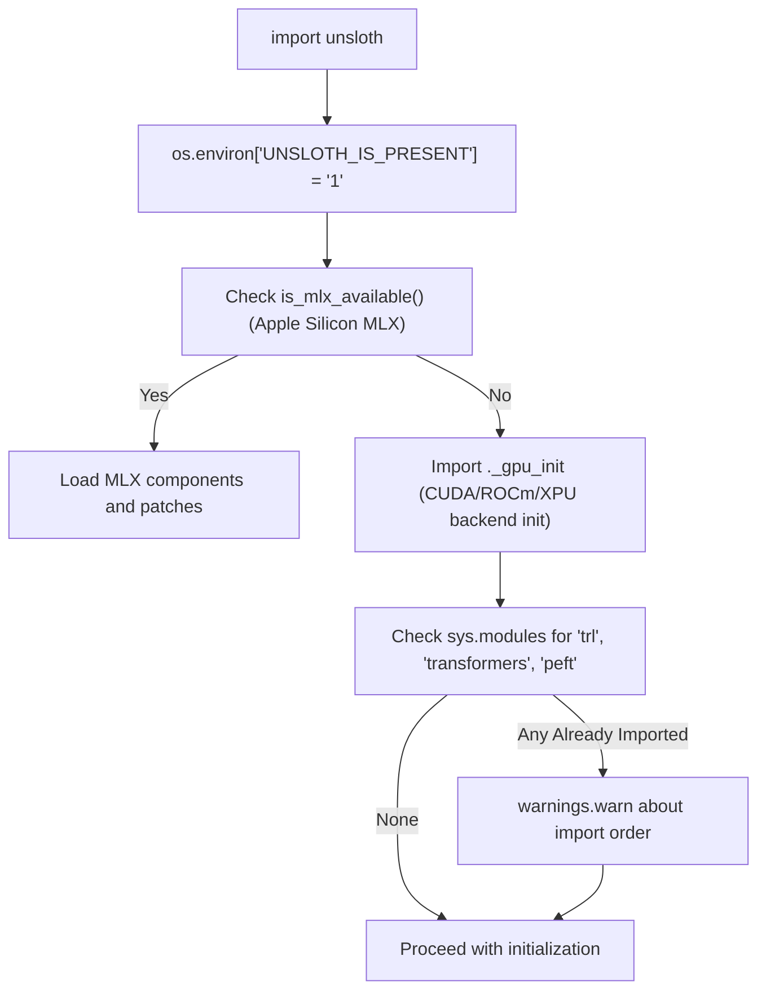
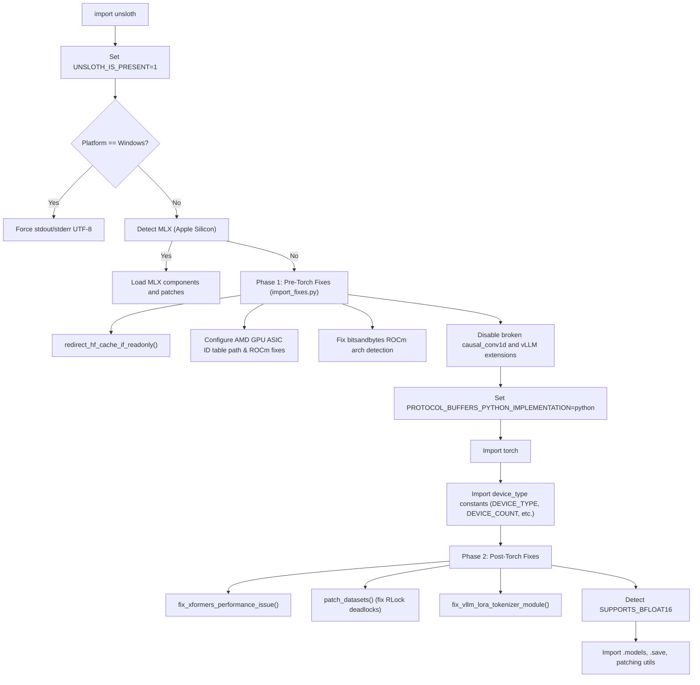
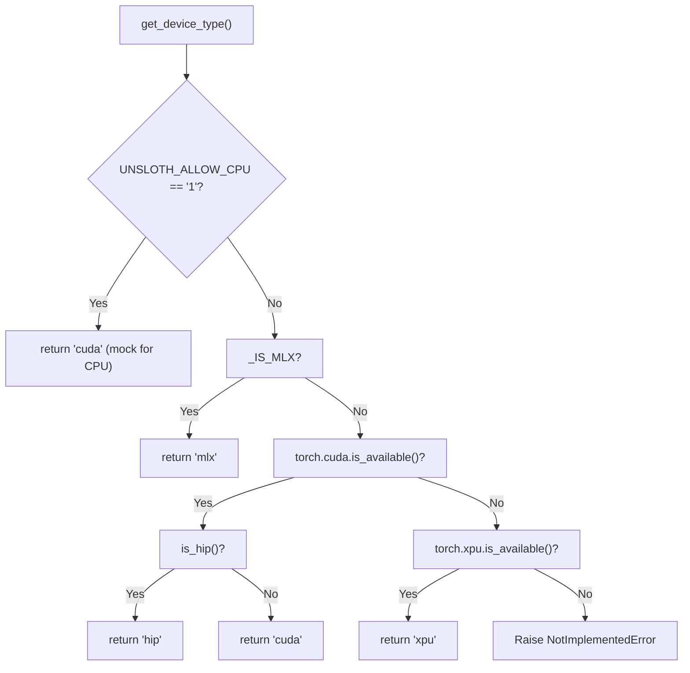
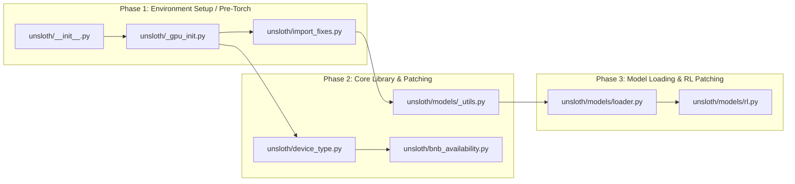
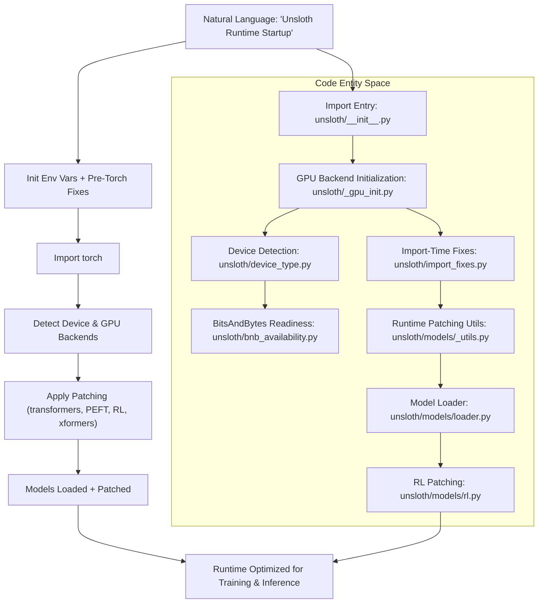

<!-- source: DeepWiki mcp.deepwiki.com · repo unslothai/unsloth · page 3.1 System Initialization and Patching · fetched 2026-10-21 -->

# System Initialization and Patching

Relevant source files

The following files were used as context for generating this wiki page:

- [README.md](README.md)
- [pyproject.toml](pyproject.toml)
- [tests/python/test_bitsandbytes_kernel_readiness.py](tests/python/test_bitsandbytes_kernel_readiness.py)
- [tests/python/test_construct_chat_template_validation.py](tests/python/test_construct_chat_template_validation.py)
- [tests/test_bf16_quant_disabled_message.py](tests/test_bf16_quant_disabled_message.py)
- [tests/test_device_helpers.py](tests/test_device_helpers.py)
- [tests/test_fp8_pre_sm89_dequant_fallback.py](tests/test_fp8_pre_sm89_dequant_fallback.py)
- [tests/test_import_fixes_drift.py](tests/test_import_fixes_drift.py)
- [tests/test_kaggle_gguf_error_message.py](tests/test_kaggle_gguf_error_message.py)
- [tests/test_offloaded_parameter_hint.py](tests/test_offloaded_parameter_hint.py)
- [tests/test_save_entrypoints_reach_converter.py](tests/test_save_entrypoints_reach_converter.py)
- [tests/test_st_save_merged_signature.py](tests/test_st_save_merged_signature.py)
- [unsloth/__init__.py](unsloth/__init__.py)
- [unsloth/_gpu_init.py](unsloth/_gpu_init.py)
- [unsloth/bnb_availability.py](unsloth/bnb_availability.py)
- [unsloth/chat_templates.py](unsloth/chat_templates.py)
- [unsloth/device_type.py](unsloth/device_type.py)
- [unsloth/import_fixes.py](unsloth/import_fixes.py)
- [unsloth/kernels/fp8.py](unsloth/kernels/fp8.py)
- [unsloth/models/_utils.py](unsloth/models/_utils.py)
- [unsloth/models/llama.py](unsloth/models/llama.py)
- [unsloth/models/loader.py](unsloth/models/loader.py)
- [unsloth/models/loader_utils.py](unsloth/models/loader_utils.py)
- [unsloth/models/mapper.py](unsloth/models/mapper.py)
- [unsloth/models/mistral.py](unsloth/models/mistral.py)
- [unsloth/models/rl.py](unsloth/models/rl.py)
- [unsloth/models/rl_replacements.py](unsloth/models/rl_replacements.py)
- [unsloth/models/vision.py](unsloth/models/vision.py)
- [unsloth/save.py](unsloth/save.py)
- [unsloth/tokenizer_utils.py](unsloth/tokenizer_utils.py)

This page documents Unsloth's multi-layered patching and initialization system. When the user runs `import unsloth`, it triggers a carefully orchestrated sequence of environment setup, import-time fixes, warning filters, and runtime patching that optimize third-party libraries (`transformers`, `peft`, and `trl`) before any user code executes. These patches enable improved training speed, inference performance, and cross-library compatibility.

The scope of this page includes:
- Environment configuration and import order requirements.
- Warning and logging suppression filters.
- Import-time patching and GPU backend initialization.
- Runtime patching in `unsloth.models._utils`.
- Integration and on-the-fly modification of transformers, PEFT, and RL-related modules.

---

## Import Order Requirement and Pre-Import Checks

Unsloth assumes it is imported **before** `transformers`, `peft`, and `trl` libraries. This ensures Unsloth can apply patches to their internals to inject optimized kernels and workarounds before those libraries initialize themselves.

If any of these critical libraries are imported earlier, Unsloth emits a warning but still continues:

- Setting `UNSLOTH_IS_PRESENT=1` enables internal detection flags used system-wide [unsloth/__init__.py:12-47]().
- MLX (Apple Silicon) has a separate backend path, loaded early if present [unsloth/__init__.py:130-150](), [unsloth/device_type.py:38-46]().
- Early import warnings help users avoid patching failure caused by incorrect import order [unsloth/_gpu_init.py:117-126]().

Sources: [unsloth/__init__.py:12-47](), [unsloth/_gpu_init.py:117-126](), [unsloth/device_type.py:35-46]()

---

## Initialization Sequence

The initialization is divided into two main phases conditioned on hardware and runtime environment:

- **Phase 1** runs before importing `torch` to set environment variables and disable broken components reliably [unsloth/_gpu_init.py:27-88]().
- **Phase 2** runs after `torch` import to patch regressions and performance issues in `transformers`, `vLLM`, `datasets`, and related libraries [unsloth/_gpu_init.py:169-190]().
- For Windows, special fixes ensure UTF-8 console encoding and set ROCm bitsandbytes version [unsloth/__init__.py:97-105](), [unsloth/_gpu_init.py:130-133]().

Sources: [unsloth/__init__.py:12-102](), [unsloth/_gpu_init.py:20-88](), [unsloth/_gpu_init.py:169-190](), [unsloth/import_fixes.py:27-42]()

---

## Phase 1: Pre-Torch Fixes

Before `torch` is imported, Unsloth runs environment variable setups, disables known-buggy native extensions, and configures paths for better ROCm/AMDGPU support.

| Fix Function                           | Purpose                                                           | Location                      |
|--------------------------------------|-------------------------------------------------------------------|-------------------------------|
| `redirect_hf_cache_if_readonly()`    | Redirect HF cache if filesystem is read-only                      | [unsloth/_gpu_init.py:66]()   |
| `configure_amdgpu_asic_id_table_path()`| Configure AMD GPU ASIC ID table for ROCm detection              | [unsloth/_gpu_init.py:74]()   |
| `fix_bitsandbytes_rocm_arch_detection()`| Fix bitsandbytes ROCm architecture detection                   | [unsloth/_gpu_init.py:76]()   |
| `disable_broken_causal_conv1d()`     | Disable broken causal_conv1d extension                            | [unsloth/_gpu_init.py:77]()   |
| `disable_broken_vllm()`               | Detect and disable broken vLLM compiled extensions               | [unsloth/_gpu_init.py:78]()   |
| `fix_message_factory_issue()`         | Patch protobuf's MessageFactory compatibility                     | [unsloth/_gpu_init.py:79]()   |
| `propagate_torchao_fix_to_subprocesses()`| Avoid torchao ImportErrors in vLLM subprocesses                | [unsloth/_gpu_init.py:84]()   |
| `maybe_set_windows_rocm_bnb_version()`| Set `BNB_ROCM_VERSION` environment variable for Windows ROCm systems | [unsloth/_gpu_init.py:130-133]() |

- Fixing these issues before `torch` import avoids side effects and import order problems.
- These functions also redirect caches and disable problematic modules which cause crashes or degraded performance.

Sources: [unsloth/_gpu_init.py:28-88](), [unsloth/_gpu_init.py:130-133]()

---

## Device Detection and Constants

Unsloth abstracts device and platform detection in the `unsloth.device_type` module:

**Key exported constants:**

| Constant                | Description                             | Reference                      |
|------------------------|---------------------------------------|--------------------------------|
| `DEVICE_TYPE`          | Logical device type: `cuda`, `hip`, `xpu`, or `mlx` | [unsloth/device_type.py:90]() |
| `DEVICE_TYPE_TORCH`    | PyTorch device string (e.g. `"mps"` for MLX)           | [unsloth/device_type.py:92-96]() |
| `ALLOW_BITSANDBYTES`   | Indicates bitsandbytes kernel readiness             | [unsloth/device_type.py:128]() |
| `ALLOW_PREQUANTIZED_MODELS` | Whether 4-bit pre-quantized models are allowed    | [unsloth/device_type.py:126]() |

Unsloth performs deep probing of `bitsandbytes` native kernel readiness by inspecting symbols inside `bitsandbytes.functional.lib`, filtering out "zombie" incomplete imports. This is done via `native_kernels_ready()` [unsloth/bnb_availability.py:90-93](), which ensures that Unsloth only activates BNB optimizations when native CUDA kernels truly loaded.

Sources: [unsloth/device_type.py:53-176](), [unsloth/bnb_availability.py:38-93]()

---

## Phase 2: Post-Torch Fixes

After importing `torch`, Unsloth applies patches fixing regressions in auxiliary libraries and improving performance.

| Fix Function                   | Purpose                                                  | Reference                      |
|------------------------------|----------------------------------------------------------|--------------------------------|
| `fix_xformers_performance_issue()` | Patch performance issues in `xformers`                 | [unsloth/_gpu_init.py:180]()   |
| `fix_vllm_aimv2_issue()`         | Fixes compatibility of vLLM with NVIDIA A10 AIMv2       | [unsloth/_gpu_init.py:181]()   |
| `fix_vllm_lora_tokenizer_module()` | Prevents vLLM's tokenizer from being corrupted by LoRA  | [unsloth/_gpu_init.py:182]()   |
| `patch_datasets()`              | Fix RLock deadlocks in `datasets` v4.4.0-4.5.0            | [unsloth/_gpu_init.py:186]()   |
| `patch_enable_input_require_grads()` | Patch vision model to avoid 'NotImplementedError' during training | [unsloth/_gpu_init.py:187]()   |

These patches ensure compatibility and improved runtime behavior for Unsloth's extended model ecosystem.

Sources: [unsloth/_gpu_init.py:179-190]()

---

## Warning and Logging Filters

To suppress noisy or unhelpful logs and warnings from dependencies, Unsloth installs filters in `unsloth/import_fixes.py`.

- `HideLoggingMessage`: A logging filter class to silence recurring or verbose logs identified by substrings [unsloth/import_fixes.py:71-79]().
- `HidePrintMessage`: Wraps and filters `sys.stderr.write` calls to suppress certain printed output [unsloth/import_fixes.py:81-98]().
- `suppress_cuda_printf()`: At the OS file descriptor level, redirects stdout and stderr to `/dev/null` temporarily to suppress device-level C prints such as CUTLASS errors that are uncatchable otherwise [unsloth/import_fixes.py:110-143]().

This comprehensive suppression mechanism reduces terminal clutter during GPU-heavy workloads and kernel launches.

Sources: [unsloth/import_fixes.py:69-183]()

---

## Runtime Patching Infrastructure

Unsloth's core runtime patching functionality resides primarily in `unsloth/models/_utils.py`. This module provides utilities and decorators that patch transformers and PEFT models dynamically at runtime to improve training and inference efficiency.

Key patching functions and classes include:

| Function/Component                 | Description                                                | Reference                   |
|----------------------------------|------------------------------------------------------------|-----------------------------|
| `patch_model_and_tokenizer()`    | Applies structural patches to models and tokenizers        | [unsloth/models/_utils.py:147-155]() |
| `patch_gradient_checkpointing()` | Patches gradient checkpointing logic to Unsloth's optimized version | [unsloth/models/_utils.py:157-162]() |
| `patch_fast_lora()`              | Injects fused CUDA/Triton kernels accelerating LoRA usage  | [unsloth/models/_utils.py:173-184]() |
| `patch_peft_fast_inference()`   | Minimizes PEFT runtime overhead during generation           | [unsloth/models/_utils.py:187-195]() |

These patching functions are invoked during model loading and training to transparently boost performance without user interaction.

### Reinforcement Learning (RL) Patching

Unsloth extends the core patching with additional runtime modifications tailored for RL training workflows found in `unsloth/models/rl.py`.

- `unsloth_unwrap_model_for_generation`: Context manager ensuring models are in correct inference mode during generation, avoiding unwanted side effects [unsloth/models/rl.py:184-200]().
- `_patch_resume_from_checkpoint_memory`: Intercepts trainer's train method to aggressively clear GPU memory before resuming training to avoid out-of-memory errors on checkpoints [unsloth/models/rl.py:124-144]().

These selective dynamic patches allow seamless integration with the TRL library while optimizing runtime reliability and resource usage.

Sources: [unsloth/models/_utils.py:17-95](), [unsloth/models/rl.py:49-212]()

---

## Summary Diagram: System Initialization and Patching Flow

The following diagram illustrates the major code components and flow from Unsloth import to runtime patching of models, showing the bridging between natural language concepts and code entity names.

---

## Detailed Data Flow from Natural Language to Code Entities: Initialization and Patching

---

# Summary

When `import unsloth` runs, Unsloth sets environment flags, patches import-time module behavior, disables buggy extensions, optimizes device detection, and dynamically patches transformers and PEFT internals. This layered approach provides major performance and compatibility improvements transparently, forming the foundation for Unsloth's high-speed model training and inference capabilities.

This system mandates import-before dependencies like `transformers` and `peft`, and carefully orders fixes pre- and post-`torch` import, integrating GPU backend initialization and environment configuration. At runtime, Unsloth rewrites model components on the fly to accelerate LoRA, quantization, and gradient checkpointing, while reinforcing compatibility with reinforcement learning libraries such as TRL.

---

Sources:  
- [unsloth/__init__.py:12-102]()  
- [unsloth/_gpu_init.py:20-190]()  
- [unsloth/import_fixes.py:27-183]()  
- [unsloth/device_type.py:53-176]()  
- [unsloth/bnb_availability.py:38-93]()  
- [unsloth/models/_utils.py:17-95]()  
- [unsloth/models/loader.py:12-170]()  
- [unsloth/models/rl.py:49-212]()

---

