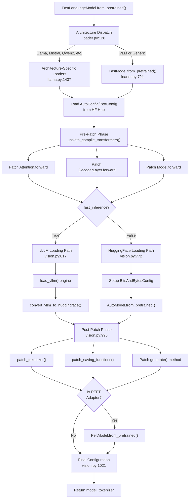
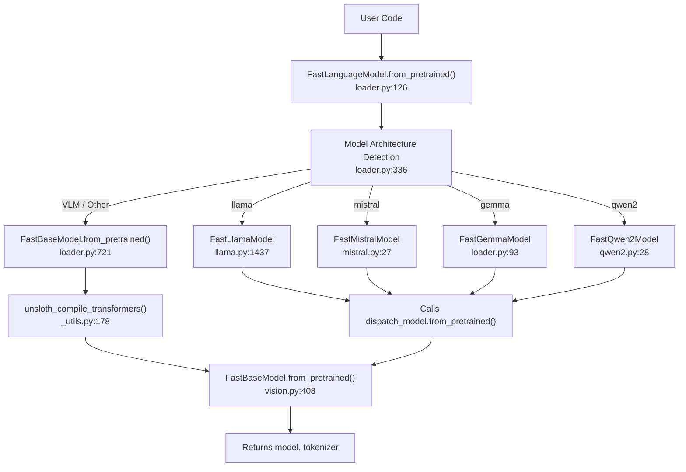
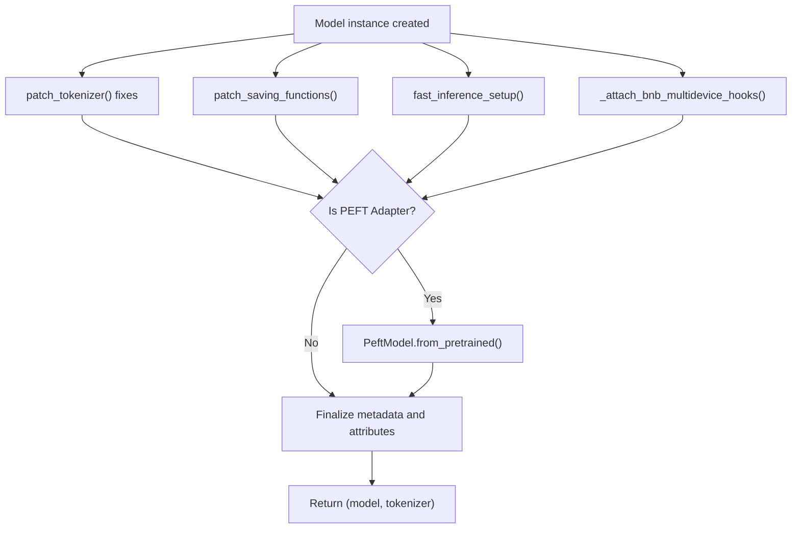
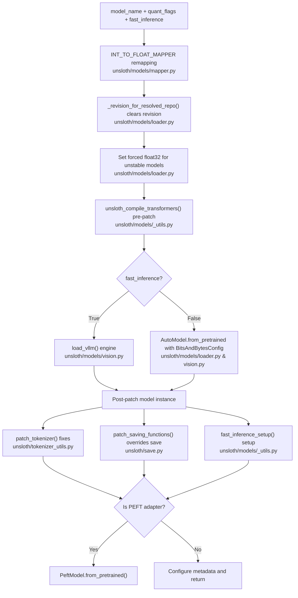

<!-- source: DeepWiki mcp.deepwiki.com · repo unslothai/unsloth · page 3.2 Model Loading Pipeline · fetched 2026-10-21 -->

# Model Loading Pipeline

Relevant source files

The following files were used as context for generating this wiki page:

- [README.md](README.md)
- [pyproject.toml](pyproject.toml)
- [tests/python/test_construct_chat_template_validation.py](tests/python/test_construct_chat_template_validation.py)
- [tests/test_fp8_pre_sm89_dequant_fallback.py](tests/test_fp8_pre_sm89_dequant_fallback.py)
- [tests/test_import_fixes_drift.py](tests/test_import_fixes_drift.py)
- [unsloth/__init__.py](unsloth/__init__.py)
- [unsloth/_gpu_init.py](unsloth/_gpu_init.py)
- [unsloth/chat_templates.py](unsloth/chat_templates.py)
- [unsloth/import_fixes.py](unsloth/import_fixes.py)
- [unsloth/kernels/fp8.py](unsloth/kernels/fp8.py)
- [unsloth/models/__init__.py](unsloth/models/__init__.py)
- [unsloth/models/_utils.py](unsloth/models/_utils.py)
- [unsloth/models/dpo.py](unsloth/models/dpo.py)
- [unsloth/models/llama.py](unsloth/models/llama.py)
- [unsloth/models/loader.py](unsloth/models/loader.py)
- [unsloth/models/loader_utils.py](unsloth/models/loader_utils.py)
- [unsloth/models/mapper.py](unsloth/models/mapper.py)
- [unsloth/models/mistral.py](unsloth/models/mistral.py)
- [unsloth/models/rl.py](unsloth/models/rl.py)
- [unsloth/models/rl_replacements.py](unsloth/models/rl_replacements.py)
- [unsloth/models/vision.py](unsloth/models/vision.py)
- [unsloth/save.py](unsloth/save.py)
- [unsloth/tokenizer_utils.py](unsloth/tokenizer_utils.py)

This page provides an in-depth technical explanation of the `FastLanguageModel.from_pretrained` pipeline in Unsloth’s core library. It details the routing logic by model architecture and quantization parameters, the sophisticated model name resolution process, and the two-phase patching mechanism that applies global and instance-level optimizations.

---

## Pipeline Overview

The model loading pipeline converts user parameters and model names into a fully patched and optionally quantized model. It supports fast vLLM backend loading or conventional HuggingFace style loading with custom Unsloth patches.

### Core Loading Control Flow

Below is a flowchart that summarizes the overall control flow for `FastLanguageModel.from_pretrained()`:

**Sources:**  
- `unsloth/models/loader.py:126-694`  
- `unsloth/models/vision.py:408-1101`  
- `unsloth/models/llama.py:1437-1660`

---

## Entry Points and Architecture Dispatch

The primary user entry point is the class method `FastLanguageModel.from_pretrained`. This method dispatches loading based on the detected or requested architecture and quantization flags.

### Model Architecture Detection and Routing

The system tries to resolve the model architecture from the user-given model identifier, the config loaded from HuggingFace Hub (`AutoConfig.from_pretrained`), or the PEFT adapter config.

- **Specialized Loaders:** Architectures like `llama`, `mistral`, `gemma`, `qwen2`, `qwen3`, `falcon_h1`, `granite`, and `cohere` are mapped to corresponding `Fast*Model` classes with specific loading logic and optimizations [unsloth/models/loader.py:26-35]().

- **Generic Fallback:** If the requested flags include `load_in_8bit=True` or `full_finetuning=True`, or if the architecture is unrecognized, the pipeline routes to the generic `FastBaseModel` loader for universal transformer models [unsloth/models/loader.py:700-750]().

- **Vision Support:** Multimodal and vision-language models route to `FastVisionModel` loading logic, based on the base model class, sharing much of the `FastBaseModel` implementation with additional preprocessing/postprocessing [unsloth/models/vision.py:400-600]().

### Dispatch Flow Diagram

**Sources:**  
- `unsloth/models/loader.py:126-721`  
- `unsloth/models/llama.py:1437-1460`  
- `unsloth/models/_utils.py:178-182`

---

## Model Name Resolution and Quantization Policies

During loading, Unsloth normalizes and remaps model names to their canonical or float-base equivalents to ensure compatibility with quantized or mirror repos.

### Repository and Revision Handling

- **Mapping Pre-Quantized Names:** `INT_TO_FLOAT_MAPPER` provides a mapping from known pre-quantized model names to their floating-point bases, allowing the loader to transparently substitute the checkpoint source without user interaction [unsloth/models/mapper.py:20-223]().

- **Revision Dropping:** When such remapping occurs, the revision argument (git branch/tag/SHA) is cleared to avoid errors from referencing a branch/tag non-existing on the alternate repo. This is controlled by `_revision_for_resolved_repo()` which logs warnings for users [unsloth/models/loader.py:155-181]().

- **Precision Forcing:** Certain models such as Gemma 4 and Qwen3.5 are known to exhibit instability in float16 training. These are forcibly marked for 32-bit float training to prevent numerical issues [unsloth/models/loader.py:126-143]().

### Quantization Configuration

- **4-bit and 8-bit:** BitsAndBytes quantization is supported with preconfigured `BitsAndBytesConfig` defaults optimized for NF4 quantization and double quant (fast quantization techniques) [unsloth/models/loader.py:79-81]().

- **FP8 support:** Advanced FP8 precision modes are supported with torchao integration, including block-wise and row-wise mapping strategies. The loader applies `_offline_quantize_to_fp8` and tags models accordingly during loading [unsloth/models/mapper.py:15-21]().

---

**Sources:**  
- `unsloth/models/mapper.py:15-223`  
- `unsloth/models/loader.py:126-181`

---

## Pre-Patching Phase: Global Optimization

Before loading model weights, Unsloth applies global runtime patches to core `transformers` model components to enable custom fast kernels.

### Component Replacement Details

| Component                   | Original Class              | Unsloth Replacement                          | Implemented in        |
|----------------------------|----------------------------|----------------------------------------------|----------------------|
| Attention forward           | `LlamaAttention.forward`    | `LlamaAttention_fast_forward`                 | `llama.py:618`        |
| Decoder layer forward       | `LlamaDecoderLayer.forward` | `LlamaDecoderLayer_fast_forward`              | `llama.py:712`        |
| Model forward               | `LlamaModel.forward`        | `LlamaModel_fast_forward`                      | `llama.py:808`        |
| Causal LM forward           | `LlamaForCausalLM.forward`  | `LlamaForCausalLM_fast_forward`                | `llama.py:1220`       |

These patches replace the native transformer forward methods with optimized fused operations, Triton kernels, or other performance-enhancing logic.

### Rotatory Embedding (RoPE) Fix for Transformers v5+

Transformers v5 introduced meta-device loading, which often corrupts the rotary embedding's `inv_freq` buffer, a non-persistent tensor. Unsloth patches this by recomputing and restoring the correct `inv_freq` to maintain function correctness [unsloth/models/loader.py:91-93]().

---

**Sources:**  
- `unsloth/models/llama.py:618-1220`  
- `unsloth/models/loader.py:91-93`

---

## Loading Strategies

### HuggingFace Loading Path

If `fast_inference` flag is false, the model is loaded using familiar HuggingFace `AutoModel.from_pretrained` calls but with important Unsloth modifications:

- **Skip Quantization for Sensitive Modules:** Modules like output embeddings (`lm_head`) are skipped during 4-bit quantization to preserve accuracy [unsloth/models/llama.py:68]().

- **BitsAndBytesConfig:** The loader sets up a `BitsAndBytesConfig` with sensible defaults (e.g., `nf4=True`, `double_quant=True`).  
- **Device Maps & Offloading:** Supports device maps and offloading as given by user or default device heuristics.

### vLLM Fast Inference Path

When `fast_inference=True` is requested, Unsloth loads the model through the vLLM engine abstraction:

- **vLLM Engine Object:** First, a device/engine-backed model (`vllm.Engine`) is created by `load_vllm()` [unsloth/models/vision.py:817-883]().
- **Conversion:** The engine is then encapsulated as a HuggingFace-compatible model via `convert_vllm_to_huggingface()` that exposes transformer interface methods, allowing consumer code to interact transparently.
- **Result:** The model object includes `model.vllm_engine` for direct engine access and fast high-throughput generation.

---

**Sources:**  
- `unsloth/models/vision.py:817-883`  
- `unsloth/models/llama.py:68`

---

## Post-Patching Phase: Instance-Level Modification

After the model instance is created, Unsloth applies instance-level patches and corrections for runtime behavior, tokenization, and checkpoint saving.

### Key Post-Patch Actions

1. **Tokenizer Correction:** `patch_tokenizer()` fixes known issues such as inconsistencies in BOS/EOS/PAD token settings across tokenizer wrappers, and special handling for SentencePiece tokenizers to ensure proper behavior during generation and saving [unsloth/tokenizer_utils.py:85-133]().

2. **Saving Functions:** The standard model `save_pretrained` methods are replaced by `patch_saving_functions()` with `unsloth_save_model` that supports fused LoRA weight saving and GGUF format exports [unsloth/save.py:85-95]().

3. **Inference Setup:** `fast_inference_setup()` wraps the `generate` method and other inference internals to enable Unsloth’s accelerated KV cache, fast decoding kernels, and static graph optimizations [unsloth/models/_utils.py:80-105]().

4. **Multi-GPU Alignment:** When using multi-device loading (via `accelerate` or device maps), `_attach_bnb_multidevice_hooks` installs hooks ensuring that `bitsandbytes` kernels use the correct device and tensors remain synchronized across GPUs, avoiding index-mismatch errors [unsloth/models/vision.py:150-211]().

5. **PEFT Adapter Handling:** If the loaded model is a PEFT adapter (Low-Rank Adaptation), `PeftModel.from_pretrained()` is called to load adapter weights layered on the base model.

### Instance Patch Sequence Diagram

---

**Sources:**  
- `unsloth/tokenizer_utils.py:85-133`  
- `unsloth/save.py:80-95`  
- `unsloth/models/vision.py:150-211`  
- `unsloth/models/_utils.py:80-105`  

---

## Final Configuration and Attributes

At the end of the pipeline, the model is further configured and tagged with metadata needed for runtime:

- **Sequence Length Fix:** The `max_seq_length` property is propagated to all rotary position embedding (RoPE) modules, ensuring correct positional embedding scaling during generation [unsloth/models/vision.py:1062]().

- **Training and Inference Modes:** Methods `for_training()` and `for_inference()` are attached to toggle gradient checkpointing modes and patch the generate method for Unsloth’s performance [unsloth/models/rl.py:205-208]().

- **Gradient Checkpointing:** Unsloth replaces standard gradient checkpointing with an offloaded variant that reduces VRAM usage by swapping activations to CPU when appropriate [unsloth/models/_utils.py:55-60]().

- **Model Compile:** Optionally, the model may be compiled with `torch.compile` after loading, and Unsloth ensures patches do not interfere with PyTorch 2.x compiler behaviors.

---

**Sources:**  
- `unsloth/models/vision.py:1062-1101`  
- `unsloth/models/rl.py:205-208`  
- `unsloth/models/_utils.py:55-60`

---

# Summary

Unsloth’s model loading pipeline is a carefully layered system that:

- Resolves canonical model names with consideration for pre-quantized mirrors.  
- Routes requests to architecture-specific loaders or a generic fallback.  
- Applies global patches before loading to replace core transformer methods with fast fused kernels.  
- Supports multiple quantization formats transparently, including novel FP8 modes.  
- Implements a dual loading path for fast inference using the vLLM engine backend or classic HuggingFace loading.  
- Applies instance-level post-patching to fix tokenizers and save logic while enabling accelerated inference methods.  
- Finalizes model metadata and behavior for training, inference, and gradient checkpointing.

This modular two-phase patching and loading strategy enables Unsloth to deliver high performance on a broad collection of model architectures and quantization configurations.

---

# Diagram: Mapping Natural Language Usage to Code Entities in Model Loading

```mermaid
flowchart LR
    subgraph UserSpace["User Natural Language Space"]
        A1["Call FastLanguageModel.from_pretrained(model_name, quantization_flags, fast_inference)"]
    end
    
    subgraph CodeSpace["Unsloth Code Entity Space"]
        B1["loader.py:FastLanguageModel.from_pretrained()"]
        B2["loader.py:resolve_model_class()"]
        B3["loader.py:Architecture dispatch -> llama.py/FastLlamaModel, mistral.py/FastMistralModel, etc."]
        B4["_utils.py:unsloth_compile_transformers() - Pre-patch"]
        B5["transformers.AutoConfig.from_pretrained()"]
        B6["loader.py:BitsAndBytesConfig setup for quantization"]
        B7["vision.py:FastBaseModel.from_pretrained() - Generic loader"]
        B8["vision.py:load_vllm() - vLLM path"]
        B9["vision.py:convert_vllm_to_huggingface()"]
        B10["tokenizer_utils.py:patch_tokenizer()"]
        B11["save.py:patch_saving_functions()"]
        B12["_utils.py:fast_inference_setup()"]
        B13["peft:PeftModel.from_pretrained()"]
        B14["vision.py:Finalize model attributes and return"]
    end
    
    A1 --> B1
    B1 --> B2
    B2 --> B3
    B3 --> B4
    B4 --> B5
    B5 --> B6
    B6 --> B7
    B6 --> B8
    B8 --> B9
    B7 --> B10
    B7 --> B11
    B7 --> B12
    B10 --> B13
    B11 --> B13
    B12 --> B13
    B13 --> B14
```

---

# Diagram: Quantization and Patching Components in Loading Pipeline

---

This concludes the detailed overview of the Unsloth Model Loading Pipeline.

# End of Page

---

**Sources:**  
- `unsloth/models/loader.py:1-750`  
- `unsloth/models/vision.py:400-1100`  
- `unsloth/models/llama.py:600-1220`  
- `unsloth/models/_utils.py:170-200`  
- `unsloth/tokenizer_utils.py:80-133`  
- `unsloth/save.py:70-90`

---

