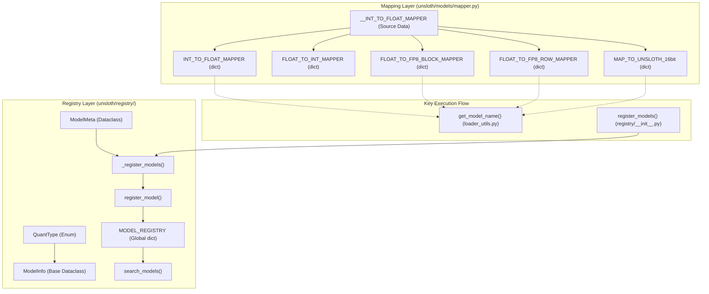
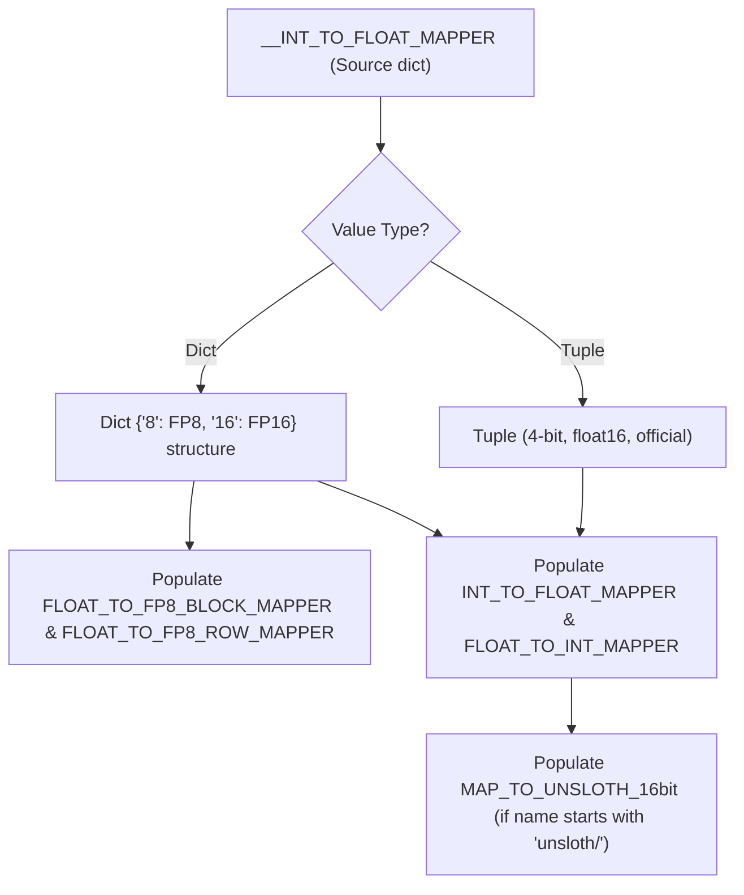
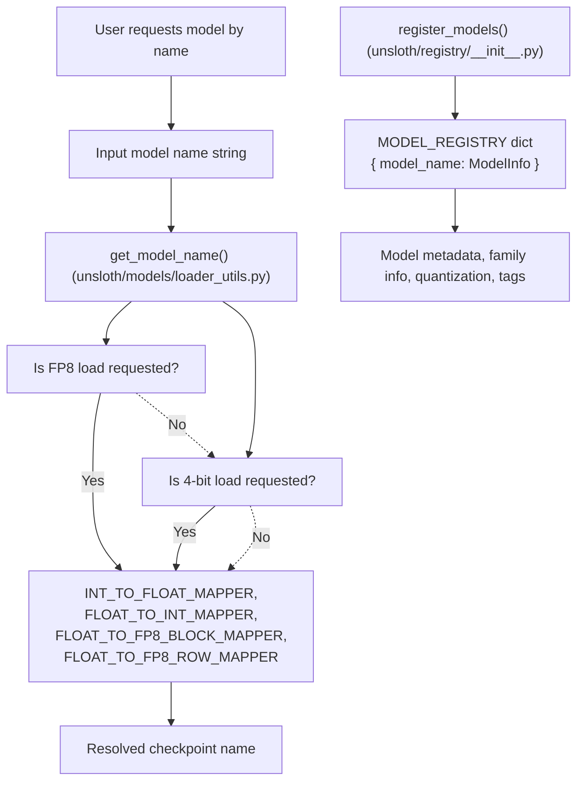
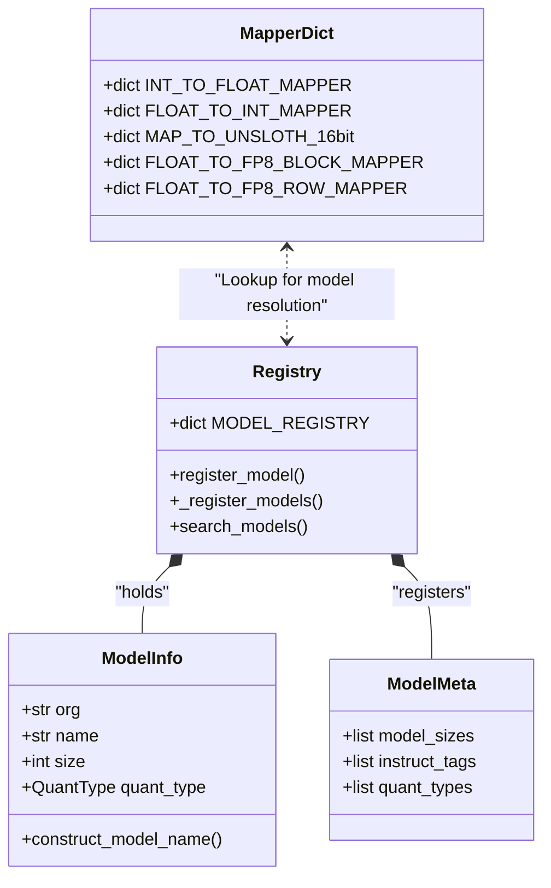

<!-- source: DeepWiki mcp.deepwiki.com · repo unslothai/unsloth · page 3.3 Model Registry and Name Resolution · fetched 2026-10-21 -->

# Model Registry and Name Resolution

Relevant source files

The following files were used as context for generating this wiki page:

- [tests/python/test_docker_nb_refresh_state_durability.py](tests/python/test_docker_nb_refresh_state_durability.py)
- [tests/test_callback_signature_drift.py](tests/test_callback_signature_drift.py)
- [tests/test_model_registry.py](tests/test_model_registry.py)
- [tests/test_source_read_encoding.py](tests/test_source_read_encoding.py)
- [unsloth/registry/REGISTRY.md](unsloth/registry/REGISTRY.md)
- [unsloth/registry/__init__.py](unsloth/registry/__init__.py)
- [unsloth/registry/_deepseek.py](unsloth/registry/_deepseek.py)
- [unsloth/registry/_gemma.py](unsloth/registry/_gemma.py)
- [unsloth/registry/_llama.py](unsloth/registry/_llama.py)
- [unsloth/registry/_mistral.py](unsloth/registry/_mistral.py)
- [unsloth/registry/_phi.py](unsloth/registry/_phi.py)
- [unsloth/registry/_qwen.py](unsloth/registry/_qwen.py)
- [unsloth/registry/registry.py](unsloth/registry/registry.py)
- [unsloth/utils/__init__.py](unsloth/utils/__init__.py)
- [unsloth/utils/hf_hub.py](unsloth/utils/hf_hub.py)

## Purpose and Scope

Unsloth’s model management relies on two tightly integrated components to handle the complexities of model naming, resolution, and metadata management:

1. **INT_TO_FLOAT_MAPPER and related dictionaries** ([`unsloth/models/mapper.py`](unsloth/models/mapper.py:1-1330))  
   These provide dictionary-based mappings between quantized and float (e.g., float16, FP8) model repository names. This mapping layer enables the core loader to transparently resolve which model checkpoint should be loaded based on the requested quantization and optimization settings.

2. **Model Registry** ([`unsloth/registry/registry.py`](unsloth/registry/registry.py:1-196), [`unsloth/registry/__init__.py`](unsloth/registry/__init__.py:1-65))  
   A structured registry system backed by dataclasses (`ModelInfo`, `ModelMeta`) that catalogs supported models with detailed metadata: organization, version, size, quantization type, multimodality, instruct tags, and descriptive naming conventions. It supports querying, validation against Hugging Face Hub, and provides a metadata interface used by clients (Studio, CLI) and the core library.

Together, these systems provide canonicalized model names, support for pre-quantized variants, and a metadata-driven foundation for model loading and tooling in Unsloth.

---

## Architecture Overview

### Relationship Between Mapper and Registry

- The **Mapping Dictionaries** live in `unsloth/models/mapper.py` and are used during runtime model loading to quickly map requested model names to the appropriate checkpoint variant.  
- The **Model Registry** uses dataclasses and centralized registration functions to populate a structured dictionary `MODEL_REGISTRY` with detailed metadata entries, supporting model search, validation, and tooling.

### Component Diagram: Model Registry and Name Resolution

Sources:  
- [`unsloth/models/mapper.py:23-1330`]()  
- [`unsloth/registry/registry.py:11-134`](unsloth/registry/registry.py:11-134)  
- [`unsloth/registry/__init__.py:12-65`](unsloth/registry/__init__.py:12-65)  
- [`unsloth/models/loader_utils.py:108-176`](unsloth/models/loader_utils.py:108-176)  

---

## The Registry System

The registry is implemented primarily in `unsloth/registry/registry.py` using dataclasses and enums to create a type-safe, extensible structure for model metadata.

### QuantType Enum

`QuantType` enumerates the supported quantization types:

| Enum Member        | Value        | Description                             |
|--------------------|--------------|------------------------------------- |
| `QuantType.BNB`    | `"bnb"`      | BitsAndBytes NF4 4-bit quantization  |
| `QuantType.UNSLOTH`| `"unsloth"`  | Unsloth dynamic 4-bit quantization   |
| `QuantType.GGUF`   | `"GGUF"`     | GGUF export format                   |
| `QuantType.NONE`   | `"none"`     | Non-quantized (float16/bfloat16)    |
| `QuantType.BF16`   | `"bf16"`     | BFloat16 (e.g., DeepSeek V3 / R1)   |

A map from `QuantType` to string suffixes (`QUANT_TAG_MAP`) is also defined for naming conventions, e.g., `"bnb-4bit"` for BNB quantization [[unsloth/registry/registry.py:11-31]]().

### ModelInfo Dataclass

`ModelInfo` holds metadata for a single model variant:

- Organization (`org`), base model name, version
- Model size (e.g., "7", "70" for billion parameters)
- Optional instruct tag (e.g., "Instruct")
- Quantization type (`QuantType`)
- Boolean multimodal flag
- Full model repository name `name`, constructed via `construct_model_name()`

The `construct_model_name()` method concatenates base components with optional instruct tags and quant type suffixes for canonical naming [[unsloth/registry/registry.py:35-85]]().

### ModelMeta Dataclass

`ModelMeta` aggregates metadata for a model family, declaring:

- Organization, base model name, version
- List of supported sizes, instruct tags, quant types (or dictionary mapping sizes to quant types)
- Associated `ModelInfo` subclass for construction
- Multimodal flag

Used by batch registration to produce all combinations of model variants [[unsloth/registry/registry.py:87-97]]().

### Registration APIs

- `register_model()` registers a single `ModelInfo` instance into the global `MODEL_REGISTRY` dict, keyed by `org/name`. It checks for duplicate registration [[unsloth/registry/registry.py:101-134]]().
- `_register_models()` expands a `ModelMeta` into all size/instruct/quant combinations and calls `register_model()` for each. It can optionally register the original, non-quantized model under the releasing org or register only Unsloth quantized variants under `org="unsloth"` [[unsloth/registry/registry.py:154-196]]().
- `register_models()` in `__init__.py` imports and calls family-specific registration functions once to populate the full registry [[unsloth/registry/__init__.py:12-25]]().

---

## Core Mapping Dictionaries in `mapper.py`

`unsloth/models/mapper.py` defines dictionary mappings crucial during model loading for quantization-aware name resolution.

### Key Mapping Dictionaries

| Variable Name               | Purpose                                          |
|----------------------------|------------------------------------------------|
| `INT_TO_FLOAT_MAPPER`      | Maps quantized model repo name to float16 base |
| `FLOAT_TO_INT_MAPPER`      | Reverse map: float16 base to quantized variants |
| `MAP_TO_UNSLOTH_16bit`     | Maps official float model names to Unsloth 16-bit mirrors |
| `FLOAT_TO_FP8_BLOCK_MAPPER`| Maps float16 names to FP8 block quantized variants |
| `FLOAT_TO_FP8_ROW_MAPPER`  | Maps float16 names to FP8 row quantized variants |

These dictionaries are generated dynamically from the source dictionary named `__INT_TO_FLOAT_MAPPER`, which contains variant tuples or nested dicts describing available quantized and float variants [[unsloth/models/mapper.py:23-1330]]().

### Mapping Generation Flow

---

## Name Resolution in Practice

When loading a model, Unsloth’s core loader calls `get_model_name()` ([`unsloth/models/loader_utils.py`](unsloth/models/loader_utils.py:108-176)) to determine the exact checkpoint repo to target:

- If FP8 quantization is requested (`load_in_fp8=True`), the loader chooses from `FLOAT_TO_FP8_ROW_MAPPER` (for FBGEMM backend) or `FLOAT_TO_FP8_BLOCK_MAPPER` (non-FBGEMM case).

- If 4-bit quantization is requested, `FLOAT_TO_INT_MAPPER` is consulted to route to the correct quantized repository.

- For 16-bit mode, Unsloth maintains mirrors of official float models optimized with faster 16-bit kernels; these are stored in `MAP_TO_UNSLOTH_16bit` and mapped accordingly.

- Some models are flagged as `BAD_MAPPINGS` due to inefficiencies or compatibility issues with pre-quantized checkpoint loading; these force fallback to the float variant for just-in-time quantization.

---

## Supported Model Families (Registry Coverage)

Unsloth supports diverse model families registered through family-specific files. Examples:

| File                      | Families Included                          | Notes                           |
|---------------------------|-------------------------------------------|--------------------------------|
| `_llama.py`               | Llama 3.1, 3.2, 3.2 Vision                 | Includes `LlamaVisionModelInfo` for Vision-LLaMA models [[_llama.py:8-20]]() |
| `_qwen.py`                | Qwen 2.5, Qwen VL (Vision-Language), QwQ | Multimodal and specialized quant versions [[_qwen.py:1-114]]()              |
| `_deepseek.py`            | DeepSeek V3, R1, Distilled variants        | Distilled model naming and quant logic [[_deepseek.py:1-156]]()              |
| `_gemma.py`               | Gemma 3 base, Gemma 3 instruct             | Gemma-specific naming conventions [[_gemma.py:1-58]]()                        |
| `_phi.py`                 | Phi 4, Phi mini-instruct                    | Microsoft Phi family [[_phi.py:1-71]]()                                       |
| `_mistral.py`             | Mistral Small                               | Small Mistral models with different versioning [[_mistral.py:1-81]]()         |

Each family defines a subclass of `ModelInfo` with custom `construct_model_name()` methods to handle family-specific naming conventions. They register their models via calls to `_register_models()` for auto-expansion of size/instruction/quantization combinatorics.

---

## Diagram: From Natural Language Model Requests to Code Entities

---

## Diagram: Linking Mapper and Model Registry Metadata

---

## Summary

- **INT_TO_FLOAT_MAPPER and related dictionaries** provide a flattening dictionary-based mapping between quantized, float16, and FP8 model repository names used by the core loader for precise model resolution based on quantization requests.

- **The unified Model Registry system** built on `ModelInfo` and `ModelMeta` dataclasses provides an extensible and family-adapted metadata catalog, describing supported models, their tags, sizes, quantization types, and multimodal capabilities.

- Bulk registration functions are designed to create all model variants and support automated validation against the Hugging Face Hub to maintain correctness and consistency.

This design modularizes name resolution from metadata management, enabling Unsloth to support diverse LLM families, pre-quantized and runtime quantized models, and integration with Studio and CLI tooling.

---

Sources:  
- [`unsloth/models/mapper.py:1-1330`](unsloth/models/mapper.py:1-1330)  
- [`unsloth/registry/registry.py:1-196`](unsloth/registry/registry.py:1-196)  
- [`unsloth/registry/__init__.py:1-65`](unsloth/registry/__init__.py:1-65)  
- [`unsloth/registry/_deepseek.py:1-156`](unsloth/registry/_deepseek.py:1-156)  
- [`unsloth/registry/_llama.py:1-103`](unsloth/registry/_llama.py:1-103)  
- [`unsloth/registry/_qwen.py:1-114`](unsloth/registry/_qwen.py:1-114)  
- [`unsloth/registry/_gemma.py:1-58`](unsloth/registry/_gemma.py:1-58)  
- [`unsloth/registry/_phi.py:1-71`](unsloth/registry/_phi.py:1-71)  
- [`unsloth/registry/_mistral.py:1-81`](unsloth/registry/_mistral.py:1-81)  
- [`unsloth/models/loader_utils.py:108-176`](unsloth/models/loader_utils.py:108-176)

---

