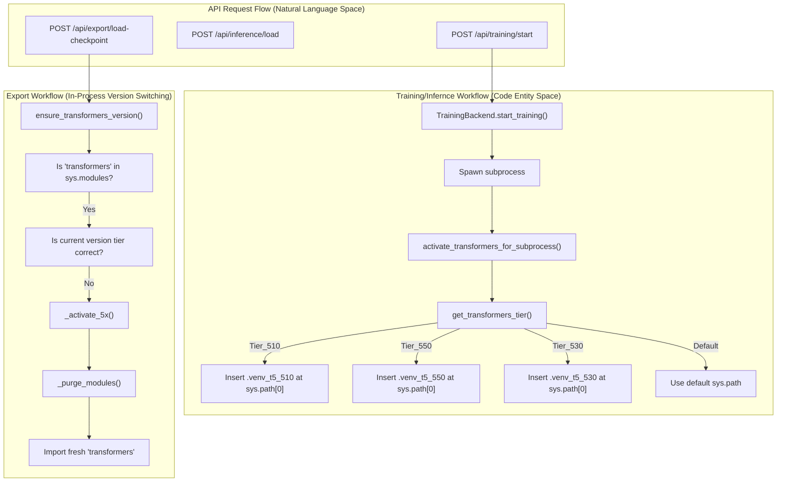
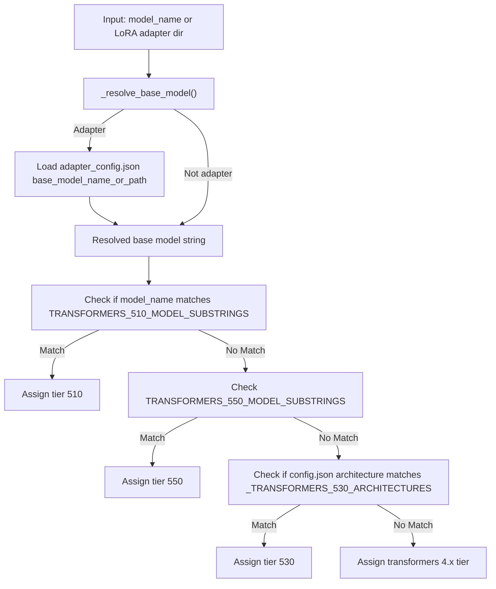
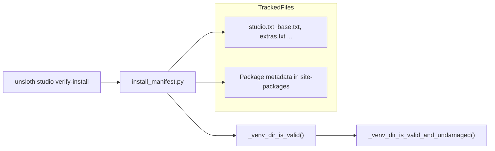

<!-- source: DeepWiki mcp.deepwiki.com · repo unslothai/unsloth · page 3.4 Transformers Version Management · fetched 2026-10-21 -->

# Transformers Version Management

<details>
<summary>Relevant source files</summary>

The following files were used as context for generating this wiki page:

- [studio/backend/tests/test_transformers_version.py](studio/backend/tests/test_transformers_version.py)
- [studio/backend/tests/test_transformers_version_optional_tiktoken.py](studio/backend/tests/test_transformers_version_optional_tiktoken.py)
- [studio/backend/utils/transformers_version.py](studio/backend/utils/transformers_version.py)
- [studio/install_manifest.py](studio/install_manifest.py)
- [tests/sh/test_setup_desktop_backend_version_fastpath.sh](tests/sh/test_setup_desktop_backend_version_fastpath.sh)
- [tests/sh/test_setup_full_deps_override.sh](tests/sh/test_setup_full_deps_override.sh)
- [tests/sh/test_setup_xpu_fastpath_escape.sh](tests/sh/test_setup_xpu_fastpath_escape.sh)
- [tests/studio/install/idempotency_proxy.py](tests/studio/install/idempotency_proxy.py)
- [tests/studio/install/test_dependency_pass_skips.py](tests/studio/install/test_dependency_pass_skips.py)
- [tests/studio/install/test_install_manifest.py](tests/studio/install/test_install_manifest.py)
- [tests/studio/install/test_install_manifest_damage.py](tests/studio/install/test_install_manifest_damage.py)
- [tests/studio/install/test_install_manifest_pass_evidence.py](tests/studio/install/test_install_manifest_pass_evidence.py)
- [tests/studio/install/test_setup_fast_path_guard.py](tests/studio/install/test_setup_fast_path_guard.py)
- [tests/test_ci_repo_cpu_shards.py](tests/test_ci_repo_cpu_shards.py)
- [tests/test_studio_root_resilience.py](tests/test_studio_root_resilience.py)
- [tests/test_version_single_source.py](tests/test_version_single_source.py)
- [unsloth/_version.py](unsloth/_version.py)

</details>


## Overview

Unsloth supports automated management and switching between multiple versions of the HuggingFace `transformers` library to ensure compatibility with diverse and evolving model architectures. The core library defaults to `transformers==4.57.x` for maximum stability and optimized support for many established models. However, newer architectures—such as **Ministral-3**, **GLM-4.7-Flash**, **Qwen3 MoE**, and advanced **Gemma 4** variants—require `transformers` version 5.x, especially versions `>=5.3.0`/`5.5.0`/`5.10.x`.

To support this, Unsloth maintains multiple isolated "sidecar" virtual environments, each hosting a specific `transformers` 5.x version. At runtime, the system automatically detects the required transformer tier for a model or LoRA adapter, and either:

- **Activates the appropriate transformers version within a fresh subprocess** for training and inference workloads.  
- Or **performs an in-process sys.path swap and module cache purge** for export or lightweight model inspection tasks.

This design prevents version conflicts, avoids global environment contamination, and enables side-by-side multi-version support [studio/backend/utils/transformers_version.py:4-29]().

---

## Architecture Overview

The version management system involves model detection, version tier resolution, and environment setup mechanisms. Different activation approaches are used depending on the operation context: subprocess isolation for heavyweight runs, and lighter in-memory switching for export tasks.

### Transformers Version Switching Flow



### Subprocess vs In-Process Activation

| Aspect                | Subprocess (Training/Inference)        | In-Process (Export/Inspection)                   |
|-----------------------|---------------------------------------|-------------------------------------------------|
| **Mechanism**         | Spawn new Python interpreter           | Modify `sys.path` and purge in-memory modules   |
| **Scope**             | Total environment isolation            | Partial environment switch in current process   |
| **When Activated**    | Before subprocess startup               | On-demand, during export or metadata reading    |
| **Cleanup**           | Subprocess exit                        | Manual purge and garbage collection              |

Sources: [studio/backend/utils/transformers_version.py:21-29](), [studio/backend/utils/transformers_version.py:441-483](), [studio/backend/utils/transformers_version.py:516-560]()

---

## Model Detection and Version Routing

Determining which transformers version to activate depends on analyzing the model or adapter metadata and configuration.

### Transformers Version Tiers & Sidecar Layout

Unsloth supports multiple transformers 5.x sidecars alongside the default 4.x environment:

| Tier   | Models / Use Cases                          | Sidecar Directory        |
|--------|--------------------------------------------|-------------------------|
| **530** | Ministral-3, GLM-4.7, Qwen3 MoE           | `.venv_t5_530/`          |
| **550** | Gemma 4                                   | `.venv_t5_550/`          |
| **510** | Gemma 4 Unified / 12B, NVIDIA NemotronH   | `.venv_t5_510/`          |
| **Default** | Most existing models, Llama 1/2/3, Gemma 1/2 | Default environment (`transformers==4.57.x`) |

### Version Detection Pipeline



Detection involves:

- **Adapter Base Model Resolution:** `_resolve_base_model()` extracts the base model name from `adapter_config.json` or `config.json` to determine routing [studio/backend/utils/transformers_version.py:118-150]().

- **Substring Matching:** Matching base model strings against predefined lists of substrings that indicate higher transformers tiers, for example, special substrings for tiers 510, 550, and 530 [studio/backend/utils/transformers_version.py:441-483]().

- **Architecture Checking:** For some models, checking the architecture field inside `config.json` to confirm tier requirements.

- **Tokenizer Class Check:** `_check_tokenizer_config_needs_v5()` examines tokenizer classes to detect if the higher transformer version is necessary [studio/backend/tests/test_transformers_version.py:22-65]().

Sources: [studio/backend/utils/transformers_version.py:118-150](), [studio/backend/utils/transformers_version.py:441-483](), [studio/backend/tests/test_transformers_version.py:22-65]()

---

## Subprocess Environment Activation

Training and inference always run in subprocesses where transformers version isolation is achieved by:

1. **Detecting required tier** via `get_transformers_tier()`.
2. **Prepending the sidecar directory path** of the appropriate `.venv_t5_*` to `sys.path`.
3. **Modifying environment variables** (`PYTHONPATH`, HF cache, tokens, etc.) to propagate the sidecar correctly to child processes.

The sidecar directories hold minimal installations of the required transformers version and related packages. This activation occurs early during subprocess startup, before ML imports [studio/backend/utils/transformers_version.py:441-485]().

Example subprocess activation snippet (from export worker):
```python
from utils.transformers_version import activate_transformers_for_subprocess

def _activate_transformers_version(model_name: str, hf_token: str | None = None) -> None:
    activate_transformers_for_subprocess(model_name, hf_token)
```
[studio/backend/core/export/worker.py:168-177]()

This ensures the entire subprocess environment uses the correct transformers version for the model being loaded or trained.

Sources: [studio/backend/utils/transformers_version.py:441-485](), [studio/backend/core/export/worker.py:168-177]()

---

## In-Process Transformers Version Switching (Export & Metadata Inspection)

When running **export** operations or lightweight model metadata inspection inside the same process, transformers version switching is done in-process by:

1. **Checking if `transformers` is already loaded.**
2. **If loaded but at wrong version tier, purging `transformers`, `tokenizers`, and related modules** from `sys.modules`.
3. **Prepending the sidecar directory of the correct transformers version** to `sys.path`.
4. **Re-importing `transformers` afresh** from the correct sidecar environment.

This is implemented in the `ensure_transformers_version()` and `_activate_5x()` functions which perform a lightweight dynamic path swapping and module clearing mechanism [studio/backend/utils/transformers_version.py:515-560]().

---

## Installation and Manifest Verification

The sidecar virtual environments are installed and maintained by Unsloth's installation scripts (`setup.sh`, `setup.ps1`, and `install_python_stack.py`) which manage dependency resolution and version pinning.

Unsloth uses a **manifest file** to track installation completeness:

- `unsloth_install_manifest.json` indicates a successful and complete installation of all Python dependencies, including the sidecars [studio/install_manifest.py:4-89]().

- The manifest records SHA256 hashes of tracked requirement files (e.g., `studio.txt`, `base.txt`, `extras.txt`) to detect inconsistencies or stale installs.

- The `install_manifest.py` module provides utility functions to verify whether sidecar directories are healthy, contain required packages, and are without corruption or partial installs.

- This manifest allows `unsloth studio verify-install` to detect if the venvs with specific transformers versions are intact and valid.

### Verification Flow



### Detecting Metadata Conflicts

Duplicate or malformed Python package metadata can cause ambiguous version detection for transformers and other dependencies. This is detected by utilities such as `installed_metadata_conflicts()` to avoid silent misrouting [unsloth_cli/_studio_deps.py:48-73]().

Sources: [studio/install_manifest.py:4-89](), [unsloth_cli/_studio_deps.py:48-73](), [unsloth_cli/tests/test_studio_update_verify.py:100-110]()

---

## Key Functions and Classes

| Name                              | Location                                         | Purpose                                                                                                    |
|----------------------------------|------------------------------------------------|------------------------------------------------------------------------------------------------------------|
| `get_transformers_tier`           | `studio/backend/utils/transformers_version.py` [441-483]() | Resolve which transformers version tier (4.x, 5.3, 5.5, 5.10) a model or adapter requires                   |
| `activate_transformers_for_subprocess` | Same as above [470-485]()                      | Prepend sidecar `.venv_t5_*` dir to `sys.path` in a freshly spawned subprocess to activate correct version |
| `ensure_transformers_version`     | Same as above [515-560]()                        | In-process check and swap to a required transformers 5.x version by purging modules and adjusting sys.path  |
| `_resolve_base_model`             | Same as above [118-150]()                        | Extract base model name from adapter or config metadata                                                    |
| `_has_adapter_weights`            | Same as above [58-69]()                          | Detects if a directory is a LoRA adapter requiring separate version detection                              |

---

## Summary

Unsloth's transformers version management is a sophisticated dual-path system:

- **Training and inference run in isolated subprocesses** with appropriate sidecar virtual environments activated early in the lifecycle, guaranteeing complete environment isolation and dependency correctness.

- **Exports and support utilities which run in-process** use a sys.path mutation and careful module purging to swap transformer versions on the fly.

The model detection system inspects adapter metadata, config files, and tokenizer requirements to determine the required transformers tier, dynamically routing model loads to the appropriate sidecar environment, guaranteeing compatibility across evolving model architectures.

---

Sources:  
- [studio/backend/utils/transformers_version.py:1-560]()  
- [studio/backend/core/export/worker.py:168-177]()  
- [studio/install_manifest.py:1-89]()  
- [unsloth_cli/_studio_deps.py:48-73]()  
- [studio/backend/tests/test_transformers_version.py:20-65]()

---

