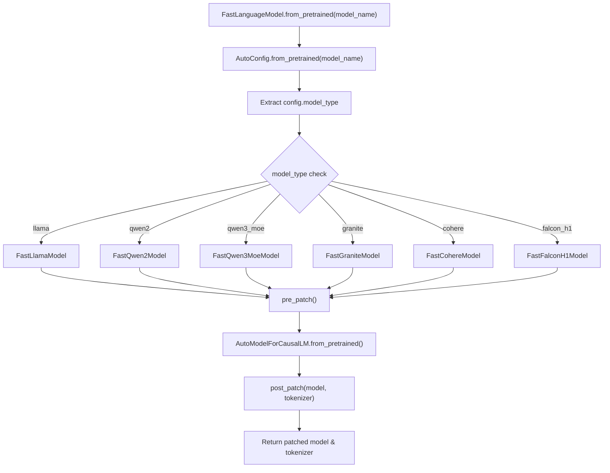
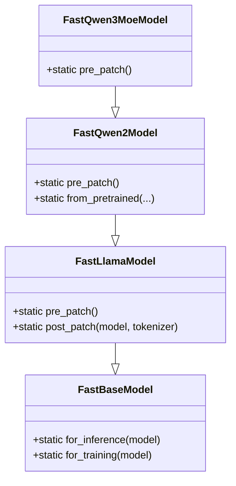

<!-- source: DeepWiki mcp.deepwiki.com · repo unslothai/unsloth · page 4 Model Architecture Support · fetched 2026-10-21 -->

# Model Architecture Support

Relevant source files

The following files were used as context for generating this wiki page:

- [unsloth/models/cohere.py](unsloth/models/cohere.py)
- [unsloth/models/falcon_h1.py](unsloth/models/falcon_h1.py)
- [unsloth/models/gemma.py](unsloth/models/gemma.py)
- [unsloth/models/gemma2.py](unsloth/models/gemma2.py)
- [unsloth/models/granite.py](unsloth/models/granite.py)
- [unsloth/models/qwen2.py](unsloth/models/qwen2.py)
- [unsloth/models/qwen3.py](unsloth/models/qwen3.py)
- [unsloth/models/qwen3_moe.py](unsloth/models/qwen3_moe.py)

Unsloth supports a broad range of large language model (LLM) and multimodal architectures through a unified system of model dispatching, patching, and runtime optimizations. This page provides a high-level overview of the model-specific support and customizations integrated into Unsloth’s core library, with pointers to detailed child pages covering each architecture family and specialized model type.

---

## High-Level Architecture Support Overview

Unsloth implements a model-loading lifecycle consisting of `pre_patch` and `post_patch` phases wrapped around HuggingFace Transformers model instantiation [unsloth/models/qwen2.py:36-55](). Specifically:

- **Pre-patch phase**: Modifies or replaces base Transformers classes (e.g., attention and decoder layers) before the model is loaded to integrate Unsloth’s custom optimized kernels and runtime fixes [unsloth/models/qwen3_moe.py:155-171]().
- **Post-patch phase**: Configures the loaded model and tokenizer instances, enabling device-aware management, LoRA adapter patching, and inference/training mode toggling with Unsloth’s efficient dispatch mechanisms [unsloth/models/qwen2.py:36-55]().

Sources: [unsloth/models/qwen2.py:36-55](), [unsloth/models/qwen3_moe.py:155-171]()

---

## Supported Model Families and Architectures

Unsloth provides tailored support for a diverse set of model families, each with its own dispatcher class implementing architecture-specific optimizations.

| Model Family            | Dispatcher Class          | Use Cases                  | Representative Models                         | Transformers Version Requirement  |
|------------------------|--------------------------|----------------------------|----------------------------------------------|----------------------------------|
| Llama 2/3/3.1/3.2/4    | `FastLlamaModel`          | Decoder-only LLMs          | Llama 2, Llama 3 variants, Mistral            | ≥ 4.0, Llama 3.1+ needs ≥4.43.2  |
| Gemma and Gemma2       | `FastGemmaModel`, `FastGemma2Model` | Google’s Gemma family        | Gemma 2B/7B, Gemma2 9B/27B                     | ≥ 4.38 (Gemma), ≥ 4.42 (Gemma2)  |
| Vision and Multimodal  | `FastVisionModel`         | Vision-language models     | LLaVA, Qwen2-VL, PaliGemma, Gemma 3           | –                                |
| Specialized Architectures | Various dispatchers      | Architecture-specific      | Granite, Qwen2/3, Cohere, FalconH1             | ≥ 4.45 (Granite), ≥ 4.53 (Falcon)|
| Mixture-of-Experts (MoE) | `FastQwen3MoeModel`      | MoE with top-k routing     | Qwen3Moe, DeepSeek MoE, GLM-4.7 MoE Lite       | ≥ 4.50.3                         |
| Sentence Transformers   | `FastSentenceTransformer` | Embeddings and retrieval   | All-MiniLM, E5 models                           | –                                |
| Diffusion and Text-Diffusion | `FastDiffusionModel`  | Text-to-image/video and text diffusion | DiffusionGemma 4, Flux, SDXL                     | ≥ 5.5.0 (Gemma 4)                |

Sources: [unsloth/models/qwen2.py:36-55](), [unsloth/models/qwen3_moe.py:155-171]()

---

## Model Type Resolution and Dispatch Flow

When `FastLanguageModel.from_pretrained()` is invoked, Unsloth resolves model architecture by inspecting the HuggingFace configuration's `model_type` attribute. Based on this, it dispatches loading to the correct architecture-specific dispatcher class (`FastQwen2Model`, `FastQwen3MoeModel`, etc.) which executes `pre_patch()` and `post_patch()` methods [unsloth/models/qwen2.py:36-92]().

Title: Model Dispatch and Patching Pipeline

Sources: [unsloth/models/qwen2.py:36-92](), [unsloth/models/qwen3_moe.py:155-171]()

---

## Dispatcher Class Hierarchy Overview

Unsloth’s architecture-specific dispatch classes derive from shared base implementations to reuse attention dispatchers and fused kernels [unsloth/models/qwen2.py:36-36]().

Title: Model Dispatcher Class Hierarchy

Sources: [unsloth/models/qwen2.py:36-36](), [unsloth/models/qwen3_moe.py:155-171]()

---

## Pre-Patch and Post-Patch Lifecycle

Unsloth relies on a two-phase initialization lifecycle to replace standard HuggingFace modules with high-performance Triton/PyTorch implementations before weights are loaded into memory [unsloth/models/qwen2.py:36-55]().

| Phase      | Description                                              | Key Methods                    |
|------------|----------------------------------------------------------|--------------------------------|
| Pre-patch  | Modify Transformers classes before model instantiation: replace attention, decoder layers, and activation functions. | `pre_patch()` (static method)  |
| Load Model | Instantiate model using standard HuggingFace loaders.     | `AutoModelForCausalLM.from_pretrained()` |
| Post-patch | Configure loaded model instance and tokenizer; attach adapters, fix positional embedding parameters. | `post_patch(model, tokenizer)` |

Sources: [unsloth/models/qwen2.py:36-55](), [unsloth/models/qwen3_moe.py:155-171]()

---

## Common Components and Shared Optimizations

Architectures share common utility routines for attention dispatching, RoPE scaling, and fused linear layers [unsloth/models/gemma2.py:104-121](), [unsloth/models/granite.py:122-128]()]:
- **Attention Dispatch**: `AttentionConfig` and `AttentionContext` manage backend routing between Flash Attention, SDPA, and xFormers [unsloth/models/gemma2.py:149-166]().
- **RoPE Embedding**: `fast_rope_embedding` applies rotary positional encodings efficiently across multiple hardware backends [unsloth/models/gemma2.py:118-120]().
- **Fused Activations**: `fast_swiglu_inference` and `fast_geglu_inference` combine projections and activation functions [unsloth/models/gemma.py:62-71](), [unsloth/models/qwen3_moe.py:169-169]().

Sources: [unsloth/models/gemma.py:62-71](), [unsloth/models/gemma2.py:104-166](), [unsloth/models/granite.py:122-128](), [unsloth/models/qwen3_moe.py:169-169]()

---

## Training vs. Inference Mode Dispatch

Unsloth separates training optimizations from inference optimizations via explicit mode toggles [unsloth/models/loader.py:102-109]():
- `for_inference(model)`: Sets generation flags (`_flag_for_generation = True`), configures paged KV caches, and disables autograd [unsloth/models/gemma.py:88-93]().
- `for_training(model)`: Prepares the model for gradient checkpointing and attaches PEFT/LoRA modules [unsloth/models/qwen2.py:54-54]().

Sources: [unsloth/models/gemma.py:88-93](), [unsloth/models/qwen2.py:54-54]()

---

## Child Pages for Detailed Architecture Support

For comprehensive details on each model family and architecture, consult the following child pages:

- [Llama Model Family](#4.1) — Optimizations for Llama versions 2 through 4, Mistral, attention dispatch, and decoder layers.
- [Gemma and Gemma2 Models](#4.2) — Gemma optimizations such as logit softcapping, RMSNorm +1 weight fix, GeGLU activation, and RoPE variants.
- [Vision and Multimodal Models](#4.3) — FastVisionModel for vision-language models including LLaVA and Qwen2-VL, image processing pipelines, and multimodal attention layers.
- [Specialized Architectures](#4.4) — Granite, Qwen2/3, Cohere, FalconH1 (hybrid Mamba), and other unique architectures.
- [Mixture-of-Experts Models](#4.5) — Support for Qwen3Moe, DeepSeek MoE, GLM-4.7 MoE Lite, and grouped GEMM kernel optimizations.
- [Sentence Transformers](#4.6) — FastSentenceTransformer usage for embedding and retrieval tasks.
- [Diffusion and Text-Diffusion Models](#4.7) — FastDiffusionModel for text-diffusion architectures, block-diffusion samplers, LoRA integration, and 4-bit/8-bit loading support.

Sources: [unsloth/models/gemma.py:12-33](), [unsloth/models/gemma2.py:31-40](), [unsloth/models/granite.py:46-52](), [unsloth/models/falcon_h1.py:32-40](), [unsloth/models/qwen3.py:32-38](), [unsloth/models/cohere.py:25-34](), [unsloth/models/qwen3_moe.py:24-31](), [unsloth/models/qwen2.py:18-23]()

---

