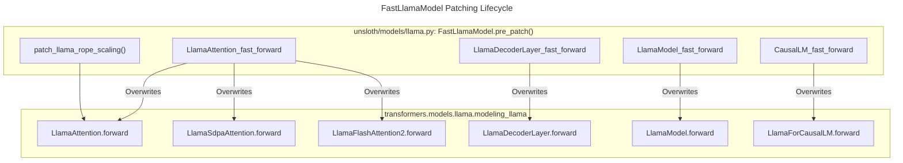
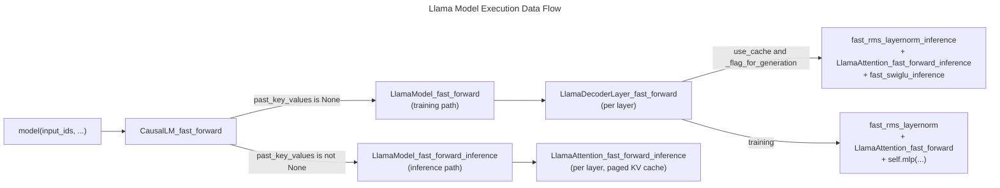
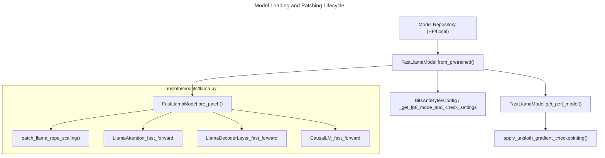
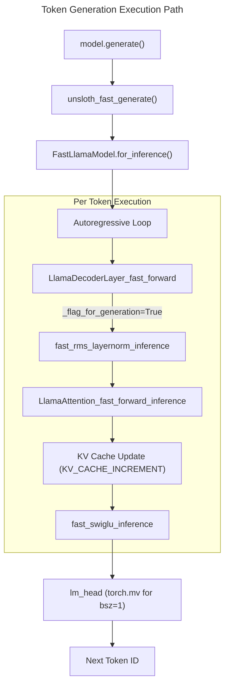

<!-- source: DeepWiki mcp.deepwiki.com · repo unslothai/unsloth · page 4.1 Llama Model Family · fetched 2026-10-21 -->

# Llama Model Family

Relevant source files

The following files were used as context for generating this wiki page:

- [README.md](README.md)
- [pyproject.toml](pyproject.toml)
- [tests/python/test_construct_chat_template_validation.py](tests/python/test_construct_chat_template_validation.py)
- [tests/test_fp8_pre_sm89_dequant_fallback.py](tests/test_fp8_pre_sm89_dequant_fallback.py)
- [tests/test_import_fixes_drift.py](tests/test_import_fixes_drift.py)
- [unsloth/__init__.py](unsloth/__init__.py)
- [unsloth/_gpu_init.py](unsloth/_gpu_init.py)
- [unsloth/chat_templates.py](unsloth/chat_templates.py)
- [unsloth/import_fixes.py](unsloth/import_fixes.py)
- [unsloth/kernels/fp8.py](unsloth/kernels/fp8.py)
- [unsloth/models/_utils.py](unsloth/models/_utils.py)
- [unsloth/models/llama.py](unsloth/models/llama.py)
- [unsloth/models/loader.py](unsloth/models/loader.py)
- [unsloth/models/loader_utils.py](unsloth/models/loader_utils.py)
- [unsloth/models/mapper.py](unsloth/models/mapper.py)
- [unsloth/models/mistral.py](unsloth/models/mistral.py)
- [unsloth/models/rl.py](unsloth/models/rl.py)
- [unsloth/models/rl_replacements.py](unsloth/models/rl_replacements.py)
- [unsloth/models/vision.py](unsloth/models/vision.py)
- [unsloth/save.py](unsloth/save.py)
- [unsloth/tokenizer_utils.py](unsloth/tokenizer_utils.py)

This page documents the technical architecture and implementation details of the Llama model family support within Unsloth, covering Llama 2, 3, 3.1, 3.2, and 4 models along with derivative architectures. It details optimization strategies, attention mechanisms, RoPE embedding adaptations, decoder layer implementations, and code entity bindings.

The core class is `FastLlamaModel` located in `unsloth/models/llama.py`, which centralizes patching, optimized forward implementations, inference-mode switching, and generation acceleration.

Sources: [unsloth/models/llama.py:1-107]()

---

## Overview and Role of `FastLlamaModel`

The `FastLlamaModel` class serves as the central entry point for all Llama-family models within Unsloth:

- Centrally patches standard `transformers` Llama classes' forward methods with Unsloth-optimized implementations at model load time [unsloth/models/llama.py:2147-2183]().
- Provides custom rotary position embedding (RoPE) implementations to support extended context lengths and scaling configurations [unsloth/models/llama.py:1699-2053]().
- Implements dual-mode (training vs. inference) attention and decoder layer forward passes optimized for throughput and minimal memory footprint [unsloth/models/llama.py:795-876]().
- Encapsulates fast attention dispatch logic, coordinating multi-backend support (Flash Attention, SDPA, xFormers) [unsloth/models/llama.py:48-56]().
- Wraps model generation via `unsloth_fast_generate` to accelerate autoregressive inference [unsloth/models/llama.py:2055-2137]().

Sources: [unsloth/models/llama.py:48-56](), [unsloth/models/llama.py:795-876](), [unsloth/models/llama.py:1699-2183](), [unsloth/models/loader.py:30-35]()

---

## Patching Architecture

Unsloth replaces core `transformers` Llama components with optimized implementations early in the loading process. This patching is performed in `FastLlamaModel.pre_patch()`, called during model initialization.

### Pre-patch replacements include:

- `LlamaAttention.forward` replaced with `LlamaAttention_fast_forward` [unsloth/models/llama.py:2164-2164]().
- `LlamaDecoderLayer.forward` replaced with `LlamaDecoderLayer_fast_forward` [unsloth/models/llama.py:2173-2173]().
- `LlamaModel.forward` replaced with `LlamaModel_fast_forward` [unsloth/models/llama.py:2174-2174]().
- `LlamaForCausalLM.forward` replaced with `CausalLM_fast_forward` [unsloth/models/llama.py:2175-2175]().
- Custom rotary embedding classes injected to replace original implementations [unsloth/models/llama.py:2147-2157]().

Sources: [unsloth/models/llama.py:2147-2183](), [unsloth/models/_utils.py:41-41]()

---

## Forward Function Hierarchy and Data Flow

Unsloth defines distinct fast-forward functions optimized for training and inference across model granularity levels. The `_flag_for_generation` attribute determines execution routing at runtime.

| Model Scope | Training Forward Function | Inference Forward Function |
|-------------|---------------------------|----------------------------|
| Attention Layer | `LlamaAttention_fast_forward` | `LlamaAttention_fast_forward_inference` |
| Decoder Layer | `LlamaDecoderLayer_fast_forward` | Dispatches internally via `_flag_for_generation` |
| Full Model | `LlamaModel_fast_forward` | `LlamaModel_fast_forward_inference` (factory) |
| Causal LM Head | `CausalLM_fast_forward` | Dispatches depending on `past_key_values` |

Sources: [unsloth/models/llama.py:695-876](), [unsloth/models/llama.py:1298-1635]()

---

## Attention Mechanisms

### Training Mode Attention (`LlamaAttention_fast_forward`)
- Implements key/value/query projections using `apply_qkv` hooks to support LoRA weight fusion [unsloth/models/llama.py:720-722]().
- Applies RoPE using Unsloth's fused Triton kernels via `fast_rope_embedding` [unsloth/models/llama.py:743-747]().
- Dynamically selects attention backends via `select_attention_backend` [unsloth/models/llama.py:756-764]().

### Inference Mode Attention (`LlamaAttention_fast_forward_inference`)
- Maintains contiguous pre-allocated KV cache buffers allocated in increments of `KV_CACHE_INCREMENT` (512 tokens) [unsloth/models/llama.py:167]().
- Executes in-place rotary embeddings to eliminate repetitive allocations [unsloth/models/llama.py:440-445]().
- Implements a single-batch fast path (`bsz=1`) using `torch.matmul` over pre-allocated tensors [unsloth/models/llama.py:535-565]().

Sources: [unsloth/models/llama.py:167](), [unsloth/models/llama.py:382-605](), [unsloth/models/llama.py:695-791]()

---

## Causal Language Model (CLM) Forward and Loss

`CausalLM_fast_forward` provides several optimizations:
- **Fused Cross Entropy:** Utilizes `unsloth_fused_ce_loss` to compute cross-entropy loss without materializing full logit tensors in global memory [unsloth/models/llama.py:1553-1555]().
- **Logit Scaling:** Applies `logit_scale` for architectures requiring scaling factors [unsloth/models/llama.py:1510-1513]().
- **Logit Softcapping:** Implements softcapping functions to prevent numerical instability [unsloth/models/llama.py:1515-1518]().
- **Empty Logits:** Returns an `EMPTY_LOGITS` sentinel during forward training passes to optimize memory usage [unsloth/models/llama.py:1557-1560]().

Sources: [unsloth/models/llama.py:1425-1635](), [unsloth/models/_utils.py:57-59]()

---

## RoPE Embedding and Scaling Variants

Unsloth implements specialized RoPE classes to manage context extension mechanisms:

| RoPE Class | Associated Model Family | Features |
|------------|-------------------------|----------|
| `LlamaRotaryEmbedding` | Llama 2/3 baseline | Standard cosine/sine caching [unsloth/models/llama.py:1699]() |
| `LlamaLinearScalingRotaryEmbedding` | Context extension | Linear interpolation of frequency bases [unsloth/models/llama.py:1809]() |
| `LlamaExtendedRotaryEmbedding` | Llama 3.1+ | NTK-by-parts frequency smoothing [unsloth/models/llama.py:1839]() |
| `LongRopeRotaryEmbedding` | Phi-3.5+ | Dual frequency sets for short/long context windows [unsloth/models/llama.py:1922]() |

Sources: [unsloth/models/llama.py:1699-2053](), [unsloth/models/_utils.py:41-41]()

---

## Model Loading and LoRA Integration

### Model Loading (`from_pretrained`)
The loader orchestrates quantization and architecture configuration:
- 4-bit loading via `BitsAndBytesConfig` integration [unsloth/models/llama.py:2275-2287]().
- Automatic extraction and injection of RoPE scaling parameters from model configurations [unsloth/models/llama.py:2366-2384]().
- Support for FP8-enabled LoRA setups and quantization-aware training (QAT) wrappers [unsloth/models/llama.py:2226-2235]().

### LoRA Integration (`get_peft_model`)
- Targets standard Llama linear modules: `q_proj`, `k_proj`, `v_proj`, `o_proj`, `gate_proj`, `up_proj`, `down_proj` [unsloth/models/llama.py:2764-2772]().
- Patches `fast_lora_forward` for fused LoRA operations [unsloth/models/llama.py:2880-2882]().
- Integrates `Unsloth_Offloaded_Gradient_Checkpointer` to reduce activation memory during backpropagation [unsloth/models/llama.py:2886-2895]().

Sources: [unsloth/models/llama.py:2186-2900](), [unsloth/models/_utils.py:34-38]()

---

## Bridging Natural Language to Code Space

### Diagram: Model Loading and Patching Lifecycle
This diagram maps logical model loading steps to their corresponding code entities in the codebase.

Sources: [unsloth/models/llama.py:2147-2183](), [unsloth/models/llama.py:2186-2724]()

### Diagram: Token Generation Execution Path
This diagram traces inference execution from high-level generation calls down to low-level decoding functions.

Sources: [unsloth/models/llama.py:382-636](), [unsloth/models/llama.py:2055-2137]()

---

