<!-- source: DeepWiki mcp.deepwiki.com · repo unslothai/unsloth · page 4.2 Gemma and Gemma2 Models · fetched 2026-10-21 -->

# Gemma and Gemma2 Models

<details>
<summary>Relevant source files</summary>

The following files were used as context for generating this wiki page:

- [unsloth/models/cohere.py](unsloth/models/cohere.py)
- [unsloth/models/falcon_h1.py](unsloth/models/falcon_h1.py)
- [unsloth/models/gemma.py](unsloth/models/gemma.py)
- [unsloth/models/gemma2.py](unsloth/models/gemma2.py)
- [unsloth/models/granite.py](unsloth/models/granite.py)
- [unsloth/models/qwen2.py](unsloth/models/qwen2.py)
- [unsloth/models/qwen3.py](unsloth/models/qwen3.py)
- [unsloth/models/qwen3_moe.py](unsloth/models/qwen3_moe.py)

</details>


This page documents Unsloth's optimizations for Google's Gemma and Gemma2 model architectures. These models share a Llama-style decoder architecture but introduce several distinctive features: GeGLU activation, a modified RMSNorm with a +1 weight offset, custom RoPE implementations, and (for Gemma2) logit softcapping combined with sliding window attention. For general model loading and patching mechanisms, see the respective model loader and utility files. For attention dispatch and kernel optimizations, consult the `attention_dispatch.py` and `rms_layernorm.py` kernels.

---

## Architecture Overview

Both Gemma and Gemma2 use decoder-only transformer architectures inspired by Llama, but they diverge in several key aspects:

- Gemma integrates GeGLU activations instead of SwiGLU.
- Both models apply RMSNorm with an unusual "+1" offset on the weight.
- Their RoPE mechanism differs from standard implementations in explicit division instead of inverse multiplication.
- Gemma2 further adds logit softcapping in attention and alternates sliding window versus global attention per layer.

Below is a functional block diagram comparing the Gemma and Gemma2 decoder layers.

Title: Gemma and Gemma2 Decoder Layer Architecture


**Sources:** [unsloth/models/gemma.py:83-155](), [unsloth/models/gemma2.py:208-299]()

---

## Model Class Hierarchy and Patching

Unsloth integrates Gemma and Gemma2 architectures by subclassing `FastLlamaModel` with `FastGemmaModel` and `FastGemma2Model`, respectively. These subclasses override the patching lifecycle hooks `pre_patch()` and `post_patch()` to replace transformers' native model components with optimized versions.

**Class and Patch Flow:**

Title: Model Class Hierarchy and Patching Flow
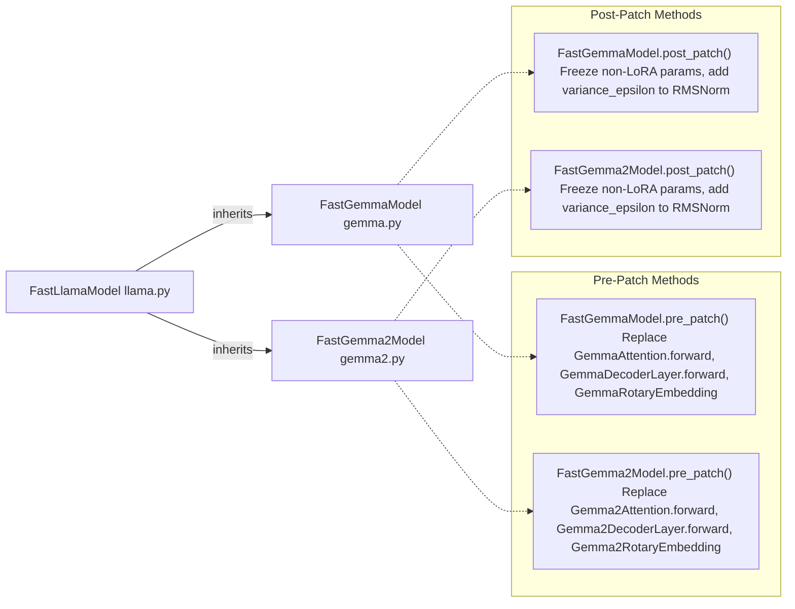

- `pre_patch()` replaces core `cls.forward` functions for attention, decoder layers, and rotary embeddings with Unsloth's implementations.
- `post_patch()` freezes all parameters except LoRA adapters, ensures RMSNorm modules have a `variance_epsilon` attribute, and disables downcasting for RoPE embeddings to preserve their precision.

**Sources:** [unsloth/models/gemma.py:419-448](), [unsloth/models/gemma.py:448](), [unsloth/models/gemma2.py:585-597](), [unsloth/models/gemma2.py:597]()

---

## Custom RoPE Implementation

Gemma models use a distinct rotary positional encoding scheme differing from the classic Llama method. The key distinctive element is explicit division by timescale rather than multiplication by an inverse frequency.

**Computation Details:**

Title: Custom Gemma RoPE Computation Pipeline
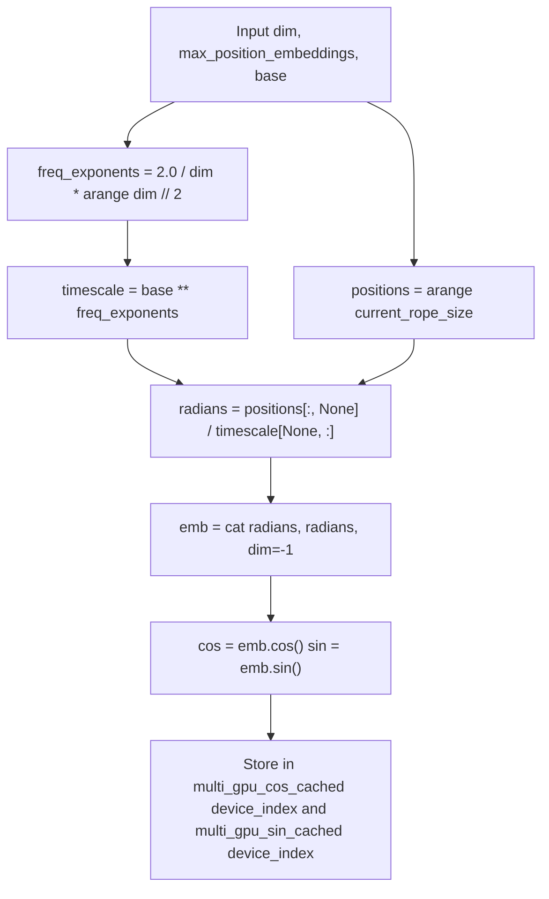

### Key Implementation Notes

| Aspect                    | Gemma Implementation                                    | Llama Implementation                |
|---------------------------|---------------------------------------------------------|-----------------------------------|
| Frequency Calculation     | Positions divided by timescale (explicit division)      | Positions multiplied by inverse of timescale |
| Intermediate Type Usage   | Uses `torch.int64` for arange before conversion          | Usually `float32` or mixed precision |
| Cache                    | Multi-GPU device-indexed cos/sin cache                   | Single device cache                 |
| Rolling Cache Extension  | Extends cache in increments of 8192 tokens               | Similar dynamic extension          |
| Precision Downcast       | Never downcasted (preserves precision)                    | Typically downcasted to model dtype |

This yields a more explicit precision control and multi-GPU compatibility.

**Sources:** [unsloth/models/gemma.py:270-350](), [unsloth/kernels/rope_embedding.py:104-166]()

---

## GeGLU Activation Function

Gemma replaces Llama's standard SwiGLU activation with GeGLU, using `torch.nn.functional.gelu` with a tanh approximation for inference speed and numerical quality.

**Activation Signal Flow:**

Title: GeGLU Activation Signal Flow
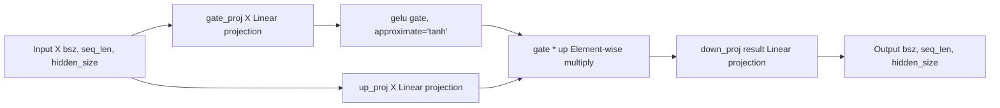

The optimized fused inference function reduces allocations by reusing the intermediate up projection buffer as an output buffer.

```python
def fast_geglu_inference(self, X):
    bsz, _, hd = X.shape
    gate = fast_linear_forward(self.gate_proj, X)
    up = fast_linear_forward(self.up_proj, X)
    gate = torch_nn_functional_gelu(gate, approximate = "tanh")
    gate *= up
    down = fast_linear_forward(self.down_proj, gate, out = up[:, :, :hd])
    return down
```

**Sources:** [unsloth/models/gemma.py:65-79](), [unsloth/kernels/geglu.py:31-36]()

---

## RMSNorm with +1 Weight Offset

Gemma and Gemma2 employ RMSNorm layers with a "+1" offset on the weight parameter to improve training dynamics:

$$\text{Output} = \text{NormalizedInput} \times (1 + \text{weight})$$

The Triton kernels implement this offset natively, avoiding any mutation of the actual weight tensor. This is accomplished by two specialized forward functions:

- `fast_rms_layernorm()` for training that sets `gemma=True`
- `fast_rms_layernorm_inference_gemma()` optimized for inference with caching

Title: RMSNorm Gemma Kernel Routing
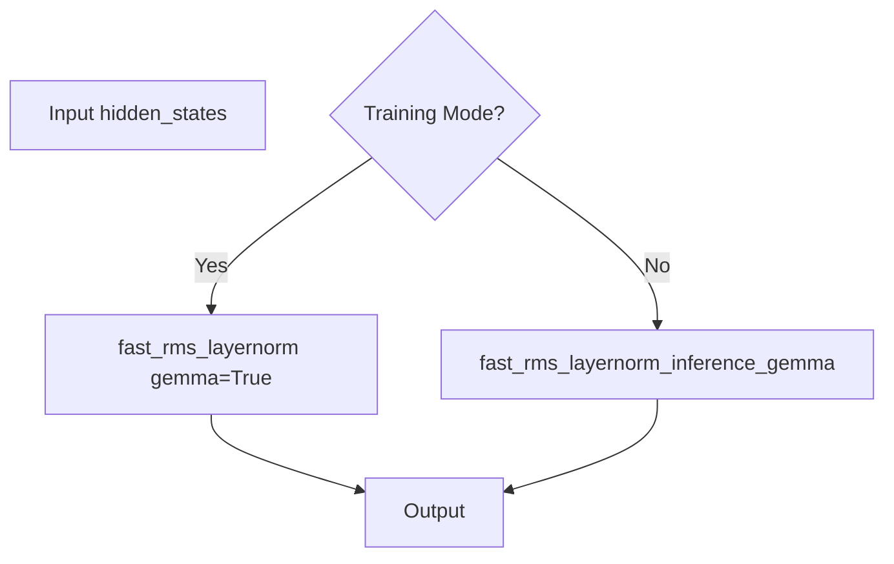

Post-patch modifications include adding `variance_epsilon` to all `GemmaRMSNorm` modules ensuring compatibility with kernel expectations, and freezing all parameters except LoRA adapters.

**Relevant Code Snippet:**

```python
for name, module in model.named_modules():
    if isinstance(module, GemmaRMSNorm):
        if not hasattr(module, "variance_epsilon"):
            module.variance_epsilon = module.eps
```

**Sources:** [unsloth/models/gemma.py:448](), [unsloth/models/gemma2.py:597](), [unsloth/kernels/rms_layernorm.py:124-159]()

---

## Gemma2 Logit Softcapping

A defining feature of Gemma2 attention is **logit softcapping**: attention logits are passed through a scaled hyperbolic tangent function before the softmax to bound large logits and stabilize training.

$$\text{A} = Q K^\top, \quad \text{A} := \frac{\text{A}}{t}, \quad \text{A} := \tanh(\text{A}), \quad \text{A} := \text{A} \times t$$

This "softcapping" uses a configurable scalar $t = \text{attn\_logit\_softcapping}$.

**Softcapping Attention Flow:**

Title: Gemma2 Logit Softcapping Pipeline
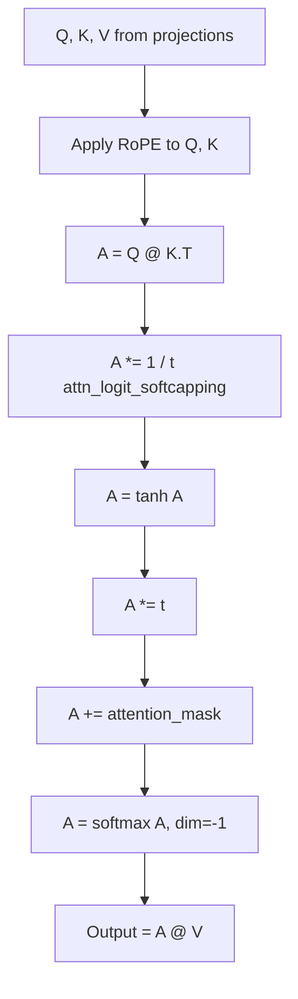

**Sources:** [unsloth/models/gemma2.py:455-470](), [unsloth/kernels/cross_entropy_loss.py:84-85]()

### Flash Attention Integration vs Manual Implementation

- When Flash Attention with softcapping support is available (`HAS_FLASH_ATTENTION_SOFTCAPPING=True`) and no attention mask is used, softcapping is handled directly in the Flash Attention kernel using the `softcap` parameter.
- If an attention mask exists or Flash Attention softcapping support is unavailable, a manual implementation using scaled tanh is performed before softmax.

Title: Softcapping Backend Selection Decision Tree
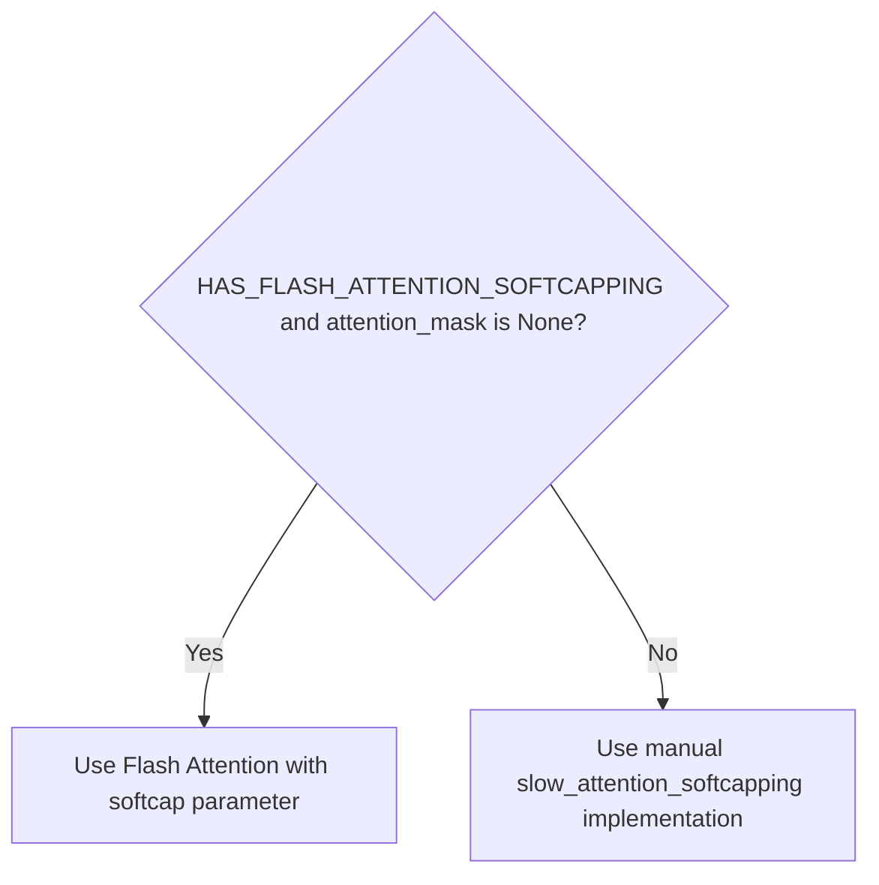

**Sources:** [unsloth/models/gemma2.py:140-194](), [unsloth/kernels/flex_attention.py:58-62]()

---

## Gemma2 Sliding Window Attention

Gemma2 alternates between sliding window attention on even layers and full global attention on odd layers to reduce attention memory.

- Even-indexed layers use sliding window attention restricted to the last N tokens (`sliding_window` config).
- Odd-indexed layers use full-sequence global attention.

Title: Layerwise Attention Windowing Strategy
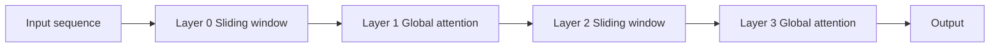

**Sources:** [unsloth/models/gemma2.py:426-432](), [unsloth/models/gemma2.py:536-550]()

---

## Attention Dispatch System

Unsloth implements multi-backend, configurable attention selection to optimize performance across models.

### Gemma Attention Dispatch Logic

Title: Gemma Attention Backend Routing
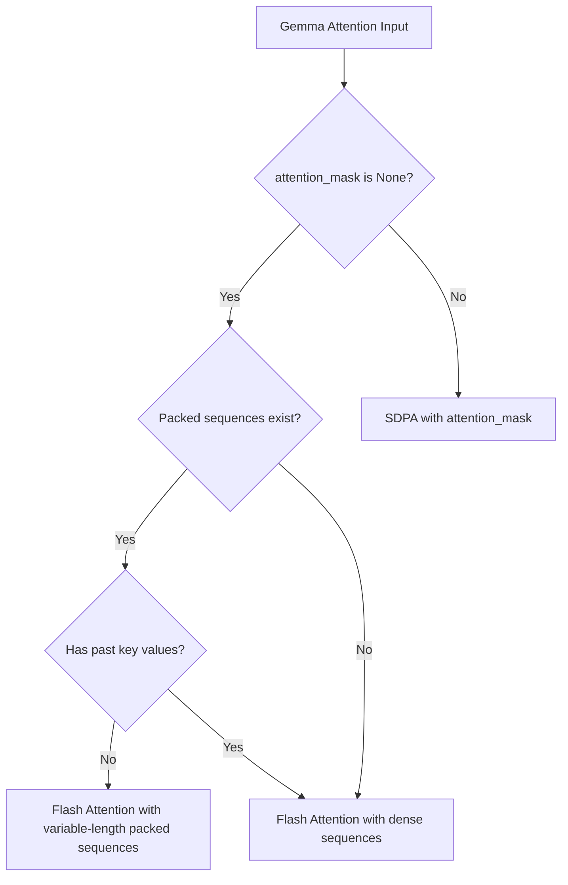

### Gemma2 Attention Dispatch Logic with Softcapping

Title: Gemma2 Attention Backend Routing
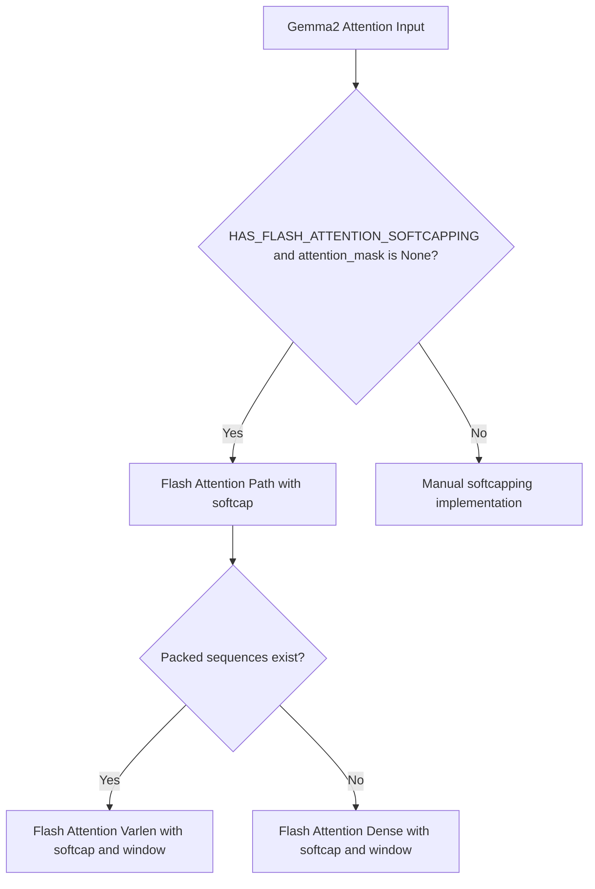

**Sources:** [unsloth/models/gemma.py:431-433](), [unsloth/models/gemma2.py:140-194](), [unsloth/models/gemma2.py:597]()

---

## Training vs Inference Execution Paths

The forward pass logic distinguishes between training and inference by checking the presence of `use_cache` and a `_flag_for_generation` attribute.

- **Inference Mode:** Uses optimized kernels for RMSNorm and GeGLU that reuse buffers and incorporate KV paging for fast autoregressive generation.
- **Training Mode:** Uses full precision RMSNorm and standard MLP forward, no caching of KV states.

Title: Training vs Inference Execution Control Flow
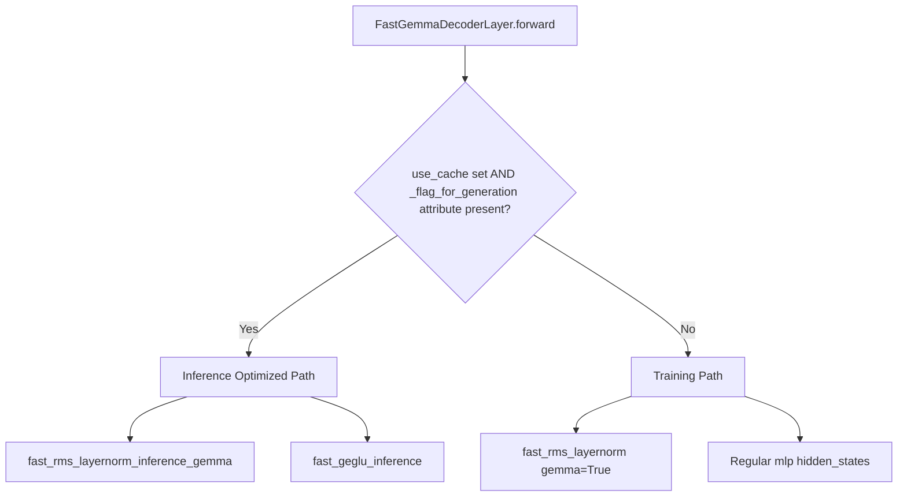

**Sources:** [unsloth/models/gemma.py:96-155](), [unsloth/models/gemma2.py:221-261]()

---

## Inference Optimization: Paged KV Cache

Gemma2's inference benefits from a **paged KV cache system** conserving GPU memory and minimizing memory movement by allocating a large continuous cache and managing views for keys and values.

Title: Paged KV Cache Initialization and Resizing Lifecycle
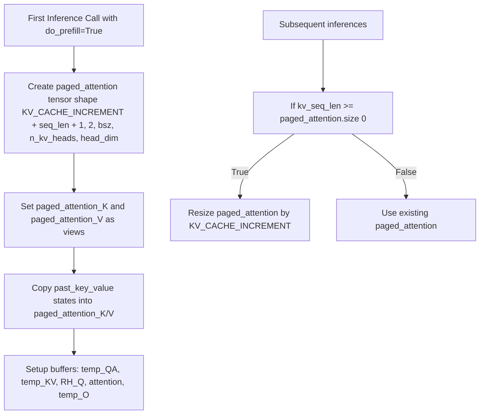

**Sources:** [unsloth/models/gemma2.py:339-370](), [unsloth/models/gemma2.py:420-423]()

---

## Model Forward Pass Architecture (Gemma2 Inference)

Title: Gemma2 Model Forward Pass Inference Flow
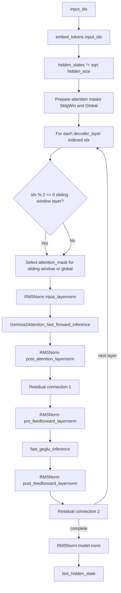

**Sources:** [unsloth/models/gemma2.py:479-582]()

---

## Summary

Unsloth's support for Gemma and Gemma2 models includes extensive patching of transformers components with optimized forward kernels, custom Triton kernels for RMSNorm (with the +1 weight offset), fused GeGLU MLP implementation, and a distinct RoPE embedding formulation with multi-GPU caching.

Gemma2 uniquely adds logit softcapping for stable attention and an alternating sliding window/global attention regime to reduce memory footprint. The inference pathways are carefully optimized for paged KV cache management, layer-specific attention dispatch, and kernel fusion to maximize throughput on GPU hardware.

---

**Sources:**

- [unsloth/models/gemma.py:1-448]()
- [unsloth/models/gemma2.py:1-597]()
- [unsloth/kernels/rms_layernorm.py:21-159]()
- [unsloth/kernels/cross_entropy_loss.py:80-100]()
- [unsloth/kernels/rope_embedding.py:20-250]()
- [unsloth/kernels/geglu.py:31-36]()
- [unsloth/kernels/flex_attention.py:58-62]()

---

