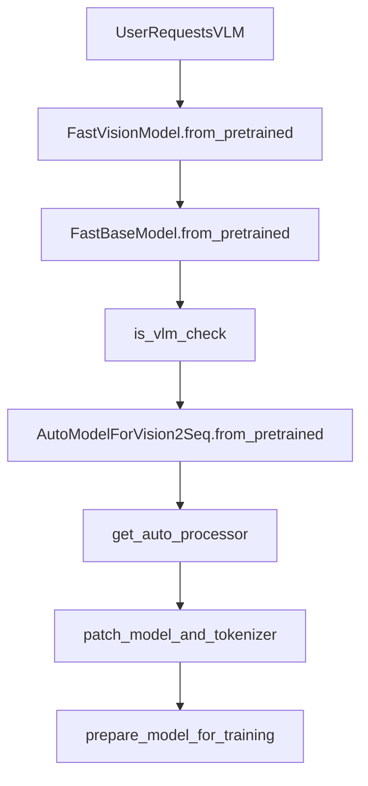

<!-- source: DeepWiki mcp.deepwiki.com · repo unslothai/unsloth · page 4.3 Vision and Multimodal Models · fetched 2026-10-21 -->

# Vision and Multimodal Models

<details>
<summary>Relevant source files</summary>

The following files were used as context for generating this wiki page:

- [README.md](README.md)
- [pyproject.toml](pyproject.toml)
- [tests/python/test_construct_chat_template_validation.py](tests/python/test_construct_chat_template_validation.py)
- [tests/test_fp8_pre_sm89_dequant_fallback.py](tests/test_fp8_pre_sm89_dequant_fallback.py)
- [tests/test_import_fixes_drift.py](tests/test_import_fixes_drift.py)
- [unsloth/__init__.py](unsloth/__init__.py)
- [unsloth/_gpu_init.py](unsloth/_gpu_init.py)
- [unsloth/chat_templates.py](unsloth/chat_templates.py)
- [unsloth/import_fixes.py](unsloth/import_fixes.py)
- [unsloth/kernels/fp8.py](unsloth/kernels/fp8.py)
- [unsloth/models/_utils.py](unsloth/models/_utils.py)
- [unsloth/models/llama.py](unsloth/models/llama.py)
- [unsloth/models/loader.py](unsloth/models/loader.py)
- [unsloth/models/loader_utils.py](unsloth/models/loader_utils.py)
- [unsloth/models/mapper.py](unsloth/models/mapper.py)
- [unsloth/models/mistral.py](unsloth/models/mistral.py)
- [unsloth/models/rl.py](unsloth/models/rl.py)
- [unsloth/models/rl_replacements.py](unsloth/models/rl_replacements.py)
- [unsloth/models/vision.py](unsloth/models/vision.py)
- [unsloth/save.py](unsloth/save.py)
- [unsloth/tokenizer_utils.py](unsloth/tokenizer_utils.py)

</details>


This page documents Unsloth's architecture and implementation details for Vision-Language Models (VLMs) and multimodal models such as LLaVA, Qwen2-VL, Gemma 3, and others. It thoroughly explains the `FastVisionModel` class, image input processing, multimodal attention mechanisms, and integration with fast inference backends like vLLM.

---

## 1. Overview of FastVisionModel

`FastVisionModel` serves as the primary entry point for loading and using vision-language and multimodal transformer models in Unsloth. It is implemented as a thin wrapper around `FastBaseModel` specialized for VLMs.

```python
from unsloth import FastVisionModel

model, processor = FastVisionModel.from_pretrained(
    model_name = "unsloth/Qwen2-VL-7B-Instruct",
    load_in_4bit = True,
    max_seq_length = 2048,
)
```

### Implementation Details

- Defined in `unsloth/models/vision.py`, lines 1-126.
- Overrides the `from_pretrained` factory method of `FastBaseModel` by setting the `auto_model` parameter to `AutoModelForVision2Seq` (or `AutoModelForImageTextToText` as fallback) [unsloth/models/vision.py:13-27]().
- On Apple Silicon (MLX) environments, it redirects loading to `FastMLXModel` with `text_only=False` [unsloth/__init__.py:127-146]().
- The actual heavy lifting of model initialization, device placement, quantization, and forwarding logic is handled within `FastBaseModel`, which unifies text-only and vision-language modalities under a single interface [unsloth/models/vision.py:124-125]().

Sources: `[unsloth/models/vision.py:13-27, 124-125]()`, `[unsloth/__init__.py:127-146]()`

---

## 2. Supported Vision and Multimodal Model Architectures

Unsloth supports several vision-language architectures, each with varying support for vLLM fast inference, LoRA fine-tuning, and specific optimizations.

| Architecture       | vLLM Support         | LoRA Support    | Description/Models                      |
|--------------------|---------------------|-----------------|----------------------------------------|
| `qwen2_5_vl`        | ✅ Full              | ✅ Yes          | Qwen2.5-VL multimodal models            |
| `qwen3_vl`          | ✅ Full              | ✅ Yes          | Qwen3-VL family                         |
| `gemma3`            | ✅ Full              | ✅ Yes          | Gemma 3 multimodal variants             |
| `mistral3`          | ✅ Full              | ✅ Yes          | Mistral 3 Vision-Language               |
| `mllama`            | ⚠ vLLM v0 only      | ❌ No           | LLama 3.2 Vision 11B/90B (limited support) |
| `gemma3n`           | ✅ Yes               | ✅ Yes          | Gemma 3N with vision towers             |
| `pixtral`           | ✅ Yes               | ✅ Yes          | Pixtral 12B models                      |

### Special Notes

- **Gemma 3N models** (architecture name `gemma3n`) default to eager attention rather than flex or SDPA attention due to `timm` vision modules incompatibility with flex-attention [unsloth/models/vision.py:117-121]().
- Models with architectures including `gemma3`, `gemma3n`, and `qwen3_moe` are forced to train in `float32` to avoid training instabilities and NaNs caused in `float16` mode [unsloth/models/loader.py:117-135]().
- Some vision variants are explicitly excluded from applying `torch.compile` due to compatibility issues [unsloth/models/loader.py:136-148]().

**Vision Architecture Detection Logic:**

Vision models are detected by checking if any `config.architectures` entry ends with `"ForConditionalGeneration"` or `"ForVisionText2Text"`, or if the model config possesses the attribute `vision_config` [unsloth/models/vision.py:34-41]().

Sources: `[unsloth/models/vision.py:34-41, 117-121]`, `[unsloth/models/loader.py:117-148]()`

---

## 3. Vision Model Loading Pipeline

The pipeline for loading vision-language models differs slightly from text-only models to handle processors and multimodal inputs.

### Key Steps in Loading

1. **User invokes `FastVisionModel.from_pretrained()`.**  
2. Internally, it calls `FastBaseModel.from_pretrained` with `auto_model=AutoModelForVision2Seq` [unsloth/models/vision.py:13-27]().  
3. The model config is inspected to detect VLM architectures and vision capabilities [unsloth/models/vision.py:34-41]().  
4. Automatically selects a processor via `get_auto_processor()` instead of a tokenizer to handle images alongside text [unsloth/zoo/hf_utils.py:83]().  
5. Applies Unsloth-specific patches like attention dispatch overrides and quantization fixes [unsloth/models/_utils.py:143-149]().  
6. Prepares the model for training or inference (e.g., gradient checkpointing, precision settings) [unsloth/models/vision.py:86]().  

### Vision Architecture Code Flow Diagram

Title: "FastVisionModel Loading Pipeline"


Sources: `[unsloth/models/vision.py:13-41, 86]`, `[unsloth/models/_utils.py:143-149]`, `[unsloth/zoo/hf_utils.py:83]()`

---

## 4. Image Processing and Multimodal Input Handling

Vision-language models require preprocessing and input management of images and other non-text modalities together with text tokens.

### Image Processing Utility

Unsloth utilizes the utility function `process_vision_info` from `unsloth_zoo` (imported in `unsloth/models/_utils.py`) to extract pixel values and related tensors from inputs and validate formatted images [unsloth/models/_utils.py:168-170]().

### Generation Wrapper: `unsloth_base_fast_generate`

For vision models, Unsloth wraps the generation process to seamlessly integrate image inputs and multimodal attention [unsloth/models/vision.py:135-224]().

Key functionalities:
- Calls `FastBaseModel.for_inference(self)` to prepare the model in inference mode.
- Uses autocasting with appropriate dtypes (`float16` or `bfloat16`) for pixel values (`pixel_values` and `pixel_values_videos`).
- Removes unsupported input keys like `token_type_ids` unless the model architecture requires it.
- Uses a static KV cache if supported, typically with a `KV_CACHE_INCREMENT` of 512 tokens [unsloth/models/llama.py:168]().

### Multimodal Generation Flow Diagram

Title: "Vision Generation Flow"


Sources: `[unsloth/models/vision.py:135-224]`, `[unsloth/models/_utils.py:168-170]`, `[unsloth/models/llama.py:168]()`

---

## 5. vLLM Integration for Vision Models

Unsloth supports fast inference using the vLLM backend for selected vision-language models.

### Supported Vision Architectures for vLLM

Specific vision architectures are supported for `fast_inference` via vLLM [unsloth/models/vision.py:34-41]():
- `qwen2_5_vl`
- `gemma3`
- `mistral3`
- `qwen3_vl`
- `qwen3_vl_moe`

If a vision model outside this list is requested with `fast_inference=True`, Unsloth raises an error [unsloth/models/vision.py:401-434]().

Sources: `[unsloth/models/vision.py:34-41, 401-434]()`, `[unsloth/__init__.py:127-146]()`

---

## 6. Multimodal Attention and Memory Optimizations

### Attention Dispatch

Unsloth's attention dispatcher selects the best available backend dynamically:
- **Flex Attention** if compatible.
- **Scaled Dot Product Attention (SDPA)** fallback.
- **Eager attention** fallback, forcibly used in models like Gemma 3N [unsloth/models/vision.py:117-121]().

### Gradient Checkpointing and Training

Unsloth applies `prepare_model_for_kbit_training` to multimodal models, enabling mixed precision and gradient checkpointing for memory savings [unsloth/models/_utils.py:22](). For vision models, `unsloth_fused_ce_loss` reduces peak memory by fusing cross-entropy computations during backward passes [unsloth/models/_utils.py:59]().

Sources: `[unsloth/models/vision.py:117-121]`, `[unsloth/models/_utils.py:22, 59]`, `[unsloth/models/llama.py:51-59]()`

---

