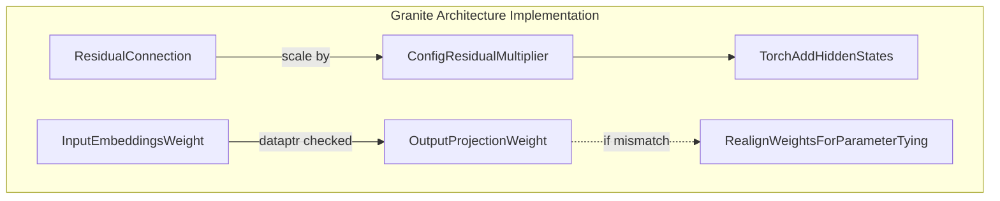
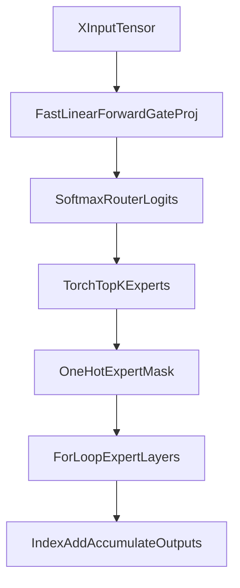
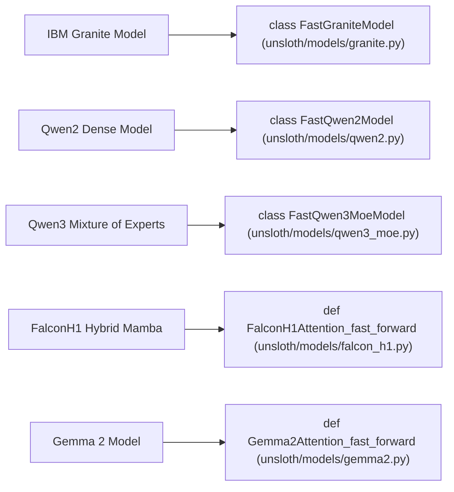
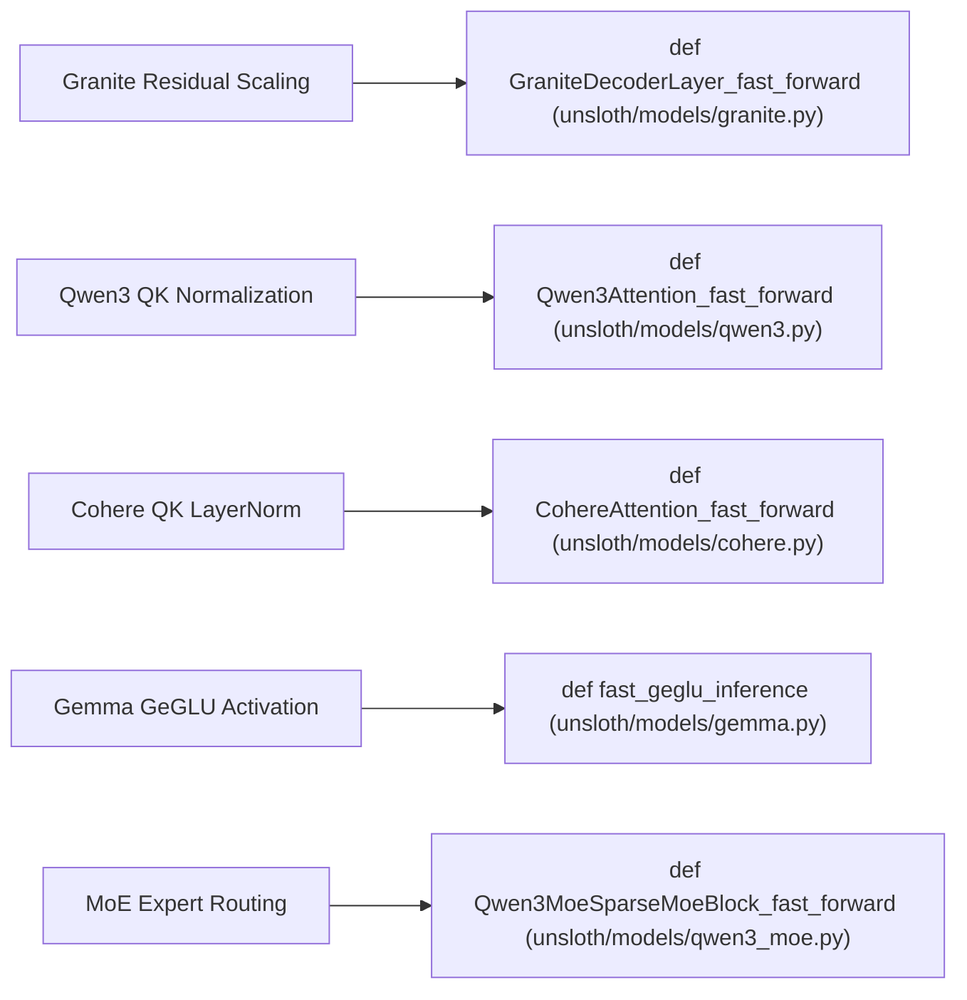

<!-- source: DeepWiki mcp.deepwiki.com · repo unslothai/unsloth · page 4.4 Specialized Architectures · fetched 2026-10-21 -->

# Specialized Architectures

Relevant source files

The following files were used as context for generating this wiki page:

- [unsloth/models/cohere.py](unsloth/models/cohere.py)
- [unsloth/models/falcon_h1.py](unsloth/models/falcon_h1.py)
- [unsloth/models/gemma.py](unsloth/models/gemma.py)
- [unsloth/models/gemma2.py](unsloth/models/gemma2.py)
- [unsloth/models/granite.py](unsloth/models/granite.py)
- [unsloth/models/qwen2.py](unsloth/models/qwen2.py)
- [unsloth/models/qwen3.py](unsloth/models/qwen3.py)
- [unsloth/models/qwen3_moe.py](unsloth/models/qwen3_moe.py)

This page documents architecture-specific optimizations and specialized implementations in the Unsloth codebase for various LLM families beyond standard Llama architectures. The specialized architectures covered include IBM Granite, Qwen2/3/MoE, Cohere, FalconH1 (hybrid Mamba), and Gemma/Gemma2. These implementations provide tailored support for distinct architectural features such as residual multipliers, QK normalization, expert routing, logit softcapping, and hybrid attention mechanisms, maximizing efficiency and correctness.

Sources: [unsloth/models/granite.py:1-60](), [unsloth/models/qwen3.py:1-47](), [unsloth/models/cohere.py:1-44](), [unsloth/models/falcon_h1.py:1-50]()

---

## IBM Granite Models

IBM Granite models introduce structural innovations including residual multipliers on residual connections and tied input/output embeddings. These features require specialized patching inside `FastGraniteModel` to maintain numerical parity and performance.

### Implementation Details

- **Residual Multipliers:** The architecture applies a configurable scalar multiplier (`residual_multiplier`) to residual connections in both attention and MLP decoder layers. During `GraniteDecoderLayer_fast_forward`, residuals are scaled using `torch.add` with an alpha coefficient [unsloth/models/granite.py:202-258]().
- **Tied Embeddings Realignment:** The `post_patch()` method verifies if input embedding data pointers match output projection weights. If a mismatch is detected due to quantization or device placement, weights are realigned to preserve parameter tying without redundant memory allocations [unsloth/models/granite.py:424-431](), [unsloth/models/granite.py:559-568]().

### Diagram: Granite Residual and Embedding Sharing

Sources: [unsloth/models/granite.py:202-258](), [unsloth/models/granite.py:424-431](), [unsloth/models/granite.py:559-568]()

---

## Qwen Architectures

Unsloth provides optimized pipelines for Qwen2, Qwen3 dense models, and Qwen3-MoE mixture-of-experts variants, incorporating custom rotary embeddings, QK normalization, and sparse expert dispatch.

### Qwen2 and Qwen3 Dense Models

- **FastQwen2Model:** Replaces custom rotary embeddings with `LlamaRotaryEmbedding` to bypass performance regressions in transformers v4.38+ [unsloth/models/qwen2.py:38-71]().
- **Qwen3 QK Normalization:** Implements QKNorm on query and key projections prior to rotary embedding application using `fast_rms_layernorm` to align with native transformer statistics [unsloth/models/qwen3.py:102-106]() [unsloth/models/qwen3.py:108-113]().

### Mixture-of-Experts (MoE) Support

The `FastQwen3MoeModel` implements specialized routing and block execution via `Qwen3MoeSparseMoeBlock_fast_forward`:
1. Gate projections are computed using `fast_linear_forward` [unsloth/models/qwen3_moe.py:52-54]().
2. Routing weights undergo softmax normalization followed by `torch.topk` selection across experts [unsloth/models/qwen3_moe.py:56-57]().
3. One-hot expert masks route token subsets to individual expert MLPs (`Qwen3MoeMLP`), accumulating results via `index_add_` [unsloth/models/qwen3_moe.py:64-79]().

### Diagram: Qwen3-MoE Routing Workflow

Sources: [unsloth/models/qwen2.py:38-71](), [unsloth/models/qwen3.py:108-113](), [unsloth/models/qwen3_moe.py:52-94]()

---

## Cohere Models

Cohere models utilize an attention mechanism paired with standard LayerNorm-based QK normalization and parallel layer execution layouts.

### Parallel Layers and QKNorm

- **Parallel Execution:** `CohereDecoderLayer_fast_forward` processes attention and MLP modules in parallel relative to the input hidden states, summing their outputs with the residual connection [unsloth/models/cohere.py:180-248]().
- **QK Normalization:** Unlike RMSNorm variants, Cohere applies classical LayerNorm to Q and K tensors via `fast_layernorm_compiled` prior to rope application [unsloth/models/cohere.py:63-75](), [unsloth/models/cohere.py:118-120]().

Sources: [unsloth/models/cohere.py:63-75](), [unsloth/models/cohere.py:118-120](), [unsloth/models/cohere.py:180-248]()

---

## FalconH1 (Hybrid Mamba Architecture)

FalconH1 combines transformer attention with Mamba state-space layers, requiring dedicated handling for attention scaling and key state adjustments.

### Key Implementation Details

- **Key Multiplier:** During `FalconH1Attention_fast_forward`, key states are multiplied by a model-defined `key_multiplier` attribute from configuration [unsloth/models/falcon_h1.py:107-111]().
- **Dynamic RoPE Extension:** Supports dynamic rope extension using `extend_rope_embedding` to fit long sequences within VRAM limits [unsloth/models/falcon_h1.py:117-124]().

Sources: [unsloth/models/falcon_h1.py:35-53](), [unsloth/models/falcon_h1.py:107-124]()

---

## Gemma and Gemma2 Architectures

Gemma models introduce architectural features such as GeGLU activations, RMSNorm weight offsets, and logit softcapping.

### Key Optimizations

- **GeGLU Activation:** `fast_geglu_inference` fuses gate and up projections with a tanh-approximate GELU activation and element-wise multiplication [unsloth/models/gemma.py:62-71]().
- **RMSNorm Offset:** Gemma RMSNorm layers apply a $+1$ weight offset during normalization computations [unsloth/models/gemma.py:120]().
- **Logit Softcapping (Gemma 2):** `Gemma2Attention_fast_forward` integrates flash attention softcapping parameters (`attn_logit_softcapping`) to stabilize extreme logit values during training and inference [unsloth/models/gemma2.py:135-165]().

Sources: [unsloth/models/gemma.py:62-120](), [unsloth/models/gemma2.py:135-165]()

---

## Architecture to Code Entity Mapping

### Diagram: Natural Language Space to Code Entity Space (Models)

Sources: [unsloth/models/granite.py:1-60](), [unsloth/models/qwen2.py:36-63](), [unsloth/models/qwen3_moe.py:155-171](), [unsloth/models/falcon_h1.py:70-175](), [unsloth/models/gemma2.py:70-170]()

### Diagram: Natural Language Space to Code Entity Space (Operations)

Sources: [unsloth/models/granite.py:202-258](), [unsloth/models/qwen3.py:63-162](), [unsloth/models/cohere.py:60-120](), [unsloth/models/gemma.py:62-71](), [unsloth/models/qwen3_moe.py:41-81]()

---

