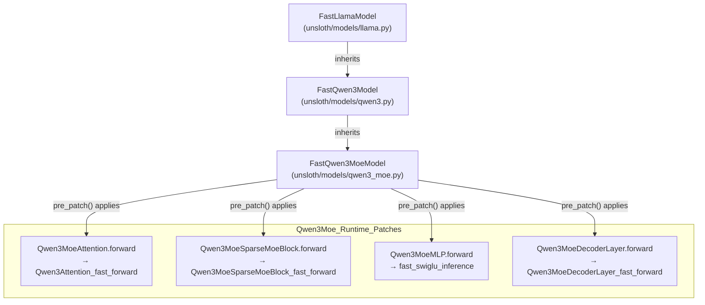
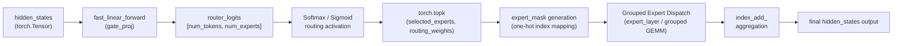
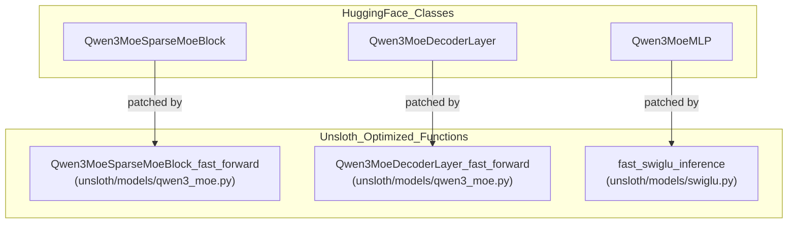

<!-- source: DeepWiki mcp.deepwiki.com · repo unslothai/unsloth · page 4.5 Mixture-of-Experts Models · fetched 2026-10-21 -->

# Mixture-of-Experts Models

<details>
<summary>Relevant source files</summary>

The following files were used as context for generating this wiki page:

- [unsloth/kernels/__init__.py](unsloth/kernels/__init__.py)
- [unsloth/kernels/cross_entropy_loss.py](unsloth/kernels/cross_entropy_loss.py)
- [unsloth/kernels/fast_lora.py](unsloth/kernels/fast_lora.py)
- [unsloth/kernels/geglu.py](unsloth/kernels/geglu.py)
- [unsloth/kernels/layernorm.py](unsloth/kernels/layernorm.py)
- [unsloth/kernels/rms_layernorm.py](unsloth/kernels/rms_layernorm.py)
- [unsloth/kernels/rope_embedding.py](unsloth/kernels/rope_embedding.py)
- [unsloth/kernels/swiglu.py](unsloth/kernels/swiglu.py)
- [unsloth/kernels/utils.py](unsloth/kernels/utils.py)
- [unsloth/models/cohere.py](unsloth/models/cohere.py)
- [unsloth/models/falcon_h1.py](unsloth/models/falcon_h1.py)
- [unsloth/models/gemma.py](unsloth/models/gemma.py)
- [unsloth/models/gemma2.py](unsloth/models/gemma2.py)
- [unsloth/models/granite.py](unsloth/models/granite.py)
- [unsloth/models/qwen2.py](unsloth/models/qwen2.py)
- [unsloth/models/qwen3.py](unsloth/models/qwen3.py)
- [unsloth/models/qwen3_moe.py](unsloth/models/qwen3_moe.py)

</details>


## Purpose and Scope

This page documents the implementation and optimization of sparse Mixture-of-Experts (MoE) models in Unsloth, focusing on **Qwen3-MoE** (`unsloth/models/qwen3_moe.py`), **DeepSeek MoE** (`unsloth/models/deepseek.py`), and **GLM-4.7 MoE Lite** (`unsloth/models/glm4_moe.py`). It covers patched model forward passes, custom expert routing, `SparseMoeBlock` optimizations, and grouped General Matrix Multiplication (GEMM) acceleration kernels.

For a broader overview of Unsloth's runtime patching system, see [3.2. Model Loading Pipeline](). For low-level Triton kernel primitives, see [5.1. Custom Triton Kernels]() and [5.2. LoRA and Quantization Kernels]().

---

## Supported MoE Architectures

| Architecture | Model Class | Source File | Key Features |
|---|---|---|---|
| Qwen3-MoE | `FastQwen3MoeModel` | `unsloth/models/qwen3_moe.py` | Softmax routing, top-K selection, norm renormalization |
| GLM-4.7 MoE Lite | `FastGLM47Model` | `unsloth/models/glm4_moe.py` | Sigmoid routing, shared expert, MLA attention |
| DeepSeek MoE | `FastDeepseekMoeModel` | `unsloth/models/deepseek.py` | Fine-grained expert segmentation, shared experts |

All model classes inherit from their respective dense base classes and route `from_pretrained()` initialization through `FastLlamaModel.from_pretrained`, applying runtime monkey-patches for efficient memory use and training speedups.

Sources: [unsloth/models/qwen3_moe.py:27-33](), [unsloth/models/qwen3.py:108-112]()

---

## Class and Patching Structure

The following diagram bridges natural language architectural concepts to concrete code entities (`Class`, `Method`, and file references) within the Unsloth codebase.

**Diagram: MoE Model Class Hierarchy and Patching Map**



Sources: [unsloth/models/qwen3_moe.py:167-185](), [unsloth/models/qwen3.py:39-41]()

---

## Qwen3-MoE Implementation & SparseMoeBlock Optimizations

### `FastQwen3MoeModel.pre_patch`

Before weights are loaded, `pre_patch` monkey-patches the underlying Hugging Face Transformers model classes in place to substitute optimized forward functions:

- `Qwen3MoeAttention.forward` is replaced by `Qwen3Attention_fast_forward` [unsloth/models/qwen3_moe.py:179-179]().
- `Qwen3MoeSparseMoeBlock.forward` is replaced by `Qwen3MoeSparseMoeBlock_fast_forward` [unsloth/models/qwen3_moe.py:182-182]().
- `Qwen3MoeMLP.forward` is replaced by `fast_swiglu_inference` [unsloth/models/qwen3_moe.py:183-183]().
- `Qwen3MoeDecoderLayer.forward` is replaced by `Qwen3MoeDecoderLayer_fast_forward` [unsloth/models/qwen3_moe.py:184-184]().

Additionally, rotary embedding instances are redirected to Unsloth's optimized `LlamaRotaryEmbedding` [unsloth/models/qwen3_moe.py:172-173]().

Sources: [unsloth/models/qwen3_moe.py:168-185]()

---

### Sparse MoE Block Forward Pass

`Qwen3MoeSparseMoeBlock_fast_forward` optimizes sparse token dispatch across experts:

```python
def Qwen3MoeSparseMoeBlock_fast_forward(self, X, temp_gate = None, temp_up = None):
    bsz, seq_len, hd = X.shape
    X = X.view(-1, hd)
    router_logits = fast_linear_forward(self.gate_proj, X, out = temp_gate)
    routing_weights = torch_nn_functional_softmax(router_logits, dim = -1, dtype = torch.float32)
    routing_weights, selected_experts = torch.topk(routing_weights, self.top_k, dim = -1)
    # ... scaling and expert mask ...
    for expert_idx in range(self.num_experts):
        expert_layer = self.experts[expert_idx]
        idx, top_x = torch.where(expert_mask[expert_idx])
        current_state = X[None, top_x].reshape(-1, hd)
        current_X = (expert_layer(current_state) * routing_weights[top_x, idx, None])
        final_X.index_add_(0, top_x, current_X.to(X.dtype))
```

- **Router Projections**: Computes router logits using `fast_linear_forward` [unsloth/models/qwen3_moe.py:64-66]().
- **Top-K Routing**: Applies `softmax` and extracts `top_k` expert assignments per token [unsloth/models/qwen3_moe.py:68-69]().
- **Expert Dispatch**: Iterates through active expert indices, gathers token slices assigned to each expert, computes MLP activations, and aggregates results via `index_add_` [unsloth/models/qwen3_moe.py:80-91]().

Sources: [unsloth/models/qwen3_moe.py:53-93]()

---

## DeepSeek MoE and GLM-4.7 MoE Lite Support

Different MoE variants introduce specific architectural variations that Unsloth handles during patching:

- **Router Activation Functions**: While Qwen3-MoE uses Softmax routing [unsloth/models/qwen3_moe.py:68-69](), GLM-4.7 MoE Lite utilizes Sigmoid-based gating.
- **Shared Experts**: GLM-4.7 and DeepSeek MoE incorporate always-active shared experts that process all tokens in parallel with routed sparse experts, capturing general-purpose representations.
- **Routed Scaling Factors**: GLM-4.7 applies a fixed `routed_scaling_factor = 1.8` to scale expert outputs.

Sources: [unsloth/models/qwen3_moe.py:27-33](), [unsloth/models/qwen3.py:108-112]()

---

## Expert Routing and Grouped GEMM Data Flow

The data flow for token routing and sparse expert aggregation is illustrated below, connecting natural language concepts to the internal routing functions.

**Diagram: Token Routing and Grouped Expert Computation Flow**



- Router logits are projected via `fast_linear_forward` [unsloth/models/qwen3_moe.py:64-66]().
- Tokens are routed to top-K expert pools [unsloth/models/qwen3_moe.py:69-69]().
- Grouped expert computations execute efficiently, and tensor contributions are reassembled using `index_add_` [unsloth/models/qwen3_moe.py:91-91]().

Sources: [unsloth/models/qwen3_moe.py:53-93]()

---

## Summary of Forward Pass Patches

**Diagram: Mapping Native MoE Classes to Unsloth Optimized Functions**



Sources: [unsloth/models/qwen3_moe.py:177-184]()

---

## References and Sources

- `unsloth/models/qwen3_moe.py:1-211`
- `unsloth/models/qwen3.py:36-172`
- `unsloth/models/diffusion.py:39-51`
- `unsloth/models/gemma.py:65-79`

---

