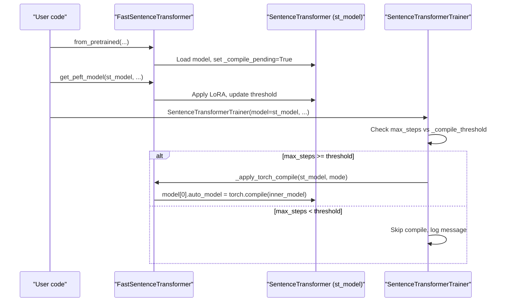
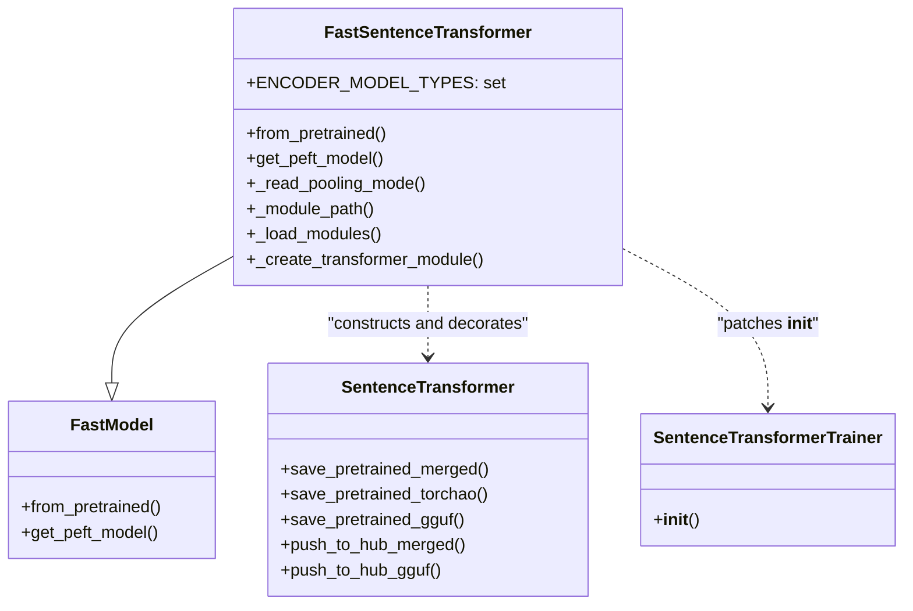

<!-- source: DeepWiki mcp.deepwiki.com · repo unslothai/unsloth · page 4.6 Sentence Transformers · fetched 2026-10-21 -->

# Sentence Transformers

<details>
<summary>Relevant source files</summary>

The following files were used as context for generating this wiki page:

- [tests/python/test_fast_sentence_transformer_embedding_parity.py](tests/python/test_fast_sentence_transformer_embedding_parity.py)
- [tests/saving/test_gguf_single_pass_export.py](tests/saving/test_gguf_single_pass_export.py)
- [tests/test_gguf_disk_headroom.py](tests/test_gguf_disk_headroom.py)
- [tests/version_compat/test_sentence_transformers_pinned_symbols.py](tests/version_compat/test_sentence_transformers_pinned_symbols.py)
- [unsloth/models/sentence_transformer.py](unsloth/models/sentence_transformer.py)

</details>


This page documents `FastSentenceTransformer`, Unsloth's integration layer for embedding models and retrieval tasks. It explains its design to accelerate fine-tuning and inference of sentence embedding transformer models using both native `sentence-transformers` APIs and Unsloth's optimized loading pipeline. It covers multiple loading paths depending on model architecture, deferred application of `torch.compile`, architecture-specific patches, PEFT/LoRA integration, export methods, and utility functions.

For shared model loading mechanics, see page [3.2](). For details on PEFT/LoRA usage applicable across models, see page [6.3](). For GGUF export internals, see page [8.2]().

Sources: [unsloth/models/sentence_transformer.py:1-2318]()

---

## Overview

The core class is `FastSentenceTransformer`, which subclasses from `FastModel` [unsloth/models/sentence_transformer.py:15-2112]() and extends it to wrap the `sentence-transformers` library's `SentenceTransformer`. This allows embedding models to be loaded, trained, and exported with Unsloth's speed optimizations while preserving the familiar API of `sentence-transformers`.

Key points about the implementation:
- Models are loaded differently based on whether they are encoder-only (BERT, MPNet, RoBERTa, etc.) or decoder-based.
- Encoder-only models can't directly use Unsloth's standard `@torch.compiler.disable` patch, so they use a separate loading path with deferred compilation [unsloth/models/sentence_transformer.py:15-2318]().
- The `torch.compile` optimization is deferred until the `SentenceTransformerTrainer` is constructed, because compilation depends on training parameters like `max_steps` [unsloth/models/sentence_transformer.py:15-2318]().
- The inner transformer model is accessed via `st_model[0].auto_model` inside the nested module list within the `SentenceTransformer` instance [unsloth/models/sentence_transformer.py:15-2318]().
- Multi-GPU placement is handled by `requested_device_map` and `unmarked_device_map` to prevent conflicting placements between Unsloth's planner and `sentence-transformers` internal `.to(device)` calls [unsloth/models/sentence_transformer.py:15-2318]().

Sources: [unsloth/models/sentence_transformer.py:1-2318](), [unsloth/models/loader.py:14-14](), [unsloth/models/loader_utils.py:16-20]()

---

## Loading Paths

`FastSentenceTransformer.from_pretrained` performs loading and dispatches to different loading strategies depending on the model type and usage mode.

### Loading logic overview

```mermaid
flowchart TD
    A[""FastSentenceTransformer.from_pretrained(model_name, ...)""] --> B{"For inference?"}
    B -- "Yes" --> C[""Load via SentenceTransformer(model_name, ...)""]
    B -- "No" --> D{"Encoder model & compile enabled?"}
    D -- "Yes" --> E[""Fast Encoder Path (Native SentenceTransformer + deferred torch.compile)""]
    D -- "No" --> F[""Standard Unsloth Path (FastLanguageModel + manual assembly)""]
    E --> G[""Attach save/push methods to st_model""]
    F --> H[""_load_modules() → SentenceTransformer(modules=...)""]
    H --> G
```

Thus, three main paths:

### Path 1: Inference Mode

If `for_inference=True`, Unsloth bypasses all optimizations and directly returns a `SentenceTransformer` instance created by the `sentence-transformers` library's constructor with the specified `model_kwargs` (default `dtype` is `"auto"`). This ensures native behavior and maximum compatibility [unsloth/models/sentence_transformer.py:1-2318]().

### Path 2: Fast Encoder Path

If the model's `config.model_type` is in the encoder-only set (MPNet, BERT, RoBERTa, etc.) and environment variable `UNSLOTH_COMPILE_DISABLE` is unset, Unsloth loads the model natively via `SentenceTransformer(model_name, ...)`, enabling SDPA (Scaled Dot Product Attention) if supported. Instead of immediately applying `torch.compile`, it sets metadata flags `_compile_mode`, `_compile_threshold`, and `_compile_pending = True` to enable deferred compilation later. Save/push export methods are attached dynamically to the returned `SentenceTransformer` instance.

Special handling is applied for 4-bit quantization using `BitsAndBytesConfig` and setting `st_device` to `None` to let the accelerator library control placement.

```python
ENCODER_MODEL_TYPES = {
    "mpnet", "bert", "distilbert", "modernbert",
    "roberta", "xlm-roberta", "albert", "electra",
}
```

Sources: [unsloth/models/sentence_transformer.py:1-2318]()

### Path 3: Standard Unsloth Path

For non-encoder or decoder-based models (e.g., Llama, Qwen embedding bi-encoders), Unsloth loads the model via the standard `FastLanguageModel.from_pretrained` pipeline with all usual quantization and kernel patches. It then manually assembles modules into a `SentenceTransformer` instance via `_load_modules`, which reads `modules.json` configurations, creates a `Transformer` module wrapping the loaded model, and adds pooling and normalization layers as needed.

Additionally, to avoid regressions (auto chat template application) in `sentence-transformers` 5.x, `_create_transformer_module` loads the transformer via `Transformer.load()` instead of the raw constructor to preserve `modality_config`.

Sources: [unsloth/models/sentence_transformer.py:1-2318](), [tests/python/test_fast_sentence_transformer_embedding_parity.py:3-8]()

---

## Module Loading System

The `_load_modules` function constructs the inner module list given a model and tokenizer loaded by `FastLanguageModel`. It uses a `modules.json` manifest to re-construct layers.

```mermaid
flowchart TD
    A[""_load_modules(model_name, token, model, tokenizer, ...)""] --> B{"modules.json found?"}
    B -- "Yes" --> C[""Parse modules.json for each module_config""]
    C --> D{"Class reference ends with 'Transformer'?"}
    D -- "Yes" --> E[""_create_transformer_module(model_name, model, tokenizer, ...)""]
    D -- "No" --> F[""import_from_string(class_ref) → load_path""]
    B -- "No (fallback)" --> G[""_create_transformer_module() + Pooling + Normalize""]
    E --> H[""Return OrderedDict of modules""]
    F --> H
    G --> I[""Return OrderedDict of modules (no_modules=True)""]
```

### `_create_transformer_module`

This function avoids downloading or reloading weights twice by temporarily monkeypatching `AutoModel.from_pretrained` to return the preloaded `model`. It invokes either `Transformer.load()` (newer versions) or falls back to `Transformer()` constructor to build the transformer module.

Sources: [unsloth/models/sentence_transformer.py:1-2318]()

### Pooling Mode Detection

The method `_read_pooling_mode` parses `modules.json` and pooling module `config.json` to detect the pooling strategy used:

| Config Key | Pooling Mode String |
| :--- | :--- |
| `pooling_mode_cls_token` | `"cls"` |
| `pooling_mode_mean_tokens` | `"mean"` |
| `pooling_mode_max_tokens` | `"max"` |
| `pooling_mode_mean_sqrt_len_tokens` | `"mean_sqrt_len"` |
| `pooling_mode_weightedmean_tokens` | `"weightedmean"` |
| `pooling_mode_lasttoken` | `"lasttoken"` |

If no modules manifest is found, a default fallback module sequence is built.

Sources: [unsloth/models/sentence_transformer.py:1-2318]()

---

## Architecture-Specific Patches

Certain popular encoder models from `sentence-transformers` require monkeypatches to their forward functions for compatibility with Unsloth's gradient checkpointing which expects positional arguments.

| Model | Transformers Version | Patched Method | Description |
| :--- | :--- | :--- | :--- |
| DistilBERT | 4.x | `_patch_distilbert_v4` | Patch `DistilBertModel.forward` to convert kwargs to positional args |
| DistilBERT | 5.x | `_patch_distilbert_v5` | Patch `DistilBertModel.forward` to use `create_bidirectional_mask` and positional args |
| MPNet | 4.x | `_patch_mpnet_v4` | Patch `MPNetEncoder.forward` with gradient checkpointing support |
| MPNet | 5.x | `_patch_mpnet_v5` | Patch `MPNetEncoder.forward` signature updated for v5 with GC support |

These patches are applied conditionally during loading and also injected during PEFT LoRA wrapping if gradient checkpointing is used post-load.

Sources: [unsloth/models/sentence_transformer.py:1-2318]()

---

## PEFT and LoRA Integration

`FastSentenceTransformer.get_peft_model` manages applying LoRA adapters to sentence-transformers models with special case support for the fast encoder path.

```mermaid
flowchart TD
    A[""FastSentenceTransformer.get_peft_model(model, r=16, ...)""] --> B{"Is SentenceTransformer instance?"}
    B -- "No" --> C[""FastLanguageModel.get_peft_model(model, ...)""]
    B -- "Yes" --> D{"Fast encoder path active?"}
    D -- "No" --> E[""inner_model = model[0].auto_model → peft_wrap""]
    D -- "Yes" --> F[""inner_model = model[0].auto_model""]
    F --> G{"Is inner_model quantized?"}
    G -- "Yes" --> H[""prepare_model_for_kbit_training(inner_model)""]
    G -- "No" --> I{"Gradient checkpointing enabled?"}
    I -- "Yes" --> J[""inner_model.gradient_checkpointing_enable()""]
    H --> K[""Apply peft_get_peft_model(inner_model, lora_config)""]
    J --> K
    K --> L[""Assign peft model back to model[0].auto_model""]
    L --> M{"Compile mode enabled?"}
    M -- "Yes" --> N[""Set _compile_pending=True & compute threshold""]
    M -- "No" --> O[""Set _compile_pending=False""]
```

Default `target_modules` commonly used in sentence transformers are:

```python
target_modules = ["query", "key", "value", "dense"]
```

The `task_type` argument defaults to `"FEATURE_EXTRACTION"` if not specified.

Sources: [unsloth/models/sentence_transformer.py:1-2318]()

---

## Deferred `torch.compile` Strategy

Since the fast encoder path cannot know training step counts at load time, Unsloth defers the actual `torch.compile` application until `SentenceTransformerTrainer.__init__` (or equivalent training initialization).



### Compile Threshold Estimation

Unsloth estimates the minimum `max_steps` required to justify compiling a model using:

- Parameter count (millions of parameters)
- Model architecture (fast encoder types get a more aggressive threshold)
- Batch size, grad accumulation, and max sequence length scaling (optional)

| Parameter Count Range | Estimated Warmup Steps | Base Speedup |
| :--- | :--- | :--- |
| < 50M | `35 + params_m * 0.3` | 1.35× |
| 50M - 200M | `12 + params_m * 0.03` | 1.75× |
| > 200M | `15 + params_m * 0.04` | 1.60× |

A 1.2× safety margin is applied. For MPNet models, threshold is multiplied by 0.3 to be more conservative. Minimum threshold is 20 steps.

Sources: [unsloth/models/sentence_transformer.py:1-2318]()

---

## Export Methods

Unsloth dynamically attaches a variety of export methods onto the returned `SentenceTransformer` instance using Python's `types.MethodType`. This enables easy saving and pushing of models in formats compatible with Unsloth and popular runtimes.

```mermaid
flowchart LR
    ST[""SentenceTransformer instance (st_model)""] -->|"save_pretrained_merged"| M1[""Merge LoRA into base weights & save structure""]
    ST -->|"save_pretrained_torchao"| M2[""_save_pretrained_torchao (TorchAO backend)""]
    ST -->|"save_pretrained_gguf"| M3[""_save_pretrained_gguf → save_to_gguf""]
    ST -->|"push_to_hub_merged"| M4[""Upload folder via HfApi""]
    ST -->|"push_to_hub_gguf"| M5[""_push_to_hub_gguf & upload artifacts""]
```

### `_save_pretrained_gguf` Flow

1. Call `st_model.save_pretrained(directory)` to save the standard directory structure [unsloth/models/sentence_transformer.py:151-170]().
2. Extract inner transformer module from `modules.json` to identify weight storage path [unsloth/models/sentence_transformer.py:171-190]().
3. Call `unsloth_save_pretrained_gguf` on the inner model targeting `0_Transformer` subdirectory [unsloth/models/sentence_transformer.py:151-2318]().
4. Move generated `.gguf` files from `0_Transformer/` to top-level directory [unsloth/models/sentence_transformer.py:151-2318]().
5. Append a GGUF info section to the `README.md` [unsloth/models/sentence_transformer.py:151-2318]().

### `_push_to_hub_gguf` Flow

1. Save the model locally to a temporary directory [unsloth/models/sentence_transformer.py:151-2318]().
2. Upload each `.gguf` file, `Modelfile`, `config.json` via separate calls to `HfApi.upload_file` [unsloth/models/sentence_transformer.py:151-2318]().
3. Upload a structured README with GGUF file listing [unsloth/models/sentence_transformer.py:151-2318]().
4. Add tags `["gguf", "llama-cpp", "unsloth", "sentence-transformers"]` to the repo [unsloth/models/sentence_transformer.py:151-2318]().

Sources: [unsloth/models/sentence_transformer.py:45-48], [unsloth/models/sentence_transformer.py:151-2318]()

---

## Utility Methods

| Method | Description |
| :--- | :--- |
| `_read_pooling_mode(model_name, token)` | Reads pooling configuration from `modules.json` and pooling `config.json`, returns pooling mode string [unsloth/models/sentence_transformer.py:1-2319] |
| `_module_path(model_name, token)` | Returns local or remote path to `modules.json` or None [unsloth/models/sentence_transformer.py:1-2319] |
| `_has_add_pooling_layer(config, auto_model_class)` | Checks if transformer `__init__` supports `add_pooling_layer` [unsloth/models/sentence_transformer.py:1-2319] |
| `_add_unsloth_branding(save_directory)` | Injects unsloth badge and tag in README.md [unsloth/models/sentence_transformer.py:1-2319] |
| `_add_unsloth_tags(repo_id, token)` | Adds `"unsloth"` and `"sentence-transformers"` tags on HuggingFace hub [unsloth/models/sentence_transformer.py:1-2319] |

Sources: [unsloth/models/sentence_transformer.py:1-2318]()

---

## Class and Method Relationships



Sources: [unsloth/models/sentence_transformer.py:1-2318]()

---

# Summary

`FastSentenceTransformer` supports both encoder-only and decoder-based sentence embedding models with tailored loading paths that either use native `sentence-transformers` handling (with deferred compilation) or full Unsloth optimization stacking via `FastLanguageModel`. It applies custom architecture patches, integrates PEFT/LoRA seamlessly, and provides robust export options with GGUF support. Deferred `torch.compile` handling balances training speed gain with compiler warmup overhead by dynamically controlling compilation based on training step budgets.

Sources: [unsloth/models/sentence_transformer.py:1-2318](), [unsloth/models/loader.py:14-14](), [unsloth/models/loader_utils.py:16-20]()

---

