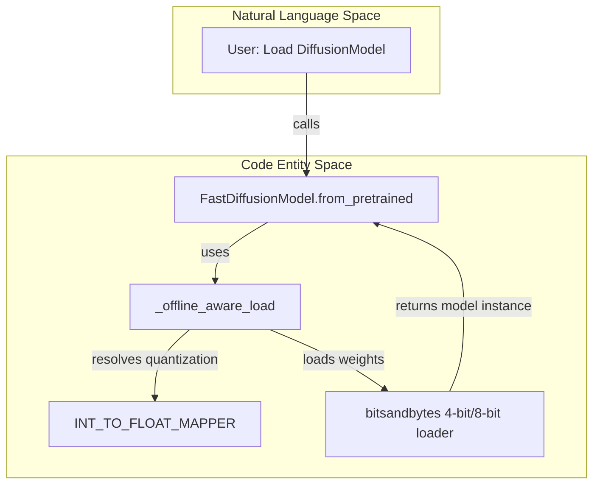
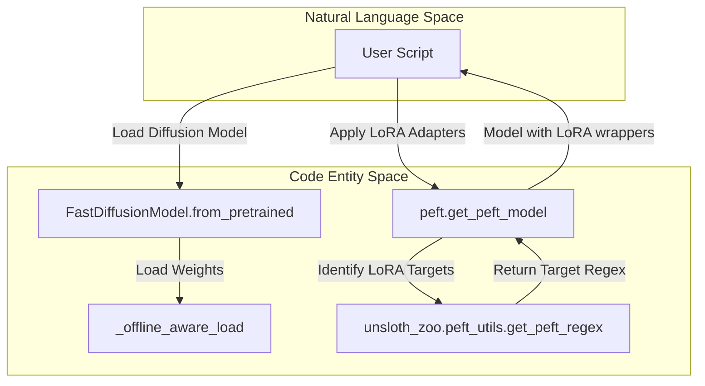
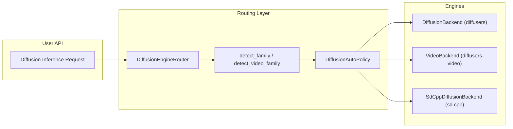

<!-- source: DeepWiki mcp.deepwiki.com · repo unslothai/unsloth · page 4.7 Diffusion and Text-Diffusion Models · fetched 2026-10-21 -->

# Diffusion and Text-Diffusion Models

Relevant source files

The following files were used as context for generating this wiki page:

- [README.md](README.md)
- [pyproject.toml](pyproject.toml)
- [studio/backend/core/inference/diffusion_cuda_graph.py](studio/backend/core/inference/diffusion_cuda_graph.py)
- [studio/backend/core/inference/diffusion_precision.py](studio/backend/core/inference/diffusion_precision.py)
- [studio/backend/core/inference/diffusion_speed.py](studio/backend/core/inference/diffusion_speed.py)
- [studio/backend/core/inference/diffusion_torchao_patches.py](studio/backend/core/inference/diffusion_torchao_patches.py)
- [studio/backend/core/inference/diffusion_transformer_quant.py](studio/backend/core/inference/diffusion_transformer_quant.py)
- [studio/backend/core/training/diffusion_dit_trainer.py](studio/backend/core/training/diffusion_dit_trainer.py)
- [studio/backend/core/training/diffusion_train_common.py](studio/backend/core/training/diffusion_train_common.py)
- [studio/backend/tests/test_diffusion_cuda_graph.py](studio/backend/tests/test_diffusion_cuda_graph.py)
- [studio/backend/tests/test_diffusion_precision.py](studio/backend/tests/test_diffusion_precision.py)
- [studio/backend/tests/test_diffusion_speed.py](studio/backend/tests/test_diffusion_speed.py)
- [studio/backend/tests/test_diffusion_transformer_quant.py](studio/backend/tests/test_diffusion_transformer_quant.py)
- [tests/python/test_construct_chat_template_validation.py](tests/python/test_construct_chat_template_validation.py)
- [tests/test_fp8_pre_sm89_dequant_fallback.py](tests/test_fp8_pre_sm89_dequant_fallback.py)
- [tests/test_import_fixes_drift.py](tests/test_import_fixes_drift.py)
- [unsloth/__init__.py](unsloth/__init__.py)
- [unsloth/_gpu_init.py](unsloth/_gpu_init.py)
- [unsloth/chat_templates.py](unsloth/chat_templates.py)
- [unsloth/import_fixes.py](unsloth/import_fixes.py)
- [unsloth/kernels/fp8.py](unsloth/kernels/fp8.py)
- [unsloth/models/_utils.py](unsloth/models/_utils.py)
- [unsloth/models/llama.py](unsloth/models/llama.py)
- [unsloth/models/loader.py](unsloth/models/loader.py)
- [unsloth/models/loader_utils.py](unsloth/models/loader_utils.py)
- [unsloth/models/mapper.py](unsloth/models/mapper.py)
- [unsloth/models/mistral.py](unsloth/models/mistral.py)
- [unsloth/models/rl.py](unsloth/models/rl.py)
- [unsloth/models/rl_replacements.py](unsloth/models/rl_replacements.py)
- [unsloth/models/vision.py](unsloth/models/vision.py)
- [unsloth/save.py](unsloth/save.py)
- [unsloth/tokenizer_utils.py](unsloth/tokenizer_utils.py)

The Unsloth library provides advanced support for diffusion and text-diffusion architectures, enabling efficient loading, fine-tuning, and inference of generative media models. This includes specialized handling of text-to-image/video models using LLM backbones, such as the **DiffusionGemma** and **Gemma 4** families, block-diffusion sampling strategies, and seamless integration with 4-bit/8-bit model loading and PEFT (Parameter-Efficient Fine-Tuning) adapters.

---

## FastDiffusionModel

The `FastDiffusionModel` class is the core entrypoint within Unsloth for diffusion architectures. It follows a similar API design philosophy as `FastLanguageModel` to offer consistent model loading, quantization, and LoRA adapter application.

- **Model Types Supported**:
  - **DiffusionGemma**: Gemma-based text encoder backbones powering diffusion models.
  - **DiffusionGemma4**: Latest Gemma 4 variants optimized for diffusion, often requiring `float32` precision during training due to gradient stability needs.

- **Loading Pipeline**:
  1. Uses Unsloth's efficient 4-bit and 8-bit loading mechanisms (via `bitsandbytes`) to minimize GPU memory footprint [unsloth/models/loader.py:17-115]().
  2. Maps pre-quantized model names (via `INT_TO_FLOAT_MAPPER`) to their original precisions for compatibility and consistent inference [unsloth/models/mapper.py:23-52]().
  3. Supports automatic device placement and distribution for CUDA/ROCm-enabled GPUs [unsloth/models/loader_utils.py:18-23]().

- **Key Loading Functions**:
  - `FastDiffusionModel.from_pretrained` handles model instantiation, optionally redirecting to specialized loaders like `_offline_aware_load` for offline scenarios [unsloth/models/loader.py:25-115]().
  - Naming and quantization routes ensure correct loading whether from GGUF, Safetensors, or Diffusers pipelines [studio/backend/core/inference/diffusion.py:6-12]().

Diagram: Diffusion Model Loading Pipeline

Sources: [unsloth/models/loader.py:25-115](), [unsloth/models/mapper.py:23-52]()  

---

## Text-Diffusion Architectures: DiffusionGemma and DiffusionGemma4

- Unsloth specializes in diffusion models that utilize Gemma-based LLM backbones for text encoding within the diffusion generation process.
- Particularly, `DiffusionGemma4` supports Float32 precision during backward passes for gradient stability, even if forward pass may use lower precision.
- These models leverage Unsloth’s optimizations for transformer backbones, combined with custom diffusion pipeline management [studio/backend/core/inference/diffusion.py:79-81]().

Sources: [studio/backend/core/inference/diffusion.py:79-81]()

---

## Block-Diffusion Sampling

Unsloth supports block-diffusion sampling strategies to optimize inference efficiency and VRAM use by splitting the sampling process into more manageable discrete blocks, reducing peak memory usage.

- This is integrated within the diffusion pipeline interface and controlled by scheduling and caching mechanisms [studio/backend/core/inference/diffusion_cache.py:130-139]().
- Block-sampling coordinates with low-level attention and step caches for performance [studio/backend/core/inference/diffusion.py:130-139]().

Sources: [studio/backend/core/inference/diffusion_cache.py:130-139](), [studio/backend/core/inference/diffusion.py:130-139]()

---

## LoRA Targeting for Diffusion Backbones

When fine-tuning diffusion models with LoRA adapters, Unsloth uses a targeted approach to select modules within the diffusion backbone that are most effective to adapt:

| Component         | Example Target Modules                    | Source Lines                |
|-------------------|------------------------------------------|-----------------------------|
| Attention Layers  | `q_proj`, `k_proj`, `v_proj`, `o_proj`   | [unsloth/save.py:113-117]() |
| MLP Layers        | `gate_proj`, `up_proj`, `down_proj`      | [unsloth/save.py:118-121]() |
| Normalization     | `input_layernorm`, `post_attention_layernorm` | [unsloth/save.py:122-126]() |

This selection ensures adapters are placed on critical transformer submodules responsible for attention and feed-forward computations, maximizing fine-tuning efficiency.

Diagram: LoRA Integration Flow for Diffusion Models

Sources: [unsloth/models/loader.py:45-55](), [unsloth/save.py:113-126]()

---

## Integration with Core Library Quantization and PEFT Interfaces

- The diffusion backbones benefit from the same core quantized loading stack as language and vision models:
  - Automatic 4-bit and 8-bit loading through `bitsandbytes` integration.
  - LoRA application through HuggingFace PEFT interfaces enhanced with Unsloth's regex targeting.
- Gradient checkpointing, FP8 support, and fused custom kernels optimized for diffusion transformer layers are supported similarly to other Unsloth model types [studio/backend/core/inference/diffusion_precision.py:140-147]().
- The design enables consistent loading, training, and inference code paths across diverse model architectures.

Sources: [studio/backend/core/inference/diffusion_precision.py:140-147]()

---

## Studio Diffusion Backend Architecture

The Studio backend includes specialized classes for diffusion inference, supporting both image and video generation:

- **`DiffusionBackend`**: Manages Hugging Face `diffusers` pipelines with Unsloth's optimizations (memory offloading, attention backends, and step caching) [studio/backend/core/inference/diffusion.py:23-33]().
- **`VideoBackend`**: A sibling to the image backend tailored for frame stacks, temporal lattices, and MP4 encoding [studio/backend/core/inference/video.py:4-29]().
- **`SdCppDiffusionBackend`**: Uses the native `sd.cpp` C++ inference engine for CPU or no-GPU fallback, providing significantly lighter RAM usage [studio/backend/core/inference/sd_cpp_backend.py:4-23]().

Diagram: Studio Diffusion Inference Routing Architecture

Sources: [studio/backend/core/inference/diffusion.py:23-33](), [studio/backend/core/inference/video.py:4-29](), [studio/backend/core/inference/sd_cpp_backend.py:4-23]()

---

## Training and Fine-Tuning Support for Diffusion Models

- Unsloth Studio backend exposes training services designed for diffusion:
  - `DiffusionTrainingService`: Orchestrates dataset pipelining, training loops, and checkpoint saving [studio/backend/core/training/diffusion_training_service.py]() (implied by service structure).
  - Specialized trainers like `diffusion_lora_trainer` and `diffusion_dit_trainer` focus on LoRA fine-tuning and DiT (Diffusion Transformer) architecture training respectively.

- Core system optimizations include:
  - **Pre-quantized Transformers**: Loading a pre-quantized transformer directly via `load_prequantized_transformer` to avoid the memory spike of in-place quantization [studio/backend/core/inference/diffusion_prequant.py:4-25]().
  - **Activation Rotation (ConvRot)**: Support for `PREQUANT_FORMAT_ROTATED` which uses activation rotation to maintain precision in 8-bit/4-bit weights [studio/backend/core/inference/diffusion_prequant.py:36-43]().
  - **FP8 Support**: Quantization support through `torchao` integration [studio/backend/core/inference/diffusion_precision.py:140-147]().

Sources: [studio/backend/core/inference/diffusion_prequant.py:4-43](), [studio/backend/core/inference/diffusion_precision.py:140-147](), [studio/backend/core/inference/video.py:111-118]()

---

## Summary

Unsloth's diffusion and text-diffusion model support is comprehensive, spanning from model loading and quantization through LoRA fine-tuning to multi-backend inference routing. By combining modern techniques like block-diffusion sampling, prequantized components, and deep integration with PEFT and bitsandbytes, Unsloth enables memory- and compute-efficient workflows for the latest diffusion architectures including DiffusionGemma and Gemma 4.

Sources: [unsloth/models/loader.py:25-115](), [studio/backend/core/inference/diffusion.py:23-33]()

---

