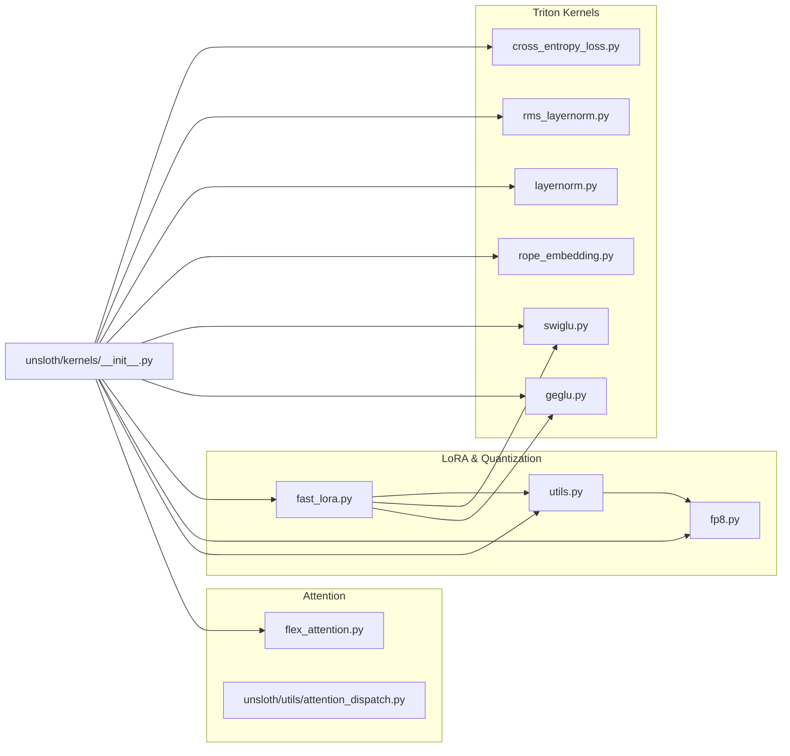
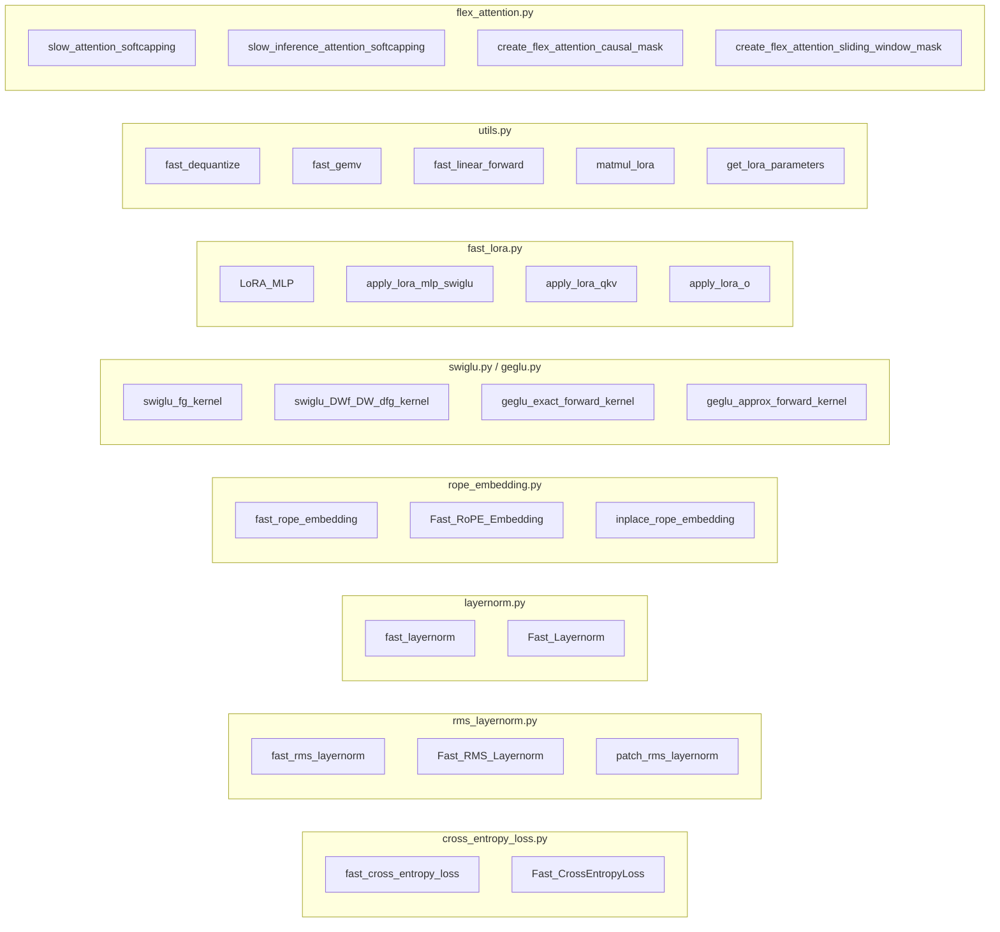
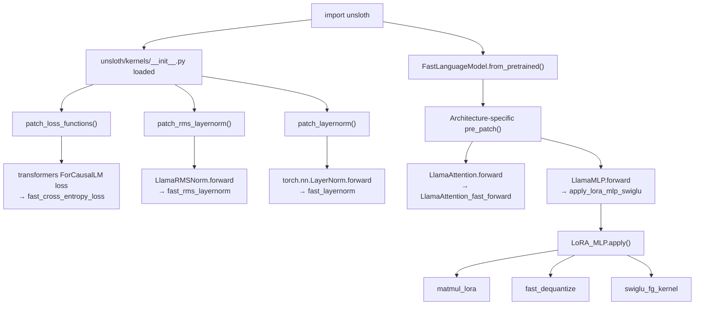

<!-- source: DeepWiki mcp.deepwiki.com · repo unslothai/unsloth · page 5 Performance Optimizations · fetched 2026-10-21 -->

# Performance Optimizations

Relevant source files

The following files were used as context for generating this wiki page:

- [unsloth/kernels/__init__.py](unsloth/kernels/__init__.py)
- [unsloth/kernels/cross_entropy_loss.py](unsloth/kernels/cross_entropy_loss.py)
- [unsloth/kernels/fast_lora.py](unsloth/kernels/fast_lora.py)
- [unsloth/kernels/geglu.py](unsloth/kernels/geglu.py)
- [unsloth/kernels/layernorm.py](unsloth/kernels/layernorm.py)
- [unsloth/kernels/rms_layernorm.py](unsloth/kernels/rms_layernorm.py)
- [unsloth/kernels/rope_embedding.py](unsloth/kernels/rope_embedding.py)
- [unsloth/kernels/swiglu.py](unsloth/kernels/swiglu.py)
- [unsloth/kernels/utils.py](unsloth/kernels/utils.py)

This page provides a high-level overview of the core performance optimizations implemented in Unsloth that enable its significant speed gains in training and inference. These optimizations span from low-level custom CUDA/HIP/XPU kernels to runtime attention dispatch and hardware abstraction, all integrated via seamless patching of HuggingFace Transformers and PEFT modules.

For in-depth technical details, please refer to the linked child pages:
- [Custom Triton Kernels](#5.1) — Triton-based GPU kernels for cross-entropy loss, RMS/LayerNorm, RoPE embedding, and SwiGLU/GeGLU activations.
- [LoRA and Quantization Kernels](#5.2) — Fused LoRA operations on quantized weights, fast dequantization, and support for NF4/FP8 formats.
- [Attention Dispatch System](#5.3) — Multi-backend attention with runtime selection among FlashAttention, SDPA, xFormers, and Flex Attention.
- [FP8 Quantization](#5.4) — FP8 quantization workflows, TorchAO integration, and FBGEMM backend usage.
- [Device Abstraction Layer](#5.5) — Cross-GPU/accelerator device support with device-specific stream management and memory utilities.

---

## Design Principles

Unsloth's optimizations operate across three computational abstraction layers:

| Level           | Scope                        | Implementation Mechanism                                   |
|-----------------|------------------------------|------------------------------------------------------------|
| Kernel-Level    | Single elementwise/reduction | Triton `@triton.jit` GPU kernels wrapped in `torch.autograd.Function` subclasses |
| Layer-Level     | Multi-step fused projections | Custom autograd functions that fuse quantized base weights with LoRA deltas in combined forward/backward passes |
| Model-Level     | Full Transformer layers      | Runtime monkey-patching of HuggingFace Transformer classes to inject optimized attention, MLP, and loss methods |

All patches are applied transparently without requiring users to change their code. The system dynamically detects supported hardware and software versions to activate the optimal code paths.

---

## Kernel Package Layout

All kernel implementations reside under the `unsloth/kernels/` directory. The `__init__.py` exports a unified API and manages inter-module dependencies.

Model-specific activations like SwiGLU and GeGLU are implemented as standalone Triton kernels to be fused into larger operations.

This modular design allows each kernel type to be developed, optimized, and maintained independently while sharing base utilities such as device abstraction and tensor helpers.

Sources: [unsloth/kernels/__init__.py:12-62]()

---

## Function Index

The key kernel functions and classes are organized by source module and functional role:

Sources: [unsloth/kernels/__init__.py:12-62]()

---

## 1. Custom Triton Kernels

Unsloth's Triton kernels replace core low-level operations with highly optimized GPU implementations wrapped as autograd-compatible PyTorch functions.

| Kernel            | Autograd Class / Helper | File                         | Replaces                                    |
|-------------------|-------------------------|------------------------------|---------------------------------------------|
| Cross-Entropy Loss | `_cross_entropy_forward` / `_chunked_cross_entropy_forward` | `cross_entropy_loss.py` | `torch.nn.CrossEntropyLoss` in causal LM |
| RMS LayerNorm      | `Fast_RMS_Layernorm`    | `rms_layernorm.py`            | `LlamaRMSNorm.forward` and similar          |
| Standard LayerNorm | `Fast_Layernorm`        | `layernorm.py`                | `torch.nn.LayerNorm.forward`                 |
| RoPE Embedding     | `Fast_RoPE_Embedding`   | `rope_embedding.py`           | HuggingFace rotary embeddings                |
| SwiGLU Activation  | `swiglu_fg_kernel`      | `swiglu.py`                   | SwiGLU computations within LoRA MLPs         |
| GeGLU Activation   | `geglu_exact_forward_kernel` | `geglu.py`              | GeGLU GELU activations in Mistral/GPT-style MLPs |

Noteworthy details:
- The cross-entropy kernel partitions large vocabularies into chunks computing logsumexp iteratively to handle out-of-memory issues efficiently [unsloth/kernels/cross_entropy_loss.py:114-151](). It supports optional softcapping for Gemma 2 and logit scaling for Cohere [unsloth/kernels/cross_entropy_loss.py:78-85]().
- RMS LayerNorm stores the inverse variance term `r` during the forward pass for reuse in backward, avoiding recomputation and accelerating gradients [unsloth/kernels/rms_layernorm.py:52-202]().
- RoPE kernel processes multiple heads simultaneously by grouping heads (default `ROPE_GROUP_SIZE = 4`), providing significant speedup in rotary embedding computations [unsloth/kernels/rope_embedding.py:98-156]().

For comprehensive details and kernel code, see [Custom Triton Kernels](#5.1).

Sources: [unsloth/kernels/cross_entropy_loss.py:32-151](), [unsloth/kernels/rms_layernorm.py:52-205](), [unsloth/kernels/rope_embedding.py:114-166](), [unsloth/kernels/swiglu.py:46-60]()

---

## 2. LoRA and Quantization Kernels

To accelerate training with LoRA adapters on quantized base weights, Unsloth fuses the matrix multiplications and decompressions into single autograd functions. This reduces overhead and memory bandwidth.

### Core fused autograd classes in `fast_lora.py`:

| Class       | Scope                       | Activation Type(s)              | Entry Points                          |
|-------------|-----------------------------|--------------------------------|-------------------------------------|
| `LoRA_MLP`  | Gate + Up + Down projections | SwiGLU, GeGLU (exact and approx) | `apply_lora_mlp_swiglu`, `apply_lora_mlp_geglu_exact`, `apply_lora_mlp_geglu_approx` |

### Quantization utilities in `utils.py`:

| Function          | Purpose                                                                          |
|-------------------|----------------------------------------------------------------------------------|
| `fast_dequantize` | Efficient in-place dequantization of NF4 or FP8 weights. Leveraged in both training and inference to avoid repeated allocations [unsloth/kernels/utils.py:30](). |
| `fast_gemv`       | Optimized GEMV for batch size 1, critical during incremental token generation [unsloth/kernels/__init__.py:47-53](). |
| `matmul_lora`     | Fused computation of `X @ W + (X @ A) @ B * scale` where `W` is quantized, avoiding separate dequantizations [unsloth/kernels/fast_lora.py:90-93](). |
| `get_lora_parameters` | Extracts essential LoRA components like quantized weight, matrices A and B, and scale factors from PEFT layers [unsloth/kernels/fast_lora.py:17-19](). |

The kernel system adapts to hardware, using `is_cdna()` or `is_rdna()` checks to tune parameters like `num_warps` and `BLOCK_SIZE` [unsloth/kernels/utils.py:77-111]().

For a full exploration of Unsloth's LoRA and quantization kernel strategies, see [LoRA and Quantization Kernels](#5.2).

Sources: [unsloth/kernels/fast_lora.py:25-110](), [unsloth/kernels/utils.py:114-133](), [unsloth/kernels/utils.py:77-111]()

---

## 3. Attention Dispatch System

Unsloth dynamically selects the most performant attention backend at each forward pass based on input and hardware conditions.

Priority order of attention backends:
1. **FlashAttention2** (`FLASH_VARLEN` for packed sequences, `FLASH_DENSE` otherwise) — Best performance on supported GPUs.
2. **xFormers memory-efficient attention** — Utilized when FlashAttention isn't suitable, with hardware compatibility checks.
3. **Scaled Dot-Product Attention (SDPA)** — Fallback to PyTorch native `scaled_dot_product_attention`.

Additional features:
- **Int32 Overflow Guard**: Specifically for FlashAttention 2 varlen backward passes, Unsloth monitors element counts to prevent illegal memory access errors when sequences are extremely long or numerous.
- **Flex Attention**: Support for specialized attention patterns and softcapping via helper functions like `slow_attention_softcapping`, `slow_inference_attention_softcapping`, `create_flex_attention_causal_mask`, and `create_flex_attention_sliding_window_mask` [unsloth/kernels/flex_attention.py:55-61]().

See [Attention Dispatch System](#5.3) for comprehensive implementation details and backend APIs.

Sources: [unsloth/kernels/__init__.py:55-61]()

---

## 4. FP8 Quantization

Unsloth provides support for FP8 quantization, enabling faster mixed-precision training and inference on modern hardware (e.g., NVIDIA H100).

- Supports FP8 quantization modes via TorchAO integration and FBGEMM backend.
- FP8 dequantization and linear kernels (`weight_dequant`, `fp8_linear`) are patched globally during model initialization to optimize non-fast inference models [unsloth/kernels/__init__.py:44]().

See [FP8 Quantization](#5.4) for kernel specifics and usage scenarios.

Sources: [unsloth/kernels/utils.py:30](), [unsloth/kernels/__init__.py:44-46]()

---

## 5. Device Abstraction Layer

All kernel modules utilize a unified hardware abstraction to support CUDA, ROCm (AMD), and XPU (Intel) platforms.

Key abstractions and utilities in `unsloth/kernels/utils.py` and `unsloth/device_type.py`:

| Name            | Purpose                                                      | Ref                          |
|-----------------|--------------------------------------------------------------|------------------------------|
| `DEVICE_TYPE`   | String identifier like `"cuda"`, `"hip"`, `"xpu"`, or `"mlx"` | [unsloth/kernels/utils.py:21-28]() |
| `is_cdna()`     | Detect AMD CDNA (MI300 series) hardware for architectural tuning | [unsloth/kernels/utils.py:77-84]() |
| `is_rdna()`     | Detect AMD RDNA (consumer GPU) hardware                       | [unsloth/kernels/utils.py:87-111]() |
| `torch_gpu_device` | Context manager for multi-GPU device selection            | [unsloth/kernels/utils.py:169-178]() |
| `_get_tensor_stream` | Retrieves the raw CUDA/XPU stream for a given tensor     | [unsloth/kernels/utils.py:198-200]() |

This abstraction layer ensures that Unsloth kernels are portable and performant, automatically leveraging platform-specific stream concurrency and device features.

See [Device Abstraction Layer](#5.5) for implementation details and device-specific optimizations.

Sources: [unsloth/kernels/utils.py:21-111](), [unsloth/kernels/utils.py:169-200]()

---

## Runtime Patch Application Overview

Unsloth's performance gains come from a two-stage patching approach linking natural language model concepts to code entities:

- **Import-time patching**: Functions like `patch_loss_functions` [unsloth/kernels/cross_entropy_loss.py:27]() and `patch_rms_layernorm` [unsloth/kernels/rms_layernorm.py:19]() replace standard library implementations with Unsloth's `fast_` variants.
- **Model-load-time patching**: Architecture-specific logic replaces MLP layers with fused versions like `apply_lora_mlp_swiglu` [unsloth/kernels/fast_lora.py:213](), which internally uses the `LoRA_MLP` autograd function [unsloth/kernels/fast_lora.py:25]().

Sources: [unsloth/kernels/__init__.py:12-33](), [unsloth/kernels/fast_lora.py:25-225](), [unsloth/kernels/rms_layernorm.py:17-21](), [unsloth/kernels/cross_entropy_loss.py:26-29]()

---

# Summary

Unsloth’s performance optimization strategy combines:

- Advanced Triton kernels replacing heavy operations like Loss and Norms.
- Integrated, fused LoRA kernels reducing quantized weight overhead.
- Flexible attention backend dispatch for best hardware utilization (Flash, xFormers, SDPA, Flex).
- Cutting-edge FP8 quantization support tuned to hardware.
- Thorough device abstraction enabling CUDA, ROCm, and XPU support.

These layers work synergistically, automatically enabled with no user intervention. The detailed kernel and runtime patch implementations are documented in child pages covering Triton kernels, LoRA/quantization, attention dispatch, FP8, and device abstraction subsystems.

For details, see:

- [Custom Triton Kernels](#5.1)  
- [LoRA and Quantization Kernels](#5.2)  
- [Attention Dispatch System](#5.3)  
- [FP8 Quantization](#5.4)  
- [Device Abstraction Layer](#5.5)

---

