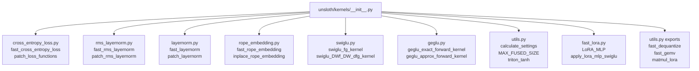
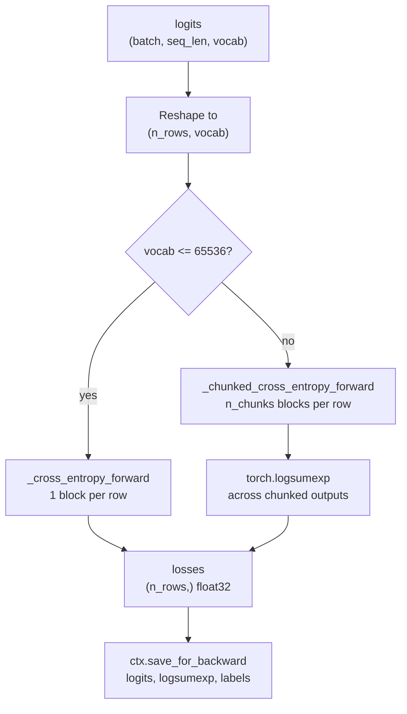
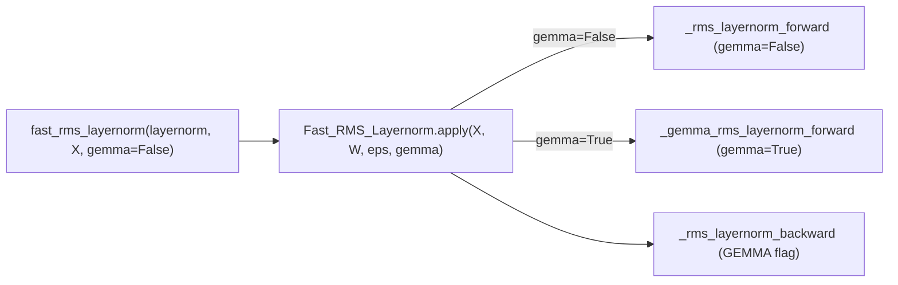
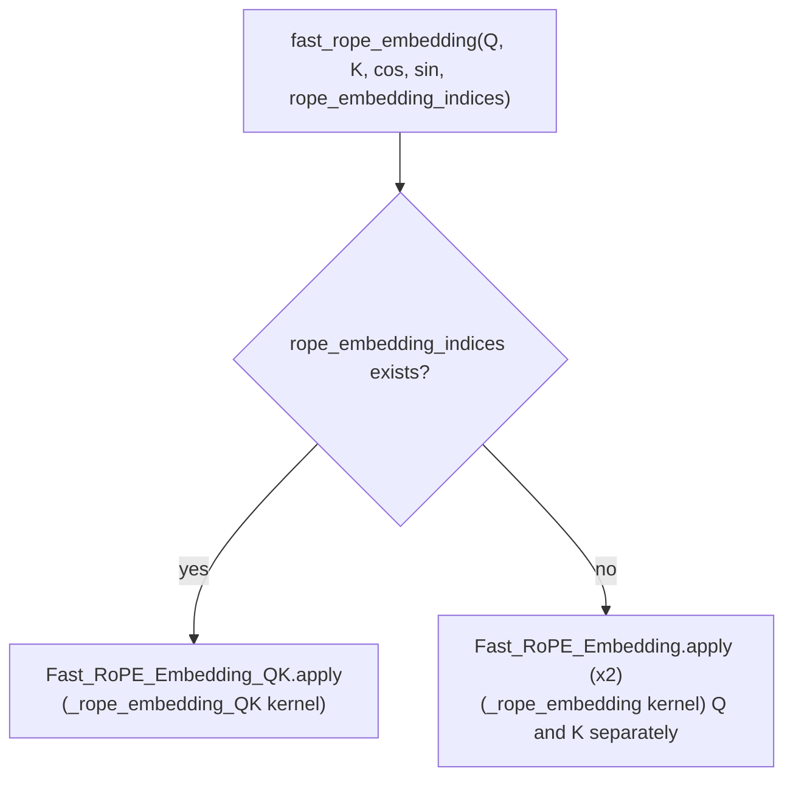
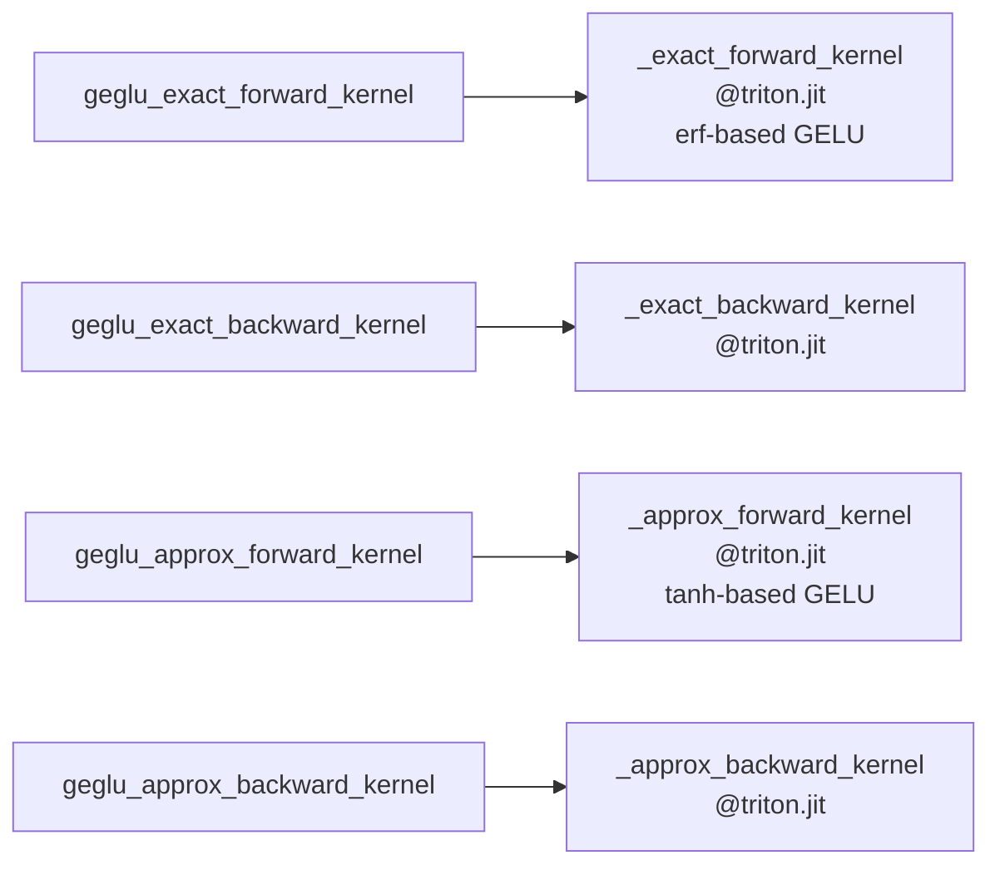
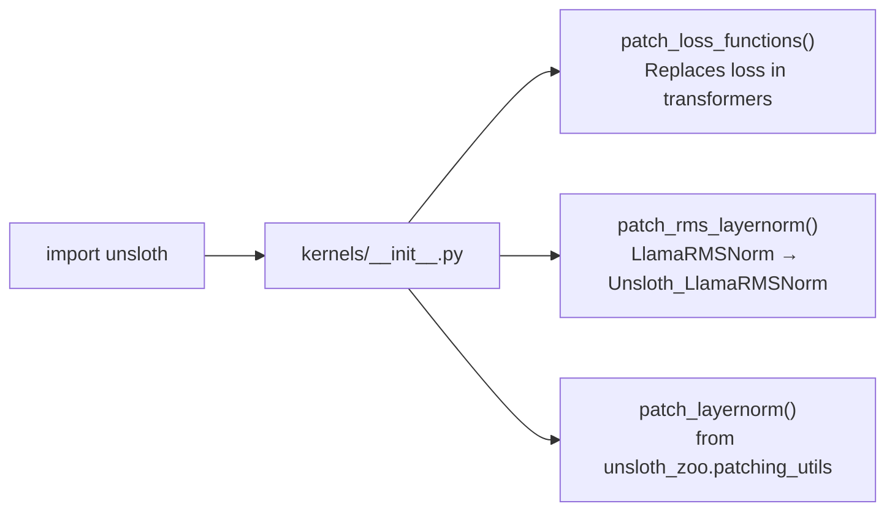

<!-- source: DeepWiki mcp.deepwiki.com · repo unslothai/unsloth · page 5.1 Custom Triton Kernels · fetched 2026-10-21 -->

# Custom Triton Kernels

Relevant source files

The following files were used as context for generating this wiki page:

- [unsloth/kernels/__init__.py](unsloth/kernels/__init__.py)
- [unsloth/kernels/cross_entropy_loss.py](unsloth/kernels/cross_entropy_loss.py)
- [unsloth/kernels/fast_lora.py](unsloth/kernels/fast_lora.py)
- [unsloth/kernels/geglu.py](unsloth/kernels/geglu.py)
- [unsloth/kernels/layernorm.py](unsloth/kernels/layernorm.py)
- [unsloth/kernels/rms_layernorm.py](unsloth/kernels/rms_layernorm.py)
- [unsloth/kernels/rope_embedding.py](unsloth/kernels/rope_embedding.py)
- [unsloth/kernels/swiglu.py](unsloth/kernels/swiglu.py)
- [unsloth/kernels/utils.py](unsloth/kernels/utils.py)

## Purpose and Scope

This page documents the core Triton GPU kernel implementations in `unsloth/kernels/`. These kernels replace standard PyTorch operations in model forward and backward passes with fused, memory-efficient GPU routines that reduce VRAM usage and improve throughput during fine-tuning.

Specifically, this page covers:

- **Cross-entropy loss** — chunked vocab processing with softcapping and logit scaling. [unsloth/kernels/cross_entropy_loss.py:32-191]()
- **RMS LayerNorm** — including a Gemma-specific variant and backward pass optimizations. [unsloth/kernels/rms_layernorm.py:18-117]()
- **LayerNorm** — full mean-variance normalization. [unsloth/kernels/layernorm.py:22-101]()
- **RoPE embedding** — rotary position encoding applied in-place. [unsloth/kernels/rope_embedding.py:20-163]()
- **SwiGLU and GeGLU activations** — fused gate activation kernels. [unsloth/kernels/swiglu.py:24-104](), [unsloth/kernels/geglu.py:28-195]()

For LoRA autograd functions (`LoRA_MLP`), dequantization (`fast_dequantize`), and matrix-multiply utilities, see [LoRA and Quantization Kernels](5.2). For attention backends (FlashAttention, xFormers, SDPA, Flex Attention), see [Attention Mechanisms](5.3). For the MoE grouped GEMM kernels, see [Mixture-of-Experts Models](4.5).

---

## Kernel Module Overview

All kernels are exported from `unsloth/kernels/__init__.py` and are loaded at import time. Each kernel is implemented as a `torch.autograd.Function` subclass wrapping one or more `@triton.jit`-decorated kernel functions.

### Kernel Module Structure

Sources: [unsloth/kernels/__init__.py:12-53]()

---

## Shared Utilities

`unsloth/kernels/utils.py` provides helpers used by every kernel module.

| Symbol | Purpose |
|---|---|
| `MAX_FUSED_SIZE` | Maximum Triton block size: `65536` (2¹⁶). Determines chunking threshold for large vocabs. [unsloth/kernels/utils.py:16]() |
| `calculate_settings(n)` | Returns `(BLOCK_SIZE, num_warps)` for a given dimension `n`, rounding up to the next power of 2. [unsloth/kernels/utils.py:114-133]() |
| `triton_tanh` | Alias to `libdevice.tanh` (Triton ≥ 3.0) or `tl.math.tanh` (older). Used for softcapping. [unsloth/kernels/utils.py:61-69]() |
| `triton_cast` | Alias to `tl.cast` (Triton ≥ 3.0) or an inline `x.to(dtype)` fallback. [unsloth/kernels/utils.py:61-75]() |
| `is_cdna()` | Detects AMD CDNA GPUs (`gfx940/941/942/950`). Affects warp counts. [unsloth/kernels/utils.py:77-84]() |
| `is_rdna()` | Detects AMD RDNA GPUs. Affects warp counts. [unsloth/kernels/utils.py:88-111]() |
| `torch_gpu_device(device)` | Context manager: `torch.cuda.device` or `torch.xpu.device` for multi-GPU. [unsloth/kernels/utils.py:169-179]() |

`calculate_settings` selects `num_warps` as follows:

| Block size | `num_warps` |
|---|---|
| < 2048 | 4 |
| ≥ 2048 | 8 |
| ≥ 8192 | 16 |
| ≥ 32768 | 32 |

Sources: [unsloth/kernels/utils.py:16](), [unsloth/kernels/utils.py:61-75](), [unsloth/kernels/utils.py:77-111](), [unsloth/kernels/utils.py:114-133](), [unsloth/kernels/utils.py:169-179]()

---

## Cross-Entropy Loss

**File:** `unsloth/kernels/cross_entropy_loss.py`

### Problem
Standard cross-entropy in PyTorch materializes the full `(batch × seq_len, vocab_size)` softmax tensor in float32 before computing the loss. For models with large vocabularies (e.g., Gemma's 256K tokens), this dominates peak VRAM.

### Design

The Unsloth Triton kernel implements a numerically stable cross-entropy loss without materializing the full softmax tensor by:

- Computing logsumexp by subtracting the maximum logit to ensure numerical stability and efficient parallelization. [unsloth/kernels/cross_entropy_loss.py:65-103]()

- Supporting optional logit transformations:
  - **Logit scaling** (`t * x`) for Cohere models. [unsloth/kernels/cross_entropy_loss.py:78-79]()
  - **Logit softcapping** (`t * tanh(x / t)`) for Gemma 2 models. [unsloth/kernels/cross_entropy_loss.py:80-82]()

- Handling very large vocabularies by chunking the logits and computing a partial logsumexp per chunk, then combining results in a second reduction pass. [unsloth/kernels/cross_entropy_loss.py:114-191]()

### Data Flow Through Cross-Entropy Loss Kernel

### Public API

- `fast_cross_entropy_loss` — Entry point that reshapes 3D logits and dispatches to the custom loss wrappers. [unsloth/kernels/cross_entropy_loss.py:12-16]()
- `patch_loss_functions` — Replaces the default transformers' loss functions with the optimized ones in Unsloth, enabling automatic use of these kernels in model training. [unsloth/kernels/cross_entropy_loss.py:26-29]()

Sources: [unsloth/kernels/cross_entropy_loss.py:32-103](), [unsloth/kernels/cross_entropy_loss.py:114-191]()

---

## RMS LayerNorm

**File:** `unsloth/kernels/rms_layernorm.py`

### Design

RMS LayerNorm normalizes the input by its root mean square computed as \( \text{inv_var} = \frac{1}{\sqrt{\mathrm{mean}(x^2) + \epsilon}} \).

- The forward kernel `_rms_layernorm_forward` loads the input row, calculates the RMS, normalizes, applies a per-feature weight vector, and stores the inverse variance `r` for backward pass caching. [unsloth/kernels/rms_layernorm.py:18-57]()
- The backward kernel `_rms_layernorm_backward` uses the cached `inv_var` and efficiently computes gradients w.r.t. input `X` and parameters. It supports a `GEMMA` mode which adds an extra offset of 1.0 to weights before multiplication to emulate Gemma RMS normalization behavior. [unsloth/kernels/rms_layernorm.py:59-116]()
- A specialized Gemma RMS kernel `_gemma_rms_layernorm_forward` is provided for exact Gemma LayerNorm behavior with amending weights. [unsloth/kernels/rms_layernorm.py:120-155]()

### Usage Flow

Sources: [unsloth/kernels/rms_layernorm.py:18-57](), [unsloth/kernels/rms_layernorm.py:59-116](), [unsloth/kernels/rms_layernorm.py:120-155](), [unsloth/kernels/rms_layernorm.py:157-215]()

---

## LayerNorm

**File:** `unsloth/kernels/layernorm.py`

### Design

Full LayerNorm kernel follows the classic mean-variance normalization including bias:

- The forward kernel `layernorm_forward` computes the mean and inverse standard deviation of each row, stores these for backward, and returns normalized output scaled by weights and shifted by bias. [unsloth/kernels/layernorm.py:22-61]()
- The backward kernel `layernorm_backward` uses cached inverse std and mean to compute gradients w.r.t. inputs. It computes gradients without additional reductions by reusing stored quantities. [unsloth/kernels/layernorm.py:63-100]()
- Wrapped in the `Fast_Layernorm` autograd function which reshapes inputs, manages block sizes, and calls Triton kernels under appropriate device contexts. [unsloth/kernels/layernorm.py:102-161]()
- `fast_layernorm` is a helper that reads parameters from a standard PyTorch `nn.LayerNorm` and calls the fast kernel. [unsloth/kernels/layernorm.py:163-170]()

Sources: [unsloth/kernels/layernorm.py:22-100](), [unsloth/kernels/layernorm.py:102-170]()

---

## RoPE Embedding

**File:** `unsloth/kernels/rope_embedding.py`

### Design

RoPE applies rotary position embeddings by rotating the query and key vectors in-place using trigonometric tensors representing cosines and sines of frequencies.

- The primary kernel `_rope_embedding` applies the rotation separately to groups of heads, exploiting parallelism by processing multiple heads per kernel invocation. Works on half the embedding dimension as RoPE applies pairwise rotation on two halves. [unsloth/kernels/rope_embedding.py:101-163]()
- A specialized kernel `_rope_embedding_QK` applies RoPE rotation simultaneously to both Query (Q) and Key (K) tensors with optional custom position indices support. [unsloth/kernels/rope_embedding.py:20-95]()
- The `Fast_RoPE_Embedding` autograd wrapper orchestrates dispatch and backward passes, reshaping tensors and managing device contexts. [unsloth/kernels/rope_embedding.py:166-213]()

### Dispatch Logic

Sources: [unsloth/kernels/rope_embedding.py:20-95](), [unsloth/kernels/rope_embedding.py:101-163](), [unsloth/kernels/rope_embedding.py:166-213]()

---

## SwiGLU Activation Kernels

**File:** `unsloth/kernels/swiglu.py`

### Design

These kernels implement the SwiGLU activation: \( f = e \times \sigma(e) \), where \(\sigma\) is the sigmoid function, then multiply by a gating tensor \(g\) to produce output \(h = f \times g\).

- The forward kernel `_fg_kernel` loads elements of tensors `e` and `g` in blocks, applies the SwiGLU function, and stores the output. [unsloth/kernels/swiglu.py:24-44]()
- The backward kernel `_DWf_DW_dfg_kernel` computes gradient terms (`df`, `dg`, `de`) for backpropagation efficiently using fused operations, stored in-place to reduce memory overhead. [unsloth/kernels/swiglu.py:63-104]()

### API Summary

| Function | Description |
|---|---|
| `swiglu_fg_kernel(e, g)` | Calls `_fg_kernel` to perform forward pass on 3D tensors. [unsloth/kernels/swiglu.py:46-60]() |
| `swiglu_DWf_DW_dfg_kernel(DW, e, g)` | Calls `_DWf_DW_dfg_kernel` for backward gradient computation. [unsloth/kernels/swiglu.py:106-119]() |

Sources: [unsloth/kernels/swiglu.py:24-44](), [unsloth/kernels/swiglu.py:63-104](), [unsloth/kernels/swiglu.py:46-60](), [unsloth/kernels/swiglu.py:106-119]()

---

## GeGLU Activation Kernels

**File:** `unsloth/kernels/geglu.py`

### Design

GeGLU uses the GELU function as a gating unit \( f = 0.5 e (1 + \mathrm{erf}(e / \sqrt{2})) \) multiplied by the `g` input.

- Two variants of GeGLU are implemented:
  - **Exact GELU variant** using the error function (`erf`), implemented in `_exact_forward_kernel` and `_exact_backward_kernel`. [unsloth/kernels/geglu.py:28-49](), [unsloth/kernels/geglu.py:69-117]()
  - **Approximate GELU variant** using a fast tanh-based approximation, implemented in `_approx_forward_kernel` and `_approx_backward_kernel`. [unsloth/kernels/geglu.py:135-158](), [unsloth/kernels/geglu.py:178-195]()

- Both kernels support large tensor sizes via optional 64-bit indexing (`LONG_INDEXING`) and are wrapped in autograd-friendly functions. [unsloth/kernels/geglu.py:33-38](), [unsloth/kernels/geglu.py:140-144]()

### Kernel Structure Diagram

Sources: [unsloth/kernels/geglu.py:28-49](), [unsloth/kernels/geglu.py:69-117](), [unsloth/kernels/geglu.py:135-158](), [unsloth/kernels/geglu.py:178-195]()

---

## Kernel Integration and Patch Workflow

At import time, `unsloth/kernels/__init__.py` exposes all kernel functions and autograd entries, setting up patches that replace standard PyTorch or Transformers-layer implementations.

### Patch Flow

Activation kernels (`swiglu_fg_kernel`, `geglu_exact_forward_kernel`, etc.) are passed directly as function pointers to `LoRA_MLP` for efficient fused forward/backward computation in fine-tuning workflows. [unsloth/kernels/fast_lora.py:84-86](), [unsloth/kernels/fast_lora.py:222-225]()

Sources: [unsloth/kernels/__init__.py:12-53](), [unsloth/kernels/fast_lora.py:84-86](), [unsloth/kernels/fast_lora.py:222-225]()

---

## Summary Table

| Kernel file                | Public entry point          | `autograd.Function`          | Triton kernels                                                 |
|---------------------------|----------------------------|-----------------------------|----------------------------------------------------------------|
| `cross_entropy_loss.py`    | `fast_cross_entropy_loss`  | `Fast_CrossEntropyLoss`     | `_cross_entropy_forward`, `_chunked_cross_entropy_forward`     |
| `rms_layernorm.py`         | `fast_rms_layernorm`       | `Fast_RMS_Layernorm`        | `_rms_layernorm_forward`, `_gemma_rms_layernorm_forward`, `_rms_layernorm_backward` |
| `layernorm.py`             | `fast_layernorm`           | `Fast_Layernorm`            | `layernorm_forward`, `layernorm_backward`                      |
| `rope_embedding.py`        | `fast_rope_embedding`      | `Fast_RoPE_Embedding`       | `_rope_embedding`, `_rope_embedding_QK`                        |
| `swiglu.py`                | `swiglu_fg_kernel`         | _Called by `LoRA_MLP`        | `_fg_kernel`, `_DWf_DW_dfg_kernel`                             |
| `geglu.py`                 | `geglu_*_kernel`           | _Called by `LoRA_MLP`        | `_exact_*_kernel`, `_approx_*_kernel`                          |

Sources: [unsloth/kernels/__init__.py:12-53]()

---

