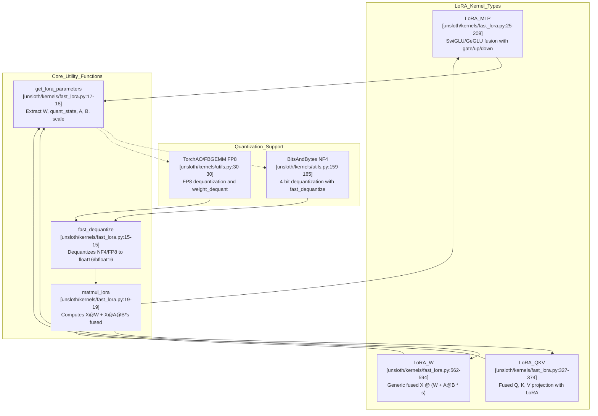
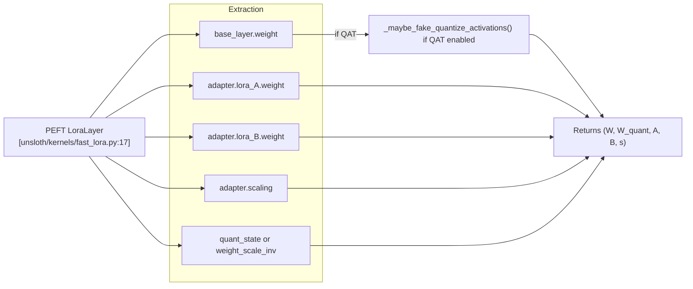
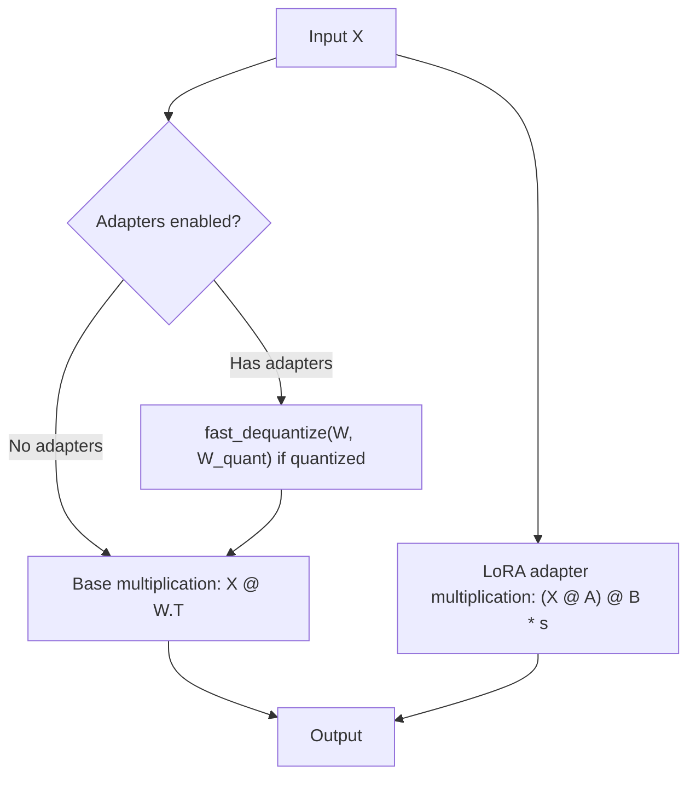

<!-- source: DeepWiki mcp.deepwiki.com · repo unslothai/unsloth · page 5.2 LoRA and Quantization Kernels · fetched 2026-10-21 -->

# LoRA and Quantization Kernels

Relevant source files

The following files were used as context for generating this wiki page:

- [unsloth/kernels/__init__.py](unsloth/kernels/__init__.py)
- [unsloth/kernels/cross_entropy_loss.py](unsloth/kernels/cross_entropy_loss.py)
- [unsloth/kernels/fast_lora.py](unsloth/kernels/fast_lora.py)
- [unsloth/kernels/geglu.py](unsloth/kernels/geglu.py)
- [unsloth/kernels/layernorm.py](unsloth/kernels/layernorm.py)
- [unsloth/kernels/rms_layernorm.py](unsloth/kernels/rms_layernorm.py)
- [unsloth/kernels/rope_embedding.py](unsloth/kernels/rope_embedding.py)
- [unsloth/kernels/swiglu.py](unsloth/kernels/swiglu.py)
- [unsloth/kernels/utils.py](unsloth/kernels/utils.py)

This page documents Unsloth's custom kernel implementations that fuse LoRA (Low-Rank Adaptation) operations with quantized weight computations for efficient training and inference. These kernels accelerate LoRA by minimizing memory loads and fusing adapter computations with base weights, supporting quantization formats such as bitsandbytes NF4 and FP8.

**Scope**: Explains fused LoRA operations (`LoRA_MLP`, `LoRA_QKV`, `LoRA_W`), fast dequantization primitives, and NF4/FP8 quantization integration. For general kernel infrastructure and device abstraction, see [5.5 Device Abstraction Layer](). For related optimizations like RoPE and cross-entropy, see [5.1 Custom Triton Kernels]().

---

## System Overview

Unsloth provides specialized fused LoRA kernel types designed to combine the base weight matrix multiplication with the LoRA low-rank adapter multiplication efficiently in a single kernel launch, avoiding multiple passes over inputs and intermediate memory copies. These kernels support different LoRA usage patterns and model architectures.

The system supports:
- LoRA MLP fusion with SwiGLU/GeGLU activations (`LoRA_MLP`).
- Parallel fused projections for Query-Key-Value (`LoRA_QKV`).
- General matrix multiplication with fused LoRA adapter (`LoRA_W`).
- Fast dequantization of quantized weights in bitsandbytes NF4 (4-bit normal float) and FP8 (torchao/FBGEMM float8).
- Support for quantization-aware training (QAT) with fake quantization.

The following diagram bridges the conceptual components to their implementation locations in code:

### LoRA and Quantization Entity Mapping

**Sources:** [unsloth/kernels/fast_lora.py:25-209](), [unsloth/kernels/fast_lora.py:327-374](), [unsloth/kernels/fast_lora.py:562-594](), [unsloth/kernels/utils.py:30-30](), [unsloth/kernels/utils.py:159-165]()

---

## LoRA Parameter Extraction

The function `get_lora_parameters()` retrieves the components of a PEFT-wrapped LoRA module necessary for fused computation. It extracts:

- `W`: The base weight matrix, possibly quantized [unsloth/kernels/fast_lora.py:17-17]().
- `W_quant`: Quantization metadata for 4-bit or FP8 weights [unsloth/kernels/fast_lora.py:16-16]().
- `A`: LoRA adapter matrix A (low-rank left projection) [unsloth/kernels/fast_lora.py:17-17]().
- `B`: LoRA adapter matrix B (low-rank right projection) [unsloth/kernels/fast_lora.py:18-18]().
- `s`: The LoRA scaling factor (`lora_alpha / rank`) [unsloth/kernels/fast_lora.py:19-21]().

If the model is in adapter-disabled or merged mode, it returns the base weight and placeholder values [unsloth/kernels/fast_lora.py:17-18]().

Additionally, if quantization-aware training (QAT) is enabled, it applies fake quantization to the input activations via `_maybe_fake_quantize_activations()` before returning [unsloth/kernels/fast_lora.py:14-14]().

### LoRA Parameter Extraction Flow

| Component | Type | Purpose |
|-----------|------|---------|
| `W` | `torch.Tensor` | Base weight matrix (may be quantized) |
| `W_quant` | `QUANT_STATE` | Quantization metadata for dequantization |
| `A` | `torch.Tensor` or None | LoRA low-rank matrix A (left projection) |
| `B` | `torch.Tensor` or None | LoRA low-rank matrix B (right projection) |
| `s` | `float` or None | LoRA scaling factor |

**Sources:** [unsloth/kernels/fast_lora.py:12-22](), [unsloth/kernels/utils.py:48-53]()

---

## LoRA_MLP: Fused LoRA MLP Kernel

`LoRA_MLP` fuses three linear layers with LoRA adapters—gate, up, and down projections—and an activation function (SwiGLU or GeGLU). It performs all projections and activations in a single fused forward/backward pass for efficiency [unsloth/kernels/fast_lora.py:25-110]().

### Forward Pass

The forward pass computes gate and up projections, applies the activation function (`_forward_function`), and then passes the result through the down projection:
\[ i = \text{down}_\text{fused}\left(\text{activation}\left(\text{gate}_\text{fused}(X) \times \text{up}_\text{fused}(X)\right)\right) \]
where each `_fused` module computes:
\[ X @ (W + A @ B \times s) \]

### Backward Pass

Gradients for LoRA matrices and input `X` are computed with fused backward calculations, leveraging saved intermediate tensors `e`, `g`, and `X` [unsloth/kernels/fast_lora.py:111-208]().

**Key Optimizations:**
- Forward saves intermediate activation states `e` and `g` for backward reuse [unsloth/kernels/fast_lora.py:95-107]().
- Backward dequantizes base weights once via `fast_dequantize()` for stable gradient calculations [unsloth/kernels/fast_lora.py:177-182]().
- Supports in-place gradient accumulation if memory permits [unsloth/kernels/fast_lora.py:86-86]().
- Uses custom autocasting-aware backward hooks `torch_amp_custom_bwd` [unsloth/kernels/fast_lora.py:112-112]().

**Sources:** [unsloth/kernels/fast_lora.py:25-209](), [unsloth/kernels/swiglu.py:46-60](), [unsloth/kernels/geglu.py:51-66]()

---

## Fused LoRA Matrix Multiplication (`matmul_lora`)

`matmul_lora()` efficiently computes the combined product:
\[ \text{output} = X @ W^T + (X @ A) @ B \times s \]

### Computation Flow

### Quantization Handling
- For bitsandbytes NF4 (4-bit normal float), `fast_dequantize()` loads weights from blockwise compressed 4-bit data to `float16`/`bfloat16` [unsloth/kernels/utils.py:159-165]().
- For FP8 quantized weights, dequantization uses `weight_dequant` deploying specialized Triton kernels [unsloth/kernels/utils.py:30-30]().

**Sources:** [unsloth/kernels/fast_lora.py:15-22](), [unsloth/kernels/utils.py:30-30]()

---

## FP8 and NF4 Quantization Support

Unsloth integrates bitsandbytes NF4 and FP8 quantization modes directly into the kernel dispatch pipeline to reduce memory footprint during training and inference.

### Quantization Modes and Kernels
- **Bitsandbytes NF4:** Employs 4-bit normal float representation with dynamic block-wise quantization. Dequantization is invoked on-the-fly via `fast_dequantize` [unsloth/kernels/fast_lora.py:15-15]().
- **FP8 Support:** Utilizes `weight_dequant` and `fp8_linear` utilities to handle 8-bit floating point representations (`torch.float8_e4m3fn`) during forward and backward passes [unsloth/kernels/utils.py:30-30]().

**Sources:** [unsloth/kernels/fast_lora.py:15-22](), [unsloth/kernels/utils.py:30-30]()

---

## Summary of Key Classes and Functions

| Name | Type | Location | Description |
|---|---|---|---|
| `LoRA_MLP` | Class | `unsloth/kernels/fast_lora.py:25` | Fused LoRA gate/up/down MLP with activation fusion. |
| `LoRA_QKV` | Class | `unsloth/kernels/fast_lora.py:327` | Fused QKV projection kernel with LoRA fusion. |
| `LoRA_W` | Class | `unsloth/kernels/fast_lora.py:562` | Generic fused matrix multiply with LoRA adapter. |
| `get_lora_parameters` | Function | `unsloth/kernels/fast_lora.py:17` | Extracts LoRA components and quantization metadata from a PEFT layer. |
| `matmul_lora` | Function | `unsloth/kernels/fast_lora.py:19` | Computes fused matrix product with LoRA adapter. |
| `fast_dequantize` | Function | `unsloth/kernels/fast_lora.py:15` | Dequantizes bitsandbytes NF4 or FP8 weights. |
| `weight_dequant` | Function | `unsloth/kernels/utils.py:30` | GPU kernel for FP8 weight dequantization with scaling. |

**Sources:** [unsloth/kernels/fast_lora.py:15-594](), [unsloth/kernels/utils.py:30-30]()

---

