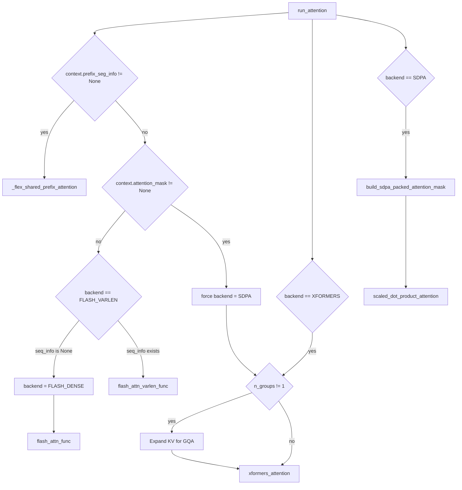
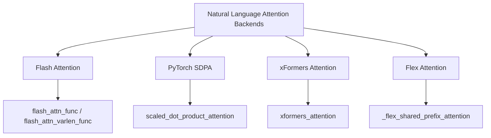
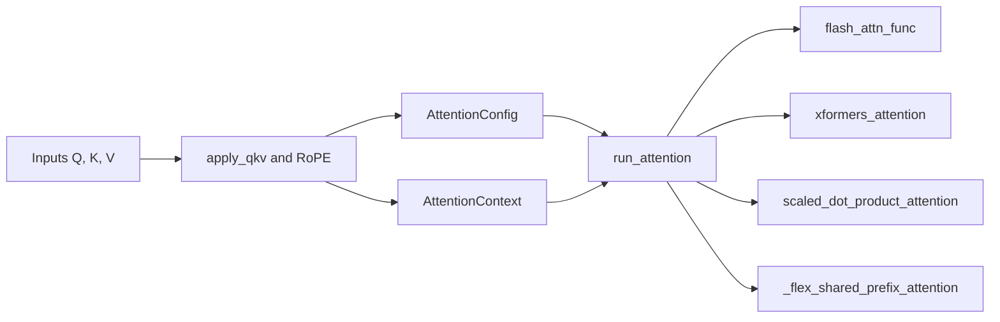

<!-- source: DeepWiki mcp.deepwiki.com · repo unslothai/unsloth · page 5.3 Attention Dispatch System · fetched 2026-10-21 -->

# Attention Dispatch System

<details>
<summary>Relevant source files</summary>

The following files were used as context for generating this wiki page:

- [README.md](README.md)
- [pyproject.toml](pyproject.toml)
- [studio/backend/tests/test_response_template_markers.py](studio/backend/tests/test_response_template_markers.py)
- [studio/backend/utils/datasets/model_mappings.py](studio/backend/utils/datasets/model_mappings.py)
- [tests/python/test_construct_chat_template_validation.py](tests/python/test_construct_chat_template_validation.py)
- [tests/test_fp8_pre_sm89_dequant_fallback.py](tests/test_fp8_pre_sm89_dequant_fallback.py)
- [tests/test_generation_failure_is_visible.py](tests/test_generation_failure_is_visible.py)
- [tests/test_import_fixes_drift.py](tests/test_import_fixes_drift.py)
- [tests/test_rl_config_compat.py](tests/test_rl_config_compat.py)
- [tests/test_warnings_issued_guard.py](tests/test_warnings_issued_guard.py)
- [tests/utils/test_attention_dispatch_dora_dtype.py](tests/utils/test_attention_dispatch_dora_dtype.py)
- [tests/utils/test_attention_masks.py](tests/utils/test_attention_masks.py)
- [tests/utils/test_packing.py](tests/utils/test_packing.py)
- [unsloth/__init__.py](unsloth/__init__.py)
- [unsloth/_gpu_init.py](unsloth/_gpu_init.py)
- [unsloth/chat_templates.py](unsloth/chat_templates.py)
- [unsloth/import_fixes.py](unsloth/import_fixes.py)
- [unsloth/kernels/fp8.py](unsloth/kernels/fp8.py)
- [unsloth/models/_utils.py](unsloth/models/_utils.py)
- [unsloth/models/llama.py](unsloth/models/llama.py)
- [unsloth/models/loader.py](unsloth/models/loader.py)
- [unsloth/models/loader_utils.py](unsloth/models/loader_utils.py)
- [unsloth/models/mapper.py](unsloth/models/mapper.py)
- [unsloth/models/mistral.py](unsloth/models/mistral.py)
- [unsloth/models/rl.py](unsloth/models/rl.py)
- [unsloth/models/rl_config_compat.py](unsloth/models/rl_config_compat.py)
- [unsloth/models/rl_replacements.py](unsloth/models/rl_replacements.py)
- [unsloth/models/vision.py](unsloth/models/vision.py)
- [unsloth/ollama_template_mappers.py](unsloth/ollama_template_mappers.py)
- [unsloth/save.py](unsloth/save.py)
- [unsloth/tokenizer_utils.py](unsloth/tokenizer_utils.py)
- [unsloth/trainer.py](unsloth/trainer.py)
- [unsloth/utils/attention_dispatch.py](unsloth/utils/attention_dispatch.py)
- [unsloth/utils/packing.py](unsloth/utils/packing.py)

</details>


This page documents the multi-backend attention dispatch system implemented in `unsloth/utils/attention_dispatch.py`, which provides a unified interface abstracting over several attention kernel backends: Flash Attention (dense and varlen), PyTorch scaled dot product attention (SDPA), xFormers fused kernels, and Flex Attention variants. The system unifies backend selection, Grouped Query Attention (GQA) expansion, packed sequence masking, sliding window attention, and specialized GRPO (Group Relative Policy Optimization) PrefixGrouper support.

For model-specific fast forward implementations calling this dispatch, see **4.1 Llama Model Family** and **4.4 Specialized Architectures**. For packed sequence usage of attention masks and lengths, see **6.5 Sample Packing and Padding-Free Training**. For Triton-based RoPE and layernorm kernels used alongside attention, see **5.1 Custom Triton Kernels**.

Sources: [`unsloth/models/llama.py:51-59]()

---

## Overview

The attention dispatch system standardizes how each Unsloth model's attention forward pass invokes attention kernels:

1. Compute query/key/value (Q,K,V) tensors via `self.apply_qkv(self, hidden_states)`.
2. Apply rotary positional embedding (RoPE) using `fast_rope_embedding`.
3. If present, concatenate cached KV from `past_key_value`.
4. Construct an `AttentionConfig` object capturing static layer metadata and backend configuration.
5. Construct an `AttentionContext` object holding runtime shapes and mask information.
6. Call `run_attention(config, context, Q, K, V)` for backend-dispatched execution.
7. Project the attention output back with `self.apply_o(self, attn_output)`.

This decouples backend kernel details from model-specific logic and accommodates dynamic runtime conditions (e.g., packed batches, presence of KV cache, precision variations).

Sources: [`unsloth/models/llama.py:51-59]()

---

## The Dispatch System

### Core Data Structures

#### `AttentionConfig`

A `@dataclass` bundling static layer config related to attention kernels and GQA:

| Field               | Type                         | Description                                |
|---------------------|------------------------------|--------------------------------------------|
| `backend`           | `str`                        | Backend name: `"flash_varlen"`, `"flash_dense"`, `"xformers"`, `"sdpa"` |
| `n_kv_heads`        | `int`                        | Number of key-value heads per layer         |
| `n_groups`          | `int`                        | Number of groups = number of query heads / key-value heads (GQA group size) |
| `flash_dense_kwargs` | `Optional[dict[str, Any]]`   | Keyword args passed to Flash Attention dense kernel |
| `flash_varlen_kwargs`| `Optional[dict[str, Any]]`   | Keyword args for Flash Attention varlen kernel (packing) |
| `sdpa_kwargs`       | `Optional[dict[str, Any]]`   | Keyword args passed to PyTorch scaled dot product attention |
| `xformers_kwargs`   | `Optional[dict[str, Any]]`   | Keyword args passed to xFormers attention kernel |

Sources: [`unsloth/models/llama.py:51-59]()

#### `AttentionContext`

A `@dataclass` holding per-call runtime info:

| Field            | Type                 | Description                                  |
|------------------|----------------------|----------------------------------------------|
| `bsz`            | `int`                | Batch size                                   |
| `q_len`          | `int`                | Query sequence length                        |
| `kv_seq_len`     | `int`                | Key/value sequence length (includes cache) |
| `n_heads`        | `int`                | Total number of query heads                  |
| `head_dim`       | `int`                | Dimension per head                           |
| `requires_grad`  | `bool`               | Whether gradients are enabled (training)    |
| `seq_info`       | `Optional[Tuple[Tensor, Tensor, int]]` | Packed batch metadata: (seq lengths, cumulative sums, max len) or None |
| `attention_mask` | `Optional[Tensor]`   | Explicit attention or padding mask          |
| `causal_mask`    | `Optional[Any]`      | xFormers-style bias mask or None             |
| `sliding_window` | `Optional[int]`      | Sliding window size for attention (if any) |
| `prefix_seg_info`| `Optional[Any]`      | PrefixGrouper shared-prefix info for GRPO kernel |

Sources: [`unsloth/models/llama.py:51-59]()

---

### Selecting Attention Backend

The function `select_attention_backend(use_varlen: bool = False)` returns the attention backend string, selecting the highest-priority available implementation based on the environment:

- If Flash Attention is available:
  - Use `"flash_varlen"` if `use_varlen=True` (for packed sequences).
  - Otherwise use `"flash_dense"`.
- Else if xFormers is available, use `"xformers"`.
- Otherwise fallback to `"sdpa"` (PyTorch scaled dot product attention).

The `use_varlen` flag is typically true if packed sequence lengths info is present (e.g., sampling packed batches).

Sources: [`unsloth/models/llama.py:51-59]()

---

### xFormers Runtime Capability Probe

Unsloth probes xFormers to detect kernel suitability on current hardware.

- `_xformers_runs_on_device()` performs a minimal attention forward on the current CUDA device to test if xFormers kernels run without error. It selects `torch.bfloat16` or `torch.float16` based on `SUPPORTS_BFLOAT16`.
- On GPUs with compute capability major version ≥ 12 (e.g., NVIDIA Blackwell architecture), if the probe fails, xFormers is disabled and fallback to SDPA occurs.
- At sm_100+ devices, fp32 attention is unsupported natively by CUTLASS in xFormers, requiring careful dtype downcasting.

Sources: [`unsloth/models/llama.py:51-59]()

---

### Flash Attention Varlen Overflow Guard

Flash Attention 2's varlen backward kernel indexes its `dq_accum` buffer with `int32`. If the element count crosses $2^{31}$, it triggers an illegal memory access. Unsloth implements a guard to detect this condition:
- `_varlen_backward_overflows_int32` calculates the element count based on sequence counts, total query length, and head dimensions.
- If an overflow is detected during training, Unsloth issues a warning and forces a fallback to the dense Flash Attention backend to prevent context poisoning.

Sources: [`unsloth/models/llama.py:51-59]()

---

### Running Attention: `run_attention`

Signature:
```python
def run_attention(*, config: AttentionConfig, context: AttentionContext,
                  Q: Tensor, K: Tensor, V: Tensor) -> Tensor:
```

This is the central dispatch function for running attention. It returns an output tensor with shape `(bsz, q_len, n_heads * head_dim)`.

**Dispatch Logic:**

1. **PrefixGrouper Shortcut:** If `context.prefix_seg_info` is set, route Q/K/V to `_flex_shared_prefix_attention`.
2. **Flash Attention:**
    - If backend is `flash_varlen` and `seq_info` is present, call `flash_attn_varlen_func`.
    - If `flash_dense`, call `flash_attn_func`.
3. **xFormers Attention:**
    - Handles GQA expansion for K/V or Q heads.
    - Builds `BlockDiagonalCausalMask` via `build_xformers_block_causal_mask`.
4. **PyTorch SDPA:**
    - Uses `scaled_dot_product_attention` with `enable_gqa` if supported.

**DoRA dtype handling:**
- Automatically downcast Q/K/V from fp32 to fp16 or bf16 for Flash Attention to maintain hardware compatibility.
- For xFormers on sm_100+, fp32 input is also downcast.

Sources: [`unsloth/models/llama.py:51-60]()

---

### Attention Dispatch Flowchart



Sources: [`unsloth/models/llama.py:51-60]()

---

## GRPO Prefix Grouping

Unsloth supports the `PrefixGrouper` optimization used in Group Relative Policy Optimization (GRPO) training.

- **Shared Prompt Prefixes:** GRPO trains multiple continuations sharing the same prompt prefix in one batch. Attention computation for this prefix is done once and re-used.
- `prefix_seg_info` data structure describes the segments for shared prefixes.
- The `run_attention` function routes to a special `_flex_shared_prefix_attention` kernel.
- Environment variable `UNSLOTH_GRPO_PREFIX_GROUPER` (default on) enables loading the FlexAttention shared prefix kernel.

Sources: [`unsloth/models/rl_replacements.py:71-90]()

---

## Diagrams Connecting Natural Language and Code Entities

### Diagram 1: Attention Backends and Associated Code Entities



Sources: [`unsloth/models/llama.py:51-60]()

### Diagram 2: Attention Dispatch Data Flow



Sources: [`unsloth/models/llama.py:51-60]()

---

# Sources

- [`unsloth/models/llama.py:51-60]()
- [`unsloth/models/rl_replacements.py:71-90]()

---

