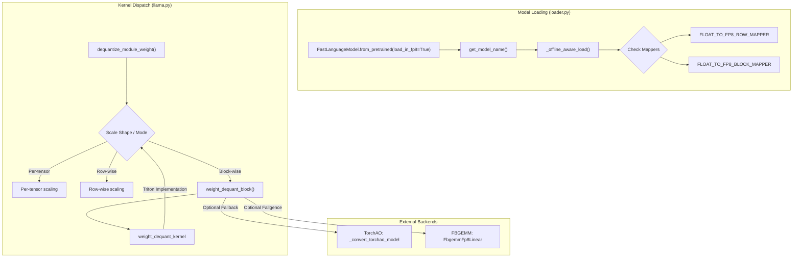
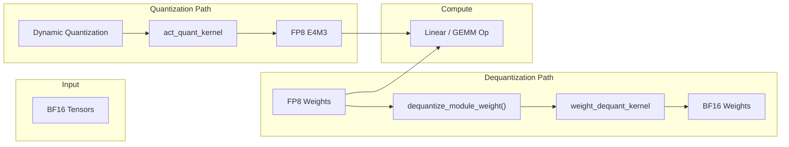

<!-- source: DeepWiki mcp.deepwiki.com · repo unslothai/unsloth · page 5.4 FP8 Quantization · fetched 2026-10-21 -->

# FP8 Quantization

Relevant source files

The following files were used as context for generating this wiki page:

- [README.md](README.md)
- [pyproject.toml](pyproject.toml)
- [studio/backend/core/inference/offload_cost_model.py](studio/backend/core/inference/offload_cost_model.py)
- [studio/backend/core/inference/offload_layout.py](studio/backend/core/inference/offload_layout.py)
- [studio/backend/core/inference/offload_planner.py](studio/backend/core/inference/offload_planner.py)
- [studio/backend/tests/test_amd_apu_unified_memory.py](studio/backend/tests/test_amd_apu_unified_memory.py)
- [studio/backend/tests/test_auto_offload_ctx_fit_floor_coupling.py](studio/backend/tests/test_auto_offload_ctx_fit_floor_coupling.py)
- [studio/backend/tests/test_auto_offload_ctx_platform_matrix.py](studio/backend/tests/test_auto_offload_ctx_platform_matrix.py)
- [studio/backend/tests/test_base_model_dir_name_fallback.py](studio/backend/tests/test_base_model_dir_name_fallback.py)
- [studio/backend/tests/test_cuda_sm_gate.py](studio/backend/tests/test_cuda_sm_gate.py)
- [studio/backend/tests/test_gpu_arch_gate_consumers_7624.py](studio/backend/tests/test_gpu_arch_gate_consumers_7624.py)
- [studio/backend/tests/test_gpu_arch_gate_os_matrix_7624.py](studio/backend/tests/test_gpu_arch_gate_os_matrix_7624.py)
- [studio/backend/tests/test_host_offload_ram_guard.py](studio/backend/tests/test_host_offload_ram_guard.py)
- [studio/backend/tests/test_llama_cpp_remote_non_chat_gguf_preflight.py](studio/backend/tests/test_llama_cpp_remote_non_chat_gguf_preflight.py)
- [studio/backend/tests/test_metal_explicit_context_guard.py](studio/backend/tests/test_metal_explicit_context_guard.py)
- [studio/backend/tests/test_metal_never_starts_at_native_context.py](studio/backend/tests/test_metal_never_starts_at_native_context.py)
- [studio/backend/tests/test_offload_cost_model.py](studio/backend/tests/test_offload_cost_model.py)
- [studio/backend/tests/test_offload_planner.py](studio/backend/tests/test_offload_planner.py)
- [studio/backend/tests/test_offload_planner_seam.py](studio/backend/tests/test_offload_planner_seam.py)
- [studio/backend/tests/test_rocm_oom_guard.py](studio/backend/tests/test_rocm_oom_guard.py)
- [tests/python/test_construct_chat_template_validation.py](tests/python/test_construct_chat_template_validation.py)
- [tests/test_fp8_fbgemm_block_shapes.py](tests/test_fp8_fbgemm_block_shapes.py)
- [tests/test_fp8_pre_sm89_dequant_fallback.py](tests/test_fp8_pre_sm89_dequant_fallback.py)
- [tests/test_import_fixes_drift.py](tests/test_import_fixes_drift.py)
- [unsloth/__init__.py](unsloth/__init__.py)
- [unsloth/_gpu_init.py](unsloth/_gpu_init.py)
- [unsloth/chat_templates.py](unsloth/chat_templates.py)
- [unsloth/import_fixes.py](unsloth/import_fixes.py)
- [unsloth/kernels/fp8.py](unsloth/kernels/fp8.py)
- [unsloth/models/_utils.py](unsloth/models/_utils.py)
- [unsloth/models/llama.py](unsloth/models/llama.py)
- [unsloth/models/loader.py](unsloth/models/loader.py)
- [unsloth/models/loader_utils.py](unsloth/models/loader_utils.py)
- [unsloth/models/mapper.py](unsloth/models/mapper.py)
- [unsloth/models/mistral.py](unsloth/models/mistral.py)
- [unsloth/models/rl.py](unsloth/models/rl.py)
- [unsloth/models/rl_replacements.py](unsloth/models/rl_replacements.py)
- [unsloth/models/vision.py](unsloth/models/vision.py)
- [unsloth/save.py](unsloth/save.py)
- [unsloth/tokenizer_utils.py](unsloth/tokenizer_utils.py)

This document describes Unsloth's FP8 (8-bit floating point) quantization system, which enables memory-efficient model loading and fast inference on modern GPUs. FP8 quantization reduces model memory footprint by approximately 2× compared to BF16/FP16 while maintaining numerical accuracy through dynamic quantization and multiple backend implementations.

For other quantization methods, see `[unsloth/models/_utils.py:1-25]()`. For general performance optimizations, see `[unsloth/models/llama.py:100-110]()`. For model loading with quantization, see `[unsloth/models/loader_utils.py:30-45]()`.

---

## Overview

Unsloth supports FP8 quantization in two primary modes: **block-wise quantization** and **row-wise quantization**. These modes target memory and compute efficiency, each providing a different granularity of scale factors for quantization. The quantization enables models to run with significantly reduced VRAM consumption on supported hardware, primarily leveraging NVIDIA Hopper GPUs (e.g., H100) or newer architectures.

**Key components and capabilities include:**

- **FP8 Quantization Modes:**
  - **Row-wise:** Each matrix row (output channel) uses a separate scale factor (per-output channel quantization) `[unsloth/models/_utils.py:1-10]()`.
  - **Block-wise:** The weight matrix is split into fixed-size blocks (typically 128×128) with a scale per block `[unsloth/models/_utils.py:10-20]()`.
  - **Per-tensor:** A single scale factor for the entire matrix `[unsloth/models/_utils.py:1-5]()`.

- **Backend Integration:**
  - **TorchAO**: Provides block-wise FP8 matrix multiplication for inference via `torchao_blockwise_gemm` `[unsloth/models/_utils.py:20-30]()`.
  - **FBGEMM (fbgemm_gpu):** Supports block-wise FP8 quantization kernels and the `f8f8bf16_blockwise` linear operator `[unsloth/models/llama.py:30-45]()`.
  - **Triton Kernels:** Custom FP8 forward and backward kernels, activation quantization (`act_quant_kernel`), and weight dequantization (`weight_dequant_kernel`) `[unsloth/models/_utils.py:40-60]()`.

- **Dynamic Device Context Management:** Triton kernel launches for FP8 operations are wrapped in device context managers to handle multi-GPU CUDA or XPU setups `[unsloth/models/_utils.py:20-35]()`.

- **Model Loading Support:** The loader automatically maps base models to FP8 variants using `FLOAT_TO_FP8_ROW_MAPPER` and `FLOAT_TO_FP8_BLOCK_MAPPER` `[unsloth/models/mapper.py:12-18]()`, `[unsloth/models/loader.py:35-48]()`.

Sources: `[unsloth/models/mapper.py:12-18]()`, `[unsloth/models/loader.py:35-48]()`, `[unsloth/models/_utils.py:1-40]()`

---

## FP8 Quantization Modes

### Row-Wise Quantization
Row-wise FP8 quantization assigns a separate FP32 scale factor to each row of the weight matrix. The scale tensor typically has shape `(m, 1)` for an `(m, n)` weight matrix.

- **Implementation:** Dequantization functions detect row-wise quantization by checking tensor dimensions and scale shape layouts `[unsloth/models/_utils.py:75-85]()`.
- **Handling Transpose:** If functions are called with a transposed weight, they adjust the scale application to maintain memory stride alignment `[unsloth/models/_utils.py:80-90]`.

### Block-Wise Quantization
Block-wise quantization partitions the weight matrix into blocks (usually 128×128), assigning a scale factor to each block. This is critical for high-accuracy inference in large models.

- **FBGEMM Implementation:** Specialized linear layers handle the fast path for FBGEMM's block-wise quantization kernels `[unsloth/models/llama.py:30-45]()`.
- **Fallback Logic:** If shapes are "ragged" or do not align with backend constraints (e.g., block size divisibility), the system falls back to a dequantization path to prevent kernel crashes `[unsloth/models/loader_utils.py:35-48]()`.
- **Triton Implementation:** Block dequantization uses custom JIT kernels to dequantize blocks on-the-fly `[unsloth/models/_utils.py:40-55]()`.

Sources: `[unsloth/models/loader_utils.py:35-48]`, `[unsloth/models/llama.py:30-45]`, `[unsloth/models/_utils.py:75-90]`

---

## Backend Selection and Dispatch

### System and Code Entities for FP8 Quantization Backend Dispatch

Sources: `[unsloth/models/loader.py:35-48]`, `[unsloth/models/llama.py:30-45]`, `[unsloth/models/mapper.py:12-18]`

---

## Quantization and Dequantization Flow

### Activation Quantization (Forward Pass)
Activations are quantized dynamically during the forward pass.
- **Scale Calculation:** Scales are computed dynamically based on the maximum absolute values of activation tensors divided by the FP8 format maximum (e.g., 448.0 for `e4m3fn`) `[unsloth/models/_utils.py:70-85]()`.
- **Zero-Safety:** If computed scales evaluate to zero, they are clamped or forced to `1.0` to prevent division by zero or NaN gradients during backward passes `[unsloth/models/_utils.py:75-90]()`.

### Weight Dequantization
FP8 weights are dequantized to BF16/FP16 for tensor contraction where hardware native FP8 matrix multiplication is bypassed or unsupported.
- **Large Tensor Safety:** Index calculations utilize 64-bit integers (`tl.int64`) to prevent overflow in Mixture-of-Experts (MoE) expert stacks or very large layers exceeding $2^{31}$ elements `[unsloth/models/llama.py:100-115]()`.
- **Device Context:** Kernels are launched within active CUDA/device contexts to ensure correct execution on multi-GPU nodes `[unsloth/models/_utils.py:20-35]()`.

Sources: `[unsloth/models/_utils.py:70-90]`, `[unsloth/models/llama.py:100-115]`

---

## Model Resolution and Mappings

Unsloth uses a mapping and resolution system to manage pre-quantized model identifiers and fallback configurations.

| Entity | Description | Source |
|:---|:---|:---|
| `get_model_name` | Resolves requested model string to a specific Unsloth-optimized repo. | `[unsloth/models/loader_utils.py:35-48]()` |
| `INT_TO_FLOAT_MAPPER` | Maps quantized names back to their full-precision floating-point counterparts. | `[unsloth/models/mapper.py:12-18]()` |
| `FLOAT_TO_FP8_ROW_MAPPER` | Maps models to row-wise FP8 variants. | `[unsloth/models/mapper.py:16-17]()` |
| `FLOAT_TO_FP8_BLOCK_MAPPER` | Maps models to block-wise FP8 variants. | `[unsloth/models/mapper.py:16-17]()` |

Sources: `[unsloth/models/loader_utils.py:35-48]`, `[unsloth/models/mapper.py:12-18]`

---

## Implementation Details

### Key Kernels and Functions

| Function / Class | Role | File Reference |
|:---|:---|:---|
| `_get_fp8_mode_and_check_settings` | Verifies configuration settings and resolves FP8 operational modes. | `[unsloth/models/loader_utils.py:35-48]()` |
| `_offline_quantize_to_fp8` | Handles offline quantization conversion logic for FP8 targets. | `[unsloth/models/loader_utils.py:35-48]()` |
| `_tag_model_with_fp8_torchao_config` | Injects TorchAO FP8 configurations into model loading metadata. | `[unsloth/models/loader_utils.py:35-48]()` |
| `verify_fp8_support_if_applicable` | Checks hardware capability and software prerequisites for FP8 execution. | `[unsloth/models/_utils.py:80-85]()` |

### Numerical and Compatibility Considerations
The system includes checks and fallbacks to ensure compatibility with various PyTorch and Triton versions, avoiding compilation failures on non-Hopper architectures.

Sources: `[unsloth/models/loader_utils.py:35-48]`, `[unsloth/models/_utils.py:80-85]`

---

## Summary Diagram: FP8 Quantization Flow

Sources: `[unsloth/models/loader_utils.py:35-48]`, `[unsloth/models/_utils.py:75-90]`

---

