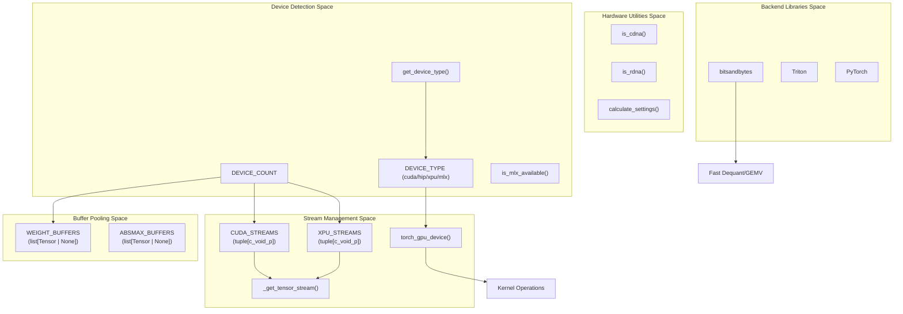
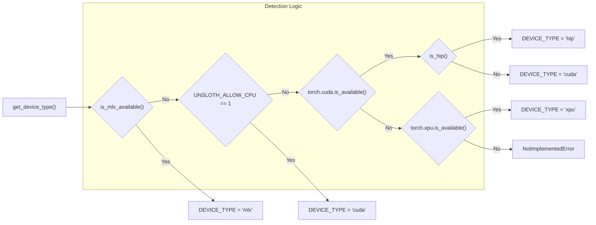
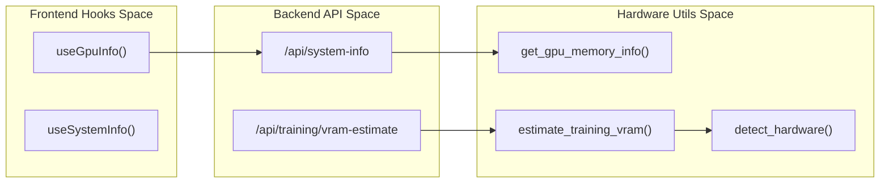

<!-- source: DeepWiki mcp.deepwiki.com · repo unslothai/unsloth · page 5.5 Device Abstraction Layer · fetched 2026-10-21 -->

# Device Abstraction Layer

Relevant source files

The following files were used as context for generating this wiki page:

- [studio/backend/core/__init__.py](studio/backend/core/__init__.py)
- [studio/backend/core/training/__init__.py](studio/backend/core/training/__init__.py)
- [studio/backend/main.py](studio/backend/main.py)
- [studio/backend/routes/llama_compat.py](studio/backend/routes/llama_compat.py)
- [studio/backend/tests/test_chat_load_during_training.py](studio/backend/tests/test_chat_load_during_training.py)
- [studio/backend/tests/test_gpu_selection.py](studio/backend/tests/test_gpu_selection.py)
- [studio/backend/tests/test_hub_token_cache_isolation.py](studio/backend/tests/test_hub_token_cache_isolation.py)
- [studio/backend/tests/test_llama_compat_routes.py](studio/backend/tests/test_llama_compat_routes.py)
- [studio/backend/tests/test_login_rate_limit.py](studio/backend/tests/test_login_rate_limit.py)
- [studio/backend/tests/test_middleware.py](studio/backend/tests/test_middleware.py)
- [studio/backend/tests/test_model_defaults_aliases_resolve.py](studio/backend/tests/test_model_defaults_aliases_resolve.py)
- [studio/backend/tests/test_utils.py](studio/backend/tests/test_utils.py)
- [studio/backend/tests/test_vram_estimation.py](studio/backend/tests/test_vram_estimation.py)
- [studio/backend/utils/hardware/VRAM_ESTIMATION.md](studio/backend/utils/hardware/VRAM_ESTIMATION.md)
- [studio/backend/utils/hardware/__init__.py](studio/backend/utils/hardware/__init__.py)
- [studio/backend/utils/hardware/hardware.py](studio/backend/utils/hardware/hardware.py)
- [studio/backend/utils/hardware/vram_estimation.py](studio/backend/utils/hardware/vram_estimation.py)
- [studio/backend/utils/inference/__init__.py](studio/backend/utils/inference/__init__.py)
- [studio/backend/utils/inference/inference_config.py](studio/backend/utils/inference/inference_config.py)
- [studio/backend/utils/utils.py](studio/backend/utils/utils.py)
- [tests/python/test_bitsandbytes_kernel_readiness.py](tests/python/test_bitsandbytes_kernel_readiness.py)
- [tests/test_bf16_quant_disabled_message.py](tests/test_bf16_quant_disabled_message.py)
- [tests/test_device_helpers.py](tests/test_device_helpers.py)
- [tests/test_kaggle_gguf_error_message.py](tests/test_kaggle_gguf_error_message.py)
- [tests/test_offloaded_parameter_hint.py](tests/test_offloaded_parameter_hint.py)
- [tests/test_save_entrypoints_reach_converter.py](tests/test_save_entrypoints_reach_converter.py)
- [tests/test_st_save_merged_signature.py](tests/test_st_save_merged_signature.py)
- [unsloth/bnb_availability.py](unsloth/bnb_availability.py)
- [unsloth/device_type.py](unsloth/device_type.py)

## Purpose and Scope

The Device Abstraction Layer in Unsloth provides a unified, consistent interface that abstracts underlying GPU hardware differences, allowing optimized kernels to seamlessly support multiple accelerator backends: NVIDIA CUDA, AMD ROCm (HIP), Intel XPU, and Apple Silicon MLX. It encapsulates device detection, stream and device context management, and GPU memory utilities, shielding higher-level kernel code and user interfaces (such as the Studio backend and frontend) from complex device-specific details.

This layer is critical for enabling Unsloth’s custom kernel implementations to achieve their performance optimizations while maintaining portability across different GPU architectures.

Sources: `[unsloth/device_type.py:12-27](), [studio/backend/utils/hardware/hardware.py:4-48]()`

---

## System Architecture

The Device Abstraction Layer is composed of several coordinated components managing device detection, stream management, memory buffer pooling, and hardware-specific kernel dispatch. The system bridges natural language hardware concepts to concrete code entities across `unsloth/device_type.py` and `studio/backend/utils/hardware/hardware.py`.

### Device Abstraction Layer Components Diagram

Sources: `[unsloth/device_type.py:15-28](), [unsloth/device_type.py:59-87]()`

---

## Device Detection and Configuration

### Hardware Identification Pipeline

Detection of the device backend (`cuda`, `hip`, `xpu`, or `mlx`) occurs at import time. The system prioritizes Apple Silicon MLX support, then falls back to NVIDIA CUDA, AMD HIP (ROCm), or Intel XPU detection by querying PyTorch or related libraries.

This logic is implemented in `get_device_type()` [unsloth/device_type.py:59-87]():

- If `is_mlx_available()` returns true (Apple Silicon native GPU stack MLX present), `DEVICE_TYPE` is set to `"mlx"` [unsloth/device_type.py:37-46]().
- Otherwise, if environment variable `UNSLOTH_ALLOW_CPU=1` is set (test override), `"cuda"` is forcibly used [unsloth/device_type.py:66-67]().
- Otherwise, PyTorch's CUDA availability is checked via `torch.cuda.is_available()`; if true, it checks for ROCm ("hip") via `is_hip()` [unsloth/device_type.py:68-71]().
- Then it checks for XPU availability via `torch.xpu.is_available()` [unsloth/device_type.py:72-73]().
- If none are detected, an error is raised [unsloth/device_type.py:84]().

Sources: `[unsloth/device_type.py:37-87](), [studio/backend/utils/hardware/hardware.py:63-88]()`

### Device-Specific Constants and Enums

Unsloth normalizes device type information through key constants and functions defined in `unsloth/device_type.py`:

| Constant / Function | Purpose | Details / Implementation |
|--------------------|---------|-------------------------|
| `DEVICE_TYPE` | Active accelerator string | `"cuda"`, `"hip"`, `"xpu"`, or `"mlx"` for the detected backend [unsloth/device_type.py:87]() |
| `DEVICE_TYPE_TORCH` | Torch-native device string | Normalizes `"hip"` to `"cuda"` due to PyTorch bugs; `"mlx"` to `"mps"`; for use in torch device APIs [unsloth/device_type.py:89-94]() |
| `DEVICE_COUNT` | Number of devices detected | Based on PyTorch API queries, e.g., `torch.cuda.device_count()` or `torch.xpu.device_count()` [unsloth/device_type.py:96-104]() |
| `ALLOW_PREQUANTIZED_MODELS` | Enable bitsandbytes 4-bit model support | Depends on bitsandbytes availability, kernel readiness, and GPU architecture compatibility [unsloth/device_type.py:113-129]() |
| `ALLOW_BITSANDBYTES` | Enable bitsandbytes usage overall | Checked including version and kernel readiness; disables on unsupported AMD GPUs like gfx906 [unsloth/device_type.py:115-130]() |

Sources: `[unsloth/device_type.py:87-130]()`

---

## Studio Backend Hardware Management

The Studio backend (`studio/backend`) implements an extensive hardware detection and management layer to support UI features like VRAM estimation and multi-GPU selection.

### Hardware State and Lifecycle

The Studio backend maintains global state in `studio/backend/utils/hardware/hardware.py`:
- `DEVICE`: The primary `DeviceType` (`CUDA`, `XPU`, `MLX`, `CPU`) [studio/backend/utils/hardware/hardware.py:40-49]().
- `CHAT_ONLY`: Boolean indicating if training/export is disabled due to hardware constraints [studio/backend/utils/hardware/hardware.py:50]().
- `IS_ROCM`: Boolean specific to AMD hardware [studio/backend/utils/hardware/hardware.py:57]().

Detection can be run in the background via `start_background_detection()` to avoid blocking FastAPI startup [studio/backend/utils/hardware/hardware.py:118-136]().

### GPU Index Ordering

To prevent discrepancies between `nvidia-smi` and PyTorch, Unsloth pins the device order to PCI bus IDs by setting `os.environ["CUDA_DEVICE_ORDER"] = "PCI_BUS_ID"` before any CUDA context is created [studio/backend/main.py:16-19](), `[studio/backend/utils/hardware/hardware.py:31-33]()`.

### Windows ROCm Support

The backend includes specialized logic for AMD ROCm on Windows, including:
- DLL injection for `amdhip64.dll` via `os.add_dll_directory()` [studio/backend/main.py:36-79]().
- Path injection for `hipInfo.exe` so `bitsandbytes` can detect the GPU architecture [studio/backend/main.py:81-91]().
- Automatic detection of the installed `bitsandbytes` ROCm version to set `BNB_ROCM_VERSION` [studio/backend/main.py:93-139]().

Sources: `[studio/backend/main.py:16-148](), [studio/backend/utils/hardware/hardware.py:31-100]()`

---

## Stream and Memory Management

### Device-Specific Stream Retrieval

High-performance kernels in CUDA, ROCm, and XPU rely on launching work on device-side streams for concurrency and synchronization. Unsloth accesses raw low-level stream handles extracted from PyTorch tensors.

### Device Context Management

Device context managers abstract device selection across multi-GPU CUDA/XPU environments (`torch.cuda.device` or `torch.xpu.device`) and single-device or CPU/MLX environments using `contextlib.nullcontext()` [studio/backend/utils/hardware/hardware.py:20-26]().

### GPU Selection and VRAM Estimation

The backend provides utilities for resolving GPU IDs and estimating memory requirements:
- `resolve_requested_gpu_ids()`: Validates user-requested GPU indices against the physical hardware and `CUDA_VISIBLE_DEVICES` [studio/backend/tests/test_gpu_selection.py:105-141]().
- `estimate_required_model_memory_gb()`: Calculates VRAM needs based on parameter count and precision [studio/backend/utils/hardware/__init__.py:33]().
- `auto_select_gpu_ids()`: Automatically picks the best GPUs based on free VRAM and model size [studio/backend/utils/hardware/__init__.py:34]().

### Memory Utility Integration Diagram

Sources: `[studio/backend/utils/hardware/__init__.py:10-52](), [studio/backend/tests/test_gpu_selection.py:20-34]()`

---

## Architecture-Specific Optimizations

### ROCm/HIP (AMD) Support

Unsloth distinguishes AMD GPU architectures to apply workarounds and optimizations, such as checking device properties (`gcnArchName`) and handling `bitsandbytes` warp sizes (`ROCM_WARP_SIZE_64`) [unsloth/device_type.py:108-174](). Legacy architectures like `gfx906` automatically disable `torch.compile` and `TORCHDYNAMO` to prevent compiler crashes [unsloth/device_type.py:130-144]().

### Intel XPU Support

Intel’s GPU backend requires specialized handling within PyTorch and Triton integration paths, utilizing `torch.xpu` device queries and accelerator checks [unsloth/device_type.py:72-84]().

Sources: `[unsloth/device_type.py:72-174]()`

---

## Cross-Backend Kernel Utilities

Unsloth defines device abstraction utility functions to unify kernel functionality across backends:

| Function / Utility | Description | Details |
|-|-|-|
| `get_device_type()` | Returns active device string | `"cuda"`, `"hip"`, `"xpu"`, or `"mlx"` [unsloth/device_type.py:59-87]() |
| `get_device_count()` | Returns accelerator count | Queries torch CUDA/XPU device count [unsloth/device_type.py:96-104]() |
| `clear_gpu_cache()` | Unified cache clearing | Calls `empty_cache()` and `ipc_collect()` across CUDA, XPU, or MPS [studio/backend/tests/test_utils.py:151-188]() |

Sources: `[unsloth/device_type.py:59-104](), [studio/backend/tests/test_utils.py:151-188]()`

---

