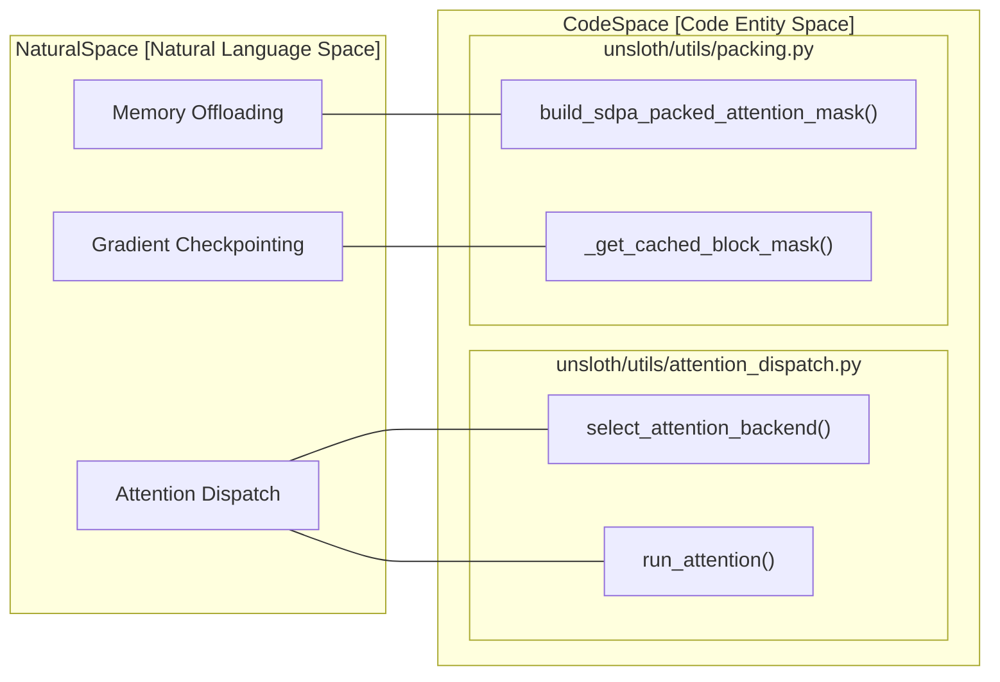

<!-- source: DeepWiki mcp.deepwiki.com · repo unslothai/unsloth · page 6 Training with Core Library · fetched 2026-10-21 -->

# Training with Core Library

<details>
<summary>Relevant source files</summary>

The following files were used as context for generating this wiki page:

- [studio/backend/tests/test_response_template_markers.py](studio/backend/tests/test_response_template_markers.py)
- [studio/backend/utils/datasets/model_mappings.py](studio/backend/utils/datasets/model_mappings.py)
- [tests/test_generation_failure_is_visible.py](tests/test_generation_failure_is_visible.py)
- [tests/test_rl_config_compat.py](tests/test_rl_config_compat.py)
- [tests/test_warnings_issued_guard.py](tests/test_warnings_issued_guard.py)
- [tests/utils/test_attention_dispatch_dora_dtype.py](tests/utils/test_attention_dispatch_dora_dtype.py)
- [tests/utils/test_attention_masks.py](tests/utils/test_attention_masks.py)
- [tests/utils/test_packing.py](tests/utils/test_packing.py)
- [unsloth/models/rl_config_compat.py](unsloth/models/rl_config_compat.py)
- [unsloth/ollama_template_mappers.py](unsloth/ollama_template_mappers.py)
- [unsloth/trainer.py](unsloth/trainer.py)
- [unsloth/utils/attention_dispatch.py](unsloth/utils/attention_dispatch.py)
- [unsloth/utils/packing.py](unsloth/utils/packing.py)

</details>


This page provides a high-level overview of how Unsloth supports training directly using its core library integrations. Unsloth itself does not implement custom training loops independently; instead, it builds on and patches existing training frameworks to inject performance and memory optimizations. Through runtime patching and extension, Unsloth enhances frameworks like TRL for reinforcement learning and PEFT for parameter-efficient fine-tuning.

For in-depth technical guidance on each training aspect, please see the child pages listed at the end of this page. Here we summarize key components, their roles, and how they interact.

---

## System Overview

Unsloth’s core training capabilities revolve around runtime patching and wrapping of standard trainer classes to improve speed, VRAM usage, and flexibility.

| Component | Location | Description |
|---|---|---|
| `UnslothTrainer` | [unsloth/trainer.py:46-54]() | A subclass of TRL’s `SFTTrainer`. Adds support for features like embedding learning rate and automatic sample packing. |
| `_patch_trl_trainer` | [unsloth/trainer.py:50]() | Entry point to patch various TRL training arguments and mechanisms. |
| `configure_sample_packing` / `configure_padding_free` | [unsloth/utils/packing.py:162-176]() | Mutates configurations for packed and padding-free sequence processing. |
| `_ensure_warnings_issued` | [unsloth/trainer.py:1-1140]() | Ensures compatibility with newer transformers versions lacking `warnings_issued` during trainer setup. |

Unsloth modifies training behaviors primarily by intercepting trainer construction, replacing or patching core functions, and injecting fast Triton kernels and memory optimizations. This injection is dynamic and transparent to the user who interacts with standard trainer APIs.

### Training System Architecture
```mermaid
graph TD
    subgraph UserSpace ["Natural Language Space"]
        User["User Training Script"]
    end

    subgraph CoreLib ["Code Entity Space"]
        subgraph trainer_py ["unsloth/trainer.py"]
            UT[/"UnslothTrainer"/]
            UVC[/"UnslothVisionDataCollator"/]
            WGuard["_ensure_warnings_issued()"]
        end

        subgraph utils_py ["unsloth/utils/packing.py"]
            CSP["configure_sample_packing()"]
            CPF["configure_padding_free()"]
            ESP["enable_sample_packing()"]
        end

        subgraph rl_compat_py ["unsloth/models/rl_config_compat.py"]
            FCC["filter_config_init_kwargs()"]
        end
    end

    subgraph ExtFrameworks ["External Frameworks"]
        SFT["SFTTrainer (TRL)"]
        RL["RL Trainers (TRL)"]
    end

    User -->|“SFTTrainer(model, args=…)”| UT
    User -->|“GRPO/DPO Trainers”| RL
    UT --> SFT
    WGuard -->|“Guards warnings_issued attribute”| SFT
    CSP -->|“Mutates SFTConfig”| SFT
    FCC -->|“Filters legacy kwargs”| RL
    ESP -->|“Enables runtime packing”| UT
```
Sources: [unsloth/trainer.py:46-91](), [unsloth/utils/packing.py:162-191](), [unsloth/models/rl_config_compat.py:31-60]()

---

## Standard Fine-tuning (SFT)

SFT is implemented by extending TRL's supervised trainer with Unsloth’s customizations to accelerate and improve VRAM efficiency.

- **`UnslothTrainer` and Data Collators**: Provide extensions to TRL’s `SFTTrainer` alongside utilities like `UnslothVisionDataCollator` which validates local video paths and raises errors on missing files [unsloth/trainer.py:59-91]().
- **Auto Sample Packing & Padding-Free**: Unsloth configures dataset packing and padding-free execution dynamically while maintaining compatibility with tokenization limits [unsloth/trainer.py:93-179]().

For detailed exploration of SFT training, please see the child page: [Standard Fine-tuning (SFT)](#6.1).

---

## Reinforcement Learning Training (RL)

Unsloth deeply integrates with TRL’s RL trainers like GRPO, DPO, and PPO, providing config compatibility layers and dynamic patching systems.

- **Config Compatibility (`rl_config_compat.py`)**: Automatically filters retired arguments, handles renames (such as `use_liger_loss` to `use_liger_kernel`), and maps deprecated TRL config fields to prevent crashes on version upgrades [unsloth/models/rl_config_compat.py:31-90]().
- **Robust Trainer Handling**: Ensures modern transformers compatibility (such as guarding against missing `warnings_issued` attributes in `PreTrainedModel`) when building RL trainers [tests/test_warnings_issued_guard.py:1-28]().

For an in-depth view of RL training patches and integration, see [Reinforcement Learning Training](#6.2).

---

## PEFT and LoRA Integration

Unsloth supports parameter-efficient fine-tuning techniques such as LoRA by configuring adapters and their target modules inline with HuggingFace PEFT conventions.

- **Fast LoRA Kernels**: Unsloth provides optimized kernels for LoRA operations, replacing standard linear layers with fused implementations.
- **Weight Offloading**: For PEFT training, trainable copies are kept on GPU while frozen original modules can be offloaded to CPU or managed efficiently via attention dispatch systems.

Details are provided on the child page [PEFT and LoRA Integration](#6.3).

---

## Training Mode and Forward Pass Management

Unsloth models maintain dual forward-pass implementations to distinguish generation (inference) and training modes.

- **Mode Switching**: Functions enable gradient checkpointing and select the training-optimized forward function dynamically.
- **Dynamic Detection**: Internal flags detect when generation mode is active during rollouts or inference passes to switch behavior accordingly.

For a technical explanation of mode switching, see [Training vs Inference Mode](#6.4).

---

## Sample Packing and Padding-Free Training

To maximize training efficiency, Unsloth supports packing multiple samples into a single sequence batch without padding using attention varlen modes.

- **Boundary Masking**: Internals handle sequence boundaries via functions like `mask_packed_sequence_boundaries` to ensure causal attention does not leak across samples [tests/utils/test_packing.py:20-29]().
- **Packing Utilities**: The `unsloth.utils.packing` module provides the logic for dataset construction, attention mask caching, and sequence length handling [unsloth/utils/packing.py:13-54]().

Complete documentation is available at [Sample Packing and Padding-Free Training](#6.5).

---

## Memory and Performance Optimizations

Unsloth implements advanced optimizations to maximize training throughput and reduce GPU memory pressure:

- **Smart Gradient Checkpointing**: Selectively offloads activations or handles gradient checkpoints to minimize VRAM footprints.
- **Fused Loss Functions & Attention Dispatch**: Dispatches attention execution to the optimal backend (FlashAttention, xFormers, or SDPA) depending on hardware capabilities and sequence properties [unsloth/utils/attention_dispatch.py:32-92]().

### Memory Optimization Mapping

Sources: [unsloth/utils/attention_dispatch.py:32-92](), [unsloth/utils/packing.py:40-125]()

---

## Summary and Subpage Links

Unsloth enhances standard training frameworks via runtime patching, memory optimizations, and sample packing. For more detailed explanations, explore the following child pages:

| Topic | Link |
|---|---|
| Standard Fine-tuning (SFT) | [Standard Fine-tuning (SFT)](#6.1) |
| Reinforcement Learning Training | [Reinforcement Learning Training](#6.2) |
| PEFT and LoRA Integration | [PEFT and LoRA Integration](#6.3) |
| Training vs Inference Mode | [Training vs Inference Mode](#6.4) |
| Sample Packing and Padding-Free Training | [Sample Packing and Padding-Free Training](#6.5) |

Sources: [unsloth/trainer.py:46-91](), [unsloth/utils/packing.py:13-176](), [unsloth/models/rl_config_compat.py:31-90](), [unsloth/utils/attention_dispatch.py:32-92]()

---

