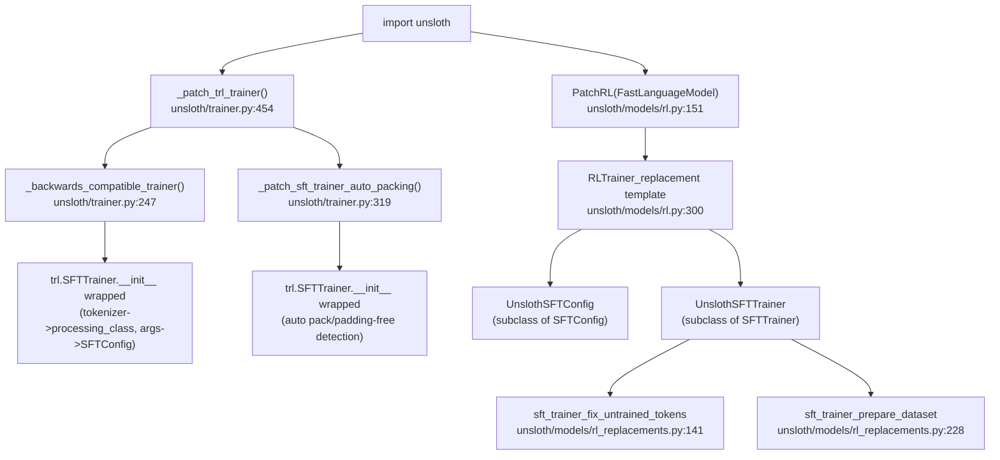
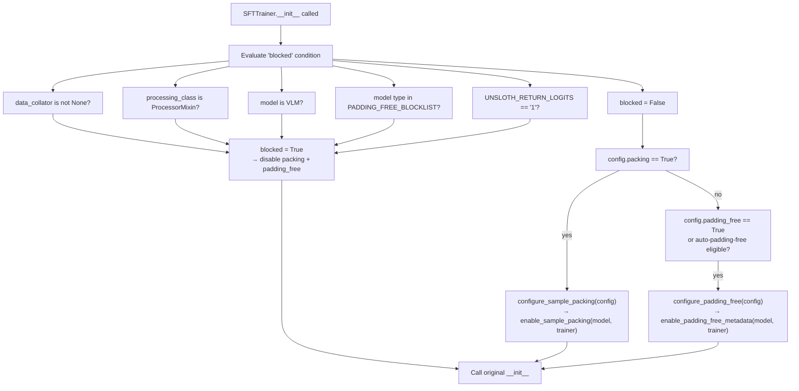
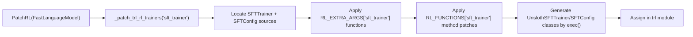
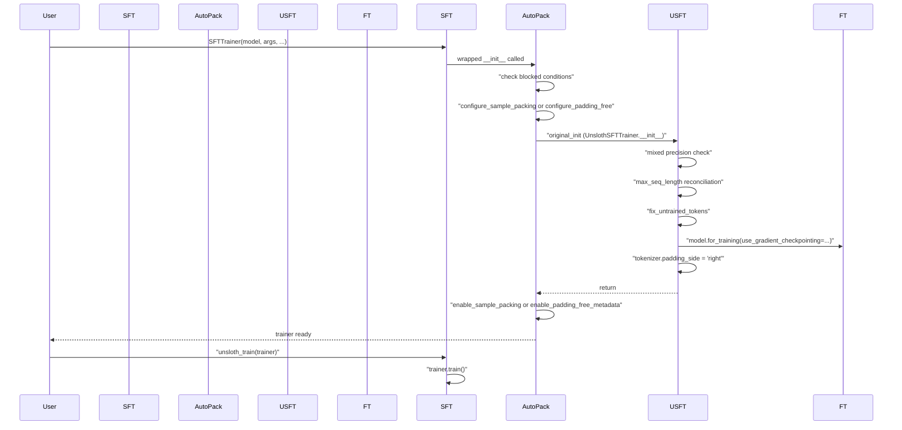

<!-- source: DeepWiki mcp.deepwiki.com · repo unslothai/unsloth · page 6.1 Standard Fine-tuning (SFT) · fetched 2026-10-21 -->

# Standard Fine-tuning (SFT)

Relevant source files

The following files were used as context for generating this wiki page:

- [studio/backend/tests/test_response_template_markers.py](studio/backend/tests/test_response_template_markers.py)
- [studio/backend/utils/datasets/model_mappings.py](studio/backend/utils/datasets/model_mappings.py)
- [tests/test_generation_failure_is_visible.py](tests/test_generation_failure_is_visible.py)
- [tests/test_rl_config_compat.py](tests/test_rl_config_compat.py)
- [tests/test_warnings_issued_guard.py](tests/test_warnings_issued_guard.py)
- [tests/utils/test_attention_dispatch_dora_dtype.py](tests/utils/test_attention_dispatch_dora_dtype.py)
- [tests/utils/test_attention_masks.py](tests/utils/test_attention_masks.py)
- [tests/utils/test_packing.py](tests/utils/test_packing.py)
- [unsloth/models/rl_config_compat.py](unsloth/models/rl_config_compat.py)
- [unsloth/ollama_template_mappers.py](unsloth/ollama_template_mappers.py)
- [unsloth/trainer.py](unsloth/trainer.py)
- [unsloth/utils/attention_dispatch.py](unsloth/utils/attention_dispatch.py)
- [unsloth/utils/packing.py](unsloth/utils/packing.py)

This page covers Unsloth's integration layer for standard supervised fine-tuning (SFT) using TRL's `SFTTrainer` as the baseline. It explains the patching mechanisms applied to TRL at import time, the `UnslothTrainer` and `UnslothTrainingArguments` extensions designed for optimized training, and the gradient checkpointing strategies supported by Unsloth for memory-efficient training.

This page focuses on the core library side involving fine-tuning machinery using `UnslothTrainer`. Topics like reinforcement learning training, PEFT/LoRA integration, and sample packing internals are covered in their dedicated pages. 

---

## Overview

Unsloth integrates with TRL’s `SFTTrainer` by applying layered patches and extensions at import time without replacing TRL's public API. The major aspects are:

- **Import-time patching:** Automates backward compatibility for different TRL versions, injects fixes for tokenization, and enables automatic sample packing or padding-free batching where beneficial [unsloth/trainer.py:454-482]().
- **Custom Trainer and Args extensions:** `UnslothTrainer` and `UnslothTrainingArguments` extend `SFTTrainer` and `SFTConfig` (or `TrainingArguments` for older TRL) to support specialized optimizations like differential learning rates and Q-GaLore optimizer usage [unsloth/trainer.py:171-241]().
- **Gradient Checkpointing:** Unsloth supports multiple gradient checkpointing strategies, including offloaded checkpointing to CPU/disk for significantly reduced VRAM usage during fine-tuning [unsloth/models/_utils.py:155-166]().

Unsloth’s patches allow smooth integration with TRL, enhance training speed and efficiency (2–5× faster), and reduce memory footprints.

---

## Component Map

### SFT Patching and Training Components

This map shows how import-time patching hooks (`_patch_trl_trainer`) set up backward compatibility and sample packing, while `PatchRL` dynamically generates patched trainer classes using source-level code synthesis.

**Sources:** [unsloth/trainer.py:203-316](), [unsloth/trainer.py:454-482](), [unsloth/trainer.py:319-451](), [unsloth/models/rl.py:151-279](), [unsloth/models/rl_replacements.py:141-297]()

---

## `_patch_trl_trainer`: Backward Compatibility and Auto-packing

Called once at import from `unsloth/trainer.py` [454-482](), `_patch_trl_trainer` wraps key TRL trainers' `__init__` methods for backward compatibility with older TRL versions and injects auto sample packing.

### Backward Compatibility

`_backwards_compatible_trainer` [unsloth/trainer.py:247-316]() handles changes such as:

- Renaming the `tokenizer` argument to `processing_class`.
- Converting `TrainingArguments` into TRL native `SFTConfig` (or related config subclasses).
- Resolving wrapped trainer parameter signatures for thin wrapper classes.

This allows older sample code to continue running with newer TRL versions unmodified.

### Auto Sample Packing and Padding-Free Batching

`_patch_sft_trainer_auto_packing` [unsloth/trainer.py:319-451]() wraps `SFTTrainer.__init__` to inspect config and trainer arguments for enabling sample packing or padding-free batching automatically, improving training efficiency.

#### Decision Flow

The `blocked` condition disables packing/padding-free features in certain cases. The `PADDING_FREE_BLOCKLIST` includes:

- `"gemma2"`: uses `slow_attention_softcapping` with known `torch.compile` issues [unsloth/trainer.py:350-353]().
- `"gpt_oss"`: uses Flex Attention which mishandles padding-free batching [unsloth/trainer.py:354-357]().

If sample packing fails during initialization (signaled by exceptions matching `_AUTO_PACK_SKIP_MESSAGES`), packing is disabled and retried [unsloth/trainer.py:431-451]().

**Sources:** [unsloth/trainer.py:247-482]()

---

## UnslothTrainer and UnslothTrainingArguments

Unsloth extends TRL’s classes with these for better support of custom optimizers and optimizations.

### UnslothTrainingArguments

Extends TRL's `SFTConfig` or `TrainingArguments` (depending on TRL version):

- Adds `embedding_learning_rate` (optional float) for applying a separate LR to embeddings and output layers [unsloth/trainer.py:187]().
- Adds `q_galore_config` for integrating Q-GaLore optimizer configuration along with other parameters [unsloth/trainer.py:188]().

See definition: [unsloth/trainer.py:171-191]()

| Parameter              | Type           | Description                                         |
|------------------------|----------------|-----------------------------------------------------|
| `embedding_learning_rate` | `Optional[float]` | Separate learning rate for embedding-related params |
| `q_galore_config`      | `Optional[QGaloreConfig]` | Q-GaLore optimizer config for quantized training     |

### UnslothTrainer

Extends TRL’s `SFTTrainer` by overriding `create_optimizer()`:

- If `q_galore_config` is specified, creates the Q-GaLore optimizer integrating quantization-aware optimizations [unsloth/trainer.py:204-207]().
- If `embedding_learning_rate` is set but not Q-GaLore, it creates an optimizer with **differential learning rates**:
  - Embeddings and output heads get the separate LR.
  - Other parameters get the main LR [unsloth/trainer.py:209-223]().
- Otherwise, defaults to base TRL optimizer behavior.

See relevant code: [unsloth/trainer.py:194-241]()

**Sources:** [unsloth/trainer.py:171-241]()

---

### Differential Learning Rate Optimizer Creation

The helper `_create_unsloth_optimizer` splits parameters into two groups:

| Parameter Group               | Criteria                                                                            | Learning Rate                    |
|------------------------------|------------------------------------------------------------------------------------|---------------------------------|
| `non_embeddings`              | All trainable parameters **except** those that belong to `modules_to_save.default.weight` | Main LR (`self.args.learning_rate`) |
| `embeddings`                  | Module parameters named exactly `modules_to_save.default.weight` (PEFT embedding) | Embedding LR (`self.args.embedding_learning_rate`) |

This strategy focuses on assigning a different LR for `lm_head` and `embed_tokens` which are saved in LoRA-aware fine-tuning modules, called `modules_to_save` [unsloth/trainer.py:22-26]().

**Sources:** [unsloth/trainer.py:22-26]()

---

## PatchRL and Dynamic SFTTrainer Subclass Generation

`PatchRL` [unsloth/models/rl.py:151-279]() dynamically patches TRL’s trainers when called by:

- Scanning TRL modules for `SFTTrainer` and `SFTConfig`.
- Extracting their source code using `inspect.getsource` [unsloth/models/rl.py:304-305]().
- Injecting extra args, functions, and fixes from the `RL_EXTRA_ARGS` and `RL_FUNCTIONS` registry keyed for `"sft_trainer"` [unsloth/models/rl.py:355-385]().
- Compiling a replacement class template (`RLTrainer_replacement`) into Unsloth’s subclasses `UnslothSFTTrainer`/`UnslothSFTConfig` [unsloth/models/rl.py:512-516]().
- Assigning these classes back into `trl.trainer.sft_trainer` [unsloth/models/rl.py:532-535]().

This enables sophisticated fixes like:

- Automatic mixed precision determination from model dtype and arguments [unsloth/models/rl.py:712-754]().
- Validation of training arguments against model dtype.
- Extended max sequence length reconciliation [unsloth/models/rl.py:657-664]().
- Adjusting tokenizer padding side to `"right"` for consistency [unsloth/models/rl.py:702-703]().
- Enabling returning logits flag (`UNSLOTH_RETURN_LOGITS`) to support padding-free batch logic.

### PatchRL Code Synthesis Flow

**Sources:** [unsloth/models/rl.py:151-437](), [unsloth/models/rl_replacements.py:141-329]()

---

## Tokenizer Fixes Applied During SFT Initialization

Unsloth injects fixes for tokenizer and dataset during fine-tuning initialization:

- **Untrained Tokens Fix:** `sft_trainer_fix_untrained_tokens` [unsloth/models/rl_replacements.py:141-152]() is injected to fix cases where newly added special tokens produce zero training loss due to uninitialized embeddings.

- **Avoid Double BOS Tokens:** `sft_trainer_prepare_dataset` [unsloth/models/rl_replacements.py:228-297]() wraps tokenizer calls in the dataset preparation to detect if input text already starts with a BOS token and disables automatic adding of special tokens to avoid duplication.

**Sources:** [unsloth/models/rl_replacements.py:141-297]()

---

## Mixed Precision Handling

`UnslothSFTTrainer.__init__` includes logic to validate and infer `fp16` or `bf16` training modes based on:

- Environment variables (`UNSLOTH_FORCE_FLOAT32` disables all mixed precision).
- Model’s configured torch dtype (`fp32`, `fp16`, `bf16`).
- User-supplied `bf16`/`fp16` flags in training arguments.

It raises clear `TypeError` if mismatches appear, e.g., model is FP16 but training requests BF16 [unsloth/models/rl.py:712-754]().

This ensures precision modes align properly during fine-tuning.

**Sources:** [unsloth/models/rl.py:712-754]()

---

## Gradient Checkpointing in Standard Fine-tuning

Unsloth supports several gradient checkpointing configurations, enhancing memory efficiency during SFT:

- **Unsloth Offloaded Gradient Checkpointing:** Uses `Unsloth_Offloaded_Gradient_Checkpointer` [unsloth/models/_utils.py:156]() to offload intermediate activations and computation states from GPU to CPU or disk [unsloth/models/_utils.py:38](), enabling training of larger models with less VRAM.

- **Patch Gradient Checkpointing:** Unsloth patches HuggingFace / transformers gradient checkpointing logic [unsloth/models/_utils.py:59]() to fix known issues and improve compatibility.

- **Apply Smart Gradient Checkpointing:** An enhanced scheme available in Unsloth that throttles checkpointing selectively for speed-memory tradeoffs [unsloth/models/_utils.py:65]().

Integration and management of these checkpointing methods occur primarily in `unsloth/models/_utils.py` and patching functions in `unsloth_zoo.gradient_checkpointing`:

- Key classes/functions:
  - `Unsloth_Offloaded_Gradient_Checkpointer` [unsloth/models/_utils.py:156]()
  - `unsloth_offloaded_gradient_checkpoint` [unsloth/models/_utils.py:157]()
  - `patch_unsloth_gradient_checkpointing` [unsloth/models/_utils.py:158]()
  - `patch_gradient_checkpointing` [unsloth/models/_utils.py:162]()
  - `apply_unsloth_gradient_checkpointing` [unsloth/models/_utils.py:105]()

During SFT, the user can configure gradient checkpointing modes via training args, which trigger corresponding patching.

**Sources:** [unsloth/models/_utils.py:38-166]()

---

## Training Call Flow Summary

The following sequence diagram summarizes how Unsloth fine-tuning initialization and training functions operate with patched TRL:

**Sources:** [unsloth/trainer.py:140-482](), [unsloth/models/rl.py:151-279]()

---

## Utility: `unsloth_train`

`unsloth_train(trainer)` [unsloth/trainer.py:140-163]() wraps `trainer.train()` to apply known patches for transformers versions < 4.45.2:

- For newer transformers versions, it calls `trainer.train()` directly.
- For older versions, applies a custom gradient accumulation fix from `unsloth_zoo.training_utils`.

Users are encouraged to call `unsloth_train(trainer)` to automatically benefit from these fixes during SFT.

**Sources:** [unsloth/trainer.py:140-163]()

---

# Summary

Unsloth’s Standard Fine-tuning support is built on a foundation of:

- Transparent, backward-compatible patching of TRL and transformers trainers.
- Enhanced `UnslothTrainer` and training argument classes supporting optimizer customizations.
- Robust gradient checkpointing strategies to reduce VRAM consumption.
- Automatic sample packing and padding-free batch optimizations that work around model and tokenizer specifics.
- Tokenizer fixes preventing common fine-tuning pitfalls such as uninitialized embeddings or duplicate BOS tokens.
- Mixed precision mode consistency checks aligned with model dtypes and environment settings.

These features collectively enable Unsloth users to train large language models faster and efficiently, using the familiar TRL `SFTTrainer` plus powerful memory/performance optimizations.

---

# References

- [unsloth/trainer.py:140-482]()
- [unsloth/models/rl.py:151-279]()
- [unsloth/models/rl_replacements.py:141-329]()
- [unsloth/models/_utils.py:143-153, 161-190]()
- [unsloth/trainer.py:319-451]()

---

