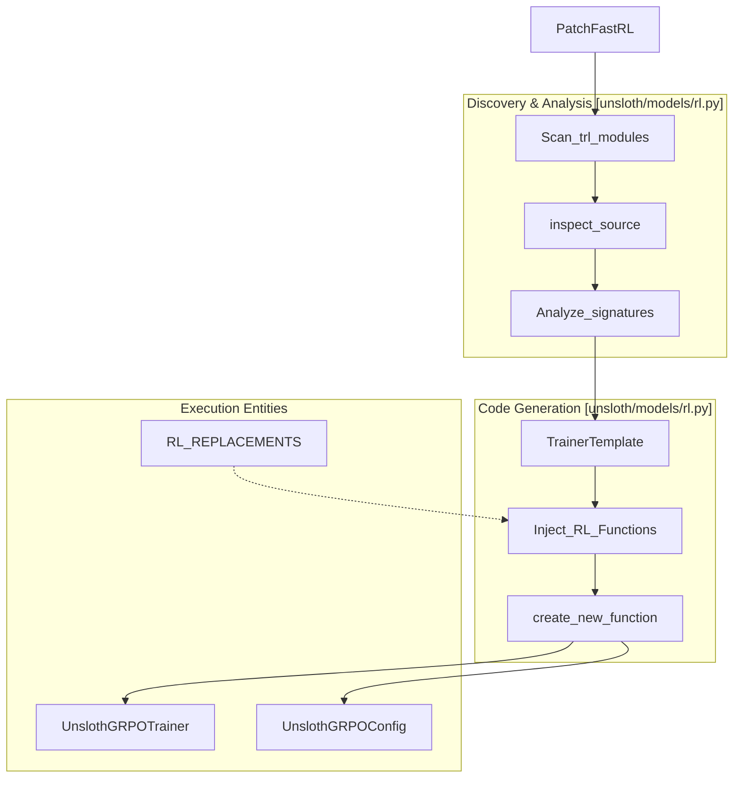
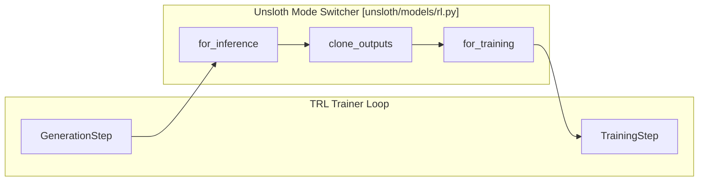
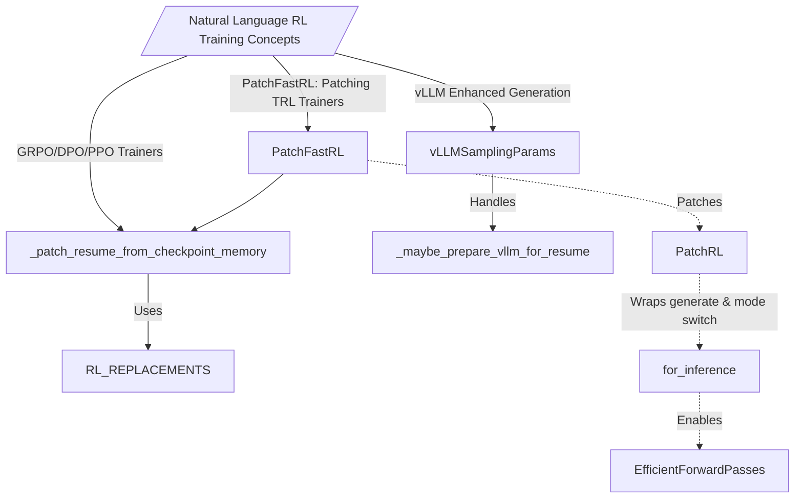

<!-- source: DeepWiki mcp.deepwiki.com · repo unslothai/unsloth · page 6.2 Reinforcement Learning Training · fetched 2026-10-21 -->

# Reinforcement Learning Training

<details>
<summary>Relevant source files</summary>

The following files were used as context for generating this wiki page:

- [README.md](README.md)
- [pyproject.toml](pyproject.toml)
- [tests/python/test_construct_chat_template_validation.py](tests/python/test_construct_chat_template_validation.py)
- [tests/test_fp8_pre_sm89_dequant_fallback.py](tests/test_fp8_pre_sm89_dequant_fallback.py)
- [tests/test_import_fixes_drift.py](tests/test_import_fixes_drift.py)
- [unsloth/__init__.py](unsloth/__init__.py)
- [unsloth/_gpu_init.py](unsloth/_gpu_init.py)
- [unsloth/chat_templates.py](unsloth/chat_templates.py)
- [unsloth/import_fixes.py](unsloth/import_fixes.py)
- [unsloth/kernels/fp8.py](unsloth/kernels/fp8.py)
- [unsloth/models/__init__.py](unsloth/models/__init__.py)
- [unsloth/models/_utils.py](unsloth/models/_utils.py)
- [unsloth/models/dpo.py](unsloth/models/dpo.py)
- [unsloth/models/llama.py](unsloth/models/llama.py)
- [unsloth/models/loader.py](unsloth/models/loader.py)
- [unsloth/models/loader_utils.py](unsloth/models/loader_utils.py)
- [unsloth/models/mapper.py](unsloth/models/mapper.py)
- [unsloth/models/mistral.py](unsloth/models/mistral.py)
- [unsloth/models/rl.py](unsloth/models/rl.py)
- [unsloth/models/rl_replacements.py](unsloth/models/rl_replacements.py)
- [unsloth/models/vision.py](unsloth/models/vision.py)
- [unsloth/save.py](unsloth/save.py)
- [unsloth/tokenizer_utils.py](unsloth/tokenizer_utils.py)

</details>


## Purpose and Scope

This document provides comprehensive technical documentation for Unsloth's Reinforcement Learning (RL) training infrastructure. The system integrates with the Hugging Face TRL (Transformer Reinforcement Learning) library to enable efficient RL training for GRPO, DPO, PPO, and KTO algorithms. It leverages vLLM for accelerated generation rollouts, implements optimized loss computations, and uses a dynamic patching system for seamless integration and performance gains.

Key technical features include:
- **Dynamic Patching System**: Intercepts TRL trainers at runtime, injecting Unsloth's optimized methods and environment fixes without manual TRL code modification [unsloth/models/rl.py:1-198]().
- **Support for GRPO/DPO/PPO algorithms**: Implements patched versions of TRL's trainers with enhanced loss functions, dataset handling, and generation coordination [unsloth/models/rl_replacements.py:1-189]().
- **vLLM Generation Optimization**: Integrates a colocated vLLM engine for high-throughput generation during policy rollouts in RL loops [unsloth/models/rl.py:51-126]().
- **Memory-Efficient Loss and Sequence Packing**: Applies chunked loss computation and selective log-softmax to handle large sequences and packed inputs [unsloth/models/rl_replacements.py:26-34]().
- **Mode Switching for Training and Inference**: Orchestrates transitions between inference mode (generation speed) and training mode (gradient efficiency) in the training loop [unsloth/models/rl.py:183-198]().

Sources: [unsloth/models/rl.py:1-198](), [unsloth/models/rl_replacements.py:1-189]()

---

## System Architecture Overview

Unsloth's RL training system is built on a dynamic patching approach that unwraps and enhances the TRL trainers and configurations, injecting custom code and environment management features to accelerate training and generation.

### Patching Workflow

1. **Detection**: The patching system scans installed TRL modules and inspects the trainer classes (e.g., `GRPOTrainer`, `DPOTrainer`) [unsloth/models/rl.py:146-198]().
2. **Code Extraction**: Source code for key methods and `__init__` signatures is extracted using `inspect` [unsloth/models/rl.py:22-25]().
3. **Generation**: Templates for Unsloth-enhanced trainers and configs are populated with patches, replacements, and extra arguments [unsloth/models/rl_replacements.py:13-39]().
4. **Injection**: Dynamic function creation (`create_new_function`) generates new trainer and config classes with Unsloth optimizations [unsloth/models/rl.py:27]().
5. **Replacement**: Original TRL classes are replaced with patched versions during runtime transparently [unsloth/models/rl.py:146-198]().

### RL Patching Flow


Sources: [unsloth/models/rl.py:1-198](), [unsloth/models/rl_replacements.py:1-39]()

---

## PatchFastRL Entry Point

The `PatchFastRL()` function is the core integration point to enable Unsloth's RL training enhancements over TRL. It is designed to be called prior to any TRL trainer instantiation [unsloth/models/rl.py:146-198]().

### Core Responsibilities

- **Patch Model Unwrapping**: Patches the `unwrap_model_for_generation` method to support Unsloth's dual forward pass architecture with `.clone()` wrapped tensors for inference to prevent gradient issues [unsloth/models/rl.py:146-198]().
- **Replace Trainers**: Iterates over supported TRL trainers (GRPO, DPO, PPO, KTO, SFT) and applies tailored replacements and patches for each [unsloth/models/rl.py:146-198]().

### Key Components Summary

| Component           | Role                                                      | Code Entity                            |
|---------------------|-----------------------------------------------------------|--------------------------------------|
| Model Wrapper       | Patch model unwrapping and generation method cloning      | `PatchRL` [unsloth/models/rl.py:146]() |
| Trainer Patcher     | Inject patched trainer and config classes                 | `PatchFastRL` [unsloth/models/rl.py:146]() |
| Sampling Parameters | vLLM sampling params wrapper with stored kwargs           | `vLLMSamplingParams` [unsloth/models/rl.py:86]() |
| Resume Guard        | Add GPU memory cleanup routines when resuming checkpoints | `_patch_resume_from_checkpoint_memory` [unsloth/models/rl.py:124]() |

Sources: [unsloth/models/rl.py:86-145](), [unsloth/models/rl.py:146-198]()

---

## vLLM Integration for Generation

Unsloth tightly integrates vLLM to accelerate generation rollouts used during RL policy optimization phases like GRPO and PPO.

### Design Highlights

- **vLLMSamplingParams Wrapper**: Provides a shim that initializes vLLM `SamplingParams` from kwargs while preserving the original keyword argument dictionary for introspection or patching [unsloth/models/rl.py:86-91]().
- **GuidedDecoding Compatibility**: If vLLM lacks a `GuidedDecodingParams` class (varied by version), Unsloth defines a dummy class to satisfy TRL dependency expectations [unsloth/models/rl.py:49-60]().

### Memory and Resume Management

When resuming from checkpoints, vLLM may hold onto GPU resources that interfere with loading:

- Detects `enable_sleep_mode` in vLLM config for a graceful sleep call [unsloth/models/rl.py:104-110]().
- Calls `llm.sleep(1)` to release GPU memory and idle the engine [unsloth/models/rl.py:112-115]().
- Runs `gc.collect()` and `torch.cuda.empty_cache()` multiple times to ensure memory is freed [unsloth/models/rl.py:117-122]().

This improves reliability and reduces VRAM pressure during RL checkpoint resume [unsloth/models/rl.py:124-144]().

Sources: [unsloth/models/rl.py:49-60](), [unsloth/models/rl.py:86-144]()

---

## Trainer-Specific Optimizations

Unsloth uses a registry pattern defined in `unsloth/models/rl_replacements.py` to inject code snippets, function replacements, and configuration fixes tailored for each RL trainer type.

### SFT Trainer Fixes

- **Untrained Token Correction**: Automatically detects tokens in the dataset missing in the tokenizer embedding matrix, applying fixes to avoid zero-loss or training failures [unsloth/models/rl_replacements.py:136-150]().

### GRPO Trainer Optimizations

- **vLLM Top_k Adjustment**: Corrects default `top_k` to -1 for vLLM compatibility in GRPO generation config, avoiding runtime errors [unsloth/models/rl_replacements.py:153-158]().
- **Sequence Packing and Prefix Grouper**: Enables hardware-optimized sequence packing gates and prefix grouping heuristics controlled by environment variables `UNSLOTH_GRPO_SEQ_PACKING` and `UNSLOTH_GRPO_PREFIX_GROUPER` [unsloth/models/rl_replacements.py:57-89]().

### DPO Trainer Optimizations

- **Dataset Column Pruning**: Removes unnecessary 'chosen', 'rejected', and 'prompt' columns after tokenization to reduce memory overhead [unsloth/models/rl_replacements.py:161-178]().
- **Data Collator Replacement**: Disables default language modeling collator when DPO dataset structure is detected, allowing specialized collators to work correctly [unsloth/models/rl_replacements.py:180-189]().
- **Vision-Specific Column Handling**: Accounts for multimodal input keys relevant to DPO vision training such as `pixel_position_ids` and `mm_token_type_ids` [unsloth/models/rl_replacements.py:113-118]().

Sources: [unsloth/models/rl_replacements.py:57-189]()

---

## Mode Management and Precision

Efficient RL training with Unsloth involves switching between inference mode (fast generation) and training mode (gradient updates) within the same training loop.

### Training-Inference Mode Switching

Unsloth wraps TRL's model unwrapping and generation process:

- At the start of generation, the model is temporarily switched to inference mode using `FastLanguageModel.for_inference()` [unsloth/models/rl.py:196]().
- The `.generate()` method is monkey patched to clone output tensors, preserving stability when Unsloth uses inference-optimized tensor layouts [unsloth/models/rl.py:198-198]().
- Post generation, the model is switched back to training mode with `FastLanguageModel.for_training()` for backward passes and optimizer steps [unsloth/models/rl.py:1-198]().

### Mode Switching Logic


Sources: [unsloth/models/rl.py:183-198]()

---

## Configuration Registry Reference

Unsloth extends TRL with global registries defined in `unsloth/models/rl_replacements.py` to customize trainer behavior dynamically.

| Registry | Purpose | Code Reference |
| :--- | :--- | :--- |
| `RL_EXTRA_ARGS` | Code run in trainer `__init__` before `super()` call | [unsloth/models/rl_replacements.py:13-18]() |
| `RL_FUNCTIONS` | Method-level replacements like `compute_loss` | [unsloth/models/rl_replacements.py:13-18]() |
| `RL_PRE_ITEMS` | Logic injected at the start of trainer `__init__` | [unsloth/models/rl_replacements.py:13-18]() |
| `RL_CONFIG_CHANGES` | Modifications to config class logic (GRPOConfig, DPOConfig) | [unsloth/models/rl_replacements.py:13-18]() |
| `RL_METRICS_CHANGES` | Custom rewards and KL divergence logging | [unsloth/models/rl_replacements.py:13-18]() |
| `RL_ADDITIONAL_FUNCTIONS` | Extra helper methods for trainers | [unsloth/models/rl_replacements.py:13-18]() |

Sources: [unsloth/models/rl_replacements.py:12-18]()

---

## Natural Language to Code Entity Mapping

This diagram bridges the conceptual RL training workflow with the key Unsloth code entities implementing it.

### Concept to Entity Mapping


### RL Training Data Flow
```mermaid
flowchart LR
    subgraph TrainerPatch["Dynamic Patching System"]
        PatchFastRL --> TrainReplace
        TrainReplace["_patch_resume_from_checkpoint_memory"]
        TrainReplace --> RLReplacements["RL_REPLACEMENTS"]
    end

    subgraph Generation["vLLM Integration & Generation"]
        TrainerSpace["TrainerModel"] --> vLLMEngine["vLLMEngine"]
        GenParams["vLLMSamplingParams"] --> vLLMEngine
        Generation -->|Rollouts| GenParams

        TrainerSpace -->|.generate calls| Generation
        Generation -->|Patching outputs| ModeSwitching["for_inference"]
    end

    subgraph DatasetLoss["Dataset and Loss"]
        Dataset["TrainingDataset"] --> Trainer["RLTrainerInstance"]
        ChunkedLoss["ChunkedLoss"] --> Trainer
    end

    DatasetLoss -.-> TrainerPatch
    TrainerPatch --> Generation
```

Sources: [unsloth/models/rl.py:1-198](), [unsloth/models/rl_replacements.py:1-189]()

---

