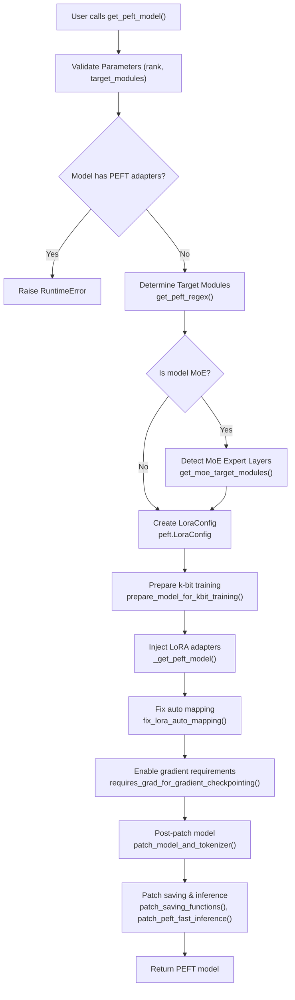
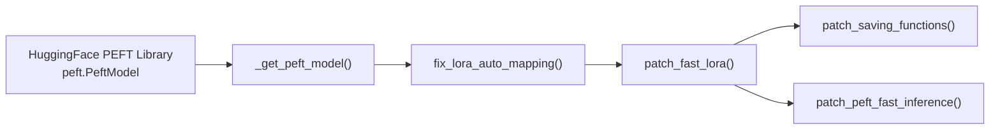

<!-- source: DeepWiki mcp.deepwiki.com · repo unslothai/unsloth · page 6.3 PEFT and LoRA Integration · fetched 2026-10-21 -->

# PEFT and LoRA Integration

Relevant source files

The following files were used as context for generating this wiki page:

- [README.md](README.md)
- [pyproject.toml](pyproject.toml)
- [tests/python/test_construct_chat_template_validation.py](tests/python/test_construct_chat_template_validation.py)
- [tests/test_fp8_pre_sm89_dequant_fallback.py](tests/test_fp8_pre_sm89_dequant_fallback.py)
- [tests/test_import_fixes_drift.py](tests/test_import_fixes_drift.py)
- [unsloth/__init__.py](unsloth/__init__.py)
- [unsloth/_gpu_init.py](unsloth/_gpu_init.py)
- [unsloth/chat_templates.py](unsloth/chat_templates.py)
- [unsloth/import_fixes.py](unsloth/import_fixes.py)
- [unsloth/kernels/fp8.py](unsloth/kernels/fp8.py)
- [unsloth/models/_utils.py](unsloth/models/_utils.py)
- [unsloth/models/llama.py](unsloth/models/llama.py)
- [unsloth/models/loader.py](unsloth/models/loader.py)
- [unsloth/models/loader_utils.py](unsloth/models/loader_utils.py)
- [unsloth/models/mapper.py](unsloth/models/mapper.py)
- [unsloth/models/mistral.py](unsloth/models/mistral.py)
- [unsloth/models/rl.py](unsloth/models/rl.py)
- [unsloth/models/rl_replacements.py](unsloth/models/rl_replacements.py)
- [unsloth/models/vision.py](unsloth/models/vision.py)
- [unsloth/save.py](unsloth/save.py)
- [unsloth/tokenizer_utils.py](unsloth/tokenizer_utils.py)

This page details the implementation and integration of LoRA adapters within Unsloth using the HuggingFace PEFT library. It covers the process of setting up LoRA adapters, automatic detection and configuration of target modules for injection, enhancements for Mixture-of-Experts (MoE) models, and composability with quantization and Reinforcement Learning (RL) workflows. The technical flow, code entities, and key functions/classes involved in PEFT+LoRA integration are explained.

---

## Overview

Unsloth provides a seamless interface to HuggingFace's PEFT library, focusing on Low-Rank Adaptation (LoRA) for parameter-efficient fine-tuning. The integration enables:

- Automatic detection of modules suitable for LoRA injection based on model architecture `[unsloth/models/_utils.py:86-93]()`.
- Support for MoE model architectures by detecting expert layers `[unsloth/models/_utils.py:91-95]`.
- Compatibility with quantized weights including 4-bit and 8-bit training `[unsloth/models/loader.py:102-104]()`.
- Patching and optimization for RL trainers `[unsloth/models/rl.py:151-152]()`.
- Custom efficient LoRA kernels implemented in Triton `[unsloth/models/_utils.py:73]()`.

The integration maintains compatibility with the PEFT API while adding Unsloth-specific optimizations and patches around LoRA adapters.

Sources: `[unsloth/models/_utils.py:86-93]()`, `[unsloth/models/loader.py:102-104]()`, `[unsloth/models/rl.py:151-152]()`

---

## High-Level LoRA Injection Flow

The core function to add PEFT LoRA layers is usually invoked via `FastLanguageModel.get_peft_model` `[unsloth/models/llama.py:134]()` or `FastVisionModel.get_peft_model` `[unsloth/models/vision.py:67]()`.

Title: LoRA Injection Flow and Code Entity Mapping

Sources: `[unsloth/models/llama.py:132-135]`, `[unsloth/models/vision.py:65-68]()`, `[unsloth/models/_utils.py:86-95]()`

---

## LoRA Adapter Setup

### `get_peft_model` Implementation

The `get_peft_model` function performs the following steps:
1. **Validation**: Checks if the model is already a `PeftModel` `[unsloth/models/llama.py:132-135]()`.
2. **Targeting**: Obtains the regex pattern for target modules via `get_peft_regex()` `[unsloth/models/vision.py:70-71]()`. For MoE models, it detects expert-specific modules using `get_moe_target_modules()` `[unsloth/models/_utils.py:87-90]()`.
3. **Configuration**: Constructs a `LoraConfig` using the provided rank `r`, `lora_alpha`, and `target_modules` `[unsloth/models/llama.py:134]()`.
4. **Quantization Preparation**: Calls `prepare_model_for_kbit_training` to ensure frozen base weights are handled correctly during gradient calculation `[unsloth/models/_utils.py:22]()`.
5. **Injection**: Invokes the underlying PEFT `_get_peft_model` to wrap the model `[unsloth/models/llama.py:134]()`.
6. **Fixes & Optimization**:
    - `fix_lora_auto_mapping()` ensures correct layer identification `[unsloth/models/llama.py:66]()`.
    - `patch_saving_functions()` handles Unsloth-specific saving logic `[unsloth/models/llama.py:136]()`.
    - `patch_peft_fast_inference()` enables optimized inference kernels for the new adapters `[unsloth/models/_utils.py:77]()`.

Sources: `[unsloth/models/llama.py:132-136]()`, `[unsloth/models/_utils.py:22-82]()`

---

## Target Module Configuration

Unsloth provides automatic determination of target modules for LoRA injection depending on the model architecture.

### Module Detection Logic
- **Standard LLMs**: Typically targets `q_proj`, `k_proj`, `v_proj`, `o_proj`, `gate_proj`, `up_proj`, and `down_proj` `[unsloth/save.py:116-124]()`.
- **MoE Models**: Extends targeting to expert-specific linear layers detected via `get_moe_target_modules()` `[unsloth/models/_utils.py:87-90]()`.
- **Vision Models**: Targets specific vision encoder layers and multimodal projectors `[unsloth/models/vision.py:67-74]()`.

### Expert Module Targeting (MoE)
For architectures like Mixtral or DeepSeek-MoE, Unsloth ensures that the LoRA adapters are correctly placed within expert blocks to allow fine-tuning of specialized pathways `[unsloth/models/_utils.py:86-90]()`.

Sources: `[unsloth/models/_utils.py:86-90]()`, `[unsloth/save.py:116-124]()`, `[unsloth/models/vision.py:67-74]()`

---

## Integration with HuggingFace PEFT

Unsloth leverages HuggingFace PEFT for the core LoRA adapter implementation while performing several customized patches to enhance performance.

Title: PEFT Integration & Code Entities

Sources: `[unsloth/models/_utils.py:73-82]()`, `[unsloth/models/llama.py:66-136]()`

---

## LoRA Fused Kernels and Quantization

Unsloth includes highly optimized Triton kernels to accelerate LoRA forward and backward computations, especially when combined with 4-bit / 8-bit quantized weights.

- **Forward**: Fuses the base layer matmul with the LoRA `A` and `B` matrix projections.
- **Backward**: Computes gradients for LoRA `A` and `B` weights while dequantizing base weights on-the-fly via `fast_dequantize` `[unsloth/save.py:58]()`.

Sources: `[unsloth/models/_utils.py:73]()`, `[unsloth/save.py:58-63]()`

---

## Reinforcement Learning (RL) Adaptations

Unsloth adapts PEFT LoRA models for use with RL trainers from `trl` (e.g., GRPO, DPO, PPO) `[unsloth/models/rl.py:146]()`.

- **`PatchRL`**: A patching utility that modifies `trl` trainers to use Unsloth's optimized generation and memory management `[unsloth/models/rl.py:146-152]()`.
- **Mode Switching**: `unsloth_unwrap_model_for_generation` handles the transition between training (gradient enabled) and inference (KV caching enabled) modes during RL rollouts `[unsloth/models/rl.py:184-197]()`.

Sources: `[unsloth/models/rl.py:146-197]()`

---

## Quantization and Model Preparation

Unsloth prepares models for LoRA + k-bit fine-tuning using specific mapping and initialization routines.

- **Pre-quantized Mapping**: The `INT_TO_FLOAT_MAPPER` and `FLOAT_TO_INT_MAPPER` in `unsloth/models/mapper.py` resolve pre-quantized model names to their original counterparts to ensure correct tokenizer and configuration loading `[unsloth/models/mapper.py:13-18]()`.
- **k-bit Preparation**: `prepare_model_for_kbit_training` is patched to handle Unsloth's custom gradient checkpointers and offloading mechanisms `[unsloth/models/_utils.py:22]()`.

Sources: `[unsloth/models/mapper.py:13-18]()`, `[unsloth/models/_utils.py:22]()`

---

## Summary of Key Entities

| Entity/Function | Source | Role |
| :--- | :--- | :--- |
| `FastLanguageModel.get_peft_model` | `[unsloth/models/llama.py:134]()` | Main entry point for adding LoRA to LLMs |
| `FastVisionModel.get_peft_model` | `[unsloth/models/vision.py:67]()` | Main entry point for adding LoRA to VLMs |
| `prepare_model_for_kbit_training` | `[unsloth/models/_utils.py:22]()` | Prepares quantized models for adapter training |
| `patch_fast_lora` | `[unsloth/models/_utils.py:73]()` | Enables Triton-accelerated LoRA kernels |
| `patch_peft_fast_inference` | `[unsloth/models/_utils.py:77]()` | Optimizes generative inference for PEFT models |
| `fix_lora_auto_mapping` | `[unsloth/models/llama.py:66]()` | Resolves layer naming mismatches between PEFT and Unsloth |
| `PatchRL` | `[unsloth/models/rl.py:146]()` | Adapts TRL reinforcement learning trainers for Unsloth |

Sources: `[unsloth/models/llama.py:66-134]()`, `[unsloth/models/vision.py:67]()`, `[unsloth/models/_utils.py:22-77]()`, `[unsloth/models/rl.py:146]()`

---

