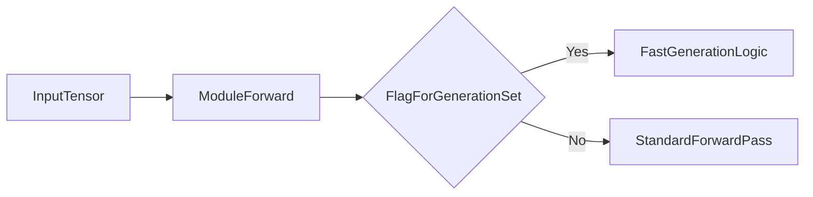
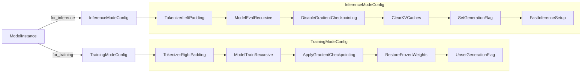
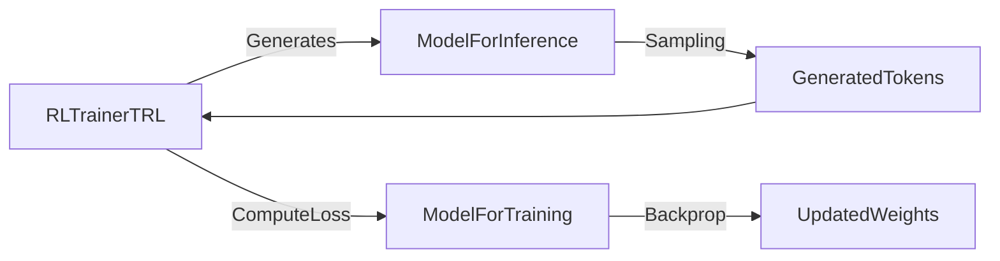
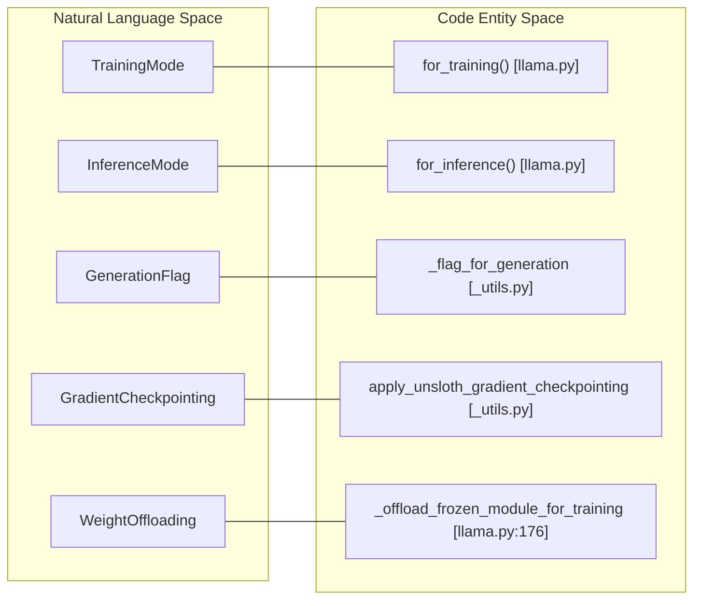

<!-- source: DeepWiki mcp.deepwiki.com · repo unslothai/unsloth · page 6.4 Training vs Inference Mode · fetched 2026-10-21 -->

# Training vs Inference Mode

Relevant source files

The following files were used as context for generating this wiki page:

- [README.md](README.md)
- [pyproject.toml](pyproject.toml)
- [tests/_shared/real_accelerator.py](tests/_shared/real_accelerator.py)
- [tests/conftest.py](tests/conftest.py)
- [tests/fast_inference/test_fast_inference.py](tests/fast_inference/test_fast_inference.py)
- [tests/python/test_construct_chat_template_validation.py](tests/python/test_construct_chat_template_validation.py)
- [tests/studio/test_gpu_inference_smoke.py](tests/studio/test_gpu_inference_smoke.py)
- [tests/test_cross_entropy_softcap_padding.py](tests/test_cross_entropy_softcap_padding.py)
- [tests/test_dispatch_hook_repair.py](tests/test_dispatch_hook_repair.py)
- [tests/test_float32_generate_autocast.py](tests/test_float32_generate_autocast.py)
- [tests/test_fp8_pre_sm89_dequant_fallback.py](tests/test_fp8_pre_sm89_dequant_fallback.py)
- [tests/test_import_fixes_drift.py](tests/test_import_fixes_drift.py)
- [tests/test_offload_frozen_module_device.py](tests/test_offload_frozen_module_device.py)
- [tests/test_rmsnorm_gradient_layout.py](tests/test_rmsnorm_gradient_layout.py)
- [tests/test_uma_safetensors_load.py](tests/test_uma_safetensors_load.py)
- [unsloth/__init__.py](unsloth/__init__.py)
- [unsloth/_gpu_init.py](unsloth/_gpu_init.py)
- [unsloth/chat_templates.py](unsloth/chat_templates.py)
- [unsloth/import_fixes.py](unsloth/import_fixes.py)
- [unsloth/kernels/fp8.py](unsloth/kernels/fp8.py)
- [unsloth/models/_utils.py](unsloth/models/_utils.py)
- [unsloth/models/llama.py](unsloth/models/llama.py)
- [unsloth/models/loader.py](unsloth/models/loader.py)
- [unsloth/models/loader_utils.py](unsloth/models/loader_utils.py)
- [unsloth/models/mapper.py](unsloth/models/mapper.py)
- [unsloth/models/mistral.py](unsloth/models/mistral.py)
- [unsloth/models/rl.py](unsloth/models/rl.py)
- [unsloth/models/rl_replacements.py](unsloth/models/rl_replacements.py)
- [unsloth/models/vision.py](unsloth/models/vision.py)
- [unsloth/save.py](unsloth/save.py)
- [unsloth/tokenizer_utils.py](unsloth/tokenizer_utils.py)

This page explains Unsloth's dual forward pass architecture, the role of the `_flag_for_generation` detection flag, and mode-specific optimizations that differentiate training and inference workflows within the core library. It provides technical details on recursive state transition methods, buffer and cache management, gradient checkpointing strategies, and integration with reinforcement learning contexts.

---

## Overview

Unsloth employs a dual-mode system to tailor model execution for two distinct operating phases:

- **Training Mode:** Focused on memory-efficient backpropagation, enabling gradient checkpointing, offloading frozen weights, and appropriate padding to aid stable training.
- **Inference Mode:** Focused on fast autoregressive generation with left-padding, disabling dropout and gradient checkpointing, clearing inference-only buffers, and managing KV caches.

Central to this design are two mutually inverse methods dynamically attached to models:

- `for_training()`: Prepares the full model and tokenizer state for training [unsloth/models/llama.py:103]().
- `for_inference()`: Prepares the model for efficient text generation and evaluation [unsloth/models/llama.py:103]().

These methods recursively configure not only the main model but all submodules, ensuring consistent mode behavior. Additionally, a special detection flag `_flag_for_generation` is used to recognize when the model is in a generation phase and adapt forward pass behavior accordingly.

**Key classes & files:**
- `FastBaseModel` (base class for Unsloth models) implements these mode transitions [unsloth/models/vision.py:124](), [unsloth/models/llama.py:103]().
- Utilities for fast inference setup and mode management reside in [unsloth/models/_utils.py:76-83]() and [unsloth/models/loader.py:101-114]().

Sources: [unsloth/models/vision.py:124](), [unsloth/models/llama.py:103](), [unsloth/models/_utils.py:76-83](), [unsloth/models/loader.py:101-114]()

---

## Dual Forward Pass Architecture

Unsloth's forward pass adapts based on the mode and generation detection:

- During **training**, standard PyTorch autograd-enabled forward passes with dropout and gradient checkpointing are used.
- During **inference**, the forward passes leverage:
  - Specialized fast kernels (e.g., custom Triton kernels for attention and fused activations).
  - Paged KV cache buffers to accelerate autoregressive decoding.
  - Logic triggered when `_flag_for_generation` is set on modules to enable fast generation-specific paths.

Some attention and MLP layers specifically check `_flag_for_generation` to bypass unnecessary computation or clear state from the previous inference cache to avoid stale buffer usage. For example, preparation methods handle `past_key_values` and `inputs_embeds` specifically for inference steps [unsloth/models/llama.py:168-202]().

### Mode Detection Logic via `_flag_for_generation`

Unsloth attaches the boolean attribute `_flag_for_generation` dynamically to certain model submodules that need to alter their forward logic during generation (inference mode). The flag enables conditional paths such as:

- Using cached keys and values instead of recomputing attention scores.
- Adjusting input masking or buffer management for incremental decoding.
- Disabling dropout or other stochastic components not needed in generation phase.

### Diagram: Forward Pass Execution Flow

Sources: [unsloth/models/llama.py:168-202](), [unsloth/models/_utils.py:76-83]()

---

## Mode Transition: `for_training()` vs `for_inference()`

The transition methods operate on the full model instance and recursively apply mode-appropriate configurations to submodules, tokenizer behavior, and internal buffers.

### Training Mode Transition (`for_training()`)

- **Sets tokenizer padding** to `"right"` — this right-padding ensures causal masking correctness during batch training.
- **Enables `train()` mode recursively** on all submodules enabling dropout and related behaviors that only occur during training.
- **Enables gradient checkpointing** recursively to save GPU memory on long sequences via `apply_unsloth_gradient_checkpointing` [unsloth/models/_utils.py:150-161]().
- **Restores offloaded frozen weights** back to GPU for training updates [unsloth/models/llama.py:176-191]().
- **Unsets generation flags** to ensure training forward passes are used.

### Inference Mode Transition (`for_inference()`)

- **Sets tokenizer padding** to `"left"` — appropriate for batched autoregressive generation.
- **Calls `eval()` recursively** to disable dropout and stochastic training layers.
- **Disables gradient checkpointing** (no need for gradients).
- **Clears inference-only buffers** like paged KV cache and temporary MLP buffers.
- **Sets generation flag `_flag_for_generation`** on submodules that need it.
- Runs `fast_inference_setup()` to prepare model internals and kernels optimized for generation [unsloth/models/_utils.py:76-83]().

### Diagram: State Transition Flow

Sources: [unsloth/models/llama.py:176-202](), [unsloth/models/_utils.py:150-161](), [unsloth/models/loader.py:95-114]()

---

## Gradient Checkpointing (GC) Modes

Unsloth features several gradient checkpointing implementations to optimize memory usage during training.

### Strategy Selection

Unsloth decides at run-time how to patch the training graph with gradient checkpointing via `patch_unsloth_gradient_checkpointing` and `patch_unsloth_smart_gradient_checkpointing` [unsloth/models/_utils.py:150-161]().

- **Standard GC:** Uses PyTorch's standard checkpointing.
- **Unsloth Smart GC:** Uses custom kernels and offloading for extreme memory efficiency.
- **Offloaded GC:** `Unsloth_Offloaded_Gradient_Checkpointer` offloads activations to disk or CPU [unsloth/models/_utils.py:150-161]().

| Mode | Implementation | Best For |
| :--- | :--- | :--- |
| **Standard** | `torch.utils.checkpoint` | Short sequences / Simple models |
| **Unsloth Smart** | `unsloth_gradient_checkpoint` | Long sequences (>= 512) |
| **Offloaded** | `unsloth_offloaded_gradient_checkpoint` | Extreme VRAM constraints |

Sources: [unsloth/models/_utils.py:150-161]()

---

## Mode-Specific Optimizations

### 1. Inference Cache and Buffer Management
During inference, Unsloth allocates buffers for fast autoregressive generation. The `KV_CACHE_INCREMENT` is used to manage paged KV cache updates [unsloth/models/llama.py:168](). When transitioning to training mode, these buffers are explicitly deleted or reset to free memory.

### 2. Weight Offloading for Training
To reduce VRAM footprint, frozen weights (embeddings and LM head) are offloaded. `_offload_frozen_module_for_training` moves the trainable copy to the target device while offloading the frozen original to CPU [unsloth/models/llama.py:176-202]().

### 3. Fast Inference Setup
The `fast_inference_setup()` function prepares the model for generation by installing hooks for replacing slow functions with fused kernel versions and patching PEFT adapters via `patch_peft_fast_inference` [unsloth/models/_utils.py:76-83]().

Sources: [unsloth/models/llama.py:168-202](), [unsloth/models/_utils.py:76-83]()

---

## Reinforcement Learning Integration

Unsloth's integration with RL libraries like TRL involves frequent switches between training and inference. The `PatchRL` system hooks into TRL's generation methods to call `for_inference()` automatically [unsloth/models/rl.py:146-198]().

- The `unsloth_unwrap_model_for_generation` context manager ensures the model is put into inference mode before sampling [unsloth/models/rl.py:183-198]().
- After generation, the model is restored to its previous state (typically training mode).

### Diagram: RL Training-Inference Loop

Sources: [unsloth/models/rl.py:146-198](), [unsloth/models/rl_replacements.py:55]()

---

## Natural Language to Code Entity Mapping

Sources: [unsloth/models/llama.py:176-202](), [unsloth/models/_utils.py:150-161]()

---

