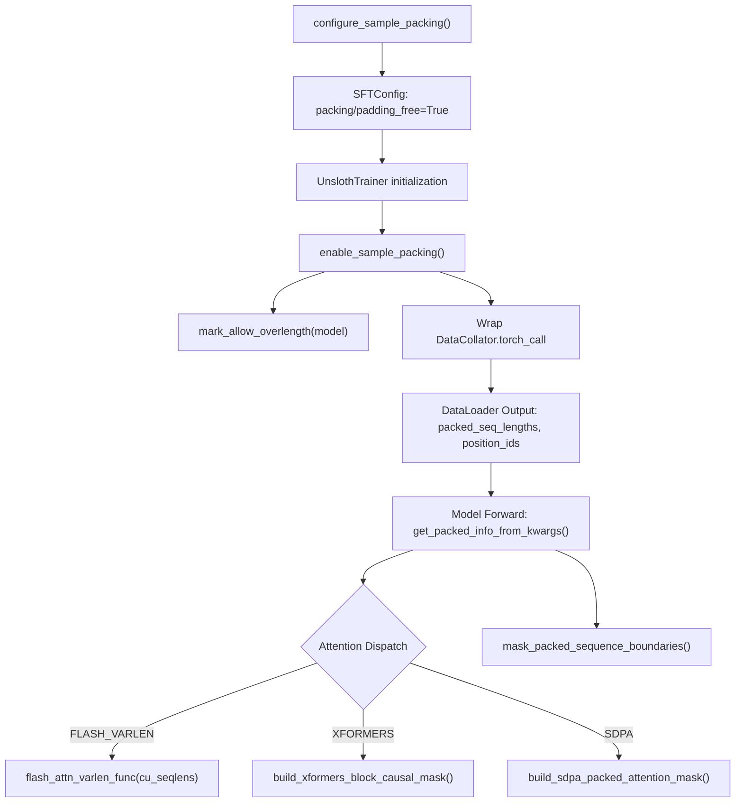
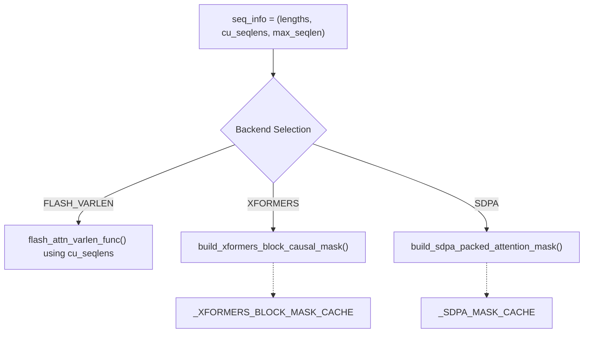

<!-- source: DeepWiki mcp.deepwiki.com · repo unslothai/unsloth · page 6.5 Sample Packing and Padding-Free Training · fetched 2026-10-21 -->

# Sample Packing and Padding-Free Training

<details>
<summary>Relevant source files</summary>

The following files were used as context for generating this wiki page:

- [studio/backend/tests/test_response_template_markers.py](studio/backend/tests/test_response_template_markers.py)
- [studio/backend/utils/datasets/model_mappings.py](studio/backend/utils/datasets/model_mappings.py)
- [tests/test_generation_failure_is_visible.py](tests/test_generation_failure_is_visible.py)
- [tests/test_rl_config_compat.py](tests/test_rl_config_compat.py)
- [tests/test_warnings_issued_guard.py](tests/test_warnings_issued_guard.py)
- [tests/utils/test_attention_dispatch_dora_dtype.py](tests/utils/test_attention_dispatch_dora_dtype.py)
- [tests/utils/test_attention_masks.py](tests/utils/test_attention_masks.py)
- [tests/utils/test_packing.py](tests/utils/test_packing.py)
- [unsloth/models/rl_config_compat.py](unsloth/models/rl_config_compat.py)
- [unsloth/ollama_template_mappers.py](unsloth/ollama_template_mappers.py)
- [unsloth/trainer.py](unsloth/trainer.py)
- [unsloth/utils/attention_dispatch.py](unsloth/utils/attention_dispatch.py)
- [unsloth/utils/packing.py](unsloth/utils/packing.py)

</details>


This page documents Unsloth's support for **sample packing** and **padding-free training**, a set of techniques that eliminate compute waste from padding tokens by concatenating multiple examples in a batch into a packed sequence or by removing padding tokens without packing. It explains the implementation details, data flow, key functions/classes, and the interaction with the attention backends, especially the **Flash Attention varlen** mode.

---

## Overview and Purpose

Traditional batched training pads shorter sequences to the longest one in the batch, wasting memory and compute on padding tokens. Unsloth addresses this with:

- **Sample Packing**: Concatenate multiple examples into a *single* flat token sequence per batch item, thereby eliminating intra-batch padding [unsloth/utils/packing.py:165-168]().
- **Padding-Free Batching**: Remove padding tokens without necessarily packing samples; sequences remain separate but processing skips padding internally [unsloth/utils/packing.py:170-175]().

Both approaches require careful handling to ensure token attention and loss computation respect the boundaries of individual samples within the packed sequences.

Sources: [unsloth/utils/packing.py:165-175]()

---

## Concepts: Packing vs Padding-Free

| Technique              | Description                                                     | Config flags in TRL's `SFTConfig`        |
|------------------------|-----------------------------------------------------------------|------------------------------------------|
| **Sample Packing**      | Multiple examples concatenated into a single long sequence.     | `packing=True`, `padding_free=True`      |
| **Padding-Free Batching** | Process sequences as-is but omit padding tokens during training. | `padding_free=True`, `packing=False`     |

Attention across tokenizer boundaries must be **block-causal**, so tokens only attend within their own examples [unsloth/utils/packing.py:1-779](). Also, loss computations mask label tokens at sequence boundaries [unsloth/utils/packing.py:1-779]().

Sources: [unsloth/utils/packing.py:1-779]()

---

## System Architecture and Data Flow


*Figure 1: Data flow and execution path for sample packing and padding-free training.*

Sources: [unsloth/utils/packing.py:153-214](), [unsloth/trainer.py:31-36](), [unsloth/utils/attention_dispatch.py:32-36]()

---

## Configuration API

Before creating the trainer, utility functions mutate the configuration object (typically `SFTConfig`) to activate these features.

### `configure_sample_packing(config)`
Sets attributes on the `config` to enable packing [unsloth/utils/packing.py:162-168]():
```python
setattr(config, "packing", True)
setattr(config, "padding_free", True)
setattr(config, "remove_unused_columns", False)
```

### `configure_padding_free(config)`
Sets attributes to enable padding-free batching *without* packing concatenation [unsloth/utils/packing.py:170-175]():
```python
setattr(config, "padding_free", True)
setattr(config, "remove_unused_columns", False)
```

Both methods call `_ensure_trl_warning_filter()` to suppress irrelevant TRL warnings about attention implementations [unsloth/utils/packing.py:141-147]().

Sources: [unsloth/utils/packing.py:141-175](), [unsloth/trainer.py:28-33]()

---

## Runtime Enablement

After `SFTTrainer` construction, enabling the feature requires these functions:

### `enable_sample_packing(model, trainer, sequence_lengths_key="seq_lengths")`
- Recursively marks modules with `_unsloth_allow_packed_overlength=True` via `mark_allow_overlength(model)` [unsloth/utils/packing.py:187]().
- Wraps `trainer.data_collator.torch_call` to inject `packed_seq_lengths` into batches [unsloth/utils/packing.py:190-214]().
- Removes `attention_mask` from the batch as masking is deferred to the backend [unsloth/utils/packing.py:1-779]().

### `mark_allow_overlength(module)`
Recursively sets `_unsloth_allow_packed_overlength = True` on any module containing a `max_seq_length` attribute. This allows input lengths to exceed the model's standard hard limit during packed runs [unsloth/utils/packing.py:149-160]().

Sources: [unsloth/utils/packing.py:149-214]()

---

## Packed Batch Format

Batches generated by the patched collator have the structure outlined below:

| Key               | Shape              | dtype    | Description                                        |
|-------------------|--------------------|----------|--------------------------------------------------|
| `input_ids`       | `(1, total_tokens)` | int64    | Flattened concatenation of all samples’ tokens  |
| `labels`          | `(1, total_tokens)` | int64    | Corresponding flattened labels                    |
| `position_ids`    | `(1, total_tokens)` | int64    | Position indices reset per sample boundary        |
| `packed_seq_lengths` | `(num_samples,)`    | int32    | Lengths of individual samples                        |

Sources: [unsloth/utils/packing.py:190-214](), [tests/utils/test_packing.py:109-121]()

---

## Attention Mask Construction for Packed Sequences

The `attention_dispatch` system selects the appropriate masking strategy based on the available hardware and backend [unsloth/utils/attention_dispatch.py:88-92]().


*Figure 2: Attention dispatch mapping to backend execution paths.*

- **FlashAttention varlen**: Uses `flash_attn_varlen_func` with cumulative sequence lengths [unsloth/utils/attention_dispatch.py:32-35]().
- **XFormers**: Uses `BlockDiagonalCausalMask` and supports sliding-window local attention [unsloth/utils/packing.py:27-35]().
- **SDPA**: Constructs an explicit additive mask tensor where blocks are separated by `-inf` [unsloth/utils/packing.py:1-779]().

Sources: [unsloth/utils/packing.py:27-125](), [unsloth/utils/attention_dispatch.py:32-95]()

---

## Varlen Backward Overflow Guard

FlashAttention 2's varlen backward kernel has a known `int32` indexing overflow risk when `dq_accum` elements reach $2^{31}$ [unsloth/utils/attention_dispatch.py:97-101]().

Unsloth implements `_varlen_backward_overflows_int32(n_seqs, total_q, n_heads, head_dim)` to detect these cases and issues a warning if an illegal memory access is likely [unsloth/utils/attention_dispatch.py:121-127]().

Sources: [unsloth/utils/attention_dispatch.py:97-127]()

---

## Hybrid Linear Attention and Loss Masking

### `patch_hybrid_linear_attention_varlen(model)`
Hybrid models (such as Qwen3.5 variants) with recurrent gated-delta states or causal conv1d layers can leak state across sequence boundaries when flattened. This function patches those layers to respect `packed_seq_lengths` [unsloth/trainer.py:34-34]().

### `mask_packed_sequence_boundaries(labels, lengths)`
To prevent cross-sequence training, labels at the end of each packed sample are masked with `-100` [tests/utils/test_packing.py:25-28]().

Sources: [unsloth/trainer.py:34-34](), [tests/utils/test_packing.py:25-28](), [unsloth/utils/packing.py:1-779]()

---

## Trainer Integration, Blocklists, and Auto-Enablement

The `UnslothTrainer` manages the lifecycle of packed training [unsloth/trainer.py:48]().

- **Blacklist**: Models like `gemma2` (due to softcapping issues) and `gpt_oss` (Flex Attention) are blocked from automatic padding-free enablement via `PADDING_FREE_BLOCKLIST` [unsloth/trainer.py:97-100]().
- **Auto-Enablement**: `_should_auto_padding_free(config)` determines if padding-free should be enabled by default [unsloth/trainer.py:112-116]().
- **Error Handling**: `_should_skip_auto_packing_error(exc)` filters known TRL errors related to packing/max_length guards [unsloth/trainer.py:136-139]().

Sources: [unsloth/trainer.py:48-154]()

---

## Summary of Key Entities

| Code Entity | Location | Role |
|:---|:---|:---|
| `configure_sample_packing` | [unsloth/utils/packing.py:162]() | Mutates `SFTConfig` for packing. |
| `enable_sample_packing` | [unsloth/utils/packing.py:177]() | Patches trainer and model for runtime packing. |
| `build_sdpa_packed_attention_mask` | [unsloth/utils/packing.py:1]() | Generates additive masks for SDPA. |
| `build_xformers_block_causal_mask` | [unsloth/utils/packing.py:1]() | Generates block-diagonal masks for XFormers. |
| `mask_packed_sequence_boundaries` | [unsloth/utils/packing.py:25]() | Masks labels at packed boundaries. |
| `_varlen_backward_overflows_int32` | [unsloth/utils/attention_dispatch.py:121]() | Guard against FlashAttention int32 overflow. |

Sources: [unsloth/utils/packing.py:1-779](), [unsloth/trainer.py:1-1140](), [unsloth/utils/attention_dispatch.py:1-590]()

---

