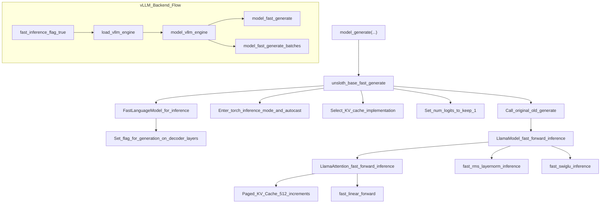
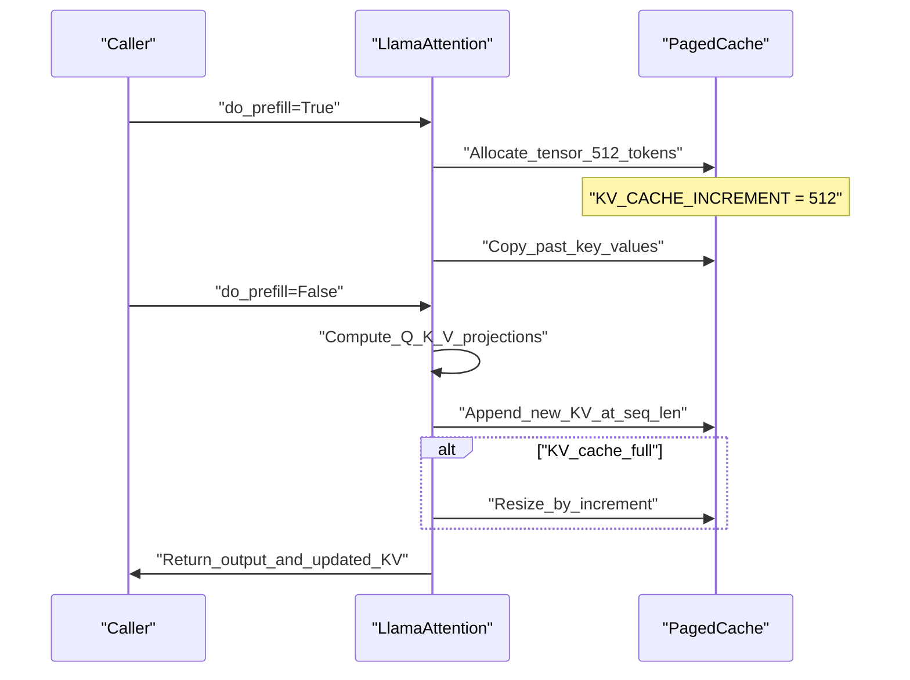
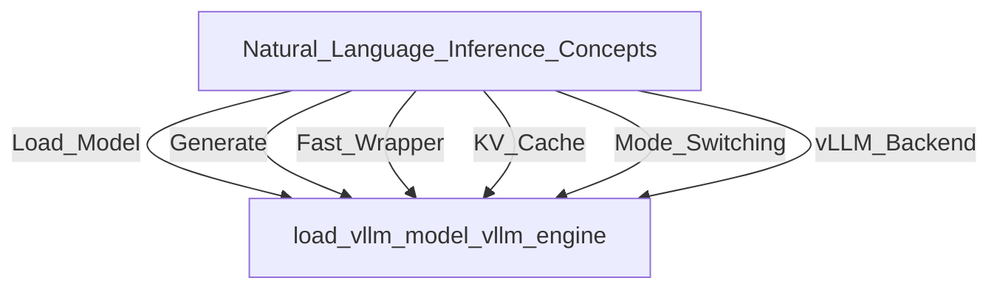
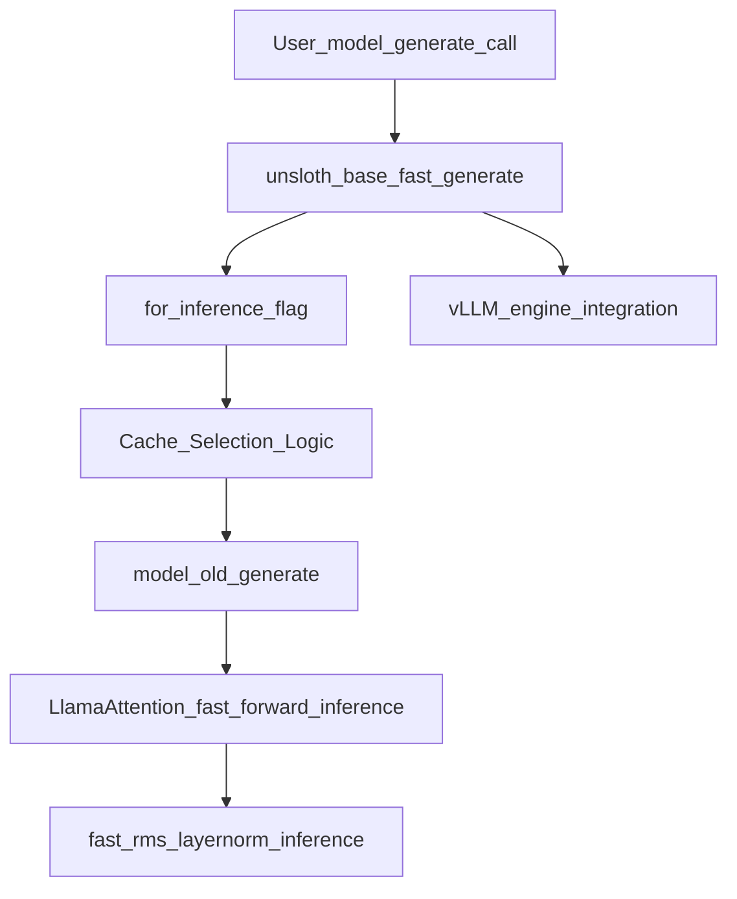

<!-- source: DeepWiki mcp.deepwiki.com · repo unslothai/unsloth · page 7 Inference with Core Library · fetched 2026-10-21 -->

# Inference with Core Library

Relevant source files

The following files were used as context for generating this wiki page:

- [README.md](README.md)
- [pyproject.toml](pyproject.toml)
- [tests/python/test_construct_chat_template_validation.py](tests/python/test_construct_chat_template_validation.py)
- [tests/test_fp8_pre_sm89_dequant_fallback.py](tests/test_fp8_pre_sm89_dequant_fallback.py)
- [tests/test_import_fixes_drift.py](tests/test_import_fixes_drift.py)
- [unsloth/__init__.py](unsloth/__init__.py)
- [unsloth/_gpu_init.py](unsloth/_gpu_init.py)
- [unsloth/chat_templates.py](unsloth/chat_templates.py)
- [unsloth/import_fixes.py](unsloth/import_fixes.py)
- [unsloth/kernels/fp8.py](unsloth/kernels/fp8.py)
- [unsloth/models/_utils.py](unsloth/models/_utils.py)
- [unsloth/models/llama.py](unsloth/models/llama.py)
- [unsloth/models/loader.py](unsloth/models/loader.py)
- [unsloth/models/loader_utils.py](unsloth/models/loader_utils.py)
- [unsloth/models/mapper.py](unsloth/models/mapper.py)
- [unsloth/models/mistral.py](unsloth/models/mistral.py)
- [unsloth/models/rl.py](unsloth/models/rl.py)
- [unsloth/models/rl_replacements.py](unsloth/models/rl_replacements.py)
- [unsloth/models/vision.py](unsloth/models/vision.py)
- [unsloth/save.py](unsloth/save.py)
- [unsloth/tokenizer_utils.py](unsloth/tokenizer_utils.py)

This page provides a high-level overview of Unsloth's fast inference capabilities within its core library, detailing the optimized generation framework and backend selection. It introduces key mechanisms such as paged KV cache management, inference mode switching, and outlines vLLM backend integration for high-throughput inference use cases. For in-depth technical details, users should refer to the linked child pages covering KV cache optimizations and vLLM integration.

---

## Overview

Unsloth’s core inference is designed around accelerating generation with extensive optimizations applied automatically when using core library model classes such as `FastLanguageModel` and `FastVisionModel`. There are two primary backends for inference:

- **Native Fast Inference:** This backend uses custom inference kernels, dynamic paged key-value cache management, and mode switching mechanisms implemented directly in PyTorch models to maximize generation speed with minimal memory overhead. For details, see [Fast Inference and KV Cache](#7.1).
- **vLLM Backend:** When enabled via the `fast_inference=True` flag during model loading, Unsloth loads a vLLM engine that provides high-throughput, batched inference capabilities optimized for reinforcement learning and production-scale usage. For details, see [vLLM Integration](#7.2).

Both backends expose the standard `model.generate()` API, ensuring compatibility and ease of use regardless of the underlying acceleration strategy.

**See also:**
- [Fast Inference and KV Cache](#7.1) — In-depth details of paged KV cache and incremental decode mechanics.  
- [vLLM Integration](#7.2) — Setup and usage guide for the vLLM backend and sampling parameters.  
- [Model Loading Pipeline](#3.2) — How models are loaded and patched to support these inference modes.  
- [Attention Dispatch System](#5.3) — Selection logic for attention backends like Flash Attention, SDPA, and xFormers.  

Sources: [unsloth/models/vision.py:103-117](), [unsloth/models/llama.py:106-111](), [unsloth/models/_utils.py:108-111](), [unsloth/models/loader.py:15-28]()

---

## Basic Inference Usage

Unsloth applies all inference-specific optimizations transparently when invoking `model.generate()`. Users typically load a model and tokenizer via `from_pretrained`, apply a chat template, and call standard generation functions.

Unsloth internally wraps `generate` with efficient inference mode, autocasting, and KV cache management without requiring extra user effort.

Sources: [unsloth/models/vision.py:135-314](), [unsloth/models/llama.py:206-223]()

---

## Inference Optimization Layers

Unsloth's generation pipeline is accelerated through layered optimizations applied during inference mode:

| Optimization Layer       | Purpose                                                               | Implementation Highlights                                              |
|-------------------------|-----------------------------------------------------------------------|----------------------------------------------------------------------|
| **Mode switching**       | Switch model layers to inference-optimized kernels, lighter weight.  | `FastLanguageModel.for_inference()` sets `_flag_for_generation` flags. |
| **Fast generate wrapper**| Wraps generation call with `torch.inference_mode()`, autocast, etc.  | `make_fast_generate_wrapper` wraps `model.generate()` to reduce overhead. |
| **Paged KV cache**       | Dynamically resizable KV cache memory allocated in 512-token pages.  | `KV_CACHE_INCREMENT = 512` defined in `llama.py`. |
| **Inference kernels**    | Specialized layer norms, activations, and linear layers optimized.   | `fast_rms_layernorm_inference`, `fast_swiglu_inference` kernels. |
| **Static cache**         | Enables compilation-based cache routines where supported.             | Controlled via cache selection logic in `unsloth_base_fast_generate`. |

Sources: [unsloth/models/vision.py:135-314](), [unsloth/models/llama.py:167-167](), [unsloth/models/_utils.py:108-111]()

---

## Generation Flow Architecture

The core fast generation call flow wraps the user `model.generate()` invocation with a method that sets inference mode, autocasting, selects cache implementations, and then delegates to the original HuggingFace generate function.

Title: Inference Execution Flow

Sources: [unsloth/models/vision.py:135-314](), [unsloth/models/llama.py:167-167](), [unsloth/models/rl.py:205-209]()

---

## Fast Generation Wrapper Details

Unless disabled by the environment, `model.generate` is replaced by `unsloth_base_fast_generate`. This wrapper performs:
- Mode switching to inference-specific kernels by setting `_flag_for_generation`.
- Setting `num_logits_to_keep=1` to compute logits only for the last generated token during decoding.
- Running generation inside `torch.inference_mode()` with mixed precision autocasting.

Sources: [unsloth/models/vision.py:135-314](), [unsloth/models/llama.py:206-223]()

---

## Paged KV Cache System

Each attention layer maintains an independent paged KV cache that resizes during inference in increments of 512 tokens. For detailed mechanics on paged cache allocation and incremental decoding, see [Fast Inference and KV Cache](#7.1).

Title: KV Cache Paging Mechanism

Sources: [unsloth/models/llama.py:167-167](), [unsloth/models/llama.py:206-223]()

---

## vLLM Backend Loading and Integration

When a model is loaded with `fast_inference=True`, Unsloth provisions a vLLM inference engine. For comprehensive instructions on configuring sampling parameters, engine attributes, and high-throughput deployments, see [vLLM Integration](#7.2).

Sources: [unsloth/models/vision.py:158-166](), [unsloth/models/loader.py:109](), [unsloth/models/rl.py:91-96]()

---

## Summary Diagrams Mapping Natural Language Constructs to Code Entities

Title: Natural Language to Code Entity Mapping

Title: Inference Execution Components

Sources: All cited above

---

