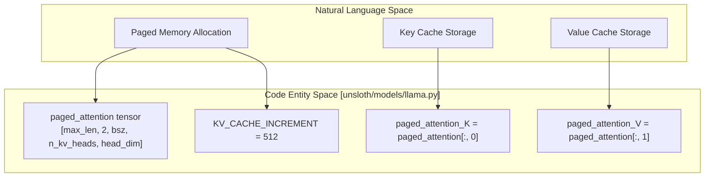
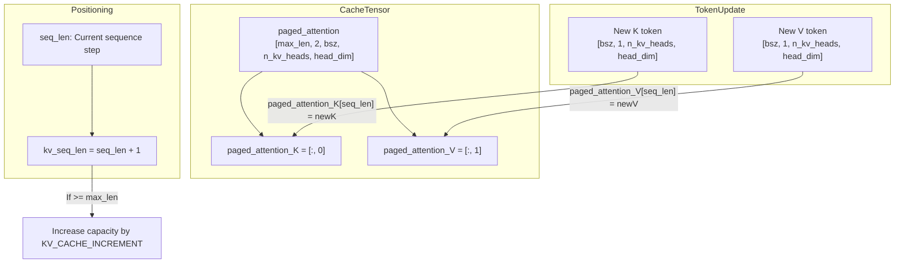
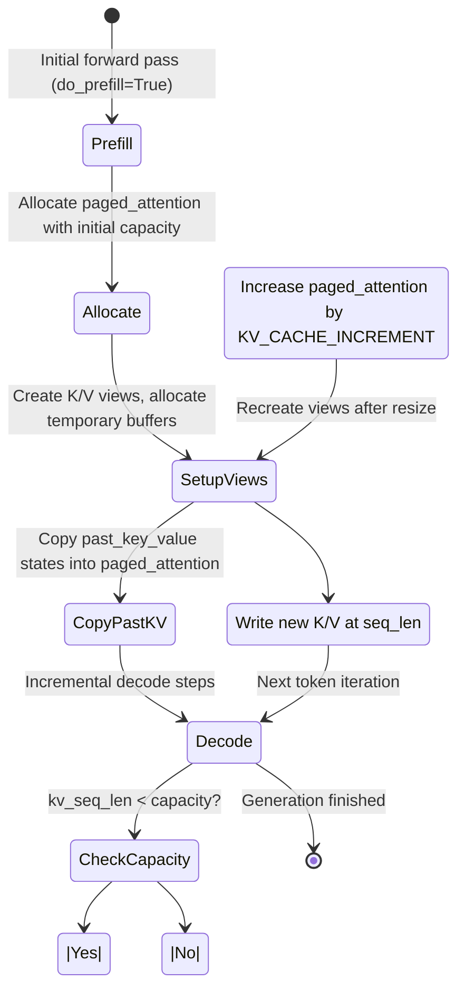
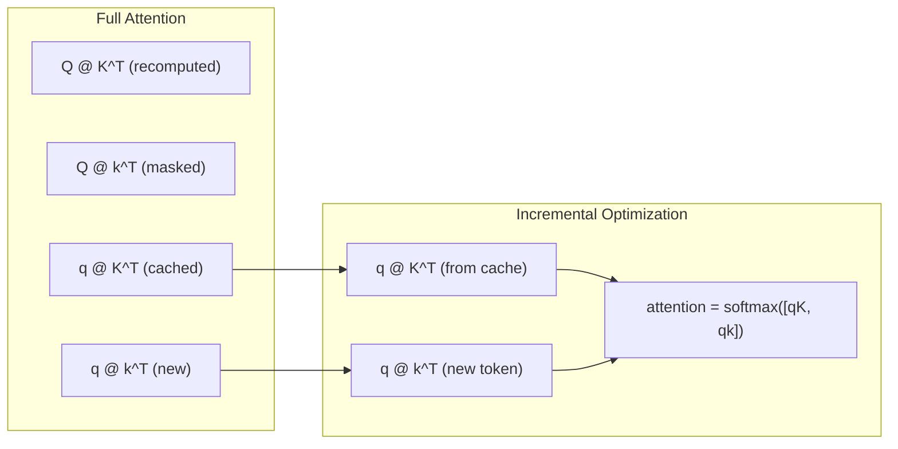
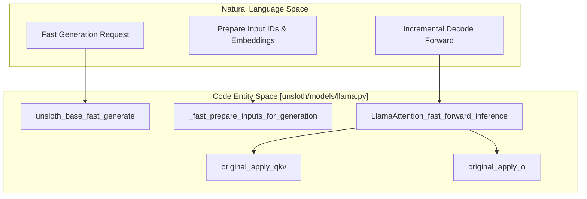

<!-- source: DeepWiki mcp.deepwiki.com · repo unslothai/unsloth · page 7.1 Fast Inference and KV Cache · fetched 2026-10-21 -->

# Fast Inference and KV Cache

Relevant source files

The following files were used as context for generating this wiki page:

- [README.md](README.md)
- [pyproject.toml](pyproject.toml)
- [tests/_shared/real_accelerator.py](tests/_shared/real_accelerator.py)
- [tests/conftest.py](tests/conftest.py)
- [tests/fast_inference/test_fast_inference.py](tests/fast_inference/test_fast_inference.py)
- [tests/python/test_construct_chat_template_validation.py](tests/python/test_construct_chat_template_validation.py)
- [tests/studio/test_gpu_inference_smoke.py](tests/studio/test_gpu_inference_smoke.py)
- [tests/test_cross_entropy_softcap_padding.py](tests/test_cross_entropy_softcap_padding.py)
- [tests/test_dispatch_hook_repair.py](tests/test_dispatch_hook_repair.py)
- [tests/test_float32_generate_autocast.py](tests/test_float32_generate_autocast.py)
- [tests/test_fp8_pre_sm89_dequant_fallback.py](tests/test_fp8_pre_sm89_dequant_fallback.py)
- [tests/test_import_fixes_drift.py](tests/test_import_fixes_drift.py)
- [tests/test_offload_frozen_module_device.py](tests/test_offload_frozen_module_device.py)
- [tests/test_rmsnorm_gradient_layout.py](tests/test_rmsnorm_gradient_layout.py)
- [tests/test_uma_safetensors_load.py](tests/test_uma_safetensors_load.py)
- [unsloth/__init__.py](unsloth/__init__.py)
- [unsloth/_gpu_init.py](unsloth/_gpu_init.py)
- [unsloth/chat_templates.py](unsloth/chat_templates.py)
- [unsloth/import_fixes.py](unsloth/import_fixes.py)
- [unsloth/kernels/fp8.py](unsloth/kernels/fp8.py)
- [unsloth/models/_utils.py](unsloth/models/_utils.py)
- [unsloth/models/llama.py](unsloth/models/llama.py)
- [unsloth/models/loader.py](unsloth/models/loader.py)
- [unsloth/models/loader_utils.py](unsloth/models/loader_utils.py)
- [unsloth/models/mapper.py](unsloth/models/mapper.py)
- [unsloth/models/mistral.py](unsloth/models/mistral.py)
- [unsloth/models/rl.py](unsloth/models/rl.py)
- [unsloth/models/rl_replacements.py](unsloth/models/rl_replacements.py)
- [unsloth/models/vision.py](unsloth/models/vision.py)
- [unsloth/save.py](unsloth/save.py)
- [unsloth/tokenizer_utils.py](unsloth/tokenizer_utils.py)

This page documents Unsloth's fast inference system and KV cache management for efficient autoregressive generation. It explains the custom paged KV cache implementation, incremental decoding, and inference-specific optimizations that enable faster token generation with reduced memory overhead.

**Scope**:  
This page focuses on the native Unsloth inference path, leveraging custom low-level KV cache management inside Unsloth’s `FastLanguageModel` (e.g., `FastLlamaModel`) and related classes. For distributed inference with external backends (e.g. vLLM), see [7.2 vLLM Integration](7.2).

---

## Overview

Unsloth implements a **paged KV cache** system to optimize autoregressive inference. Key features include:

- **Paged memory allocation:** The KV cache tensor grows in fixed increments (`KV_CACHE_INCREMENT = 512` tokens), minimizing costly reallocations [unsloth/models/llama.py:168]().
- **Incremental decoding:** Only new token key-value pairs are computed and appended at each generation step, avoiding recomputation over entire past sequences [unsloth/models/llama.py:408-632]().
- **Dual forward pass modes:** Separate code paths for training and inference controlled by `_flag_for_generation` for efficient runtime dispatch [unsloth/models/vision.py:158-166]().
- **Transformer cache compatibility:** Supports native transformers static/hybrid cache modes when available for compiled inference [unsloth/models/vision.py:257-294]().
- **Inference context managers:** Globally uses `torch.inference_mode()` and autocasts at appropriate dtype (fp16/bf16) for low overhead [unsloth/models/vision.py:237-312]().

These design choices yield a 2-5× speedup in inference token throughput and reduce memory fragmentation and allocation stalls.

Sources: [unsloth/models/llama.py:168](), [unsloth/models/llama.py:408-632](), [unsloth/models/vision.py:135-330]()

---

## KV Cache Architecture

### Paged Attention Structure and Code Entity Mapping

Unsloth organizes the KV cache as a **paged tensor** of shape `[max_len, 2, batch_size, n_kv_heads, head_dim]`, where the dimension `2` separates keys (`0`) and values (`1`):

- `paged_attention_K = paged_attention[:, 0, :, :, :]` extracts key cache [unsloth/models/llama.py:465]().
- `paged_attention_V = paged_attention[:, 1, :, :, :]` extracts value cache [unsloth/models/llama.py:466]().

This layout ensures contiguous memory allocation, efficient in-place updates, and fast indexing.

Diagram: "KV Cache Paged Tensor Layout to Code Entities"

Sources: [unsloth/models/llama.py:168](), [unsloth/models/llama.py:465-487]()

### Paged KV Cache Update Logic

At each decode step, only the current token's K, V tensors computed are written into `paged_attention` at position `seq_len` [unsloth/models/llama.py:552-558]().

Diagram: "Paged KV Cache Update Flow"

Sources: [unsloth/models/llama.py:465-487](), [unsloth/models/llama.py:552-558]()

### Cache Lifecycle

#### State Transitions
The cache goes through two main phases during generation:

Diagram: "Cache Lifecycle State Machine"

- **Prefill phase:** On the first forward pass with `do_prefill=True`, `paged_attention` is allocated with capacity of `(kv_seq_len + KV_CACHE_INCREMENT)`. Past key-value states are copied into the cache [unsloth/models/llama.py:462-507]().
- **Decode phase:** For each new token during decoding:
  - Check if current capacity suffices; if not, resize the `paged_attention` tensor [unsloth/models/llama.py:493-507]().
  - Update the cache at the current position with newly computed K and V tensors.
  - Use the full cache slice up to `kv_seq_len` for attention computation.

Sources: [unsloth/models/llama.py:462-507](), [unsloth/models/llama.py:493-507]()

---

## Incremental Decoding Mechanism

### QK^T Decomposition for Inference

Traditional attention recomputes all queries (Q) against all keys (K) at each generation step. However, autoregressive inference only adds one token at a time, so it can exploit a decomposition:

- At step *n*, only compute the new query `q` against all *cached* keys `K`.
- Keys and values of previous tokens remain cached and constant.
- Future tokens masked out prevent recomputing QK^T with previous queries.

Diagram: "QK^T Decomposition Architecture"

Sources: [unsloth/models/llama.py:417-443]()

### Fast Forward Pass Flow and Code Entities

The inference forward pass manages steps using specific functions defined in `unsloth/models/llama.py` [unsloth/models/llama.py:408-632]().

Diagram: "Inference Forward Pass Code Routing"

Sources: [unsloth/models/llama.py:153-162](), [unsloth/models/llama.py:206-397](), [unsloth/models/llama.py:408-632]()

---

## Fast Generation Wrapper

### `unsloth_base_fast_generate`

The main wrapper that instruments fast inference generation is `unsloth_base_fast_generate` [unsloth/models/vision.py:151-330](). It performs:

- Extraction of `input_ids` from various argument keys for compatibility.
- Invokes `FastBaseModel.for_inference(self)` to set `_flag_for_generation` enabling inference mode dispatch [unsloth/models/vision.py:176]().
- Sets autocast dtype to bf16 or fp16 based on environment and model config [unsloth/models/vision.py:237-253]().
- Chooses `cache_implementation` mode (`static`, `hybrid`, or `None`) based on model and environment [unsloth/models/vision.py:257-294]().
- Calls the original `generate()` method inside `torch.inference_mode()` and autocast context for minimal overhead [unsloth/models/vision.py:312]().

Sources: [unsloth/models/vision.py:151-330](), [unsloth/models/vision.py:176](), [unsloth/models/vision.py:257-294]()

---

## Prepare Inputs for Generation

The method `_fast_prepare_inputs_for_generation` intercepts and optimizes input handling during generation [unsloth/models/llama.py:206-397]().

Sources: [unsloth/models/llama.py:206-397]()

---

## Inference Mode Optimizations

### Dual Forward Pass Architecture

Unsloth models employ two forward passes in attention layers:

| Mode       | Detection                      | Forward Function                          | Characteristics                                                  |
|------------|--------------------------------|------------------------------------------|-----------------------------------------------------------------|
| Training   | `_flag_for_generation` missing | `LlamaAttention_fast_forward`            | Full attention computation, gradient tracking, training ops     |
| Inference  | `_flag_for_generation` present | `LlamaAttention_fast_forward_inference` | KV caching, incremental decoding, batch size 1 path             |

The inference path utilizes incremental KV cache updates and avoids autograd overhead. Model initialization to inference mode is triggered by `FastBaseModel.for_inference(model)` [unsloth/models/vision.py:176]().

Sources: [unsloth/models/llama.py:848-877](), [unsloth/models/vision.py:176]()

### Temporary Buffer Reuse

To avoid repetitive GPU allocations during decoding, Unsloth pre-allocates temporary buffers the size of KV cache on the first prefill pass:

- Buffers: `paged_attention_K_tmp`, `paged_attention_V_tmp` hold transient K/V computations per step [unsloth/models/llama.py:474-490]().
- This eliminates malloc overhead each forward pass [unsloth/models/llama.py:509-511]().

Sources: [unsloth/models/llama.py:474-490](), [unsloth/models/llama.py:509-511]()

---

## Related Functions and Utilities

| Function / Constant                         | Location                                    | Purpose                                                  |
|--------------------------------------------|---------------------------------------------|----------------------------------------------------------|
| `LlamaAttention_fast_forward_inference`    | [unsloth/models/llama.py:408-632]()       | Main inference forward pass managing KV cache updates    |
| `_fast_prepare_inputs_for_generation`      | [unsloth/models/llama.py:206-397]()       | Patched inputs preparation for incremental decoding      |
| `unsloth_base_fast_generate`                | [unsloth/models/vision.py:151-330]()      | Top-level fast generation wrapper                        |
| `FastBaseModel.for_inference` (flag set)   | [unsloth/models/vision.py:176]()          | Enables inference mode by setting `_flag_for_generation` |
| `KV_CACHE_INCREMENT`                        | [unsloth/models/llama.py:168]()           | Increment size for paged cache growth                    |
| `SDPA_HAS_GQA`                              | [unsloth/models/llama.py:170]()           | Whether SDPA attention supports GQA internally           |

Sources: [unsloth/models/llama.py:168](), [unsloth/models/llama.py:170](), [unsloth/models/llama.py:206-397](), [unsloth/models/llama.py:408-632](), [unsloth/models/vision.py:151-330](), [unsloth/models/vision.py:176]()

---

