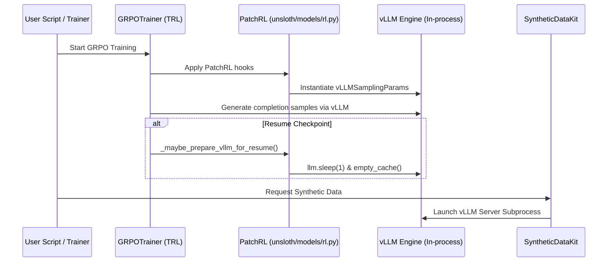

<!-- source: DeepWiki mcp.deepwiki.com · repo unslothai/unsloth · page 7.2 vLLM Integration · fetched 2026-10-21 -->

# vLLM Integration

<details>
<summary>Relevant source files</summary>

The following files were used as context for generating this wiki page:

- [README.md](README.md)
- [pyproject.toml](pyproject.toml)
- [tests/python/test_construct_chat_template_validation.py](tests/python/test_construct_chat_template_validation.py)
- [tests/test_fp8_pre_sm89_dequant_fallback.py](tests/test_fp8_pre_sm89_dequant_fallback.py)
- [tests/test_import_fixes_drift.py](tests/test_import_fixes_drift.py)
- [unsloth/__init__.py](unsloth/__init__.py)
- [unsloth/_gpu_init.py](unsloth/_gpu_init.py)
- [unsloth/chat_templates.py](unsloth/chat_templates.py)
- [unsloth/import_fixes.py](unsloth/import_fixes.py)
- [unsloth/kernels/fp8.py](unsloth/kernels/fp8.py)
- [unsloth/models/_utils.py](unsloth/models/_utils.py)
- [unsloth/models/llama.py](unsloth/models/llama.py)
- [unsloth/models/loader.py](unsloth/models/loader.py)
- [unsloth/models/loader_utils.py](unsloth/models/loader_utils.py)
- [unsloth/models/mapper.py](unsloth/models/mapper.py)
- [unsloth/models/mistral.py](unsloth/models/mistral.py)
- [unsloth/models/rl.py](unsloth/models/rl.py)
- [unsloth/models/rl_replacements.py](unsloth/models/rl_replacements.py)
- [unsloth/models/vision.py](unsloth/models/vision.py)
- [unsloth/save.py](unsloth/save.py)
- [unsloth/tokenizer_utils.py](unsloth/tokenizer_utils.py)

</details>


This page provides an in-depth technical overview of how Unsloth integrates with the [vLLM](https://github.com/vllm-project/vllm) backend for fast, efficient large language model inference and generation. It covers the two main integration modes (in-process during GRPO reinforcement learning training and out-of-process for synthetic data generation), details of critical parameters like `fast_inference` and `SamplingParams` configuration, and the associated data flow, compatibility shims, and patching mechanisms.

---

## Architecture Overview

Unsloth integrates with vLLM in two primary operational contexts:

1. **In-process vLLM Integration for GRPO Reinforcement Learning**  
   During reinforcement learning training loops (such as GRPO via TRL), the vLLM engine runs directly inside Unsloth’s process to generate efficient completion samples. This is orchestrated through hooks in `PatchRL` and a custom `vLLMSamplingParams` wrapper [unsloth/models/rl.py:14-18](), [unsloth/models/rl.py:86-92]().

2. **Out-of-process vLLM Server for Synthetic Data Generation**  
   For synthetic dataset generation and text chunking tasks, Unsloth spawns and manages a separate vLLM server subprocess.

**vLLM Integration Points**
```mermaid
flowchart TD
    A[""Unsloth vLLM Integration""]

    A --> B[""In-process vLLM (GRPO training)""]
    B --> B1[""PatchRL (unsloth/models/rl.py)""]
    B --> B2[""vLLMSamplingParams (unsloth/models/rl.py)""]
    B --> B3[""UnslothGRPOConfig vllm_sampling_params field""]

    A --> C[""Subprocess vLLM server (Synthetic Data)""]
    C --> C1[""SyntheticDataKit (unsloth/tokenizer_utils.py)""]
    C --> C2[""vllm server subprocess (PipeCapture & lifecycle)""]
    C --> C3[""vLLM utilities & loaders (unsloth/models/_utils.py)""]
```

Sources: [unsloth/models/rl.py:14-18](), [unsloth/models/rl.py:86-92](), [unsloth/models/rl.py:146-152](), [unsloth/tokenizer_utils.py:30-36]()

---

## vLLMSamplingParams — Wrapper for Sampling Parameters

Unsloth defines a thin compatibility wrapper function `vLLMSamplingParams` in `unsloth/models/rl.py` [unsloth/models/rl.py:86-92](). This function instantiates `vllm.SamplingParams` with user-supplied keyword arguments and attaches the raw `kwargs` dictionary to the resulting object as `_set_kwargs`.

```python
def vLLMSamplingParams(**kwargs):
    from vllm import SamplingParams

    sampling_params = SamplingParams(**kwargs)
    sampling_params._set_kwargs = kwargs
    return sampling_params
```

This ensures that training components and the GRPO training loop can inspect or re-apply sampling configurations consistently across varying `vllm` package versions.

Sources: [unsloth/models/rl.py:86-92]()

---

## GuidedDecodingParams Compatibility Shim

Certain versions of the `trl` reinforcement learning library expect `GuidedDecodingParams` to be importable directly from `vllm.sampling_params`. When operating against vLLM installations lacking this symbol, Unsloth injects a dynamic fallback stub at import time in `unsloth/models/rl.py` [unsloth/models/rl.py:49-61]().

```python
try:
    import vllm.sampling_params as _unsloth_vllm_sp
    if not hasattr(_unsloth_vllm_sp, "GuidedDecodingParams"):

        class GuidedDecodingParams:
            def __init__(self, **kwargs):
                self.kwargs = kwargs

        _unsloth_vllm_sp.GuidedDecodingParams = GuidedDecodingParams
except Exception:
    pass
```

Sources: [unsloth/models/rl.py:49-61]()

---

## GRPO vLLM Generation Path and Memory Management

### Generation Path
During GRPO training, completion generation can be delegated to vLLM. The patching mechanism is governed by `PatchRL`, which wraps the model and configures generation flows [unsloth/models/rl.py:146-152](). Model unwrapping during generation leverages `unsloth_unwrap_model_for_generation`, ensuring the model invokes `FastLanguageModel.for_inference(model)` to set the correct execution context [unsloth/models/rl.py:183-198]().

### Resume Checkpoint Memory Management
When resuming training from a checkpoint (`_patch_resume_from_checkpoint_memory`), Unsloth checks if vLLM's sleep mode is enabled via `_maybe_prepare_vllm_for_resume` [unsloth/models/rl.py:94-122](). If active, it invokes `llm.sleep(1)` to yield VRAM before reloading weights and executes garbage collection routines.

**vLLM Code Dependency Mapping**
```mermaid
flowchart TD
    PatchRL[""PatchRL(FastLanguageModel) in unsloth/models/rl.py""]
    unwrap_model[""unwrap_model_for_generation in trl.models.utils""]
    unsloth_unwrap[""unsloth_unwrap_model_for_generation in unsloth/models/rl.py""]
    for_inference[""FastLanguageModel.for_inference(model) in unsloth/models/llama.py""]
    fast_inference_setup[""fast_inference_setup in unsloth/models/_utils.py""]

    PatchRL --> unwrap_model
    unwrap_model --> unsloth_unwrap
    unsloth_unwrap --> for_inference
    for_inference --> fast_inference_setup

    resume_patch["""_patch_resume_from_checkpoint_memory(trainer_class)"""]
    resume_patch --> _maybe_prepare_vllm["""_maybe_prepare_vllm_for_resume(trainer)"""]

    PatchRL -. injects guard .-> resume_patch
```

Sources: [unsloth/models/rl.py:94-144](), [unsloth/models/rl.py:146-152](), [unsloth/models/rl.py:183-198](), [unsloth/models/_utils.py:76]()

---

## Configuration Fix: top_k Parameter for vLLM Sampling

TRL sets `top_k=0` by default in its configuration classes, but `vllm.SamplingParams` treats `0` as an invalid value (expecting `-1` to disable filtering). To resolve this discrepancy, Unsloth injects a configuration patch via `RL_CONFIG_CHANGES["grpo_trainer"]` in `unsloth/models/rl_replacements.py` [unsloth/models/rl_replacements.py:154-158]().

```python
def grpo_config_fix_vllm_top_k(old_RLTrainer_source, old_RLConfig_source):
    return "if use_vllm and (top_k is None or top_k == 0): top_k = -1\n"
```

Sources: [unsloth/models/rl_replacements.py:154-158]()

---

## Fast Inference Parameter (fast_inference)

The `fast_inference` parameter (and the underlying `fast_inference_setup` utility defined in `unsloth/models/_utils.py`) enables inference-specific optimizations on Unsloth models [unsloth/models/_utils.py:76](). When enabled:
- Standard HuggingFace generation hooks are bypassed or replaced with optimized wrappers (`make_fast_generate_wrapper`) [unsloth/models/_utils.py:103]().
- Paged KV cache management and custom decoding paths are initialized.
- Compatibility checks verify whether the loaded model topology supports direct vLLM weight export or fast execution paths [unsloth/models/_utils.py:76-77]().

Sources: [unsloth/models/_utils.py:76-77](), [unsloth/models/_utils.py:103]()

---

## Summary of Key Classes and Functions

| Name | Role / Description | Location |
| :--- | :--- | :--- |
| `vLLMSamplingParams` | Factory wrapping vLLM `SamplingParams`, storing raw kwargs in `_set_kwargs` | [unsloth/models/rl.py:86-92]() |
| `GuidedDecodingParams` | Fallback stub class preventing `ImportError` in TRL integration | [unsloth/models/rl.py:54-58]() |
| `PatchRL` | Main entry point patching TRL trainers for vLLM generation and RL loops | [unsloth/models/rl.py:146-152]() |
| `_maybe_prepare_vllm_for_resume` | VRAM release hook invoked during checkpoint resumption | [unsloth/models/rl.py:94-122]() |
| `grpo_config_fix_vllm_top_k` | Code injection patch normalizing `top_k=0` to `-1` for vLLM compatibility | [unsloth/models/rl_replacements.py:154-158]() |
| `fast_inference_setup` | Utility configuring accelerated inference pathways and KV cache | [unsloth/models/_utils.py:76-77]() |

Sources: [unsloth/models/rl.py:54-152](), [unsloth/models/rl_replacements.py:154-158](), [unsloth/models/_utils.py:76-77]()

---

## Data Flow and Control in vLLM Integration

**vLLM Integration Sequence**


Sources: [unsloth/models/rl.py:86-144](), [unsloth/models/rl_replacements.py:154-158](), [unsloth/tokenizer_utils.py:30-36]()

---

## Dependency and Integration Overview

**Module Relations**
```mermaid
flowchart LR
    subgraph "unsloth/models"
        RL[""rl.py (PatchRL, vLLMSamplingParams)""]
        RLR[""rl_replacements.py (grpo_config_fix_vllm_top_k)""]
        LOAD[""loader.py (is_vLLM_available)""]
        UTIL["""_utils.py (fast_inference_setup)"""]
    end
    subgraph "External Libraries"
        VLLM[""vllm package (SamplingParams)""]
        TRL[""trl package (GRPOTrainer)""]
    end

    RL -->|wraps| VLLM
    RL -->|patches| TRL
    RL -->|depends on| RLR
    LOAD -->|checks| VLLM
    UTIL -->|enables| RL
```

Sources: [unsloth/models/rl.py:86-92](), [unsloth/models/rl_replacements.py:154-158](), [unsloth/models/loader.py:15](), [unsloth/models/_utils.py:21-76]()

---

