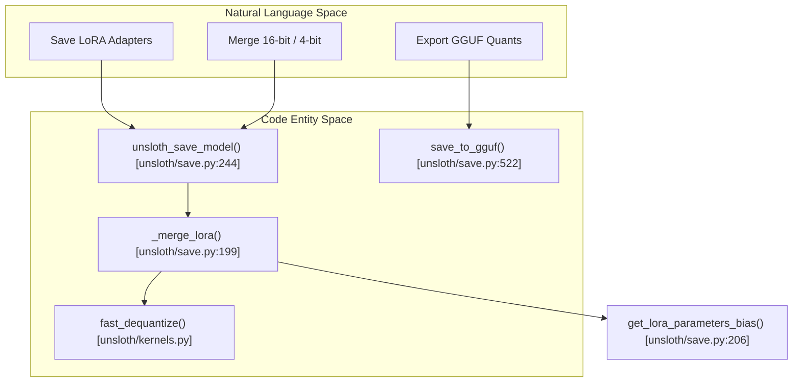
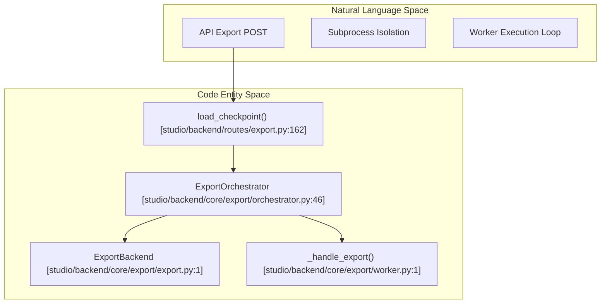

<!-- source: DeepWiki mcp.deepwiki.com · repo unslothai/unsloth · page 8 Model Persistence and Export · fetched 2026-10-21 -->

# Model Persistence and Export

Relevant source files

The following files were used as context for generating this wiki page:

- [studio/backend/core/export/export.py](studio/backend/core/export/export.py)
- [studio/backend/core/export/orchestrator.py](studio/backend/core/export/orchestrator.py)
- [studio/backend/core/export/worker.py](studio/backend/core/export/worker.py)
- [studio/backend/models/export.py](studio/backend/models/export.py)
- [studio/backend/routes/export.py](studio/backend/routes/export.py)
- [studio/backend/tests/test_export_gguf_discovery.py](studio/backend/tests/test_export_gguf_discovery.py)
- [studio/backend/tests/test_export_gguf_hub_upload.py](studio/backend/tests/test_export_gguf_hub_upload.py)
- [studio/backend/tests/test_export_gguf_sharding.py](studio/backend/tests/test_export_gguf_sharding.py)
- [studio/backend/tests/test_export_imatrix_compressed.py](studio/backend/tests/test_export_imatrix_compressed.py)
- [studio/frontend/src/features/export/api/export-api.ts](studio/frontend/src/features/export/api/export-api.ts)
- [studio/frontend/src/features/export/export-page.tsx](studio/frontend/src/features/export/export-page.tsx)
- [studio/frontend/src/features/export/stores/export-runtime-store.ts](studio/frontend/src/features/export/stores/export-runtime-store.ts)
- [studio/frontend/src/features/studio/studio-page.tsx](studio/frontend/src/features/studio/studio-page.tsx)

This page documents the model persistence, merging, and export capabilities in Unsloth. It covers both the core Python library routines (`unsloth_save_model`, `save_to_gguf`) and the Studio backend's subprocess orchestration system (`ExportOrchestrator`) that handle model saving, quantization conversion, and HuggingFace Hub publishing.

For information about model loading, see [Model Loading Pipeline](#3.2). For training workflows, see [Training with Core Library](#6).

---

## Overview

Unsloth provides flexible persistence workflows across both its core library and Studio web backend:
1. **LoRA Adapter Saving**: Serializes only trained adapter weights for minimal storage footprint [unsloth/save.py:320-350]().
2. **Merged Model Export**: Merges LoRA weights into base models in 16-bit or 4-bit precision [unsloth/save.py:199-228]().
3. **GGUF Export Pipeline**: Converts models into GGUF format with multiple quantization options and shard sizing for `llama.cpp` [unsloth/save.py:522-1032](), [studio/backend/models/export.py:38-60]().
4. **HuggingFace Hub Integration**: Manages repository creation, metadata generation, and direct uploads [unsloth/save.py:1225-1347]().

---

## Core Save and Export Architecture

### System Mapping: Core Persistence to Code Entities

**Sources**: [unsloth/save.py:199-522]()

---

## Saving and Merging LoRA Weights

The primary entry point for core library persistence is `unsloth_save_model()`, which routes requests based on the `save_method` parameter (`"lora"`, `"merged_16bit"`, or `"merged_4bit"`) [unsloth/save.py:244-250](). For merging, `_merge_lora()` computes `W_merged = W_base + (A @ B) * scaling`, dequantizing 4-bit base weights on-the-fly using `fast_dequantize()` when necessary [unsloth/save.py:199-228]().

For deep technical details, sharding strategies, and code examples, see [Saving and Merging LoRA Weights](#8.1).

**Sources**: [unsloth/save.py:199-520]()

---

## GGUF Export Pipeline

The `save_to_gguf()` function coordinates temporary FP16 model merging, llama.cpp integration via `unsloth_zoo`, quantization parameter validation, and SentencePiece tokenizer metadata fixing (`fix_sentencepiece_gguf`) [unsloth/save.py:522-1032](), [unsloth/tokenizer_utils.py:47](). 

For full details on quantization methods (e.g., `q4_k_m`, `q5_k_m`, `q8_0`), imatrix generation, and multi-shard export handling, see [GGUF Export Pipeline](#8.2).

**Sources**: [unsloth/save.py:522-1032](), [unsloth/tokenizer_utils.py:47]()

---

## HuggingFace Hub Integration

Model publishing is handled through Hub integration utilities that initialize `HfApi`, authenticate via token arguments, generate descriptive `README.md` files with model cards, and upload sharded weights or adapters [unsloth/save.py:1225-1347]().

For detailed metadata configuration and tokenizer patching workflows, see [HuggingFace Hub Integration](#8.3).

**Sources**: [unsloth/save.py:1225-1347]()

---

## Studio Export Orchestration Backend

Studio exposes export operations through FastAPI endpoints (`routes/export.py`), leveraging an isolated subprocess architecture via `ExportOrchestrator` and `ExportBackend` to avoid transformers version collisions and manage long-running export tasks safely [studio/backend/routes/export.py:162-172](), [studio/backend/core/export/orchestrator.py:46-84](), [studio/backend/core/export/export.py:58-60]().

### System Mapping: Studio Export Orchestration

**Sources**: [studio/backend/routes/export.py:162-172](), [studio/backend/core/export/orchestrator.py:46-84](), [studio/backend/core/export/worker.py:1-45](), [studio/backend/core/export/export.py:1-60]()

---

## Related Pages

* [Saving and Merging LoRA Weights](#8.1) — In-depth coverage of `unsloth_save_model`, LoRA merging strategies, and model sharding.
* [GGUF Export Pipeline](#8.2) — Detailed explanation of `save_to_gguf`, quantization methods, and multi-shard handling.
* [HuggingFace Hub Integration](#8.3) — Documentation on `push_to_hub` functionality, metadata generation, and tokenizers.

---

