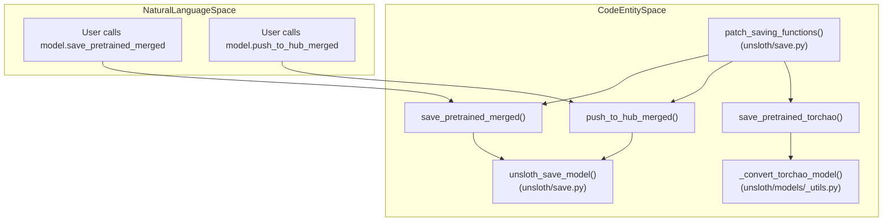
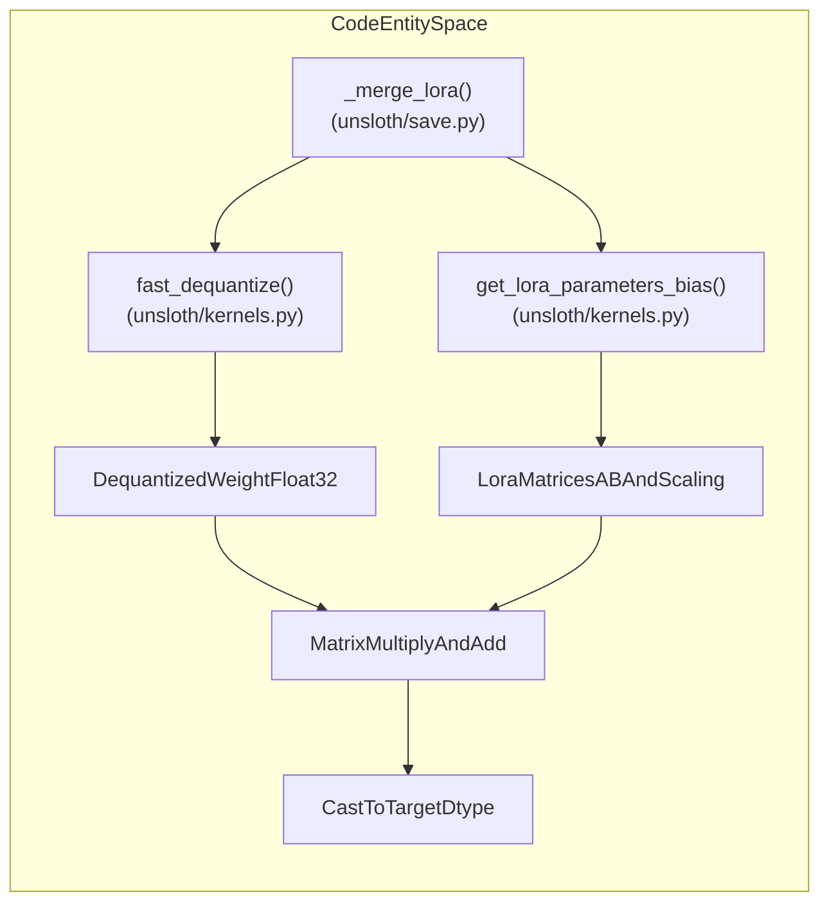

<!-- source: DeepWiki mcp.deepwiki.com · repo unslothai/unsloth · page 8.1 Saving and Merging LoRA Weights · fetched 2026-10-21 -->

# Saving and Merging LoRA Weights

Relevant source files

The following files were used as context for generating this wiki page:

- [README.md](README.md)
- [pyproject.toml](pyproject.toml)
- [tests/python/test_construct_chat_template_validation.py](tests/python/test_construct_chat_template_validation.py)
- [tests/test_fp8_pre_sm89_dequant_fallback.py](tests/test_fp8_pre_sm89_dequant_fallback.py)
- [tests/test_import_fixes_drift.py](tests/test_import_fixes_drift.py)
- [unsloth/__init__.py](unsloth/__init__.py)
- [unsloth/_gpu_init.py](unsloth/_gpu_init.py)
- [unsloth/chat_templates.py](unsloth/chat_templates.py)
- [unsloth/import_fixes.py](unsloth/import_fixes.py)
- [unsloth/kernels/fp8.py](unsloth/kernels/fp8.py)
- [unsloth/models/_utils.py](unsloth/models/_utils.py)
- [unsloth/models/llama.py](unsloth/models/llama.py)
- [unsloth/models/loader.py](unsloth/models/loader.py)
- [unsloth/models/loader_utils.py](unsloth/models/loader_utils.py)
- [unsloth/models/mapper.py](unsloth/models/mapper.py)
- [unsloth/models/mistral.py](unsloth/models/mistral.py)
- [unsloth/models/rl.py](unsloth/models/rl.py)
- [unsloth/models/rl_replacements.py](unsloth/models/rl_replacements.py)
- [unsloth/models/vision.py](unsloth/models/vision.py)
- [unsloth/save.py](unsloth/save.py)
- [unsloth/tokenizer_utils.py](unsloth/tokenizer_utils.py)

## Purpose and Scope

This page documents how Unsloth saves trained models and merges LoRA adapters back into base weights. It covers the primary save methods (`lora`, `merged_16bit`, `merged_4bit`), the internal merging mathematics, memory management during the merge process, model sharding, and integration with specialized export formats like TorchAO.

Unsloth extends the standard Hugging Face `PreTrainedModel` by patching custom saving functions that handle the complexities of 4-bit dequantization and high-precision merging within `unsloth/save.py` [unsloth/save.py:88]().

---

## Overview and Entry Points

After training a LoRA adapter on a quantized or full-precision base model, Unsloth provides three main save strategies through the `unsloth_save_model` function [unsloth/save.py:88]().

| `save_method`   | Description                                                | Use Case                                                        |
| --------------- | ---------------------------------------------------------- | --------------------------------------------------------------- |
| `lora`          | Saves only the LoRA adapter weights (A, B matrices and config). | Smallest output; requires the original base model to load.      |
| `merged_16bit`  | Dequantizes base weights, merges LoRA, and saves as FP16/BF16. | Required for GGUF conversion and general deployment.            |
| `merged_4bit`   | Merges LoRA into base weights and saves in 4-bit bitsandbytes format. | Follow-on fine-tuning on the merged model; possible accuracy loss. |

### `patch_saving_functions`

The function `patch_saving_functions` attaches custom saving and pushing methods to the model instance during initialization [unsloth/save.py:90](), enabling convenient saving and exporting features. It is invoked in model constructors such as in `FastLlamaModel` [unsloth/models/llama.py:136]() and `FastVisionModel` via `patch_saving_functions` import [unsloth/models/vision.py:59]().

The patched methods include `save_pretrained_merged`, `push_to_hub_merged`, and `save_pretrained_torchao` [unsloth/save.py:88-91]().

### Diagram: Saving and Merging Entrypoints Workflow

Sources: [unsloth/save.py:88-91](), [unsloth/models/llama.py:136](), [unsloth/models/vision.py:59](), [unsloth/models/_utils.py:71]()

---

## LoRA Merge Mathematics (`_merge_lora`)

The `_merge_lora` function executes the core high-precision merge of LoRA adapter weights into the base weights of a given layer [unsloth/save.py:189-218]().

### Dequantization and Precision

When the base model's weight is quantized (commonly 4-bit), Unsloth dequantizes it first into `float32` using the custom kernel `fast_dequantize` [unsloth/save.py:58](). This prevents compounded quantization errors when performing the LoRA addition.

### Merge Formula

Given base weight $W$, LoRA matrices $A$ and $B$, scaling $s$, the merged weight is computed as:

$$W_{merged} = W_{dequantized} + s \times (B \times A)$$

where scaling $s = \frac{\text{lora_alpha}}{\text{r}}$, with $r$ the LoRA rank.

### Diagram: LoRA Merging Kernel Execution Flow

Sources: [unsloth/save.py:58](), [unsloth/save.py:189-218]()

---

## Memory Management and Sharding

Merging large models demands memory exceeding typical GPU VRAM. Unsloth implements a hybrid memory placement and sharding approach [unsloth/save.py:544-596]().

### Placement Strategy

- **VRAM-first allocation:** When GPU memory allocation is below the `maximum_memory_usage` threshold, tensors involved in merging remain on CUDA devices [unsloth/save.py:544-560]().
- **Disk Offload:** Upon surpassing the VRAM limit, partial model state dictionaries are offloaded to disk as temporary files using `torch.save` [unsloth/save.py:560-580]().
- **Memory Mapping:** These offloaded files are read back with `mmap=True` enabled, allowing the OS to manage RAM usage efficiently without loading all data into Python memory at once [unsloth/save.py:587-596]().

### Model Sharding

During `merged_16bit` saves, the full `state_dict` is passed to Hugging Face's standard `save_pretrained` method with a specified `max_shard_size` (default 5GB). This automatically triggers sharding where large weights are split into multiple shard files and an index JSON [unsloth/save.py:850-860]().

Sources: [unsloth/save.py:544-596](), [unsloth/save.py:850-860]()

---

## Serialization Backends

Unsloth chooses serialization backends adaptively depending on hardware:

| Hardware    | Default Backend | Rationale                                                   |
|-------------|-----------------|-------------------------------------------------------------|
| CPUs > 2 cores | `safetensors`  | Offers multi-threaded, performant, and safe serialization  |
| CPUs ≤ 2 cores | `pickle` (.bin) | `safetensors` is slow on low-core CPUs; pickle is faster   |

If using `safe_serialization=True` on CPU-limited machines, Unsloth forces fallback to pickle-based saving to reduce save time [unsloth/save.py:570-583]().

Sources: [unsloth/save.py:570-583]()

---

## TorchAO Integration

Unsloth supports saving models quantized with TorchAO (e.g., int8 weight-only or int4 GPTQ-style quantization) [unsloth/save.py:71]().

### Saving Flow

1. Perform a `merged_16bit` save into a temporary directory to first obtain a merged and dequantized model [unsloth/save.py:1048-1055]().
2. Convert the merged weights to TorchAO's quantization format using an internal `_convert_torchao_model` utility [unsloth/save.py:71]().
3. Save the quantized model to the target directory and include the `quantization_config` in the configuration JSON for proper downstream loading.

Sources: [unsloth/save.py:71](), [unsloth/save.py:1048-1055]()

---

## Model Name Mapping and Registry

Unsloth maintains a comprehensive mapping registry to resolve model names, particularly when dealing with quantized or pre-quantized variants [unsloth/models/mapper.py:13-18]().

- The `INT_TO_FLOAT_MAPPER` dictionary in `unsloth/models/mapper.py` maps 4-bit quantized model names back to their original full precision counterparts [unsloth/models/mapper.py:20-223]().
- This mapping is leveraged by loader functions to identify the correct tokenizer and config when merging or saving models using `merged_16bit`.
- Auxiliary utility `_strip_unsloth_bnb_4bit_suffix` from `loader.py` removes Unsloth-specific suffixes to normalize model names [unsloth/models/loader.py:140-146]().

Sources: [unsloth/models/mapper.py:20-223](), [unsloth/models/loader.py:140-146]()

---

