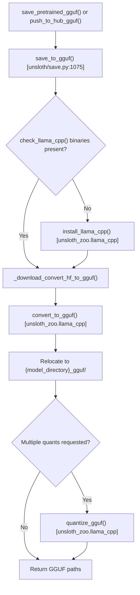
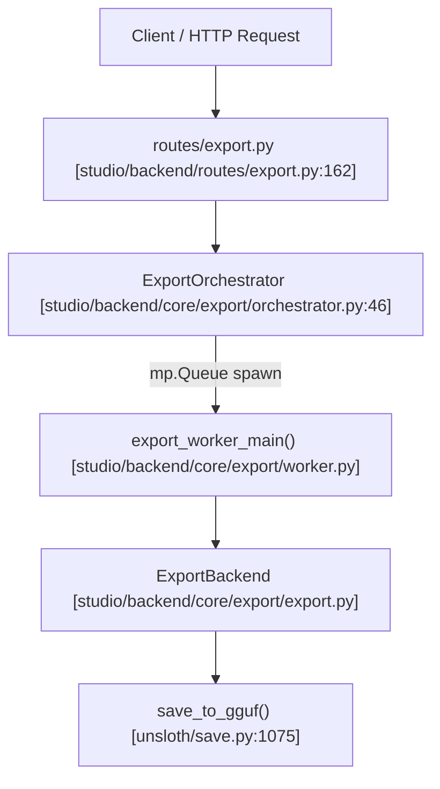
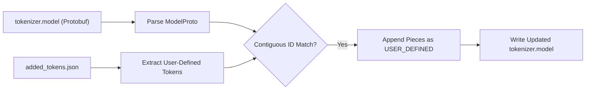

<!-- source: DeepWiki mcp.deepwiki.com · repo unslothai/unsloth · page 8.2 GGUF Export Pipeline · fetched 2026-10-21 -->

# GGUF Export Pipeline

Relevant source files

The following files were used as context for generating this wiki page:

- [studio/backend/core/export/export.py](studio/backend/core/export/export.py)
- [studio/backend/core/export/orchestrator.py](studio/backend/core/export/orchestrator.py)
- [studio/backend/core/export/worker.py](studio/backend/core/export/worker.py)
- [studio/backend/models/export.py](studio/backend/models/export.py)
- [studio/backend/routes/export.py](studio/backend/routes/export.py)
- [studio/backend/tests/test_detect_mmproj_file.py](studio/backend/tests/test_detect_mmproj_file.py)
- [studio/backend/tests/test_export_gguf_discovery.py](studio/backend/tests/test_export_gguf_discovery.py)
- [studio/backend/tests/test_export_gguf_hub_upload.py](studio/backend/tests/test_export_gguf_hub_upload.py)
- [studio/backend/tests/test_export_gguf_sharding.py](studio/backend/tests/test_export_gguf_sharding.py)
- [studio/backend/tests/test_export_imatrix_compressed.py](studio/backend/tests/test_export_imatrix_compressed.py)
- [studio/backend/tests/test_gguf_load_cache_reuse.py](studio/backend/tests/test_gguf_load_cache_reuse.py)
- [studio/backend/tests/test_gguf_metadata.py](studio/backend/tests/test_gguf_metadata.py)
- [studio/backend/tests/test_llama_cpp_mtp_detection.py](studio/backend/tests/test_llama_cpp_mtp_detection.py)
- [studio/backend/tests/test_llama_cpp_placement.py](studio/backend/tests/test_llama_cpp_placement.py)
- [studio/backend/tests/test_memory_estimate.py](studio/backend/tests/test_memory_estimate.py)
- [studio/backend/tests/test_metal_paravirtual_guard.py](studio/backend/tests/test_metal_paravirtual_guard.py)
- [studio/backend/tests/test_mmproj_placement_policy.py](studio/backend/tests/test_mmproj_placement_policy.py)
- [studio/backend/tests/test_mtp_drafter_companion.py](studio/backend/tests/test_mtp_drafter_companion.py)
- [studio/backend/utils/models/gguf_metadata.py](studio/backend/utils/models/gguf_metadata.py)
- [studio/frontend/src/features/chat/lib/resident-config-match.ts](studio/frontend/src/features/chat/lib/resident-config-match.ts)
- [studio/frontend/src/features/export/api/export-api.ts](studio/frontend/src/features/export/api/export-api.ts)
- [studio/frontend/src/features/export/export-page.tsx](studio/frontend/src/features/export/export-page.tsx)
- [studio/frontend/src/features/export/stores/export-runtime-store.ts](studio/frontend/src/features/export/stores/export-runtime-store.ts)
- [studio/frontend/src/features/studio/studio-page.tsx](studio/frontend/src/features/studio/studio-page.tsx)
- [studio/frontend/tests/resident-config-match.test.ts](studio/frontend/tests/resident-config-match.test.ts)

This page details Unsloth's GGUF export system, covering both the core library's `save_to_gguf` pipeline [unsloth/save.py:1075-1350]() and the Studio backend's asynchronous subprocess orchestration (`ExportOrchestrator` [studio/backend/core/export/orchestrator.py:46-173]() and `ExportBackend` [studio/backend/core/export/export.py]()). It explains quantization methods, `llama.cpp` integration, multi-shard handling, vision projector (`mmproj`) pairing [studio/backend/utils/models/gguf_metadata.py:4-5](), and SentencePiece tokenizer patching [unsloth/tokenizer_utils.py:426-495]().

---

## Overview and Core Library Orchestration

The GGUF export pipeline converts HuggingFace models—including fine-tuned models with merged LoRA weights—into the GGUF format compatible with `llama.cpp`, Ollama, and LM Studio. In the core library, this process is anchored by `save_to_gguf` in `unsloth/save.py` [unsloth/save.py:1075-1350]().

The pipeline executes the following sequential operations:
1. **Binary Verification and Installation**: Verifies the availability of `llama.cpp` binaries (`llama-quantize`, `llama-cli`, `llama-server`) via `check_llama_cpp()`. If missing, it invokes `install_llama_cpp()` from `unsloth_zoo.llama_cpp` [unsloth/save.py:99-105]().
2. **Intermediate Conversion**: Converts the HuggingFace model folder into an unquantized or baseline quantized GGUF file (`f16`, `bf16`, or `f32`) using `convert_to_gguf()` [unsloth/save.py:1155-1191]().
3. **Quantization Loop**: Iterates through requested quantization variants using `quantize_gguf()` [unsloth/save.py:1330-1345]().
4. **Tokenizer Patching**: Patches SentencePiece `tokenizer.model` binaries to include custom tokens added during training [unsloth/tokenizer_utils.py:426-495]().
5. **Multi-Shard Management**: Resolves sharded safetensors checkpoints to ensure conversion scripts process all component files.

### Core Pipeline Architecture

Sources: [unsloth/save.py:99-1350](), [unsloth/tokenizer_utils.py:426-495]()

---

## Quantization Methods and Aliases

Unsloth maps friendly quantization aliases to concrete `llama.cpp` quant types via the `ALLOWED_QUANTS` dictionary in `unsloth/save.py` [unsloth/save.py:147-172]().

| Alias | Concrete Quantization | Description |
| :--- | :--- | :--- |
| `not_quantized` | Model dtype (`f16`/`bf16`) | Fast conversion, uncompressed size, slow inference speed [unsloth/save.py:148]() |
| `fast_quantized` | `q8_0` | Fast conversion, balanced file size and inference performance [unsloth/save.py:149]() |
| `quantized` | `q4_k_m` | Standard K-quant, fast inference, compact file size [unsloth/save.py:150]() |

### Specialized and I-Matrix Quants
The pipeline also supports Importance-Matrix (`imatrix`) quants and IQ formats requiring calibration datasets [unsloth/save.py:176-188]():
* **IQ Quants**: `iq1_s`, `iq2_xxs`, `iq3_m`, `iq4_nl`
* **K-Quants**: `q4_k_s`, `q5_k_m`, `q6_k`

Available quantization methods and descriptions can be audited programmatically via `print_quantization_methods()` [unsloth/save.py:189-204]().

Sources: [unsloth/save.py:147-204]()

---

## Studio Backend Export Orchestration

In the Studio web interface and CLI, export tasks run inside isolated background workers via `ExportOrchestrator` [studio/backend/core/export/orchestrator.py:46-173]() and `ExportBackend` [studio/backend/core/export/export.py](). This design isolates heavy PyTorch operations and allows seamless switching of the active `transformers` version without contaminating the main FastAPI server process.

### Natural Language to Code Entity Space: Export Subprocess Architecture

Sources: [studio/backend/routes/export.py:162](), [studio/backend/core/export/orchestrator.py:46-173](), [studio/backend/core/export/worker.py](), [studio/backend/core/export/export.py]()

### Request Lifecycle and Subprocess Isolation
1. **Preflight Validation**: The FastAPI route handler `load_checkpoint` validates hardware export capabilities and checks for ongoing `transformers` installation locks [studio/backend/routes/export.py:58-82,162-172]().
2. **Subprocess Spawning**: `ExportOrchestrator` initializes a dedicated persistent worker process using `multiprocessing.get_context("spawn")` [studio/backend/core/export/orchestrator.py:21-32]() to avoid deadlocks and memory fragmentation.
3. **Log Streaming**: Standard output and error streams from the worker are intercepted via piped file descriptors (`_setup_log_capture`) and buffered into a ring buffer (`_log_buffer`) to stream live progress to the frontend via Server-Sent Events (SSE) [studio/backend/core/export/worker.py:46-166](), [studio/backend/core/export/orchestrator.py:62-68]().

Sources: [studio/backend/routes/export.py:58-172](), [studio/backend/core/export/orchestrator.py:21-168](), [studio/backend/core/export/worker.py:46-166]()

---

## Vision Projector and Tokenizer Patching

### Vision Projector (`mmproj`) Integration
For Multimodal Large Language Models (VLMs like LLaVA or Qwen2-VL), the export pipeline generates a separate vision projector GGUF file (`mmproj`) alongside the primary model weights [unsloth/save.py:1348-1350](). The metadata parser reads `general.base_model.0.repo_url` and header properties to correctly pair the vision encoder with the language backbone [studio/backend/utils/models/gguf_metadata.py:4-39]().

### SentencePiece Tokenizer Patching Data Flow
When fine-tuning incorporates custom chat template tokens, standard GGUF converters omit them unless the tokenizer binary is patched. Unsloth uses `fix_sentencepiece_gguf` to update protobuf tokens [unsloth/tokenizer_utils.py:426-495]().

Sources: [unsloth/save.py:1348-1350](), [unsloth/tokenizer_utils.py:426-495](), [studio/backend/utils/models/gguf_metadata.py:4-39]()

---

## Multi-Shard Handling and Environment Safeguards

Large checkpoints spanning multiple safetensors shards are handled by passing the root directory context to `convert_to_gguf()`, ensuring all shard files are loaded in sequence [unsloth/save.py:1270-1275]().

Additional platform safeguards include:
* **Disk Space Verification**: `estimate_gguf_export_bytes` calculates required temporary space before conversion to prevent mid-export I/O failures [unsloth/save.py:116]().
* **Environment Adaptations**: Kaggle and Google Colab environments automatically redirect temporary artifacts to `/tmp` to respect local user storage quotas [unsloth/save.py:123-124]().

Sources: [unsloth/save.py:116-125](), [unsloth/save.py:1270-1275]()

---

