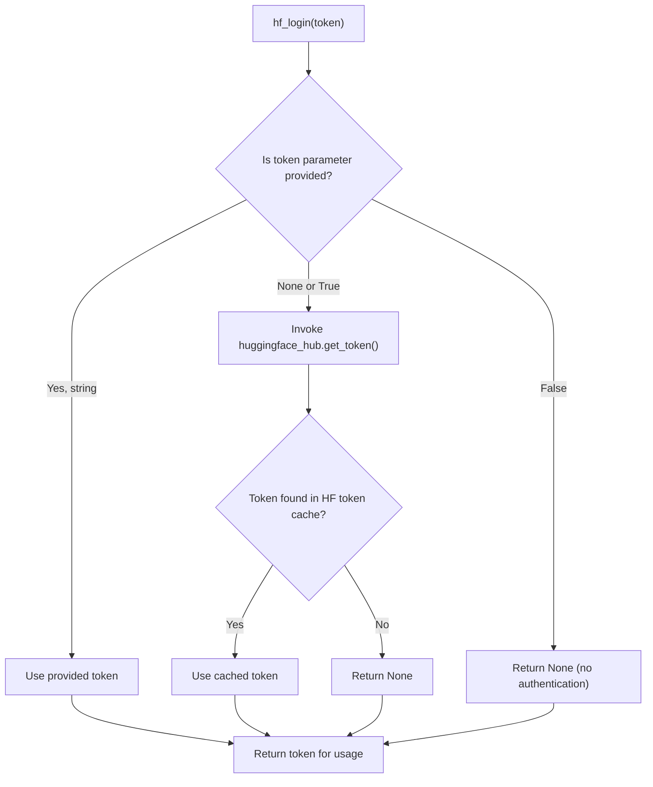
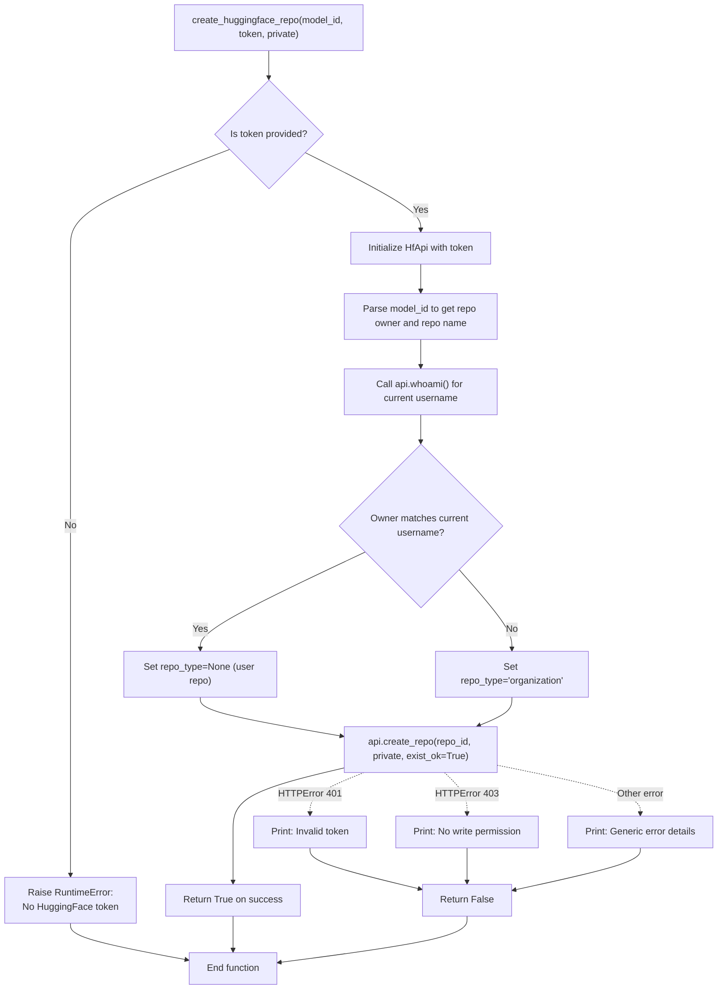
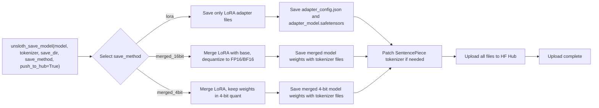
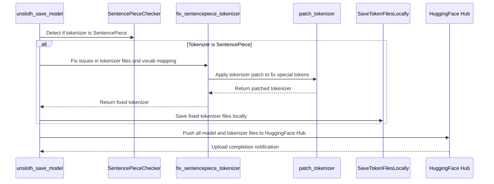
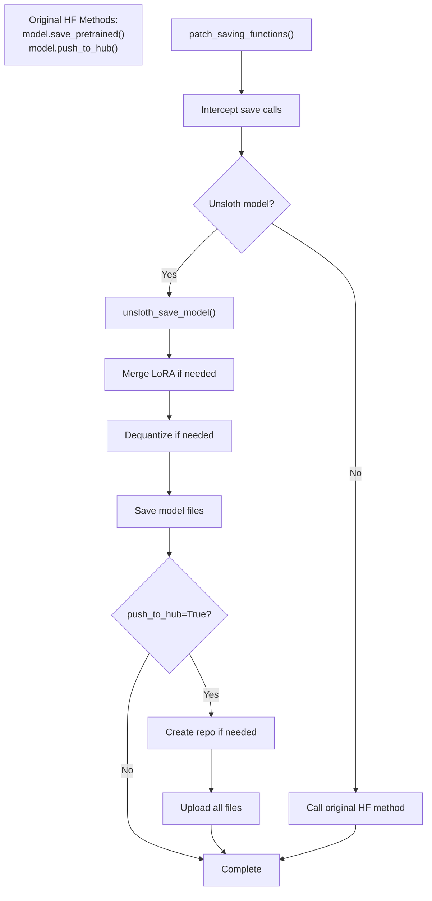

<!-- source: DeepWiki mcp.deepwiki.com · repo unslothai/unsloth · page 8.3 HuggingFace Hub Integration · fetched 2026-10-21 -->

# HuggingFace Hub Integration

Relevant source files

The following files were used as context for generating this wiki page:

- [README.md](README.md)
- [pyproject.toml](pyproject.toml)
- [studio/backend/hub/tests/test_process_unique_incomplete_repro.py](studio/backend/hub/tests/test_process_unique_incomplete_repro.py)
- [studio/backend/hub/tests/test_resumable_partials.py](studio/backend/hub/tests/test_resumable_partials.py)
- [studio/backend/hub/tests/test_unresumable_partial_purge.py](studio/backend/hub/tests/test_unresumable_partial_purge.py)
- [studio/backend/hub/utils/download_registry.py](studio/backend/hub/utils/download_registry.py)
- [studio/backend/hub/utils/resumable_partials.py](studio/backend/hub/utils/resumable_partials.py)
- [studio/backend/hub/workers/hf_download.py](studio/backend/hub/workers/hf_download.py)
- [studio/backend/tests/test_hf_xet_fallback.py](studio/backend/tests/test_hf_xet_fallback.py)
- [studio/backend/tests/test_hub_download_transport_auto.py](studio/backend/tests/test_hub_download_transport_auto.py)
- [studio/backend/tests/test_model_update_robustness.py](studio/backend/tests/test_model_update_robustness.py)
- [studio/backend/tests/test_partial_resume_verdict.py](studio/backend/tests/test_partial_resume_verdict.py)
- [studio/backend/tests/test_text_io_encoding.py](studio/backend/tests/test_text_io_encoding.py)
- [studio/backend/tests/test_training_worker_import_discipline.py](studio/backend/tests/test_training_worker_import_discipline.py)
- [studio/backend/tests/test_worker_activates_correct_transformers.py](studio/backend/tests/test_worker_activates_correct_transformers.py)
- [studio/backend/utils/hf_cache_settings.py](studio/backend/utils/hf_cache_settings.py)
- [studio/backend/utils/hf_xet_fallback.py](studio/backend/utils/hf_xet_fallback.py)
- [tests/python/test_construct_chat_template_validation.py](tests/python/test_construct_chat_template_validation.py)
- [tests/test_fp8_pre_sm89_dequant_fallback.py](tests/test_fp8_pre_sm89_dequant_fallback.py)
- [tests/test_import_fixes_drift.py](tests/test_import_fixes_drift.py)
- [tests/test_prefetch_snapshot_scope.py](tests/test_prefetch_snapshot_scope.py)
- [tests/test_st_subfolder_weights_are_fetched.py](tests/test_st_subfolder_weights_are_fetched.py)
- [unsloth/__init__.py](unsloth/__init__.py)
- [unsloth/_gpu_init.py](unsloth/_gpu_init.py)
- [unsloth/chat_templates.py](unsloth/chat_templates.py)
- [unsloth/import_fixes.py](unsloth/import_fixes.py)
- [unsloth/kernels/fp8.py](unsloth/kernels/fp8.py)
- [unsloth/models/_utils.py](unsloth/models/_utils.py)
- [unsloth/models/llama.py](unsloth/models/llama.py)
- [unsloth/models/loader.py](unsloth/models/loader.py)
- [unsloth/models/loader_utils.py](unsloth/models/loader_utils.py)
- [unsloth/models/mapper.py](unsloth/models/mapper.py)
- [unsloth/models/mistral.py](unsloth/models/mistral.py)
- [unsloth/models/rl.py](unsloth/models/rl.py)
- [unsloth/models/rl_replacements.py](unsloth/models/rl_replacements.py)
- [unsloth/models/vision.py](unsloth/models/vision.py)
- [unsloth/save.py](unsloth/save.py)
- [unsloth/tokenizer_utils.py](unsloth/tokenizer_utils.py)

## Purpose and Scope

This page details the mechanisms by which Unsloth integrates with the HuggingFace Hub for model repository creation, pushing models (including LoRA adapters and merged variants), and handling tokenizer compatibility issues, especially for SentencePiece tokenizers. It explains authentication, metadata generation, and the patching of save and push methods to provide seamless upload workflows.

Sources: [unsloth/save.py:86-92](), [unsloth/tokenizer_utils.py:40-46]()

---

## Authentication and Token Management

Unsloth uses a unified approach for authenticating with HuggingFace Hub via the `hf_login` function. This function resolves the appropriate token based on the input parameter and the existing HuggingFace token cache.

### Token Resolution Strategy

Title: Token Authentication Flow

- **Behavior**:  
  - If a string is provided, use it directly.  
  - If `None` or `True` is passed, attempt to retrieve the token from the HF cache using `get_token` [unsloth/models/_utils.py:121-145]().  
  - If `False`, skip authentication.

Sources: [unsloth/models/_utils.py:121-145](), [unsloth/save.py:76-85]()

---

## Repository Creation and Management

Unsloth encapsulates the logic to create HuggingFace repositories programmatically via the `create_huggingface_repo` function [unsloth/save.py:91-92](). This utility determines repository ownership scope (user vs. organization), privacy settings, and handles errors such as missing tokens or insufficient permissions.

### Repository Creation Workflow

Title: Repository Creation Decision Tree

- **Automatic repository type detection**: Uses `api.whoami()` to decide if the repo belongs to the user or an organization [unsloth/save.py:74-84]().  
- **Error handling**: Authentication and permission issues log appropriate messages and return `False` instead of crashing [unsloth/save.py:74-84]().

Sources: [unsloth/save.py:74-92]()

---

## Pushing Models to Hub

Unsloth integrates HuggingFace Hub upload logic into its model saving pipeline through the `unsloth_save_model` function [unsloth/save.py:88-88](). The approach supports multiple save methods that determine how the model and any LoRA adapters are saved and subsequently pushed.

### Save Methods and Upload Flow

Title: Model Upload Pipeline by Save Method

- **LoRA method**: Only LoRA adapters are saved and pushed alongside tokenizer files [unsloth/save.py:88-89]().  
- **Merged_16bit**: Merges LoRA weights, dequantizes to FP16/BF16 for better interoperability [unsloth/save.py:88-90]().  
- **Merged_4bit**: Keeps model and adapters in 4-bit quantized form [unsloth/save.py:88-90]().  
- **Tokenizer patching** ensures special cases like SentencePiece tokenizers are handled correctly before pushing [unsloth/tokenizer_utils.py:40-46]().

Sources: [unsloth/save.py:88-90](), [unsloth/tokenizer_utils.py:40-46]()

---

## SentencePiece Tokenizer Patching

SentencePiece tokenizers require specific fixes before uploading to HuggingFace Hub to ensure compatibility downstream. Unsloth applies patching during save operations when SentencePiece tokenizers are detected via `fix_sentencepiece_tokenizer` [unsloth/tokenizer_utils.py:41-41]().

### Patch Workflow

Title: SentencePiece Tokenizer Patching Sequence

- The patch involves:  
  - Fixing special tokens and token IDs [unsloth/tokenizer_utils.py:30-38]().  
  - Adjusting prepend behavior for token strings [unsloth/tokenizer_utils.py:30-38]().  
  - Ensuring slow and fast tokenizer vocabularies are consistent via conversion routines [unsloth/tokenizer_utils.py:12-15]().

Sources: [unsloth/save.py:88-90](), [unsloth/tokenizer_utils.py:12-46]()

---

## Metadata Generation

When models are pushed, Unsloth leverages HuggingFace Transformers' push mechanisms to generate standard metadata files automatically. This metadata is essential for model card creation and downstream tools’ compatibility.

### Metadata Files Included

| File Name                 | Purpose                           | Generated By                 |
|---------------------------|---------------------------------|------------------------------|
| `config.json`             | Model architecture config        | Transformers library          |
| `tokenizer_config.json`   | Tokenizer configuration          | Transformers library          |
| `special_tokens_map.json` | Mapping of special tokens        | Transformers library          |
| `tokenizer.model` (if SP) | SentencePiece tokenizer model    | Tokenizer save logic          |
| `adapter_config.json`     | LoRA adapter metadata            | PEFT library (if LoRA used)  |
| `adapter_model.safetensors` | LoRA weight matrices           | PEFT library (if LoRA used)  |

- For LoRA adapters, fields such as rank (`r`), alpha (`lora_alpha`), and target modules are preserved to facilitate reloading with PEFT [unsloth/save.py:84-85]().

Sources: [unsloth/save.py:84-90]()

---

## Integration with Save Functions

Unsloth injects its own save and push logic via monkeypatching to HuggingFace Transformers native methods through `patch_saving_functions` [unsloth/save.py:90-90]().

### Patch and Routing Diagram

Title: Save Function Patching and Routing

### Patched Methods Details

| Method                   | Modified Behavior |
|--------------------------|-------------------|
| `save_pretrained`        | Routes calls into `unsloth_save_model` with `push_to_hub=False` [unsloth/save.py:88-90](). |
| `push_to_hub`            | Routes calls into `unsloth_save_model` with `push_to_hub=True` [unsloth/save.py:88-90](). |
| `save_pretrained_merged` | Custom Unsloth API method allowing explicit selection of save method [unsloth/save.py:88-90](). |

Sources: [unsloth/save.py:88-90]()

---

## System Integration Points and Related Modules

Unsloth’s HuggingFace Hub integration hooks into several internal subsystems:

| Subsystem                 | Integration Point                  | Purpose and Notes                                          |
|---------------------------|----------------------------------|-----------------------------------------------------------|
| LoRA Merging              | `fast_dequantize`                | Used during save to merge and dequantize LoRA adapters [unsloth/save.py:58-58](). |
| GGUF Export               | `fix_sentencepiece_gguf`         | Patches SentencePiece tokenizer for llama.cpp GGUF export [unsloth/tokenizer_utils.py:44-44](). |
| Model Loading             | `hf_login`                       | Shared authentication mechanism for private model access [unsloth/models/_utils.py:84-84](). |
| Tokenizer Patching        | `patch_tokenizer`                | Ensures stable tokenization before pushing [unsloth/models/_utils.py:32-32](). |

Sources: [unsloth/save.py:58-58](), [unsloth/tokenizer_utils.py:44-44](), [unsloth/models/_utils.py:32-84]()

---

