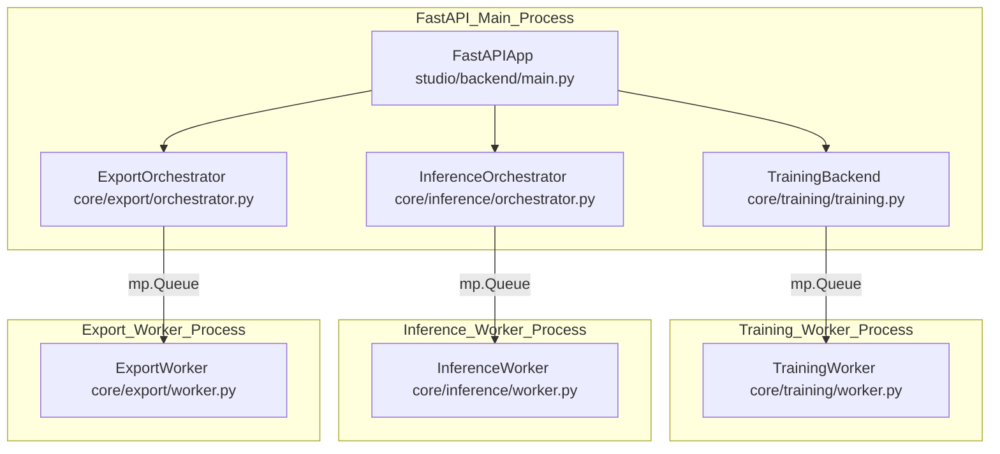
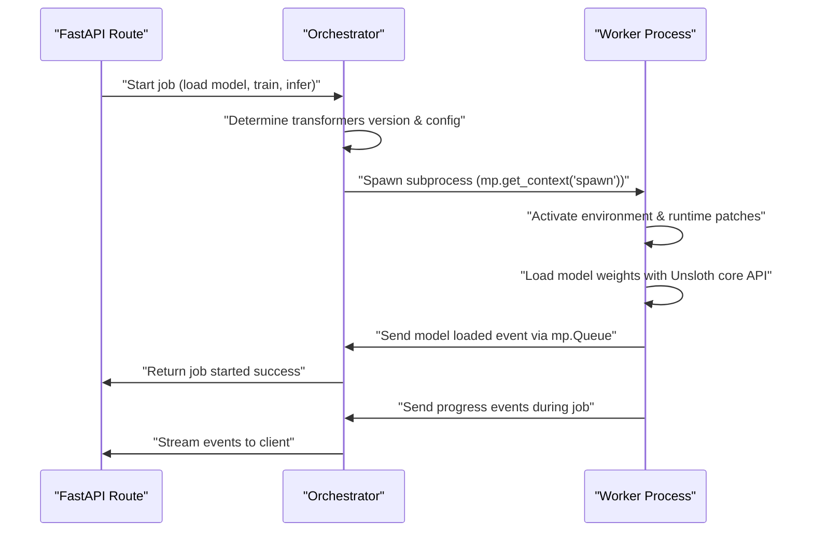

<!-- source: DeepWiki mcp.deepwiki.com · repo unslothai/unsloth · page 9 Studio Backend · fetched 2026-10-21 -->

# Studio Backend

Relevant source files

The following files were used as context for generating this wiki page:

- [studio/backend/core/__init__.py](studio/backend/core/__init__.py)
- [studio/backend/core/training/__init__.py](studio/backend/core/training/__init__.py)
- [studio/backend/main.py](studio/backend/main.py)
- [studio/backend/routes/llama_compat.py](studio/backend/routes/llama_compat.py)
- [studio/backend/tests/test_chat_load_during_training.py](studio/backend/tests/test_chat_load_during_training.py)
- [studio/backend/tests/test_gpu_selection.py](studio/backend/tests/test_gpu_selection.py)
- [studio/backend/tests/test_hub_token_cache_isolation.py](studio/backend/tests/test_hub_token_cache_isolation.py)
- [studio/backend/tests/test_llama_compat_routes.py](studio/backend/tests/test_llama_compat_routes.py)
- [studio/backend/tests/test_login_rate_limit.py](studio/backend/tests/test_login_rate_limit.py)
- [studio/backend/tests/test_middleware.py](studio/backend/tests/test_middleware.py)
- [studio/backend/tests/test_model_defaults_aliases_resolve.py](studio/backend/tests/test_model_defaults_aliases_resolve.py)
- [studio/backend/tests/test_utils.py](studio/backend/tests/test_utils.py)
- [studio/backend/tests/test_vram_estimation.py](studio/backend/tests/test_vram_estimation.py)
- [studio/backend/utils/hardware/VRAM_ESTIMATION.md](studio/backend/utils/hardware/VRAM_ESTIMATION.md)
- [studio/backend/utils/hardware/__init__.py](studio/backend/utils/hardware/__init__.py)
- [studio/backend/utils/hardware/hardware.py](studio/backend/utils/hardware/hardware.py)
- [studio/backend/utils/hardware/vram_estimation.py](studio/backend/utils/hardware/vram_estimation.py)
- [studio/backend/utils/inference/__init__.py](studio/backend/utils/inference/__init__.py)
- [studio/backend/utils/inference/inference_config.py](studio/backend/utils/inference/inference_config.py)
- [studio/backend/utils/utils.py](studio/backend/utils/utils.py)

The Studio Backend is the AGPLv3-licensed web service layer of Unsloth Studio, providing a FastAPI server with subprocess-based orchestration for training, inference, and export operations. This architecture enables transformers version isolation, fault tolerance, and GPU memory safety by running each heavy ML task inside dedicated Python subprocesses.

It acts as the core API backend coordinating model management, user authentication, and subprocess lifecycles. The FastAPI server itself remains light, offloading heavy ML work to isolated subprocesses that can be independently restarted, upgraded, or switched for different model architectures and versions.

For details on the core Unsloth library (Apache 2.0 license), see [Core Library Architecture](#3). For CLI integration, see [CLI Commands](#10.1). For frontend client integration, see [Frontend Architecture](#10.2).

---

## Architecture Overview

The Studio Backend architecture is centered on **subprocess orchestration**, where the FastAPI main process acts as a coordinator that delegates training, inference, and export tasks to isolated worker processes. This design brings several critical advantages:

- **Transformers Version Isolation:** Each subprocess can run with its own compatible version of `transformers`, avoiding conflicts when different models require different versions or patching techniques.
- **Memory and Fault Safety:** GPU memory is fully reclaimed when a subprocess is killed, preventing memory leaks or fragmentation. Failures such as OOM or crashes in training do not affect inference or the API server stability.
- **Hardware-Aware Initialization:** Startup hooks ensure correct CUDA device ordering, ROCm DLL injection on Windows [studio/backend/main.py:38-79](), and appropriate environment adjustments for launching subprocesses safely [studio/backend/main.py:16-19]().
- **SQLite-based Persistence:** Model metadata, training histories, users, API keys, and credentials are stored locally in a SQLite database managed by the backend.

### Studio Backend System Diagram

**Figure:** High-level subprocess orchestration of the Studio backend

At startup, the FastAPI server applies important environment and hardware initializations such as pinning GPU device ordering to PCI bus IDs (`CUDA_DEVICE_ORDER=PCI_BUS_ID`) [studio/backend/main.py:16-19](). On Windows, it performs DLL path injection for ROCm to ensure `amdhip64.dll` is found [studio/backend/main.py:38-79]() and sets `BNB_ROCM_VERSION` before `bitsandbytes` is imported [studio/backend/main.py:97-139]().

Sources:
[studio/backend/main.py:16-19](),
[studio/backend/main.py:38-79](),
[studio/backend/main.py:97-139]()

---

## Subprocess Orchestration Pattern

The Studio Backend uses a consistent subprocess orchestration pattern for all long-running ML tasks:

1. **Spawn Isolated Worker Subprocess:** Each job runs in a fresh Python subprocess spawned with the `"spawn"` method to guarantee a clean interpreter.
2. **Activate Environment:** The worker subprocess dynamically activates the correct environment and applies runtime patches.
3. **Initialize Hardware:** The subprocess fixes library paths and environment variables to prevent symbol loading errors.
4. **Load Model:** The backend class loads the model with the core Unsloth API, applying quantization or LoRA adapters.
5. **Event Streaming:** Progress and logs pass back to the FastAPI orchestrator through a multiprocessing `Queue`.
6. **Graceful Shutdown:** The orchestrator manages resource cleanup by terminating the subprocess.

### Subprocess Lifecycle Sequence Diagram

**Figure:** Overview of subprocess startup, configuration, and event streaming workflow

Sources:
[studio/backend/main.py:16-139]()

---

## Hardware and Device Management

The backend performs centralized hardware detection via `utils.hardware`. This is run once at startup and the state is shared globally across the backend [studio/backend/utils/hardware/hardware.py:4-17]().

- **Device Classification:** Categorizes the system into `DeviceType` (CUDA, XPU, MLX, CPU) [studio/backend/utils/hardware/hardware.py:40-47]().
- **GPU Selection:** Implements logic to resolve physical vs. relative GPU IDs, ensuring `CUDA_VISIBLE_DEVICES` matches the user's intent [studio/backend/utils/hardware/hardware.py:31-34]().
- **VRAM Estimation:** Provides utilities to estimate required memory for models and training configurations before launching subprocesses via `utils.hardware.vram_estimation` [studio/backend/utils/hardware/vram_estimation.py:4-16]().
- **Background Detection:** Supports daemon-thread hardware detection to avoid blocking API health checks during slow framework imports [studio/backend/utils/hardware/hardware.py:118-136]().

Sources:
[studio/backend/utils/hardware/hardware.py:4-47](),
[studio/backend/utils/hardware/hardware.py:118-136](),
[studio/backend/utils/hardware/vram_estimation.py:4-16]()

---

## Model Configuration and Detection

The backend implements utilities for detecting model types and determining appropriate default settings:

- **Model Configuration Management:** Resolves model-specific defaults, inference parameters, and family overrides from YAML configurations in `assets/configs/` [studio/backend/utils/inference/inference_config.py:4-17]().
- **VRAM Estimation:** Calculates memory bounds for model weights, LoRA adapters, optimizer states, gradients, and activations to prevent out-of-memory errors during concurrent chat loading and training [studio/backend/utils/hardware/vram_estimation.py:104-124]().

Sources:
[studio/backend/utils/inference/inference_config.py:4-17](),
[studio/backend/utils/hardware/vram_estimation.py:104-124]()

---

## Child Pages

For detailed, component-level documentation of the Studio Backend, see these pages:

- [Backend Architecture Overview](#9.1) — Explain the subprocess isolation pattern, FastAPI server structure, orchestrator-worker communication via `mp.Queue`, hardware-aware initialization, SQLite storage, and logging infrastructure.
- [Training Backend and Orchestration](#9.2) — Detail `TrainingBackend`, `UnslothTrainer`, event queue communication, dataset preprocessing, progress streaming, and training history persistence in SQLite. Also covers diffusion LoRA training service.
- [Inference Backend (Transformers and GGUF)](#9.3) — Document dual inference backends: `InferenceOrchestrator` for Transformers models and `LlamaCppBackend` for GGUF, including GPU selection and tool calling.
- [Export Backend](#9.4) — Explain `ExportBackend` and `ExportOrchestrator`, GGUF conversion subprocess, merged/LoRA export modes, and file relocation logic.
- [Model Configuration and Detection](#9.5) — Cover `model_config.py` utilities for detecting VLM/audio/embedding models, GGUF variant selection, canonical name mapping, and VRAM estimation.
- [Authentication and Security](#9.6) — Document the Studio's local-first authentication system: SQLite credential storage, JWT session management, PBKDF2 password hashing, and bootstrap password flow.
- [Speech-to-Text and Audio Features](#9.7) — Document the Whisper-based dictation system, audio codec support for TTS models, and the `whisper.cpp` update pipeline.
- [Image and Video Generation Backend](#9.8) — Document the Studio's diffusion inference system: `DiffusionBackend` and `SdCppDiffusionBackend`, engine routing, and GPU arbiter for VRAM coordination.

---

