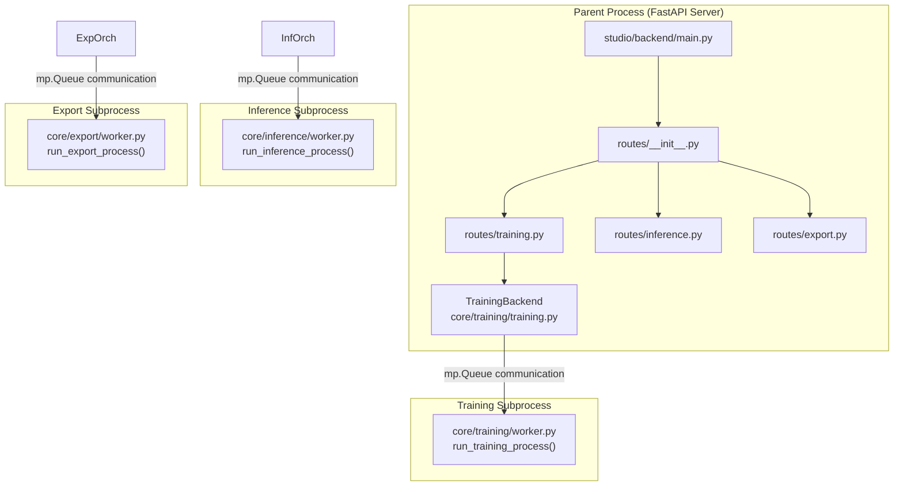
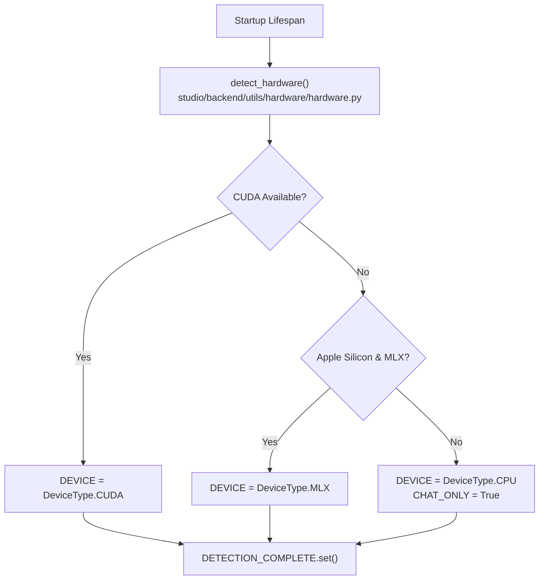

<!-- source: DeepWiki mcp.deepwiki.com · repo unslothai/unsloth · page 9.1 Backend Architecture Overview · fetched 2026-10-21 -->

# Backend Architecture Overview

Relevant source files

The following files were used as context for generating this wiki page:

- [studio/backend/core/__init__.py](studio/backend/core/__init__.py)
- [studio/backend/core/inference/sd_cpp_engine.py](studio/backend/core/inference/sd_cpp_engine.py)
- [studio/backend/core/inference/sd_cpp_server.py](studio/backend/core/inference/sd_cpp_server.py)
- [studio/backend/core/training/__init__.py](studio/backend/core/training/__init__.py)
- [studio/backend/loggers/config.py](studio/backend/loggers/config.py)
- [studio/backend/loggers/handlers.py](studio/backend/loggers/handlers.py)
- [studio/backend/loggers/media_progress.py](studio/backend/loggers/media_progress.py)
- [studio/backend/main.py](studio/backend/main.py)
- [studio/backend/routes/chat_history.py](studio/backend/routes/chat_history.py)
- [studio/backend/routes/llama_compat.py](studio/backend/routes/llama_compat.py)
- [studio/backend/storage/studio_db.py](studio/backend/storage/studio_db.py)
- [studio/backend/tests/log_budget/session.py](studio/backend/tests/log_budget/session.py)
- [studio/backend/tests/test_chat_history_routes.py](studio/backend/tests/test_chat_history_routes.py)
- [studio/backend/tests/test_chat_history_storage.py](studio/backend/tests/test_chat_history_storage.py)
- [studio/backend/tests/test_chat_load_during_training.py](studio/backend/tests/test_chat_load_during_training.py)
- [studio/backend/tests/test_chat_message_identity.py](studio/backend/tests/test_chat_message_identity.py)
- [studio/backend/tests/test_chat_settings_payload.py](studio/backend/tests/test_chat_settings_payload.py)
- [studio/backend/tests/test_chat_thread_settings.py](studio/backend/tests/test_chat_thread_settings.py)
- [studio/backend/tests/test_gpu_selection.py](studio/backend/tests/test_gpu_selection.py)
- [studio/backend/tests/test_hub_token_cache_isolation.py](studio/backend/tests/test_hub_token_cache_isolation.py)
- [studio/backend/tests/test_llama_compat_routes.py](studio/backend/tests/test_llama_compat_routes.py)
- [studio/backend/tests/test_logging_middleware.py](studio/backend/tests/test_logging_middleware.py)
- [studio/backend/tests/test_login_rate_limit.py](studio/backend/tests/test_login_rate_limit.py)
- [studio/backend/tests/test_middleware.py](studio/backend/tests/test_middleware.py)
- [studio/backend/tests/test_min_p_mode_settings.py](studio/backend/tests/test_min_p_mode_settings.py)
- [studio/backend/tests/test_model_defaults_aliases_resolve.py](studio/backend/tests/test_model_defaults_aliases_resolve.py)
- [studio/backend/tests/test_openai_images_generations_route.py](studio/backend/tests/test_openai_images_generations_route.py)
- [studio/backend/tests/test_openai_videos_route.py](studio/backend/tests/test_openai_videos_route.py)
- [studio/backend/tests/test_sd_cpp_engine.py](studio/backend/tests/test_sd_cpp_engine.py)
- [studio/backend/tests/test_third_party_progress_bars.py](studio/backend/tests/test_third_party_progress_bars.py)
- [studio/backend/tests/test_utils.py](studio/backend/tests/test_utils.py)
- [studio/backend/tests/test_video_routes.py](studio/backend/tests/test_video_routes.py)
- [studio/backend/tests/test_vram_estimation.py](studio/backend/tests/test_vram_estimation.py)
- [studio/backend/utils/hardware/VRAM_ESTIMATION.md](studio/backend/utils/hardware/VRAM_ESTIMATION.md)
- [studio/backend/utils/hardware/__init__.py](studio/backend/utils/hardware/__init__.py)
- [studio/backend/utils/hardware/hardware.py](studio/backend/utils/hardware/hardware.py)
- [studio/backend/utils/hardware/vram_estimation.py](studio/backend/utils/hardware/vram_estimation.py)
- [studio/backend/utils/inference/__init__.py](studio/backend/utils/inference/__init__.py)
- [studio/backend/utils/inference/inference_config.py](studio/backend/utils/inference/inference_config.py)
- [studio/backend/utils/utils.py](studio/backend/utils/utils.py)
- [studio/frontend/src/features/chat/api/chat-settings-api.ts](studio/frontend/src/features/chat/api/chat-settings-api.ts)
- [studio/frontend/src/features/chat/lib/min-p-policy.ts](studio/frontend/src/features/chat/lib/min-p-policy.ts)
- [studio/frontend/src/features/chat/lib/min-p-recovery.ts](studio/frontend/src/features/chat/lib/min-p-recovery.ts)
- [studio/frontend/src/features/chat/lib/per-model-params.ts](studio/frontend/src/features/chat/lib/per-model-params.ts)
- [studio/frontend/src/features/chat/presets/preset-policy.ts](studio/frontend/src/features/chat/presets/preset-policy.ts)
- [studio/frontend/src/features/chat/types/runtime.ts](studio/frontend/src/features/chat/types/runtime.ts)
- [studio/frontend/src/features/chat/utils/chat-history-storage.ts](studio/frontend/src/features/chat/utils/chat-history-storage.ts)
- [studio/frontend/src/features/chat/utils/chat-settings-storage.ts](studio/frontend/src/features/chat/utils/chat-settings-storage.ts)
- [studio/frontend/src/features/chat/utils/mirrored-chat-settings.ts](studio/frontend/src/features/chat/utils/mirrored-chat-settings.ts)
- [studio/frontend/src/features/chat/utils/thread-scoped-settings.ts](studio/frontend/src/features/chat/utils/thread-scoped-settings.ts)
- [studio/frontend/tests/chat-user-turn-identity.test.ts](studio/frontend/tests/chat-user-turn-identity.test.ts)
- [studio/frontend/tests/mirrored-chat-settings.test.ts](studio/frontend/tests/mirrored-chat-settings.test.ts)
- [studio/frontend/tests/mirrored-settings-write-authority.test.ts](studio/frontend/tests/mirrored-settings-write-authority.test.ts)
- [studio/frontend/tests/thread-scoped-pairing-invariants.test.ts](studio/frontend/tests/thread-scoped-pairing-invariants.test.ts)
- [studio/frontend/tests/thread-scoped-settings.test.ts](studio/frontend/tests/thread-scoped-settings.test.ts)

The Studio backend is a **subprocess-orchestrated FastAPI service** that provides REST APIs to support training, inference, and export functions. It employs subprocess isolation to handle transformers version compatibility, GPU memory management, and fault tolerance by running heavy ML workloads in separate processes from the FastAPI server.

---

## Architecture Pattern: Subprocess Orchestration

The backend implements a **three-tier architecture**:

1. **FastAPI Server (Parent Process)**  
   This process hosts the FastAPI web server, handles all incoming HTTP requests, authentication, dispatching routes, state management, and the lifecycle of specialized worker subprocesses. It is initialized in `studio/backend/main.py` [studio/backend/main.py:4-15]().

2. **Orchestrators**  
   Orchestrators manage communication with subprocess workers. They spawn subprocesses using the `multiprocessing` module with a `spawn` context, handle interprocess queues (`mp.Queue`), and coordinate the flow of commands, events, and responses.

3. **Workers (Child Subprocesses)**  
   Actual heavy ML operations like training, inference, and model export are executed in isolated subprocesses, each running a fresh Python interpreter. This isolation allows each subprocess to load specific versions of dependencies (e.g., different `transformers` versions) and avoid GPU memory leaks in the FastAPI server.

This subprocess model is consistently applied across major backend functionalities and offers several key benefits:

- **Transformers Version Isolation:** Worker processes activate particular virtual environments (venvs) for different transformers versions before importing ML libraries, allowing side-by-side support for legacy and newer models.
- **Memory Isolation:** GPU memory is freed on subprocess exit, avoiding persistent leaks that accumulate with long-running GPU contexts in the parent process.
- **Fault Isolation:** Subprocess crashes (e.g., CUDA out-of-memory) do not bring down the FastAPI server. Orchestrators detect abnormal exits and report errors cleanly to the UI.
- **Clean Stateful Starts:** Each worker starts in a fresh interpreter, removing issues with module-level caching/states common in continuous ML serving.

### System Component Diagram

Sources: [studio/backend/main.py:4-15](), [studio/backend/routes/chat_history.py:10-64]()

---

## Communication Model

The orchestrators and worker subprocesses communicate using **multiprocessing queues and events** (`mp.Queue`, `mp.Event`) from Python's `multiprocessing` module configured with the `spawn` start method. This ensures cross-platform compatibility on Linux, Windows, and macOS.

- **Training Backend:** One-way event queues stream progress, metrics, and logs from training subprocess to the parent process.
- **Inference Backend:** Bidirectional communication via command and response queues enables interactive inference with streaming outputs.
- **Export Backend:** Sequential command-response loops handle export tasks like GGUF conversion and merged checkpoint saving.

Signals like cancellation are communicated via `mp.Event` objects to cleanly interrupt work when requested.

Sources: [studio/backend/main.py:4-15](), [studio/backend/core/__init__.py:7-10]()

---

## Hardware-Aware Initialization

The backend performs hardware detection once during server startup to configure global device state and operational mode. This detection determines:

- Whether CUDA, AMD ROCm (HIP), Apple Silicon MLX, or CPU-only is available [studio/backend/utils/hardware/hardware.py:40-48]().
- Whether to enable full training/export capabilities or restrict to `CHAT_ONLY` inference mode using GGUF [studio/backend/utils/hardware/hardware.py:50-56]().
- Global device enumeration order to match `nvidia-smi` PCI bus IDs [studio/backend/main.py:16-20]().

### Device Detection Flow

### Key Functions

| Function | Location | Description |
| :--- | :--- | :--- |
| `detect_hardware()` | `studio/backend/utils/hardware/hardware.py` | Detects available GPUs and sets global device state [studio/backend/utils/hardware/hardware.py:118-136](). |
| `get_gpu_memory_info()` | `studio/backend/utils/hardware/hardware.py` | Queries and returns VRAM total, used, and free information. |
| `clear_gpu_cache()` | `studio/backend/utils/hardware/hardware.py` | Releases GPU allocator caches (e.g. `torch.cuda.empty_cache()`) [studio/backend/tests/test_utils.py:151-189](). |

### GPU Index Pinning

The system sets environment variable `CUDA_DEVICE_ORDER` to `"PCI_BUS_ID"` early in process startup to ensure GPU indices reported by PyTorch and `nvidia-smi` align [studio/backend/main.py:16-20](), [studio/backend/utils/hardware/hardware.py:31-33]().

Sources: [studio/backend/main.py:16-20](), [studio/backend/utils/hardware/hardware.py:40-136]()

---

## Transformers Version Switching

Unsloth Studio supports multiple transformers versions simultaneously because some models require specific major transformer versions.

To manage this:
- Each worker subprocess activates the appropriate Python virtual environment **before** any heavyweight ML import by adjusting `sys.path`.
- On Windows, special handling is present for ROCm DLL lookup using `os.add_dll_directory` [studio/backend/main.py:36-79](), and ensuring binaries like `hipInfo.exe` are discoverable for AMD GPU detection [studio/backend/main.py:81-91]().
- `BNB_ROCM_VERSION` is explicitly set before `bitsandbytes` import to avoid crashes on Windows ROCm systems [studio/backend/main.py:93-146]().

Sources: [studio/backend/main.py:36-146]()

---

## Storage and Logging Infrastructure

### SQLite Storage

The backend relies on SQLite databases for persistent state management, such as training history, metrics, projects, and chat history managed via `studio/backend/storage/studio_db.py` [studio/backend/storage/studio_db.py:4-8]().

The SQLite connections use write-ahead logging (WAL) mode and `PRAGMA foreign_keys = ON` for integrity [studio/backend/storage/studio_db.py:4-8]().

Sources: [studio/backend/storage/studio_db.py:4-8]()

### Logging Infrastructure

- Uses **Structured Logging** with the `structlog` library and custom handlers defined in `studio/backend/loggers/handlers.py` [studio/backend/loggers/handlers.py:4-6]() and `studio/backend/utils/utils.py` [studio/backend/utils/utils.py:7-11]().
- Windows terminals are reconfigured to use `utf-8` to prevent crashes from non-ASCII output [studio/backend/main.py:21-30]().
- C-level dependency warnings are globally suppressed via `os.environ["PYTHONWARNINGS"] = "ignore"` [studio/backend/main.py:14-14]().
- Request/response traffic is managed and logged via `LoggingMiddleware` with performance tracking and deduplication [studio/backend/loggers/handlers.py:4-6]().

Sources: [studio/backend/main.py:14-30](), [studio/backend/loggers/handlers.py:4-6](), [studio/backend/utils/utils.py:7-11]()

---

# Summary

Unsloth Studio's backend architecture centers on **isolated subprocess workers** managed by a FastAPI server orchestrator. This pattern solves complex dependency and memory state issues by encapsulating transformers versioning and GPU memory management. The system incorporates robust hardware detection, multi-database SQLite persistence, and structured logging infrastructure.

Sources:
- [studio/backend/main.py:4-156]()
- [studio/backend/utils/hardware/hardware.py:1-150]()
- [studio/backend/storage/studio_db.py:1-100]()
- [studio/backend/loggers/handlers.py:1-100]()

---

