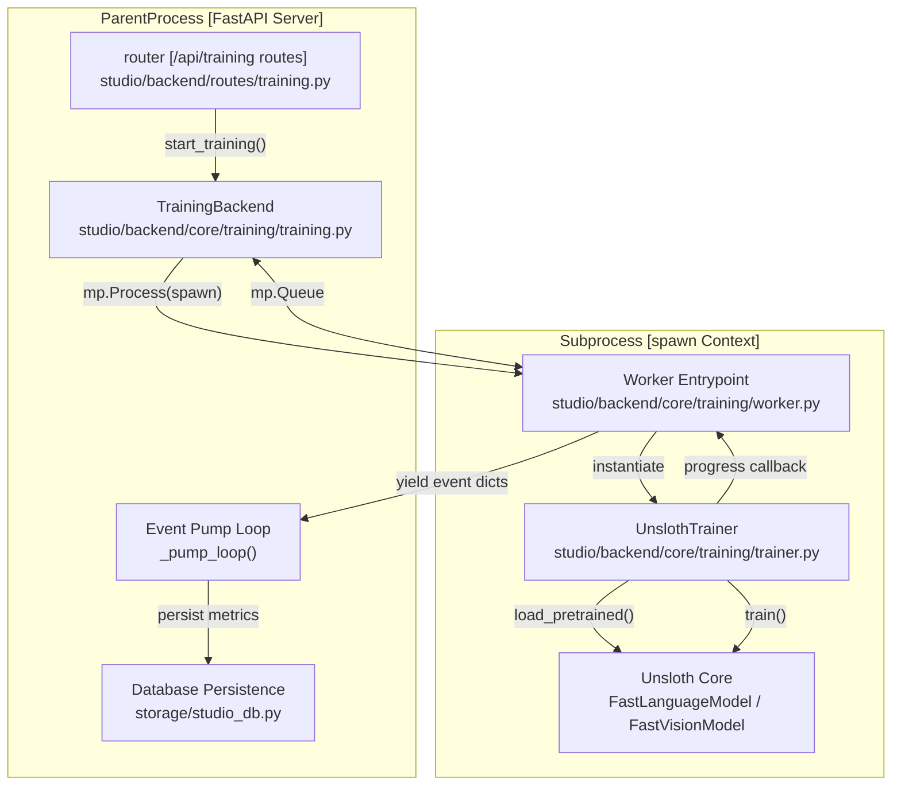
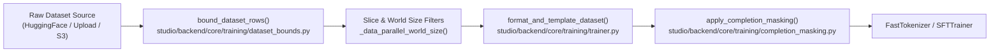
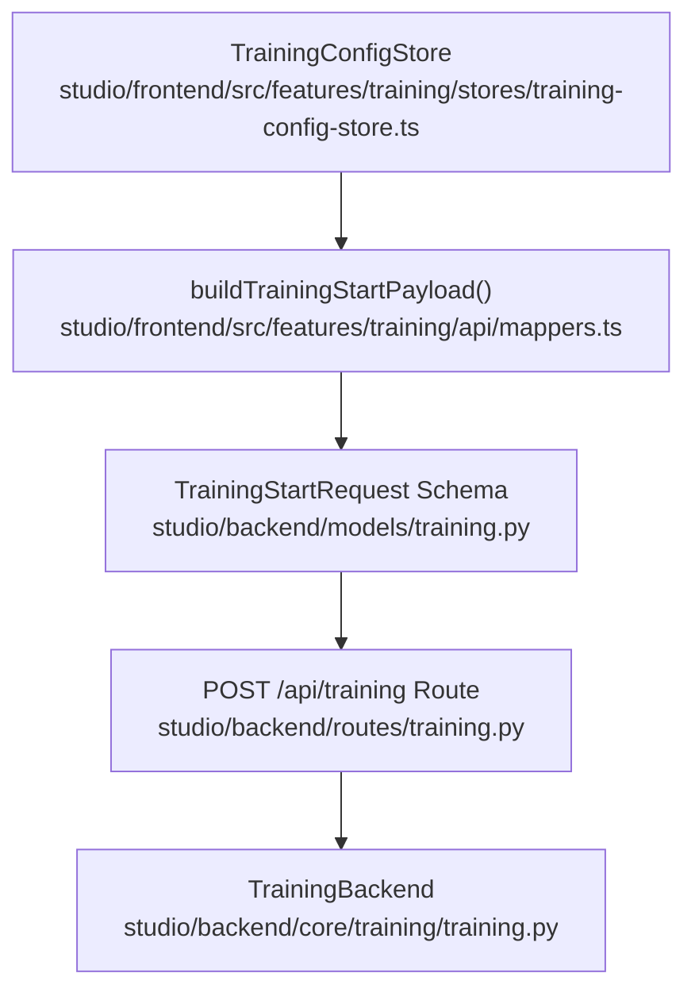

<!-- source: DeepWiki mcp.deepwiki.com · repo unslothai/unsloth · page 9.2 Training Backend and Orchestration · fetched 2026-10-21 -->

# Training Training Backend and Orchestration

Relevant source files

The following files were used as context for generating this wiki page:

- [studio/backend/core/training/trainer.py](studio/backend/core/training/trainer.py)
- [studio/backend/core/training/training.py](studio/backend/core/training/training.py)
- [studio/backend/core/training/worker.py](studio/backend/core/training/worker.py)
- [studio/backend/models/training.py](studio/backend/models/training.py)
- [studio/backend/routes/training.py](studio/backend/routes/training.py)
- [studio/backend/tests/test_mlx_training_worker_config.py](studio/backend/tests/test_mlx_training_worker_config.py)
- [studio/backend/tests/test_training_cached_start.py](studio/backend/tests/test_training_cached_start.py)
- [studio/frontend/src/config/training.ts](studio/frontend/src/config/training.ts)
- [studio/frontend/src/features/studio/sections/dataset-section.tsx](studio/frontend/src/features/studio/sections/dataset-section.tsx)
- [studio/frontend/src/features/studio/sections/lora-params-section.tsx](studio/frontend/src/features/studio/sections/lora-params-section.tsx)
- [studio/frontend/src/features/studio/sections/params-section.tsx](studio/frontend/src/features/studio/sections/params-section.tsx)
- [studio/frontend/src/features/studio/sections/use-mlx-training-config-policy.ts](studio/frontend/src/features/studio/sections/use-mlx-training-config-policy.ts)
- [studio/frontend/src/features/training/api/mappers.ts](studio/frontend/src/features/training/api/mappers.ts)
- [studio/frontend/src/features/training/api/models-api.ts](studio/frontend/src/features/training/api/models-api.ts)
- [studio/frontend/src/features/training/components/hf-dataset-subset-split-selectors.tsx](studio/frontend/src/features/training/components/hf-dataset-subset-split-selectors.tsx)
- [studio/frontend/src/features/training/lib/model-defaults.ts](studio/frontend/src/features/training/lib/model-defaults.ts)
- [studio/frontend/src/features/training/lib/training-methods.ts](studio/frontend/src/features/training/lib/training-methods.ts)
- [studio/frontend/src/features/training/stores/training-config-store.ts](studio/frontend/src/features/training/stores/training-config-store.ts)
- [studio/frontend/src/features/training/types/api.ts](studio/frontend/src/features/training/types/api.ts)
- [studio/frontend/src/features/training/types/config.ts](studio/frontend/src/features/training/types/config.ts)
- [studio/frontend/src/hooks/use-hf-dataset-splits.ts](studio/frontend/src/hooks/use-hf-dataset-splits.ts)
- [studio/frontend/src/types/training.ts](studio/frontend/src/types/training.ts)
- [studio/frontend/tests/training-model-defaults-warmup-ratio.test.ts](studio/frontend/tests/training-model-defaults-warmup-ratio.test.ts)
- [studio/frontend/tests/training-validation.test.ts](studio/frontend/tests/training-validation.test.ts)
- [tests/studio/test_mlx_training_worker_behaviors.py](tests/studio/test_mlx_training_worker_behaviors.py)

## Purpose and Scope

This document details the training backend architecture of Unsloth Studio, focusing on the orchestration and execution of model fine-tuning jobs. The system utilizes subprocess isolation combined with interprocess communication (IPC) for robustness, memory cleanup, and flexible transformers version management. It covers dataset preprocessing, worker event queue communication, progress streaming to clients, training history persistence in SQLite, and specialized diffusion LoRA training services.

---

## 1. Architecture Overview and Parent-Worker Subprocess Pattern

The training backend follows a strict **parent-worker subprocess pattern** implemented via Python's `multiprocessing` library using the `spawn` start method. The FastAPI server (`parent` process) manages training lifecycle commands, while isolated `worker` processes execute the actual training routines (`UnslothTrainer` and TRL integration).

### Core Architecture Concepts

- **Subprocess Isolation**: Each training run spawns a clean Python interpreter via `mp.get_context("spawn")`, avoiding module state contamination and enabling transformers major-version switching [studio/backend/core/training/worker.py:4-6]().
- **Event Queue Communication**: Workers communicate state changes, step metrics, and fatal errors asynchronously to the parent process using a shared `mp.Queue` (`_event_queue`) [studio/backend/core/training/training.py:7-11]().
- **Dataset Preprocessing**: Tokenization, prompt formatting, slicing bounds, and chat templating occur inside the worker subprocess before the trainer initialization [studio/backend/core/training/trainer.py:72-83]().
- **Training History Persistence**: Metrics, step history, and run state are committed to SQLite (`studio.db`) for recovery, dashboard inspection, and resume handling [studio/backend/routes/training.py:52-63]().

Title: "Training System Architecture and Component Mapping"

Sources: [studio/backend/core/training/training.py:4-11](), [studio/backend/core/training/worker.py:4-7](), [studio/backend/routes/training.py:48-63]()

---

## 2. Subprocess Orchestration and IPC Protocol

### Rationale for Subprocess Isolation

| Benefit | Implementation Mechanism | Purpose |
| :------- | :----------------------- | :------ |
| **Transformers Version Isolation** | Separate spawned Python interpreter | Allows switching between transformers 4.x and 5.x / custom forks without polluting the FastAPI server space [studio/backend/core/training/worker.py:4-6]() |
| **Memory Reclamation** | OS process termination | Fully reclaims GPU VRAM and CPU memory upon job completion, failure, or cancellation [studio/backend/core/training/training.py:68-74]() |
| **Fault Tolerance** | Isolated `_event_queue` reading | Segmentation faults, CUDA OOM errors, or unhandled exceptions in Triton/PyTorch crash only the worker process, keeping the Studio backend responsive [studio/backend/core/training/training.py:7-11]() |

Sources: [studio/backend/core/training/training.py:7-15](), [studio/backend/core/training/worker.py:4-9]()

### Event Communication Protocol

The worker process sends structured dictionaries containing a mandatory `"event"` key to the parent via `_event_queue` [studio/backend/core/training/training.py:213-218](). The parent's background pump thread consumes these events and translates them into Server-Sent Events (SSE) or database records.

- **`progress`**: Emitted per logging step with keys `step`, `loss`, `learning_rate`, `epoch`, and `grad_norm` [studio/backend/core/training/trainer.py:143-151]().
- **`status`**: Informational lifecycle string (e.g., `"Loading model..."`, `"Tokenizing dataset..."`).
- **`error`**: Captured exception string and stack trace when a training run fails [studio/backend/core/training/training.py:350-380]().
- **`complete`**: Final payload containing `output_dir` and training summaries upon successful completion.

Sources: [studio/backend/core/training/training.py:400-470](), [studio/backend/core/training/trainer.py:140-160]()

---

## 3. TrainingBackend Orchestrator and API Integration

The `TrainingBackend` class (in `studio/backend/core/training/training.py`) manages the lifecycle of the worker process inside the FastAPI server.

### Key Class Methods and Attributes
- `start_training(job_id: str, config: dict)`: Prepares run directories, sets environment variables, spawns the worker process, and initiates the event pumping thread [studio/backend/core/training/training.py:172-220]().
- `stop_training(save: bool = True)`: Signals the worker via `_stop_queue` to perform a graceful checkpoint save or immediate termination [studio/backend/core/training/training.py:54-75]().
- `_pump_loop()`: Background loop that reads from `_event_queue`, updates in-memory metrics, and handles database synchronization with configurable retries (`_DB_FINALIZE_RETRIES`) [studio/backend/core/training/training.py:76-79]().

API routes in `studio/backend/routes/training.py` receive requests validated by Pydantic models (`TrainingStartRequest` in `studio/backend/models/training.py`) and dispatch them to the backend singleton [studio/backend/routes/training.py:100-125]().

Sources: [studio/backend/core/training/training.py:172-250](), [studio/backend/models/training.py:100-136]()

---

## 4. UnslothTrainer and Worker Execution

Inside the subprocess (`studio/backend/core/training/worker.py`), the environment is initialized with hardware-specific flags (e.g., AMD ROCm `HSA_ENABLE_DXG_DETECTION` or tokenizers parallelism guards) [studio/backend/core/training/worker.py:34-40]().

### Trainer Integration
- **`UnslothTrainer`**: Extends HuggingFace TRL `SFTTrainer` (`studio/backend/core/training/trainer.py`) [studio/backend/core/training/trainer.py:83-83]().
- **Stdout Callback Suppression**: `_drop_hf_stdout_callbacks()` removes HuggingFace's `PrinterCallback` and `ProgressCallback` to prevent raw progress bars and carriage-return fragments from polluting structlog JSON records [studio/backend/core/training/trainer.py:148-166]().
- **Quantization Loading**: Automatically routes 4-bit/8-bit QLoRA configs (`_effective_training_load_in_4bit`) based on model metadata and hardware capabilities [studio/backend/core/training/worker.py:157-161]().

Sources: [studio/backend/core/training/worker.py:1-40](), [studio/backend/core/training/trainer.py:83-166]()

---

## 5. Dataset Preprocessing and Bounding

Dataset loading and transformation occur in the worker before model training commences.

### Preprocessing Workflow
1. **Dataset Slicing**: Bounded row selectors (`bound_dataset_rows` in `studio/backend/core/training/dataset_bounds.py`) enforce slice boundaries (`dataset_slice_start`, `dataset_slice_end`) and account for distributed data-parallel world sizes (`_data_parallel_world_size`) [studio/backend/core/training/worker.py:80-118]().
2. **Format Detection & Templating**: `format_and_template_dataset()` handles instruction templating, system prompts, and completion masking (`apply_completion_masking`) [studio/backend/core/training/trainer.py:72-74]().
3. **Streaming Datasets**: For unbounded streaming datasets, `STREAMING_EVAL_MAX_SAMPLES` caps evaluation samples to prevent infinite iteration during evaluation steps [studio/backend/core/training/trainer.py:95-96]().

Title: "Dataset Preprocessing and Bounding Data Flow"

Sources: [studio/backend/core/training/worker.py:80-118](), [studio/backend/core/training/trainer.py:72-74](), [studio/backend/core/training/trainer.py:95-96]()

---

## 6. Progress Streaming and SQLite History Persistence

The parent orchestrator monitors the worker queue and updates both memory stores and persistent database tables.

- **SQLite Persistence**: Completed and active runs record summaries, loss history, and configurations into `studio.db` (`storage/studio_db.py`) [studio/backend/routes/training.py:63-63]().
- **Client SSE Streaming**: Frontend clients subscribe to `/api/training` event streams (`account_event_stream`), updating `TrainingRuntimeStore` and rendering real-time progress charts via `ProgressSection` [studio/backend/routes/training.py:8-17]().

Sources: [studio/backend/routes/training.py:8-17](), [studio/backend/routes/training.py:52-63]()

---

## 7. Diffusion LoRA Training Services

In addition to LLMs and VLMs, the Studio backend includes specialized training modules for diffusion models and Diffusion Transformers (DiT):
- **`DiffusionTrainingService`**: Orchestrates diffusion fine-tuning pipelines (`studio/backend/core/training/diffusion_training_service.py`) [studio/backend/core/training/training.py:100-115]().
- **Trainable Families**: Supports standard diffusion architectures and DiT variants with LoRA target mapping, image dataset ingestion, and caption updating (`DiffusionCaptionUpdateRequest`) [studio/backend/routes/training.py:108-124]().

Sources: [studio/backend/routes/training.py:108-124](), [studio/backend/core/training/training.py:100-115]()

---

## 8. Frontend Payload Mapping and Configuration

User configurations are managed in the frontend via `TrainingConfigStore` (`studio/frontend/src/features/training/stores/training-config-store.ts`) [studio/frontend/src/features/training/stores/training-config-store.ts:127-130](). 

When starting a run, `buildTrainingStartPayload` (`studio/frontend/src/features/training/api/mappers.ts`) serializes store state into the `TrainingStartRequest` Pydantic schema consumed by FastAPI endpoints [studio/frontend/src/features/training/api/mappers.ts:53-96]().

Title: "Frontend State to Backend Payload Mapping"

Sources: [studio/frontend/src/features/training/stores/training-config-store.ts:127-130](), [studio/frontend/src/features/training/api/mappers.ts:53-96](), [studio/backend/models/training.py:100-125]()

---

