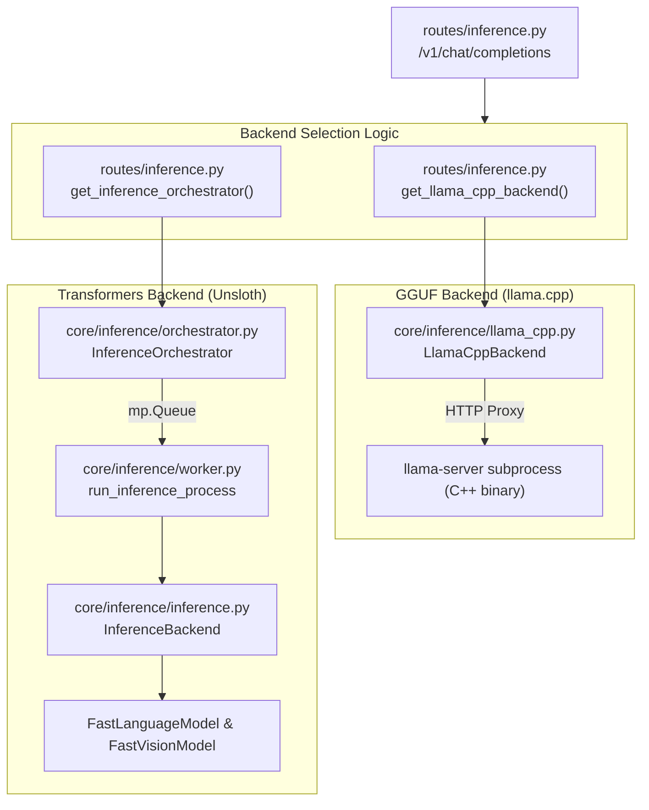
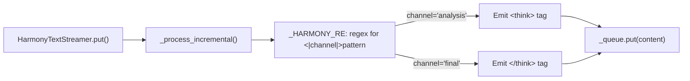
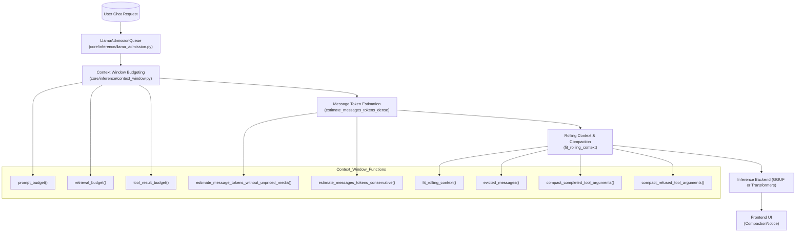

<!-- source: DeepWiki mcp.deepwiki.com · repo unslothai/unsloth · page 9.3 Inference Backend (Transformers and GGUF) · fetched 2026-10-21 -->

# Inference Backend (Transformers and GGUF)

Relevant source files

The following files were used as context for generating this wiki page:

- [scripts/lint_no_parallel_clamp.py](scripts/lint_no_parallel_clamp.py)
- [studio/backend/core/inference/anthropic_compat.py](studio/backend/core/inference/anthropic_compat.py)
- [studio/backend/core/inference/chat_template_helpers.py](studio/backend/core/inference/chat_template_helpers.py)
- [studio/backend/core/inference/checkpoint.py](studio/backend/core/inference/checkpoint.py)
- [studio/backend/core/inference/context_window.py](studio/backend/core/inference/context_window.py)
- [studio/backend/core/inference/inference.py](studio/backend/core/inference/inference.py)
- [studio/backend/core/inference/llama_admission.py](studio/backend/core/inference/llama_admission.py)
- [studio/backend/core/inference/llama_cpp.py](studio/backend/core/inference/llama_cpp.py)
- [studio/backend/core/inference/llama_server_args.py](studio/backend/core/inference/llama_server_args.py)
- [studio/backend/core/inference/mlx_inference.py](studio/backend/core/inference/mlx_inference.py)
- [studio/backend/core/inference/orchestrator.py](studio/backend/core/inference/orchestrator.py)
- [studio/backend/core/inference/worker.py](studio/backend/core/inference/worker.py)
- [studio/backend/models/inference.py](studio/backend/models/inference.py)
- [studio/backend/routes/inference.py](studio/backend/routes/inference.py)
- [studio/backend/tests/test_anthropic_admission.py](studio/backend/tests/test_anthropic_admission.py)
- [studio/backend/tests/test_anthropic_native_tool_images.py](studio/backend/tests/test_anthropic_native_tool_images.py)
- [studio/backend/tests/test_anthropic_passthrough_respawn.py](studio/backend/tests/test_anthropic_passthrough_respawn.py)
- [studio/backend/tests/test_batch_sizes_per_load.py](studio/backend/tests/test_batch_sizes_per_load.py)
- [studio/backend/tests/test_checkpoint_compaction.py](studio/backend/tests/test_checkpoint_compaction.py)
- [studio/backend/tests/test_compute_buffer.py](studio/backend/tests/test_compute_buffer.py)
- [studio/backend/tests/test_context_overflow_truncation.py](studio/backend/tests/test_context_overflow_truncation.py)
- [studio/backend/tests/test_conversation_recall_injection.py](studio/backend/tests/test_conversation_recall_injection.py)
- [studio/backend/tests/test_embedding_gguf_launch.py](studio/backend/tests/test_embedding_gguf_launch.py)
- [studio/backend/tests/test_gpu_memory_mode.py](studio/backend/tests/test_gpu_memory_mode.py)
- [studio/backend/tests/test_idle_slot_clearing_is_known.py](studio/backend/tests/test_idle_slot_clearing_is_known.py)
- [studio/backend/tests/test_inference_status_route.py](studio/backend/tests/test_inference_status_route.py)
- [studio/backend/tests/test_llama_admission.py](studio/backend/tests/test_llama_admission.py)
- [studio/backend/tests/test_llama_admission_compat_matrix.py](studio/backend/tests/test_llama_admission_compat_matrix.py)
- [studio/backend/tests/test_llama_admission_kv_budget.py](studio/backend/tests/test_llama_admission_kv_budget.py)
- [studio/backend/tests/test_llama_admission_kv_budget_media_and_tools.py](studio/backend/tests/test_llama_admission_kv_budget_media_and_tools.py)
- [studio/backend/tests/test_llama_admission_recost.py](studio/backend/tests/test_llama_admission_recost.py)
- [studio/backend/tests/test_llama_admission_stress.py](studio/backend/tests/test_llama_admission_stress.py)
- [studio/backend/tests/test_llama_admission_unstated_max_tokens.py](studio/backend/tests/test_llama_admission_unstated_max_tokens.py)
- [studio/backend/tests/test_llama_cpp_effective_parallel_slots.py](studio/backend/tests/test_llama_cpp_effective_parallel_slots.py)
- [studio/backend/tests/test_llama_cpp_single_sequence_retry.py](studio/backend/tests/test_llama_cpp_single_sequence_retry.py)
- [studio/backend/tests/test_llama_server_args.py](studio/backend/tests/test_llama_server_args.py)
- [studio/backend/tests/test_mlx_inference_backend.py](studio/backend/tests/test_mlx_inference_backend.py)
- [studio/backend/tests/test_mlx_vlm_prompt_cache.py](studio/backend/tests/test_mlx_vlm_prompt_cache.py)
- [studio/backend/tests/test_mtp_vram_budget.py](studio/backend/tests/test_mtp_vram_budget.py)
- [studio/backend/tests/test_openai_passthrough_respawn.py](studio/backend/tests/test_openai_passthrough_respawn.py)
- [studio/backend/tests/test_parallel_slots_never_clamped.py](studio/backend/tests/test_parallel_slots_never_clamped.py)
- [studio/backend/tests/test_parallel_slots_per_load.py](studio/backend/tests/test_parallel_slots_per_load.py)
- [studio/backend/tests/test_presence_penalty.py](studio/backend/tests/test_presence_penalty.py)
- [studio/backend/tests/test_responses_api.py](studio/backend/tests/test_responses_api.py)
- [studio/backend/tests/test_sf_client_tools_passthrough.py](studio/backend/tests/test_sf_client_tools_passthrough.py)
- [studio/backend/tests/test_slot_offload_fit.py](studio/backend/tests/test_slot_offload_fit.py)
- [studio/backend/tests/test_slot_reduction_context_refit.py](studio/backend/tests/test_slot_reduction_context_refit.py)
- [studio/backend/tests/test_slot_refit_ctx_checkpoints.py](studio/backend/tests/test_slot_refit_ctx_checkpoints.py)
- [studio/backend/tests/test_slot_refit_platform_matrix.py](studio/backend/tests/test_slot_refit_platform_matrix.py)
- [studio/backend/tests/test_tensor_parallel.py](studio/backend/tests/test_tensor_parallel.py)
- [studio/backend/tests/test_think_prefill_reemit.py](studio/backend/tests/test_think_prefill_reemit.py)
- [studio/backend/tests/test_tool_approval_context_release.py](studio/backend/tests/test_tool_approval_context_release.py)
- [studio/backend/tests/test_tp_vision_regression.py](studio/backend/tests/test_tp_vision_regression.py)
- [studio/backend/tests/test_validate_diffusion_extra_args.py](studio/backend/tests/test_validate_diffusion_extra_args.py)
- [studio/backend/tests/test_vision_client_tools.py](studio/backend/tests/test_vision_client_tools.py)
- [studio/frontend/src/components/app-sidebar.tsx](studio/frontend/src/components/app-sidebar.tsx)
- [studio/frontend/src/components/assistant-ui/thread.tsx](studio/frontend/src/components/assistant-ui/thread.tsx)
- [studio/frontend/src/features/chat/api/chat-adapter.ts](studio/frontend/src/features/chat/api/chat-adapter.ts)
- [studio/frontend/src/features/chat/chat-page.tsx](studio/frontend/src/features/chat/chat-page.tsx)
- [studio/frontend/src/features/chat/chat-settings-sheet.tsx](studio/frontend/src/features/chat/chat-settings-sheet.tsx)
- [studio/frontend/src/features/chat/hooks/use-chat-model-runtime.ts](studio/frontend/src/features/chat/hooks/use-chat-model-runtime.ts)
- [studio/frontend/src/features/chat/index.ts](studio/frontend/src/features/chat/index.ts)
- [studio/frontend/src/features/chat/runtime-provider.tsx](studio/frontend/src/features/chat/runtime-provider.tsx)
- [studio/frontend/src/features/chat/shared-composer.tsx](studio/frontend/src/features/chat/shared-composer.tsx)
- [studio/frontend/src/features/chat/stores/chat-runtime-store.ts](studio/frontend/src/features/chat/stores/chat-runtime-store.ts)
- [studio/frontend/src/features/chat/thread-sidebar.tsx](studio/frontend/src/features/chat/thread-sidebar.tsx)
- [studio/frontend/src/features/chat/types.ts](studio/frontend/src/features/chat/types.ts)
- [studio/frontend/src/features/chat/types/api.ts](studio/frontend/src/features/chat/types/api.ts)
- [studio/frontend/src/features/chat/utils/context-truncation.ts](studio/frontend/src/features/chat/utils/context-truncation.ts)
- [studio/frontend/src/features/chat/utils/queued-chat-run-settings.ts](studio/frontend/src/features/chat/utils/queued-chat-run-settings.ts)
- [studio/frontend/src/features/settings/tabs/chat-tab.tsx](studio/frontend/src/features/settings/tabs/chat-tab.tsx)
- [studio/frontend/src/index.css](studio/frontend/src/index.css)
- [studio/frontend/src/main.tsx](studio/frontend/src/main.tsx)
- [studio/frontend/tests/auto-compaction-settings.test.ts](studio/frontend/tests/auto-compaction-settings.test.ts)
- [studio/frontend/tests/chat-sampling-seed.test.ts](studio/frontend/tests/chat-sampling-seed.test.ts)
- [studio/frontend/tests/rolling-context-window.test.ts](studio/frontend/tests/rolling-context-window.test.ts)
- [studio/frontend/tests/sidebar-action-rows-inert.test.ts](studio/frontend/tests/sidebar-action-rows-inert.test.ts)
- [tests/studio/test_multi_chat_prompt_queue_contract.py](tests/studio/test_multi_chat_prompt_queue_contract.py)
- [tests/test_lint_no_parallel_clamp.py](tests/test_lint_no_parallel_clamp.py)

## Purpose and Scope

This documentation page details Studio's dual inference backend architecture. It explains how Studio supports two distinct model backends for text generation and chat:

- **Transformers Backend** leveraging the Unsloth core library (`FastLanguageModel` and `FastVisionModel`) to handle Transformers-format models (including LoRA adapters).
- **GGUF Backend** using the `llama-server` subprocess (via the `LlamaCppBackend`) to serve quantized GGUF models efficiently.

It covers GPU selection, port management, tool calling integration, reasoning mode display, compatibility with Anthropic API, and how requests are routed and proxied in Studio.

**Related pages:**  
- [9.2 Training Backend and Orchestration]()  
- [9.5 Model Configuration and Detection]()  
- [7.1 Fast Inference and KV Cache]()

---

## Architecture Overview

Studio implements a **dual-backend inference system** that directs model inference requests to either the Transformers or the GGUF backend based on the model format and metadata. Model loading and inference requests received via the `/v1/chat/completions` and related API routes invoke the appropriate orchestrator/backend.

### High-Level Component Mapping

- API routes decide which backend to invoke based on model type and metadata [studio/backend/routes/inference.py:151-157]().
- The GGUF backend runs `llama-server` as a subprocess, communicating over HTTP [studio/backend/core/inference/llama_cpp.py:4-8]().
- The Transformers backend manages a Python worker process running the Unsloth core inference stack [studio/backend/core/inference/inference.py:6-9]().

**Sources:** [studio/backend/routes/inference.py:1-200](), [studio/backend/core/inference/llama_cpp.py:1-100](), [studio/backend/core/inference/inference.py:1-50]()

---

## LlamaCppBackend (GGUF Inference)

`LlamaCppBackend` is the class responsible for inference with GGUF models via the `llama-server` subprocess, which is a C++ binary optimized for quantized GGUF files [studio/backend/core/inference/llama_cpp.py:4-8]().

### Key Responsibilities

- **Subprocess Lifecycle:** Spawns and manages the `llama-server` process, which exposes an OpenAI-compatible `/v1/chat/completions` endpoint [studio/backend/core/inference/llama_cpp.py:4-8]().
- **Port Management:** Dynamically selects free local TCP ports to avoid collisions when launching `llama-server` [studio/backend/core/inference/llama_cpp.py:24-29]().
- **GPU Selection and Layer Offloading:** Supports specifying GPU device IDs (`gpu_ids`) or letting the system auto-select GPUs. Options like `tensor_parallel`, `gpu_memory_mode`, and `gpu_layers` control tensor parallelism and memory allocation strategies [studio/backend/core/inference/llama_server_args.py:78-80]().
- **CLI Argument Mapping:** Maps flags such as `--split-mode`, `--tensor-split`, and extra arguments transparently to the subprocess based on caller `GgufLoadIntent` data [studio/backend/core/inference/llama_server_args.py:78-80]().
- **Tool Calling Integration:** Manages orchestration for detecting and running tool calls inside model replies. It also attempts *tool call healing* whereby if the model plans an action but does not emit the required markup, a re-prompt nudges to fix interaction continuity [studio/backend/core/inference/llama_cpp.py:119-129]().
- **CPU Fallback:** Has mechanisms to fallback to CPU execution if GPU resources are insufficient or disabled [studio/frontend/src/features/chat/hooks/use-chat-model-runtime.ts:117-122]().

### GPU Selection and Placement

The `LoadRequest` schema records detailed hardware and model loading intent [studio/backend/models/inference.py:34-164]():

- `gpu_ids`: Explicit device IDs or `None` for automatic selection [studio/backend/models/inference.py:116-129]().
- `n_parallel`, `n_batch`: Control concurrency and batching on `llama-server` [studio/backend/models/inference.py:161-175]().

This intent is translated into subprocess CLI flags that configure `llama-server`'s memory placement and parallelism behavior [studio/backend/core/inference/llama_server_args.py:78-80]().

**Sources:** [studio/backend/core/inference/llama_cpp.py:4-8](), [studio/backend/core/inference/llama_cpp.py:24-29](), [studio/backend/core/inference/llama_cpp.py:119-129](), [studio/backend/core/inference/llama_server_args.py:78-80](), [studio/backend/models/inference.py:34-164](), [studio/backend/models/inference.py:116-129](), [studio/backend/models/inference.py:161-175](), [studio/frontend/src/features/chat/hooks/use-chat-model-runtime.ts:117-122]()

---

## Transformers Backend (Unsloth Core)

For models in Transformers format, including native Transformers and LoRA adapters, Studio uses the `InferenceOrchestrator` class to manage inference workflows [studio/backend/core/inference/orchestrator.py:71-76]().

### Unsloth Core Library Integration

The orchestrator launches a Python worker subprocess running the `InferenceBackend`, which uses Unsloth core's `FastLanguageModel` and `FastVisionModel` for inference [studio/backend/core/inference/inference.py:6-9]().

### HarmonyTextStreamer: Multi-Channel Streaming Protocol

For models implementing the "harmony" multi-channel output protocol (e.g., `gpt-oss`), the system uses the `HarmonyTextStreamer` to decode structured outputs [studio/backend/core/inference/inference.py:90-95]():

- Incoming tokens may contain channel markers like `<|channel|>analysis<|message|>...` [studio/backend/core/inference/inference.py:177-178]().
- The streamer tracks separate positions per channel to emit deltas robustly [studio/backend/core/inference/inference.py:174-175]().
- Emits `</think>` closing tag when `final` or `assistant` channels appear [studio/backend/core/inference/inference.py:199-201]().

**Sources:** [studio/backend/core/inference/orchestrator.py:71-76](), [studio/backend/core/inference/inference.py:6-9](), [studio/backend/core/inference/inference.py:90-95](), [studio/backend/core/inference/inference.py:174-175](), [studio/backend/core/inference/inference.py:177-178](), [studio/backend/core/inference/inference.py:199-201]()

---

## Inference API and Frontend Integration

### API Routing and Compatibility

Studio exposes standard OpenAI-compatible endpoints such as `/v1/chat/completions` along with Anthropic API compatibility layers [studio/backend/routes/inference.py:51-52](). These routes:

- Accept chat requests.
- Load models on demand using the `LoadRequest` schema [studio/backend/models/inference.py:34-164]().
- Instantiate the appropriate backend (`LlamaCppBackend` for GGUF or `InferenceOrchestrator` for Transformers) [studio/backend/routes/inference.py:151-157]().
- Proxy streaming generation results with proper error handling and cancellation support [studio/backend/routes/inference.py:29-30]().

### Reasoning and Thinking Display

The frontend UI (component `thread.tsx`) renders reasoning blocks using `Reasoning` and `ReasoningGroup` components [studio/frontend/src/components/assistant-ui/thread.tsx:28](). These parse streamed tokens for reasoning channels, showing the model's internal thoughts or tool call progress using special markup (`<think>`) [studio/backend/core/inference/inference.py:191-193]().

### GPU Memory and Speculative Decoding Modes

The `LoadRequest` model schema lets users control GPU memory modes and speculative decoding options [studio/backend/models/inference.py:124-154]():

- `gpu_ids`: Controlled via `gpu_ids` and internal fitter logic [studio/backend/models/inference.py:116-129]().
- `speculative_type`: e.g., `"auto"`, `"mtp"`, `"dspark"`, `"dflash"`, or `"off"` [studio/backend/models/inference.py:130-147]().
- `spec_draft_n_max`: Maximum draft tokens in speculative decoding [studio/backend/models/inference.py:148-160]().

### Summary of Key API Endpoints

| Endpoint | Method | Description |
| :--- | :--- | :--- |
| `/api/inference/load` | POST | Load a model, specifying path, variant, resources [studio/backend/models/inference.py:36] |
| `/v1/chat/completions` | POST | Standard OpenAI-compatible chat completion [studio/backend/routes/inference.py:153] |
| `/v1/messages` | POST | Anthropic-style chat message inference [studio/backend/routes/inference.py:153] |

**Sources:** [studio/backend/routes/inference.py:29-30](), [studio/backend/routes/inference.py:51-52](), [studio/backend/routes/inference.py:151-157](), [studio/backend/models/inference.py:34-164](), [studio/backend/models/inference.py:36](), [studio/backend/models/inference.py:116-129](), [studio/backend/models/inference.py:130-147](), [studio/backend/models/inference.py:148-160](), [studio/frontend/src/components/assistant-ui/thread.tsx:28](), [studio/backend/core/inference/inference.py:191-193]()

---

## Context Compaction and Admission Control

Studio implements advanced context management to optimize inference and prevent out-of-memory errors, especially for long conversations. This involves:

- **Context Window Budgeting:** Functions like `prompt_budget`, `retrieval_budget`, and `tool_result_budget` calculate available token space for different message types [studio/backend/core/inference/context_window.py:58-71]().
- **Message Token Estimation:** `estimate_message_tokens_without_unpriced_media` and `estimate_messages_tokens_conservative` provide token counts for messages, considering media and tool calls [studio/backend/core/inference/context_window.py:62-66]().
- **Rolling Context and Compaction:** `fit_rolling_context` and `evicted_messages` manage the conversation history, compacting or truncating older messages to fit within the model's context window [studio/backend/core/inference/context_window.py:68-71]().
- **Tool Argument Compaction:** Specific functions like `compact_completed_tool_arguments` and `compact_refused_tool_arguments` handle compaction of tool-related messages [studio/backend/core/inference/context_window.py:60-61]().
- **Admission Control:** The `LlamaAdmissionQueue` manages concurrent inference requests, ensuring that the system doesn't get overloaded. `LlamaAdmissionReservation` and `LlamaAdmissionLease` handle resource allocation [studio/backend/routes/inference.py:116-126]().

The frontend also plays a role in displaying context truncation notices to the user [studio/frontend/src/components/assistant-ui/thread.tsx:12-15]().

**Sources:** [studio/backend/core/inference/context_window.py:58-71](), [studio/backend/core/inference/context_window.py:60-61](), [studio/backend/core/inference/context_window.py:62-66](), [studio/backend/core/inference/context_window.py:68-71](), [studio/backend/routes/inference.py:116-126](), [studio/frontend/src/components/assistant-ui/thread.tsx:12-15]()

---

## Code Entity Mapping

The following diagram bridges the Natural Language concepts to the specific Code Entities used in the inference lifecycle.

```mermaid
graph TD
    subgraph "Natural Language Space"
        GGUF_Model["GGUF Model Inference"]
        Trans_Model["Transformers Model Inference"]
        Tool_Call["Tool Calling & Execution"]
        Reasoning_Disp["Reasoning / Thinking Mode"]
        GPU_Selection["GPU Selection & Offloading"]
        Context_Compaction["Context Compaction"]
        Admission_Control["Admission Control"]
        Anthropic_Compat["Anthropic API Compatibility"]
    end

    subgraph "Code Entity Space"
        LlamaCppBackend["core/inference/llama_cpp.py<br/>LlamaCppBackend"]
        InferenceOrchestrator["core/inference/orchestrator.py<br/>InferenceOrchestrator"]
        InferenceBackend["core/inference/inference.py<br/>InferenceBackend"]
        HarmonyTextStreamer["core/inference/inference.py<br/>HarmonyTextStreamer"]
        LoadRequest["models/inference.py<br/>LoadRequest"]
        LlamaServerArgs["core/inference/llama_server_args.py<br/>_GPU_LAYER_FLAGS, _DEVICE_FLAGS, etc."]
        ContextWindow["core/inference/context_window.py<br/>fit_rolling_context, prompt_budget"]
        LlamaAdmission["core/inference/llama_admission.py<br/>LlamaAdmissionQueue"]
        AnthropicCompat["core/inference/anthropic_compat.py"]
        InferenceRoutes["routes/inference.py<br/>/v1/chat/completions, /v1/messages"]
    end

    GGUF_Model -.-> LlamaCppBackend
    Trans_Model -.-> InferenceOrchestrator
    Trans_Model -.-> InferenceBackend
    Tool_Call -.-> LlamaCppBackend
    Reasoning_Disp -.-> HarmonyTextStreamer
    GPU_Selection -.-> LoadRequest
    GPU_Selection -.-> LlamaServerArgs
    Context_Compaction -.-> ContextWindow
    Admission_Control -.-> LlamaAdmission
    Anthropic_Compat -.-> AnthropicCompat
    InferenceRoutes --> GGUF_Model
    InferenceRoutes --> Trans_Model
    InferenceRoutes --> Anthropic_Compat
```

**Sources:** [studio/backend/core/inference/llama_cpp.py:4-8](), [studio/backend/core/inference/orchestrator.py:71-76](), [studio/backend/core/inference/inference.py:59-70](), [studio/backend/models/inference.py:34-164](), [studio/backend/core/inference/llama_server_args.py:78-80](), [studio/backend/core/inference/context_window.py:58-71](), [studio/backend/core/inference/llama_admission.py:116-126](), [studio/backend/core/inference/anthropic_compat.py](), [studio/backend/routes/inference.py:151-157]()

---

# Summary

Studio’s inference backend implements a sophisticated dual architecture integrating a **Transformers backend** using the Unsloth core library with rich multi-channel streaming, and a **GGUF backend** that manages `llama-server` subprocesses for performant quantized serving. This approach offers flexibility across model formats while providing a consistent API experience with advanced features like tool calling, adaptive GPU placement, and reasoning-mode support.

---

# Sources

- [studio/backend/routes/inference.py:1-200]()
- [studio/backend/models/inference.py:1-200]()
- [studio/backend/core/inference/llama_cpp.py:1-199]()
- [studio/backend/core/inference/inference.py:1-203]()
- [studio/backend/core/inference/orchestrator.py:1-115]()
- [studio/backend/core/inference/llama_server_args.py:63-116]()
- [studio/backend/core/inference/context_window.py:56-73]()
- [studio/backend/core/inference/llama_admission.py:116-126]()
- [studio/backend/core/inference/anthropic_compat.py]()
- [studio/frontend/src/components/assistant-ui/thread.tsx:1-168]()
- [studio/frontend/src/features/chat/hooks/use-chat-model-runtime.ts:1-181]()
- [studio/frontend/src/features/chat/api/chat-adapter.ts:1-200]()

---

