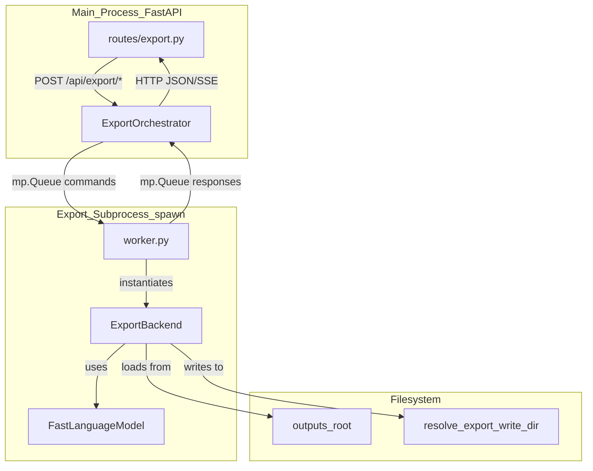
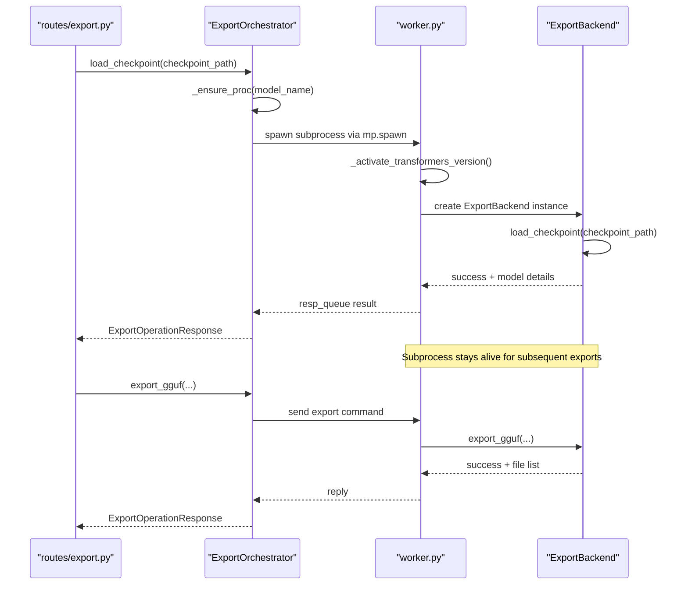

<!-- source: DeepWiki mcp.deepwiki.com · repo unslothai/unsloth · page 9.4 Export Backend · fetched 2026-10-21 -->

# Export Backend

Relevant source files

The following files were used as context for generating this wiki page:

- [studio/backend/core/export/export.py](studio/backend/core/export/export.py)
- [studio/backend/core/export/orchestrator.py](studio/backend/core/export/orchestrator.py)
- [studio/backend/core/export/worker.py](studio/backend/core/export/worker.py)
- [studio/backend/models/export.py](studio/backend/models/export.py)
- [studio/backend/routes/export.py](studio/backend/routes/export.py)
- [studio/backend/tests/test_export_gguf_discovery.py](studio/backend/tests/test_export_gguf_discovery.py)
- [studio/backend/tests/test_export_gguf_hub_upload.py](studio/backend/tests/test_export_gguf_hub_upload.py)
- [studio/backend/tests/test_export_gguf_sharding.py](studio/backend/tests/test_export_gguf_sharding.py)
- [studio/backend/tests/test_export_imatrix_compressed.py](studio/backend/tests/test_export_imatrix_compressed.py)
- [studio/frontend/src/features/export/api/export-api.ts](studio/frontend/src/features/export/api/export-api.ts)
- [studio/frontend/src/features/export/export-page.tsx](studio/frontend/src/features/export/export-page.tsx)
- [studio/frontend/src/features/export/stores/export-runtime-store.ts](studio/frontend/src/features/export/stores/export-runtime-store.ts)
- [studio/frontend/src/features/studio/studio-page.tsx](studio/frontend/src/features/studio/studio-page.tsx)

The Export Backend in Unsloth handles converting trained model checkpoints into deployable output formats. It supports merged HuggingFace transformers models (16-bit, 4-bit, or compressed tensors), `llama.cpp`-compatible GGUF files, and standalone PEFT LoRA adapters.

Export operations run inside a persistent, isolated multiprocessing subprocess (`spawn`) to prevent memory leaks, manage dynamic `transformers` version switching, and clean up accelerator state between tasks.

Sources: `[studio/backend/core/export/export.py:1-85]()`, `[studio/backend/core/export/orchestrator.py:1-45]()`, `[studio/backend/core/export/worker.py:1-12]()`

---

## Architecture Overview

The backend uses a bifurcated orchestration pattern mirroring Unsloth's training and inference systems:
- **`ExportOrchestrator`**: Runs in the main FastAPI process (`studio/backend/core/export/orchestrator.py`) to manage API requests, thread-safe command dispatch, and asynchronous log streaming [studio/backend/core/export/orchestrator.py:35-81]().
- **`ExportBackend`**: Runs inside the worker subprocess (`studio/backend/core/export/export.py`), wrapping Unsloth's core ML engine (`FastLanguageModel`, `FastVisionModel`) and PEFT libraries [studio/backend/core/export/export.py:19-40]().
- **`mp.Queue`**: Inter-process communication channels (`_cmd_queue` and `_resp_queue`) transmitting serialized tasks and responses [studio/backend/core/export/orchestrator.py:46-47]().

### Natural Language to Code Entity Space: Architecture

Sources: `[studio/backend/core/export/orchestrator.py:35-81]()`, `[studio/backend/routes/export.py:162-180]`, `[studio/backend/core/export/export.py:19-40]`, `[studio/backend/core/export/worker.py:4-12]()`

---

## Subprocess Lifecycle and Transformers Versioning

`ExportOrchestrator` manages a persistent subprocess that survives across multiple export operations for the same model, minimizing reload overhead. When a new checkpoint requiring a different `transformers` version is loaded, the orchestrator terminates the current subprocess and spawns a fresh interpreter [studio/backend/core/export/orchestrator.py:284-332]().

### Natural Language to Code Entity Space: Subprocess Lifecycle

Sources: `[studio/backend/core/export/orchestrator.py:284-332]()`, `[studio/backend/core/export/worker.py:168-177]()`, `[studio/backend/routes/export.py:162-180]()`

---

## Checkpoint Loading Logic

`ExportBackend.load_checkpoint()` handles checkpoint detection, PEFT resolution, and multi-GPU sharding:
- **LoRA and PEFT Detection**: Uses `get_base_model_from_lora()` to locate the base model configuration if an adapter is loaded [studio/backend/core/export/export.py:32]().
- **Multimodal Support**: Routes multimodal architectures via `FastVisionModel` [studio/backend/core/export/export.py:20]().
- **Multi-GPU Device Mapping**: Computes sharded device maps via `_multi_gpu_device_map_kwargs()` to distribute large models across available CUDA/ROCm accelerators without overloading GPU0 [studio/backend/core/export/export.py:86-112]().

Sources: `[studio/backend/core/export/export.py:28-40]()`, `[studio/backend/core/export/export.py:86-112]()`

---

## Export Modes and Formats

Unsloth exposes specialized export paths through `routes/export.py` and Pydantic schemas in `models/export.py`:
- **Merged Models (`/api/export/export/merged`)**: Fuses LoRA weights into the base model using `unsloth.save_pretrained_merged` across 16-bit, 4-bit, or compressed formats (`llm-compressor`) [studio/backend/routes/export.py:128-144]().
- **Base Models (`/api/export/export/base`)**: Exports or pushes the base model configuration and weights [studio/backend/routes/export.py:146-160]().
- **GGUF Export (`/api/export/export/gguf`)**: Converts models into `llama.cpp` compatible GGUF quants (e.g., `Q4_K_M`, `Q8_0`, importance matrix `imatrix` options, and multi-file sharding via `gguf_shard_size`) [studio/backend/routes/export.py:162-180](), `[studio/backend/models/export.py:41-60]()`.
- **LoRA Adapters (`/api/export/export/lora`)**: Saves standalone adapter weights or converts them into GGUF LoRA format (`--lora`) [studio/frontend/src/features/export/api/export-api.ts:182-191]().

Sources: `[studio/backend/routes/export.py:128-180]()`, `[studio/backend/models/export.py:41-60]()`, `[studio/frontend/src/features/export/api/export-api.ts:182-191]()`

---

## GGUF Export and File Relocation Logic

Because `save_pretrained_gguf()` may write output files into the current working directory or intermediate paths, Unsloth executes robust relocation logic to ensure files reach the user-specified `save_directory`:
1. **Pre-Export Scan**: Inspects working directories and reports generated `.gguf` artifacts via `_reported_gguf_files()` [studio/backend/tests/test_export_gguf_discovery.py:134-159]().
2. **Execution & Set Difference**: Captures files written by the export routine and compares against pre-existing paths.
3. **Relocation**: Moves stray or default outputs to `resolve_export_write_dir()` and structures metadata files correctly for local saving or HuggingFace Hub upload (`push_to_hub_gguf`) [studio/backend/tests/test_export_gguf_hub_upload.py:150-195]().

Sources: `[studio/backend/tests/test_export_gguf_discovery.py:134-212]()`, `[studio/backend/tests/test_export_gguf_hub_upload.py:150-195]()`

---

## Live Log Capture and Recovery

The export subprocess captures stdout and stderr file descriptors through pipes (`_setup_log_capture` in `worker.py`), feeding lines into `ExportOrchestrator._log_buffer` (a thread-safe ring buffer of 4,000 lines) [studio/backend/core/export/worker.py:46-166](), `[studio/backend/core/export/orchestrator.py:35-64]()`.

If an HTTP request is interrupted by a gateway timeout (such as a Cloudflare 524 tunnel timeout during a lengthy export), the frontend invokes `recoverViaStatus` to poll `/api/export/status` until `is_export_active` becomes false, reading `last_op_status` and `last_op_output_path` to verify completion [studio/frontend/src/features/export/stores/export-runtime-store.ts:45-98](), `[studio/backend/models/export.py:91-136]`.

Sources: `[studio/backend/core/export/worker.py:46-166]()`, `[studio/backend/core/export/orchestrator.py:35-81]()`, `[studio/backend/models/export.py:91-136]()`, `[studio/frontend/src/features/export/stores/export-runtime-store.ts:45-98]()`

---

