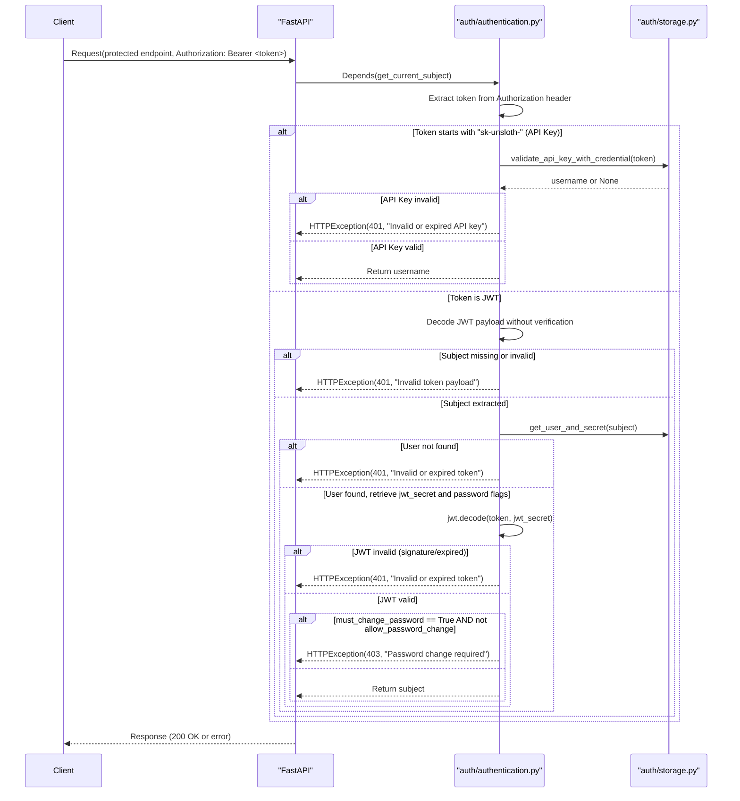

<!-- source: DeepWiki mcp.deepwiki.com · repo unslothai/unsloth · page 9.6 Authentication and Security · fetched 2026-10-21 -->

# Authentication and Security

<details>
<summary>Relevant source files</summary>

The following files were used as context for generating this wiki page:

- [studio/backend/auth/__init__.py](studio/backend/auth/__init__.py)
- [studio/backend/auth/authentication.py](studio/backend/auth/authentication.py)
- [studio/backend/auth/storage.py](studio/backend/auth/storage.py)
- [studio/backend/auth/terminal_prompt.py](studio/backend/auth/terminal_prompt.py)
- [studio/backend/cloudflare_tunnel.py](studio/backend/cloudflare_tunnel.py)
- [studio/backend/lan_access.py](studio/backend/lan_access.py)
- [studio/backend/models/__init__.py](studio/backend/models/__init__.py)
- [studio/backend/models/auth.py](studio/backend/models/auth.py)
- [studio/backend/models/users.py](studio/backend/models/users.py)
- [studio/backend/routes/__init__.py](studio/backend/routes/__init__.py)
- [studio/backend/routes/auth.py](studio/backend/routes/auth.py)
- [studio/backend/run.py](studio/backend/run.py)
- [studio/backend/startup_banner.py](studio/backend/startup_banner.py)
- [studio/backend/state/tool_policy.py](studio/backend/state/tool_policy.py)
- [studio/backend/tests/test_bind_host_policy.py](studio/backend/tests/test_bind_host_policy.py)
- [studio/backend/tests/test_change_password_policy.py](studio/backend/tests/test_change_password_policy.py)
- [studio/backend/tests/test_cloudflare_tunnel.py](studio/backend/tests/test_cloudflare_tunnel.py)
- [studio/backend/tests/test_desktop_auth.py](studio/backend/tests/test_desktop_auth.py)
- [studio/backend/tests/test_lan_access_settings.py](studio/backend/tests/test_lan_access_settings.py)
- [studio/backend/tests/test_lan_share_host_resolution.py](studio/backend/tests/test_lan_share_host_resolution.py)
- [studio/backend/tests/test_password_prompt.py](studio/backend/tests/test_password_prompt.py)
- [studio/backend/tests/test_password_prompt_backstop.py](studio/backend/tests/test_password_prompt_backstop.py)
- [studio/backend/tests/test_secure_tunnel_gate.py](studio/backend/tests/test_secure_tunnel_gate.py)
- [studio/backend/tests/test_startup_banner_loopback.py](studio/backend/tests/test_startup_banner_loopback.py)
- [studio/backend/tests/test_tool_policy_gates.py](studio/backend/tests/test_tool_policy_gates.py)
- [studio/backend/tests/test_wildcard_prompt_compatibility.py](studio/backend/tests/test_wildcard_prompt_compatibility.py)
- [studio/backend/utils/host_policy.py](studio/backend/utils/host_policy.py)
- [studio/backend/utils/lan_access_settings.py](studio/backend/utils/lan_access_settings.py)
- [studio/backend/utils/paths/__init__.py](studio/backend/utils/paths/__init__.py)
- [studio/backend/utils/paths/storage_roots.py](studio/backend/utils/paths/storage_roots.py)
- [studio/frontend/src/features/settings/api/lan-access-state.ts](studio/frontend/src/features/settings/api/lan-access-state.ts)
- [studio/frontend/src/features/settings/api/lan-access.ts](studio/frontend/src/features/settings/api/lan-access.ts)
- [studio/frontend/src/features/settings/components/change-password-dialog.tsx](studio/frontend/src/features/settings/components/change-password-dialog.tsx)
- [studio/frontend/src/features/settings/components/lan-access-section.tsx](studio/frontend/src/features/settings/components/lan-access-section.tsx)
- [studio/frontend/tests/lan-access-state.test.ts](studio/frontend/tests/lan-access-state.test.ts)
- [studio/src-tauri/icons/icon.png](studio/src-tauri/icons/icon.png)
- [tests/python/test_unsloth_run_tool_policy_resolver.py](tests/python/test_unsloth_run_tool_policy_resolver.py)
- [tests/test_installer_shortcut_icons.py](tests/test_installer_shortcut_icons.py)
- [unsloth_cli/_tool_policy.py](unsloth_cli/_tool_policy.py)
- [unsloth_cli/commands/_password_prompt.py](unsloth_cli/commands/_password_prompt.py)
- [unsloth_cli/commands/studio.py](unsloth_cli/commands/studio.py)
- [unsloth_cli/tests/conftest.py](unsloth_cli/tests/conftest.py)
- [unsloth_cli/tests/test_studio_cloudflare_flag.py](unsloth_cli/tests/test_studio_cloudflare_flag.py)
- [unsloth_cli/tests/test_studio_password_prompt.py](unsloth_cli/tests/test_studio_password_prompt.py)
- [unsloth_cli/tests/test_studio_run_parallel_flag.py](unsloth_cli/tests/test_studio_run_parallel_flag.py)
- [unsloth_cli/tests/test_studio_secure_flag.py](unsloth_cli/tests/test_studio_secure_flag.py)

</details>


Unsloth Studio implements a local-first authentication system designed to provide secure access to the Studio web UI and API endpoints in local or private environments. The system manages user credentials, session tokens, and API keys using an embedded SQLite database, JWT-based session tokens, strong password hashing with PBKDF2-HMAC-SHA256, and desktop secret integration. The authentication process includes a robust bootstrap password flow for initial setup, rotating refresh tokens for session continuity, and pre-tunnel terminal password gating for public exposures (such as Cloudflare tunnels or raw wildcard bindings).

This page documents the detailed implementation of the Studio's authentication system, explaining the database schema, cryptographic protocols, terminal security gates, API endpoints, and key functions and classes involved.

---

## 1. Core Security Architecture

The authentication system relies on several integrated components:

### 1.1 SQLite Credential Storage

The persistent storage for authentication data is a dedicated SQLite file `auth.db`, located via the utility function `auth_db_path()` [studio/backend/utils/paths/storage_roots.py:138-140](). This database holds crucial tables:

- **`auth_user`**: Stores user records with fields for username, password salt, hashed password, individual JWT signing secret, and a `must_change_password` boolean flag that enforces password updates [studio/backend/auth/storage.py:160-170]().
- **`refresh_tokens`**: Contains SHA-256 hashes of active refresh tokens, the associated username, expiration timestamps, and a boolean indicating whether the token is from desktop login [studio/backend/auth/storage.py:173-181]().
- **`api_keys`**: Manages API keys for programmatic access including key prefix, salted/hashed key, human-readable description, and usage metadata like last-used timestamp [studio/backend/auth/storage.py:184-197]().
- **`app_secrets`**: Holds global secrets such as the persistent salt used for API key PBKDF2 hashing, created on demand [studio/backend/auth/storage.py:203-208]().

Sources: [studio/backend/utils/paths/storage_roots.py:138-140](), [studio/backend/auth/storage.py:160-208]()

### 1.2 Password and Key Hashing

Different hashing schemes are applied depending on input entropy:

- **Passwords** use **PBKDF2-HMAC-SHA256** with 100,000 iterations and a 16-byte hex salt unique per user to guard against offline brute force or rainbow table attacks. Verification uses constant-time `hmac.compare_digest()` [studio/backend/auth/hashing.py:10-29]().
- **Refresh tokens** are high-entropy random strings generated via `secrets.token_urlsafe(48)` (approx. 288 bits of entropy). They are stored hashed using SHA-256 for fast verification without the need for a KDF [studio/backend/auth/authentication.py:117](), [studio/backend/auth/storage.py:124-132]().
- **API keys** also use PBKDF2-HMAC-SHA256 hashing combined with a persistent server-side salt stored in `app_secrets` to satisfy strict security demands over potentially long-lived secrets [studio/backend/auth/storage.py:221-235]().

Sources: [studio/backend/auth/hashing.py:10-29](), [studio/backend/auth/authentication.py:117](), [studio/backend/auth/storage.py:124-132, 221-235]()

### 1.3 JWT Session Management and Desktop Secrets

Interactive login sessions use JWTs for access tokens:

- Each user has a **random per-user JWT signing secret**, stored plaintext in `auth_user.jwt_secret`.
- JWTs sign with the HS256 algorithm and have a default lifespan of 60 minutes [studio/backend/auth/authentication.py:31-32]().
- Refresh tokens are opaque strings (random URL-safe 48-char) expiring after 7 days. They are hashed and tracked for revocation/rotation in `refresh_tokens`.
- **Desktop Secrets**: For Tauri desktop application integrations, desktop secrets (prefixed with `desktop-`) are generated and validated to authenticate local desktop bridge requests directly against the admin subject [studio/backend/tests/test_desktop_auth.py:91-95]().

Sources: [studio/backend/auth/authentication.py:31-32](), [studio/backend/tests/test_desktop_auth.py:91-95]()

---

## 2. Bootstrap Flow and Initialization

### 2.1 Bootstrap Password Generation, Normalization, and Storage

On first startup with no users present, the Studio backend generates a bootstrap password to allow initial authentication before a user explicitly sets a password:

1. A **4-word diceware passphrase** is generated via the `diceware` Python module [studio/backend/auth/storage.py:128-132]().
2. This bootstrap password is saved *in plaintext* atomically to `.bootstrap_password` (located beside `auth.db`) with `0600` permissions and LF-termination across all platforms via `_persist_bootstrap_password()` [studio/backend/auth/storage.py:32-60]().
3. Upgrade paths and malformed file shapes are normalized via `_normalise_bootstrap_file()` to prevent line-ending bugs (such as Windows CRLF issues or missing trailing newlines) [studio/backend/auth/storage.py:66-90]().
4. When a user changes the bootstrap password, `clear_bootstrap_password()` deletes or truncates the file to prevent lingering plaintext recovery credentials on disk [studio/backend/auth/storage.py:154-184]().

Sources: [studio/backend/auth/storage.py:32-90, 128-184]()

### 2.2 Default Administrator Creation

Upon startup, the backend checks if the `auth_user` table is empty. If so, it creates a default admin user named `"unsloth"` with the bootstrap password as its initial password [studio/backend/auth/storage.py:382-402](). This user must then change the bootstrap password to a permanent secure password.

Sources: [studio/backend/auth/storage.py:382-402]()

---

## 3. Cloudflare Tunnel Gating and Terminal Password Prompt

To prevent exposing instances with default credentials to the public internet, Unsloth Studio enforces a **pre-tunnel terminal password gate** (`should_prompt_password_change()`) when starting with a public tunnel (`--secure` / `--cloudflare`) or a raw non-loopback bind (`-H 0.0.0.0`) [studio/backend/auth/terminal_prompt.py:4-12](), [studio/backend/tests/test_password_prompt_backstop.py:4-6]().

- **Interactive Terminals**: If `sys.stdin` and `sys.stderr` are valid TTYs and the default admin password is still active, the CLI and backend prompt the user interactively in the terminal to choose a new password before starting the server or launching the tunnel [studio/backend/tests/test_password_prompt_backstop.py:108-115]().
- **Headless / Non-TTY Fallback**: If no TTY is attached (e.g., in containerized or background environments), the terminal gate checks the bootstrap deadline (`UNSLOTH_STUDIO_BOOTSTRAP_TIMEOUT`). If armed, it logs a warning pointing to the reset-password recovery flow (`unsloth studio reset-password`) and proceeds with headless fallback; otherwise, it fails closed and refuses to publish the public URL [studio/backend/tests/test_password_prompt_backstop.py:118-158]().

Sources: [studio/backend/auth/terminal_prompt.py:4-12](), [studio/backend/tests/test_password_prompt_backstop.py:4-158]()

---

## 4. Authentication Data Flow

The following diagram outlines how core entities interact during authentication requests.

### Diagram: Authentication Architecture Mapping

```mermaid
graph TD
    subgraph "FastAPI_Auth_Routes [studio/backend/routes/auth.py]"
        Login["POST /api/auth/login"]
        Refresh["POST /api/auth/refresh"]
        ChangePassword["POST /api/auth/change-password"]
        DesktopLogin["POST /api/auth/desktop-login"]
    end

    subgraph "Auth_Logic [studio/backend/auth/authentication.py]"
        CreateAccess["create_access_token()"]
        CreateRefresh["create_refresh_token()"]
        VerifyRefresh["refresh_access_token()"]
        GetUserAndSecret["get_user_and_secret()"]
        GetCurrentSubject["get_current_subject()"]
    end

    subgraph "Storage_Layer [studio/backend/auth/storage.py]"
        AuthDB["SQLite DB (auth.db)"]
        BootstrapFile[".bootstrap_password file"]
        SaveRefreshToken["save_refresh_token()"]
        ValidateApiKey["validate_api_key_with_credential()"]
        UpdatePassword["update_password()"]
        ClearBootstrapPW["clear_bootstrap_password()"]
        EnsureDefaultAdmin["ensure_default_admin()"]
    end

    Login -->|"AuthLoginRequest"| GetUserAndSecret
    GetUserAndSecret -- "Read user, salt, hash, secret" --> AuthDB
    Login --> CreateAccess
    Login --> CreateRefresh
    CreateRefresh --> SaveRefreshToken
    SaveRefreshToken -- "Store hashed refresh token" --> AuthDB

    Refresh -->| "RefreshTokenRequest" | VerifyRefresh
    VerifyRefresh --> ValidateApiKey
    ValidateApiKey -- "Confirm API Key or JWT validity" --> AuthDB
    VerifyRefresh --> CreateAccess
    VerifyRefresh --> CreateRefresh

    ChangePassword -->| "ChangePasswordRequest" | GetCurrentSubject
    GetCurrentSubject --> UpdatePassword
    UpdatePassword --> AuthDB
    ChangePassword --> ClearBootstrapPW
    ClearBootstrapPW --> BootstrapFile

    DesktopLogin -->| "DesktopLoginRequest" | GetUserAndSecret
    DesktopLogin --> CreateAccess
    DesktopLogin --> CreateRefresh

    subgraph "Initialization"
      StudioStart["Studio Backend Startup"]
    end
    StudioStart --> EnsureDefaultAdmin
    EnsureDefaultAdmin --> AuthDB
    EnsureDefaultAdmin --> BootstrapFile
```
Sources: [studio/backend/routes/auth.py:6-44](), [studio/backend/auth/authentication.py:4-42](), [studio/backend/auth/storage.py:6-208]()

---

## 5. API Keys and Programmatic Access

Unsloth Studio supports API keys for seamless programmatic authentication primarily used by CLI tools.

- API keys have a fixed prefix `sk-unsloth-` [studio/backend/auth/storage.py:19]() to distinguish them from JWT tokens.
- Incoming tokens starting with this prefix are validated via `validate_api_key_with_credential()`, which checks the key against stored PBKDF2 hashes and updates usage metadata including the last-used timestamp [studio/backend/auth/authentication.py:73-76](), [studio/backend/auth/storage.py:453-467]().
- This allows granular API key management (creation, listing, revocation) stored alongside regular user credentials in SQLite.

Sources: [studio/backend/auth/storage.py:19](), [studio/backend/auth/authentication.py:73-76]()

---

## 6. Implementation Details

### 6.1 FastAPI Security Dependencies

To protect API endpoints, FastAPI dependencies parse and verify the `Authorization: Bearer <token>` header:

- `get_current_subject()`: Enforces JWT or API key validation for general authenticated routes. It verifies JWT signatures using the user-specific `jwt_secret` and enforces the `must_change_password` flag to block unauthorized use [studio/backend/auth/authentication.py:40-42]().
- `_BearerOrKeyless`: Supports optional keyless API access (`KEYLESS_SCHEME` and `KEYLESS_FALLBACK_SCHEME`) when configured by local environment policies, while keeping authenticated sessions strictly enforced [studio/backend/auth/authentication.py:36-49, 139-144]().

Sources: [studio/backend/auth/authentication.py:36-49, 139-144]()

### Diagram: Security Verification Logic


Sources: [studio/backend/auth/authentication.py:82-101](), [studio/backend/auth/authentication.py:156-231](), [studio/backend/auth/storage.py:453-467]()

### 6.2 Login Rate Limiting

To mitigate brute-force password attempts, the login endpoint enforces an in-memory rate limiter with these parameters:

- Max 5 failed attempts per (IP, username) bucket within 60 seconds.
- Max 30 failed attempts aggregated per IP within 60 seconds.
- Lockout of 60 seconds on limit breaches [studio/backend/routes/auth.py:142-148]().

This protects from both targeted user enumeration and large-scale IP sprays using a sharded overflow mechanism for high-cardinality attacks [studio/backend/routes/auth.py:150-156]().

Sources: [studio/backend/routes/auth.py:142-156]()

### 6.3 Token Lifetimes and Storage Summary

| Token Type       | Implementation                 | Lifetime                  | Storage                          |
|------------------|--------------------------------|---------------------------|---------------------------------|
| **Access Token**  | JWT signed per-user secret (HS256) | 60 minutes [studio/backend/auth/authentication.py:32]() | Client-side volatile storage        |
| **Refresh Token** | Opaque URL-safe random string, SHA-256 stored | 7 days [studio/backend/auth/authentication.py:33]()      | `refresh_tokens` table (hashed)  |
| **API Key**       | PBKDF2 hashed key with app salt  | Configurable              | `api_keys` table (hashed)         |
| **JWT Secret**    | Random string per user, stored plaintext | Permanent (until user deleted) | `auth_user.jwt_secret` column     |

Sources: [studio/backend/auth/authentication.py:32-33]()

---

# Citations

- SQLite credential schema and storage management: [studio/backend/auth/storage.py:160-208]()
- Password hashing and verification: [studio/backend/auth/hashing.py:10-29]()
- JWT session token creation and refresh: [studio/backend/auth/authentication.py:31-44, 117-144]()
- Authentication routes and rate limiting: [studio/backend/routes/auth.py:142-156]()
- Path location for auth DB: [studio/backend/utils/paths/storage_roots.py:138-140]()
- Bootstrap password generation and normalization: [studio/backend/auth/storage.py:32-90, 128-184]()
- API key validation and update: [studio/backend/auth/storage.py:453-467](), [studio/backend/auth/authentication.py:73-76]()
- Terminal prompt and Cloudflare tunnel gating: [studio/backend/auth/terminal_prompt.py:4-12](), [studio/backend/tests/test_password_prompt_backstop.py:4-158]()

Sources:  
[studio/backend/auth/storage.py:32-208, 382-402, 453-467](),  
[studio/backend/auth/hashing.py:10-29](),  
[studio/backend/auth/authentication.py:31-44, 73-76, 117-144](),  
[studio/backend/routes/auth.py:142-156](),  
[studio/backend/utils/paths/storage_roots.py:138-140](),  
[studio/backend/auth/terminal_prompt.py:4-12](),  
[studio/backend/tests/test_password_prompt_backstop.py:4-158]()

---

