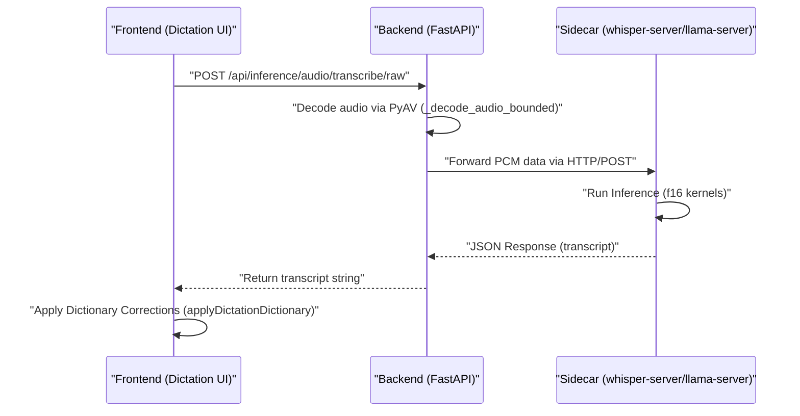
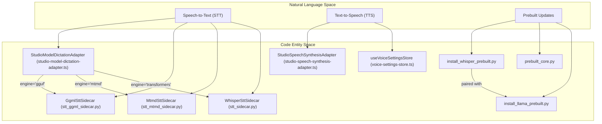

<!-- source: DeepWiki mcp.deepwiki.com · repo unslothai/unsloth · page 9.7 Speech-to-Text and Audio Features · fetched 2026-10-21 -->

# Speech-to-Text and Audio Features

Relevant source files

The following files were used as context for generating this wiki page:

- [studio/backend/core/inference/stt_download_worker.py](studio/backend/core/inference/stt_download_worker.py)
- [studio/backend/core/inference/stt_ggml_sidecar.py](studio/backend/core/inference/stt_ggml_sidecar.py)
- [studio/backend/core/inference/stt_mtmd_sidecar.py](studio/backend/core/inference/stt_mtmd_sidecar.py)
- [studio/backend/core/inference/stt_registry.py](studio/backend/core/inference/stt_registry.py)
- [studio/backend/core/inference/stt_sidecar.py](studio/backend/core/inference/stt_sidecar.py)
- [studio/backend/core/inference/stt_transformers_worker.py](studio/backend/core/inference/stt_transformers_worker.py)
- [studio/backend/hub/tests/test_stt_repository_ownership.py](studio/backend/hub/tests/test_stt_repository_ownership.py)
- [studio/backend/tests/test_native_tls.py](studio/backend/tests/test_native_tls.py)
- [studio/backend/tests/test_stt_download_followups.py](studio/backend/tests/test_stt_download_followups.py)
- [studio/backend/tests/test_stt_ggml_sidecar.py](studio/backend/tests/test_stt_ggml_sidecar.py)
- [studio/backend/tests/test_stt_http_downloads.py](studio/backend/tests/test_stt_http_downloads.py)
- [studio/backend/tests/test_stt_registry.py](studio/backend/tests/test_stt_registry.py)
- [studio/backend/tests/test_stt_sidecar.py](studio/backend/tests/test_stt_sidecar.py)
- [studio/backend/tests/test_stt_transformers_worker.py](studio/backend/tests/test_stt_transformers_worker.py)
- [studio/backend/utils/native_tls.py](studio/backend/utils/native_tls.py)
- [studio/install_node_prebuilt.py](studio/install_node_prebuilt.py)
- [studio/install_whisper_prebuilt.py](studio/install_whisper_prebuilt.py)
- [studio/prebuilt_core.py](studio/prebuilt_core.py)
- [tests/studio/install/_pr10648_helpers.py](tests/studio/install/_pr10648_helpers.py)
- [tests/studio/install/test_install_node_prebuilt_logic.py](tests/studio/install/test_install_node_prebuilt_logic.py)
- [tests/studio/install/test_install_whisper_prebuilt_logic.py](tests/studio/install/test_install_whisper_prebuilt_logic.py)
- [tests/studio/install/test_pr10648_host_matrix.py](tests/studio/install/test_pr10648_host_matrix.py)
- [tests/studio/install/test_prebuilt_core.py](tests/studio/install/test_prebuilt_core.py)

This page documents the Whisper-based speech-to-text (STT) dictation system in Unsloth, the audio codec support leveraged by TTS models, the management of STT models, and the update pipeline for the `whisper.cpp` runtime engine. It covers both the Transformers and `whisper.cpp` inference backends, subprocess orchestration patterns, and technical details for integrating audio features into the Unsloth Studio ecosystem.

---

## Whisper-based Dictation System

Unsloth supports state-of-the-art speech recognition through Whisper models, employing three main execution engines depending on the model architecture and user environment:

- **Transformers Engine:** Uses PyTorch and Hugging Face Transformers for standard Whisper models and custom safetensors repositories [studio/backend/core/inference/stt_sidecar.py:7-12]().
- **GGUF Engine (`whisper.cpp`):** A lightweight C++ sidecar for curated Whisper GGUF checkpoints, offering ~2.5x speedups on Apple Silicon and CPU by running weights in `f16` [studio/backend/core/inference/stt_ggml_sidecar.py:6-9]().
- **MTMD Engine (`llama.cpp`):** Supports newer multimodal ASR models (like Qwen3-ASR) by pairing a text model with an audio `mmproj` projector [studio/backend/core/inference/stt_mtmd_sidecar.py:4-13]().

### Architecture and Subprocess Pattern

To maintain responsiveness in Studio, audio decoding and inference happen in dedicated sidecar processes isolated from the main FastAPI server.

- **`WhisperSttSidecar`**: Manages the lifecycle of Transformers-based STT workers, handling device choice (CUDA/MPS/CPU) and idle timeouts (default 5 minutes) [studio/backend/core/inference/stt_sidecar.py:10-51]().
- **`GgmlSttSidecar`**: Orchestrates the `whisper-server` binary, managing ephemeral port binding on `127.0.0.1` and model-on-demand loading [studio/backend/core/inference/stt_ggml_sidecar.py:11-15]().
- **`MtmdSttSidecar`**: Leverages `llama-server` for multimodal ASR, providing a prompt-based transcription interface ("Transcribe the audio") [studio/backend/core/inference/stt_mtmd_sidecar.py:96-105]().

### Frontend Adapters and Logic Space

The frontend abstracts these backends through a unified adapter interface:

| Adapter | Responsibility |
| :--- | :--- |
| `StudioWebSpeechDictationAdapter` | Fallback to browser Web Speech API (Chrome/Safari) [studio/frontend/src/features/chat/adapters/studio-web-speech-dictation-adapter.ts:115-134]() (not provided in files). |
| `StudioModelDictationAdapter` | Routes audio blobs to the Studio backend, selecting between `transformers`, `gguf`, or `mtmd` engines [studio/frontend/src/features/chat/adapters/studio-model-dictation-adapter.ts:71-80]() (not provided in files). |
| `StudioDictationAdapter` | The primary router that checks `voice-settings-store` to decide which adapter to instantiate [studio/frontend/src/features/chat/adapters/studio-dictation-adapter.tsx:56-77]() (not provided in files). |

**Sources:**
[studio/backend/core/inference/stt_sidecar.py:4-18]()
[studio/backend/core/inference/stt_ggml_sidecar.py:4-22]()
[studio/backend/core/inference/stt_mtmd_sidecar.py:4-13]()

---

## Audio Codec Support for TTS Models

Unsloth includes support for advanced audio codecs used by modern Text-to-Speech (TTS) models. These codecs allow models to generate discrete tokens that represent audio, which are then reconstructed into waveforms.

### Supported Codecs and Synthesis
The system supports synthesis via:
- **System Voices**: Native OS `speechSynthesis` [studio/frontend/src/features/settings/stores/voice-settings-store.ts:137-140]() (not provided in files).
- **Studio Models**: Local TTS models using codecs like **SNAC**, **CSM**, **BiCodec**, or **DAC**.
- **Custom Providers**: OpenAI-compatible `/audio/speech` endpoints [studio/frontend/src/features/chat/adapters/studio-speech-synthesis-adapter.ts:24-30]() (not provided in files).

The `StudioSpeechSynthesisAdapter` manages the generation of audio URLs and handles the cleanup of object URLs via `URL.revokeObjectURL` to prevent memory leaks [studio/frontend/src/features/settings/tabs/voice-tab.tsx:24-34]() (not provided in files).

**Sources:**
[studio/frontend/src/features/settings/stores/voice-settings-store.ts:83-85]() (not provided in files).
[studio/frontend/src/features/settings/tabs/voice-tab.tsx:24-34]() (not provided in files).

---

## STT Model Management

### Model Discovery and Curated Catalog
Unsloth provides a curated set of Whisper models optimized for the platform:
- **Curated Models**: `tiny`, `base`, `small`, `large-v3-turbo`, and `large-v3` [studio/backend/core/inference/stt_sidecar.py:43-49]().
- **Multimodal ASR**: `qwen3-asr-0.6b` and `qwen3-asr-1.7b` [studio/backend/core/inference/stt_mtmd_sidecar.py:76-91]().

### Model Validation and Loading
Before loading a custom Hugging Face repository, the system validates the `config.json` to ensure the architecture is `WhisperForConditionalGeneration` [studio/backend/tests/test_stt_sidecar.py:152-168]().

### Audio Segmentation Logic
For long dictations, the `StudioModelDictationAdapter` implements a "rolling" segmentation strategy:
- **Time Slice**: 250ms chunks are recorded [studio/frontend/src/features/chat/adapters/studio-model-dictation-adapter.ts:38]() (not provided in files).
- **VAD (Voice Activity Detection)**: Uses a raw RMS threshold of `0.015` to detect speech [studio/frontend/src/features/chat/adapters/studio-model-dictation-adapter.ts:46]() (not provided in files).
- **Segmentation**: Cuts audio at silence pauses between 20s and 28s to keep Whisper within its optimal 30s window [studio/frontend/src/features/chat/adapters/studio-model-dictation-adapter.ts:41-43]() (not provided in files).

### Transcription Data Flow

**Sources:**
[studio/backend/core/inference/stt_sidecar.py:43-51]()
[studio/backend/core/inference/stt_ggml_sidecar.py:104-114]()

---

## Whisper.cpp Update Pipeline

The `whisper.cpp` binary (`whisper-server`) is managed as a prebuilt component. Its installation and update lifecycle are tightly coupled with the `llama.cpp` runtime to ensure compatible `ggml` backends.

### Prebuilt Installer Logic
The `install_whisper_prebuilt.py` script handles cross-platform binary deployment:
- **Slim Bundles**: Modern releases use "slim" bundles that do not include `ggml` libraries; they dynamically link to the libraries provided by the `llama.cpp` install [studio/install_whisper_prebuilt.py:41-46]().
- **Platform Mapping**: Detects OS and architecture (e.g., mapping `Linux x86_64` to `linux-x64`) [tests/studio/install/test_install_whisper_prebuilt_logic.py:129-140]().
- **Integrity**: Verifies downloads against `whisper-prebuilt-sha256.json` [studio/install_whisper_prebuilt.py:20-25]().

### Layout and Discovery
- **Binary Path**: `<UNSLOTH_HOME>/whisper.cpp/build/bin/whisper-server` [studio/install_whisper_prebuilt.py:12-13]().
- **Marker**: Uses `UNSLOTH_WHISPER_PREBUILT_INFO.json` to track the installed version and paired `llama.cpp` tag [studio/backend/core/inference/stt_ggml_sidecar.py:194-196]().

**Sources:**
[studio/install_whisper_prebuilt.py:5-51]()
[studio/backend/core/inference/stt_ggml_sidecar.py:146-179]()
[tests/studio/install/test_install_whisper_prebuilt_logic.py:129-140]()

---

## Audio Feature to Code Entity Mapping

This diagram maps the high-level audio features to the specific classes and files implementing them.

**Sources:**
[studio/backend/core/inference/stt_ggml_sidecar.py:4-22]()
[studio/install_whisper_prebuilt.py:72-74]()
[studio/prebuilt_core.py:1-2817]()

---

