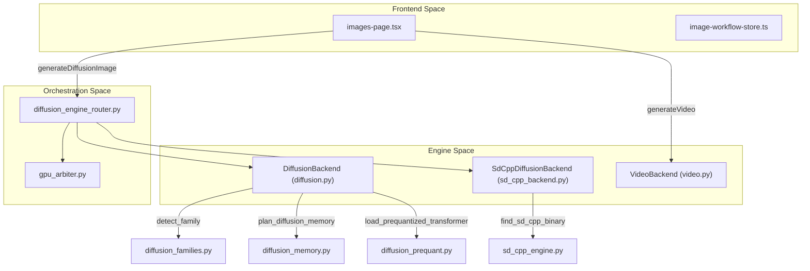
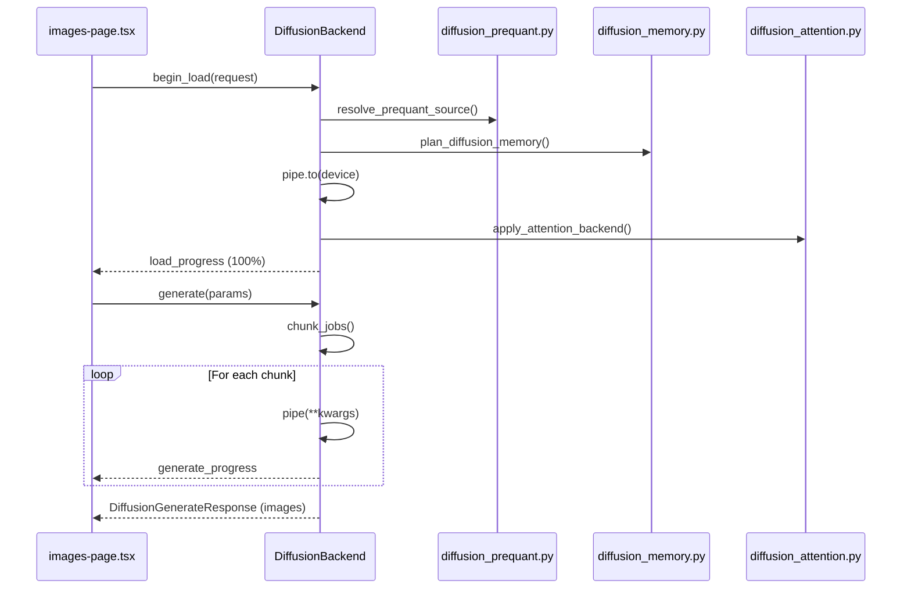

<!-- source: DeepWiki mcp.deepwiki.com · repo unslothai/unsloth · page 9.8 Image and Video Generation Backend · fetched 2026-10-21 -->

# Image and Video Generation Backend

Relevant source files

The following files were used as context for generating this wiki page:

- [scripts/diffusion_bench.py](scripts/diffusion_bench.py)
- [scripts/verify_import_hoist.py](scripts/verify_import_hoist.py)
- [studio/backend/core/_torchao_stub.py](studio/backend/core/_torchao_stub.py)
- [studio/backend/core/inference/diffusion.py](studio/backend/core/inference/diffusion.py)
- [studio/backend/core/inference/diffusion_auto_policy.py](studio/backend/core/inference/diffusion_auto_policy.py)
- [studio/backend/core/inference/diffusion_cuda_graph.py](studio/backend/core/inference/diffusion_cuda_graph.py)
- [studio/backend/core/inference/diffusion_engine_router.py](studio/backend/core/inference/diffusion_engine_router.py)
- [studio/backend/core/inference/diffusion_families.py](studio/backend/core/inference/diffusion_families.py)
- [studio/backend/core/inference/diffusion_hidream.py](studio/backend/core/inference/diffusion_hidream.py)
- [studio/backend/core/inference/diffusion_memory.py](studio/backend/core/inference/diffusion_memory.py)
- [studio/backend/core/inference/diffusion_precision.py](studio/backend/core/inference/diffusion_precision.py)
- [studio/backend/core/inference/diffusion_prequant.py](studio/backend/core/inference/diffusion_prequant.py)
- [studio/backend/core/inference/diffusion_speed.py](studio/backend/core/inference/diffusion_speed.py)
- [studio/backend/core/inference/diffusion_te_prequant.py](studio/backend/core/inference/diffusion_te_prequant.py)
- [studio/backend/core/inference/diffusion_torchao_patches.py](studio/backend/core/inference/diffusion_torchao_patches.py)
- [studio/backend/core/inference/diffusion_transformer_quant.py](studio/backend/core/inference/diffusion_transformer_quant.py)
- [studio/backend/core/inference/media_locality.py](studio/backend/core/inference/media_locality.py)
- [studio/backend/core/inference/sd_cpp_backend.py](studio/backend/core/inference/sd_cpp_backend.py)
- [studio/backend/core/inference/video.py](studio/backend/core/inference/video.py)
- [studio/backend/core/inference/video_families.py](studio/backend/core/inference/video_families.py)
- [studio/backend/core/training/diffusion_dit_trainer.py](studio/backend/core/training/diffusion_dit_trainer.py)
- [studio/backend/core/training/diffusion_train_common.py](studio/backend/core/training/diffusion_train_common.py)
- [studio/backend/hub/services/snapshot_progress.py](studio/backend/hub/services/snapshot_progress.py)
- [studio/backend/routes/video.py](studio/backend/routes/video.py)
- [studio/backend/tests/test_audio_token_detection.py](studio/backend/tests/test_audio_token_detection.py)
- [studio/backend/tests/test_dense_quant_rocm_gate_9396.py](studio/backend/tests/test_dense_quant_rocm_gate_9396.py)
- [studio/backend/tests/test_dgx_spark_diffusion_memory.py](studio/backend/tests/test_dgx_spark_diffusion_memory.py)
- [studio/backend/tests/test_diffusion_auto_policy.py](studio/backend/tests/test_diffusion_auto_policy.py)
- [studio/backend/tests/test_diffusion_backend.py](studio/backend/tests/test_diffusion_backend.py)
- [studio/backend/tests/test_diffusion_base_precision.py](studio/backend/tests/test_diffusion_base_precision.py)
- [studio/backend/tests/test_diffusion_bench.py](studio/backend/tests/test_diffusion_bench.py)
- [studio/backend/tests/test_diffusion_cuda_graph.py](studio/backend/tests/test_diffusion_cuda_graph.py)
- [studio/backend/tests/test_diffusion_dit_trainer.py](studio/backend/tests/test_diffusion_dit_trainer.py)
- [studio/backend/tests/test_diffusion_gated_base.py](studio/backend/tests/test_diffusion_gated_base.py)
- [studio/backend/tests/test_diffusion_memory.py](studio/backend/tests/test_diffusion_memory.py)
- [studio/backend/tests/test_diffusion_more_families.py](studio/backend/tests/test_diffusion_more_families.py)
- [studio/backend/tests/test_diffusion_precision.py](studio/backend/tests/test_diffusion_precision.py)
- [studio/backend/tests/test_diffusion_predownload_guard_platforms.py](studio/backend/tests/test_diffusion_predownload_guard_platforms.py)
- [studio/backend/tests/test_diffusion_prequant.py](studio/backend/tests/test_diffusion_prequant.py)
- [studio/backend/tests/test_diffusion_routes.py](studio/backend/tests/test_diffusion_routes.py)
- [studio/backend/tests/test_diffusion_speed.py](studio/backend/tests/test_diffusion_speed.py)
- [studio/backend/tests/test_diffusion_te_prequant.py](studio/backend/tests/test_diffusion_te_prequant.py)
- [studio/backend/tests/test_diffusion_transformer_quant.py](studio/backend/tests/test_diffusion_transformer_quant.py)
- [studio/backend/tests/test_media_auto_switch.py](studio/backend/tests/test_media_auto_switch.py)
- [studio/backend/tests/test_offline_gguf_cache_fallback.py](studio/backend/tests/test_offline_gguf_cache_fallback.py)
- [studio/backend/tests/test_sd_cpp_backend.py](studio/backend/tests/test_sd_cpp_backend.py)
- [studio/backend/tests/test_sd_cpp_install.py](studio/backend/tests/test_sd_cpp_install.py)
- [studio/backend/tests/test_video_backend.py](studio/backend/tests/test_video_backend.py)
- [studio/backend/tests/test_video_prequant.py](studio/backend/tests/test_video_prequant.py)
- [studio/backend/tests/test_video_shape_validation.py](studio/backend/tests/test_video_shape_validation.py)
- [studio/backend/tests/test_vision_cache.py](studio/backend/tests/test_vision_cache.py)
- [studio/install_sd_cpp_prebuilt.py](studio/install_sd_cpp_prebuilt.py)

The Unsloth Studio offers a sophisticated and high-performance backend system for diffusion model inference supporting both image and video generation workflows. It manages different model families, quantization methods including pre-quantized checkpoints, and hardware environments from GPU-accelerated (diffusers) to CPU-native (sd.cpp) inference. This backend integrates tightly with Studio's GPU arbitration system to coordinate VRAM usage amid concurrent LLM training and diffusion inference tasks, ensuring efficient multi-modal operation.

---

## Architecture Overview

Unsloth's diffusion inference backend employs a dual-engine model orchestrated by a main engine router (`diffusion_engine_router.py`). It coordinates GPU resource allocation and VRAM management through a central arbiter to avoid out-of-memory errors when models are concurrently loaded or used.

### Engine Router

- **DiffusionBackend (diffusers-based):**
  - This is the primary GPU-accelerated backend [studio/backend/core/inference/diffusion.py:6-17]().
  - Uses Hugging Face's `diffusers` library extended via custom patches (fast loading, memory planning, pre-quantized support).
  - Handles complex pipeline composition including LoRA adapters, ControlNet, img2img, and inpainting pipelines.
  - Supports quantization types like BF16, FP8, and in-place 4-bit [studio/backend/core/inference/diffusion.py:166-174]().

- **SdCppDiffusionBackend (sd.cpp native):**
  - Used when no GPU or suitable GPU is detected [studio/backend/core/inference/sd_cpp_backend.py:10-12]().
  - Runs a subprocess that uses the `sd-cli` binary for native stable-diffusion.cpp inference [studio/backend/core/inference/sd_cpp_backend.py:8-9]().
  - Reuses the downloaded GGUF transformer checkpoint and corresponding VAEs/text encoders that share file caches with the diffusers backend [studio/backend/core/inference/sd_cpp_backend.py:14-16]().
  - More lightweight on RAM and often faster than diffusers on CPU-only hosts.

### DiffusionFamily Model Classification

The `DiffusionFamily` dataclass classifies and configures supported diffusion model families, defining their pipeline classes, transformer classes, companion repos, and feature flags for workflows like img2img or ControlNet [studio/backend/core/inference/diffusion_families.py:76-130]().

| Property | Description |
| :--- | :--- |
| `name` | Canonical family name (e.g., `flux.1`, `qwen-image`) |
| `pipeline_class` | Diffusers pipeline class to instantiate |
| `transformer_class` | Diffusers transformer class name for denoiser |
| `base_repo` | The default companion HuggingFace repo ID for VAE, tokenizer, etc. |
| `cfg_kwarg` | Pipeline keyword for guidance scale (often `"guidance_scale"`) |
| `img2img_pipeline_class` | Optional pipeline class for image-to-image tasks |
| `inpaint_pipeline_class` | Optional pipeline class for inpainting tasks |
| `prequant_repos` | Hosted repos providing pre-quantized transformer checkpoints |

**Sources:** [studio/backend/core/inference/diffusion.py:4-17](), [studio/backend/core/inference/sd_cpp_backend.py:4-23](), [studio/backend/core/inference/diffusion_families.py:76-130]()

---

## Image Generation Backend (Diffusers-based): `DiffusionBackend`

The main GPU-accelerated image backend supports loading diffusion pipelines based on multiple model kinds: `gguf`, `single_file`, and `pipeline` [studio/backend/core/inference/diffusion.py:189-191]().

Key behaviors include:
- **Memory Planning:** Uses `plan_diffusion_memory` to calculate VRAM requirements for transformer and text encoder components based on the selected precision and offload strategy [studio/backend/core/inference/diffusion.py:82-101]().
- **Quantization:** Supports dynamic quantization of transformers via `quantize_transformer` and text encoders via `quantize_text_encoders` [studio/backend/core/inference/diffusion.py:140-174]().
- **Batching:** Implements `chunk_jobs` to split large generation requests into smaller VRAM-safe chunks [studio/backend/core/inference/diffusion.py:123-129]().
- **Attention Optimization:** Automatically selects and applies optimal attention backends (Flash Attention, SDPA, xFormers) [studio/backend/core/inference/diffusion.py:114-119]().

**Sources:** [studio/backend/core/inference/diffusion.py:82-191](), [studio/backend/core/inference/diffusion_families.py:76-130]()

---

## Native CPU Backend: `SdCppDiffusionBackend`

The `SdCppDiffusionBackend` provides a fallback for systems without compatible GPUs, wrapping the `sd-cli` binary in a managed subprocess lifecycle [studio/backend/core/inference/sd_cpp_backend.py:4-12]().

- **Managed Installation:** Binary installation is handled lazily and serialized via `_install_lock` to prevent race conditions during concurrent first-loads [studio/backend/core/inference/sd_cpp_backend.py:94-95](), [studio/backend/core/inference/sd_cpp_backend.py:113-115]().
- **Asset Resolution:** Automatically resolves required companion files (VAE, CLIP-L, T5XXL) based on the model family [studio/backend/tests/test_sd_cpp_backend.py:116-122]().
- **One-shot vs Server Mode:** Supports both launching `sd-cli` for one-shot generation and maintaining an `SdCppServer` for lower-latency sequential requests [studio/backend/core/inference/sd_cpp_backend.py:168-170]().

**Sources:** [studio/backend/core/inference/sd_cpp_backend.py:4-170](), [studio/backend/tests/test_sd_cpp_backend.py:116-122]()

---

## Video Generation Backend: `VideoBackend`

Video generation is managed by `VideoBackend`, which shares hardware optimization layers with the image backend but implements video-specific frame and temporal logic [studio/backend/core/inference/video.py:4-15]().

- **Frame Snapping:** Automatically snaps `num_frames` to the family's temporal lattice and `width`/`height` to required multiples before allocation [studio/backend/core/inference/video.py:22-24](). This is handled by `snap_num_frames` and `snap_video_size` [studio/backend/core/inference/video_families.py:132-133]().
- **Memory Estimation:** Uses `estimate_video_runtime_mib` to account for VAE decode spikes during long clip generation [studio/backend/core/inference/video.py:18-19]().
- **VAE Tiling:** Always enables VAE tiling to handle high-resolution frame stacks without exceeding VRAM [studio/backend/core/inference/video.py:20-21]().
- **Encoding:** Results are encoded to MP4 (H.264) using PyAV, muxing audio tracks for families like LTX-2 [studio/backend/core/inference/video.py:24-25]().

**Sources:** [studio/backend/core/inference/video.py:4-29](), [studio/backend/core/inference/video_families.py:132-133]()

---

## Pre-Quantized Checkpoints Support

To reduce download time and VRAM usage, the Studio supports loading pre-quantized checkpoints (INT8, FP8) directly [studio/backend/core/inference/diffusion_prequant.py:4-9]().

- **Resolution:** `resolve_prequant_source` maps a model family and desired scheme to a specific hosted repository and filename [studio/backend/core/inference/diffusion_prequant.py:16-19]().
- **Caching:** The system checks for cached blobs before initiating downloads, ensuring that pre-quantized artifacts are preferred over dense weights when available [studio/backend/tests/test_video_prequant.py:143-147]().
- **Text Encoder Pre-quant:** Supports loading pre-cast text encoder checkpoints to skip the dense download and on-device casting overhead [studio/backend/core/inference/diffusion_families.py:126-127]().

**Sources:** [studio/backend/core/inference/diffusion_prequant.py:4-19](), [studio/backend/core/inference/diffusion_families.py:108-127](), [studio/backend/tests/test_video_prequant.py:143-160]()

---

## Diagram: Natural Language to Image Generation Backend (Code Entities)

**Sources:** [studio/backend/core/inference/diffusion.py:23-130](), [studio/backend/core/inference/sd_cpp_backend.py:4-89](), [studio/backend/core/inference/video.py:4-30]()

---

## Diagram: Diffusion Generation Lifecycle

**Sources:** [studio/backend/core/inference/diffusion.py:82-147](), [studio/backend/core/inference/diffusion_batched.py:123-129]()

---

## Summary of Key Entities

| Class / Module | Role | File Path |
| :--- | :--- | :--- |
| `DiffusionBackend` | Main GPU-accelerated diffusers orchestrator | [studio/backend/core/inference/diffusion.py]() |
| `SdCppDiffusionBackend` | Subprocess-based CPU-native engine | [studio/backend/core/inference/sd_cpp_backend.py]() |
| `VideoBackend` | specialized sibling for temporal/video generation | [studio/backend/core/inference/video.py]() |
| `DiffusionFamily` | Registry of architecture-specific pipeline metadata | [studio/backend/core/inference/diffusion_families.py]() |
| `plan_diffusion_memory` | VRAM budgeter and offload strategy resolver | [studio/backend/core/inference/diffusion_memory.py]() |
| `resolve_prequant_source` | Hosted quantized artifact resolution logic | [studio/backend/core/inference/diffusion_prequant.py]() |

**Sources:** [studio/backend/core/inference/diffusion.py](), [studio/backend/core/inference/sd_cpp_backend.py](), [studio/backend/core/inference/video.py](), [studio/backend/core/inference/diffusion_families.py](), [studio/backend/core/inference/diffusion_memory.py](), [studio/backend/core/inference/diffusion_prequant.py]()

---

