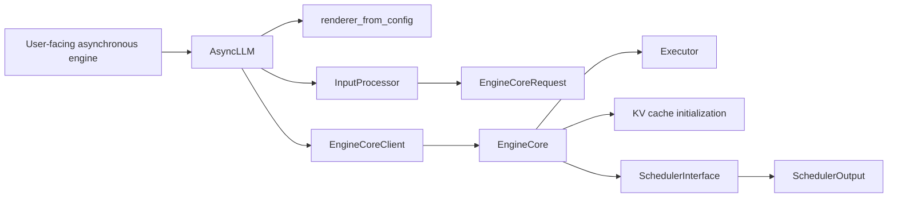
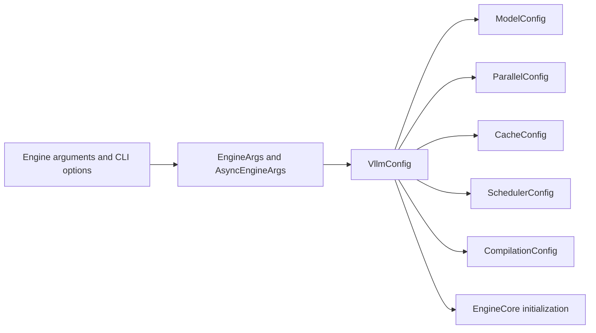
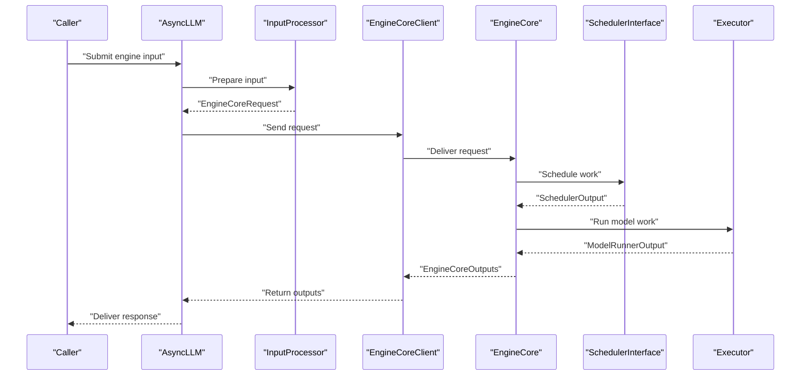

<!-- source: DeepWiki mcp.deepwiki.com · repo vllm-project/vllm · page 1 Overview · fetched 2026-10-28 -->

# Overview

Relevant source files

The following files were used as context for generating this wiki page:

- [.buildkite/image_build/image_build.yaml](.buildkite/image_build/image_build.yaml)
- [README.md](README.md)
- [docker/Dockerfile.cpu](docker/Dockerfile.cpu)
- [docker/Dockerfile.xpu](docker/Dockerfile.xpu)
- [docker/entrypoints/test_vllm_nonroot_entrypoint.sh](docker/entrypoints/test_vllm_nonroot_entrypoint.sh)
- [docker/entrypoints/vllm-nonroot-entrypoint.sh](docker/entrypoints/vllm-nonroot-entrypoint.sh)
- [docs/assets/models/pooling_models/cheat_sheet.svg](docs/assets/models/pooling_models/cheat_sheet.svg)
- [docs/assets/models/pooling_models/pooling_types.svg](docs/assets/models/pooling_models/pooling_types.svg)
- [docs/assets/models/pooling_models/score_types.svg](docs/assets/models/pooling_models/score_types.svg)
- [docs/benchmarking/README.md](docs/benchmarking/README.md)
- [docs/configuration/README.md](docs/configuration/README.md)
- [docs/configuration/serve_args.md](docs/configuration/serve_args.md)
- [docs/deployment/docker.md](docs/deployment/docker.md)
- [docs/features/structured_outputs.md](docs/features/structured_outputs.md)
- [docs/getting_started/installation/README.md](docs/getting_started/installation/README.md)
- [docs/getting_started/installation/gpu.apple.inc.md](docs/getting_started/installation/gpu.apple.inc.md)
- [docs/getting_started/installation/gpu.md](docs/getting_started/installation/gpu.md)
- [docs/getting_started/installation/gpu.rocm.inc.md](docs/getting_started/installation/gpu.rocm.inc.md)
- [docs/getting_started/installation/gpu.xpu.inc.md](docs/getting_started/installation/gpu.xpu.inc.md)
- [docs/getting_started/quickstart.md](docs/getting_started/quickstart.md)
- [docs/models/generative_models.md](docs/models/generative_models.md)
- [docs/models/supported_models.md](docs/models/supported_models.md)
- [docs/usage/troubleshooting.md](docs/usage/troubleshooting.md)
- [requirements/xpu.txt](requirements/xpu.txt)
- [tests/config/test_model_arch_config.py](tests/config/test_model_arch_config.py)
- [tests/cuda/test_cuda_compatibility_path.py](tests/cuda/test_cuda_compatibility_path.py)
- [tests/engine/test_arg_utils.py](tests/engine/test_arg_utils.py)
- [tests/entrypoints/launchers/api_server/test_api_server_process_manager.py](tests/entrypoints/launchers/api_server/test_api_server_process_manager.py)
- [tests/entrypoints/serve/utils/test_api_utils.py](tests/entrypoints/serve/utils/test_api_utils.py)
- [tests/models/multimodal/generation/test_common.py](tests/models/multimodal/generation/test_common.py)
- [tests/models/multimodal/generation/vlm_utils/model_utils.py](tests/models/multimodal/generation/vlm_utils/model_utils.py)
- [tests/models/registry.py](tests/models/registry.py)
- [tests/test_config.py](tests/test_config.py)
- [tests/v1/distributed/test_async_llm_dp.py](tests/v1/distributed/test_async_llm_dp.py)
- [tests/v1/engine/test_core_engine_actor_manager.py](tests/v1/engine/test_core_engine_actor_manager.py)
- [tests/v1/engine/test_dp_world_group_port.py](tests/v1/engine/test_dp_world_group_port.py)
- [tests/v1/engine/test_engine_core.py](tests/v1/engine/test_engine_core.py)
- [tests/v1/engine/test_engine_core_client.py](tests/v1/engine/test_engine_core_client.py)
- [tests/v1/engine/test_startup_watch_processes.py](tests/v1/engine/test_startup_watch_processes.py)
- [vllm/config/cache.py](vllm/config/cache.py)
- [vllm/config/model.py](vllm/config/model.py)
- [vllm/config/model_arch.py](vllm/config/model_arch.py)
- [vllm/config/parallel.py](vllm/config/parallel.py)
- [vllm/config/speculative.py](vllm/config/speculative.py)
- [vllm/config/vllm.py](vllm/config/vllm.py)
- [vllm/engine/arg_utils.py](vllm/engine/arg_utils.py)
- [vllm/engine/protocol.py](vllm/engine/protocol.py)
- [vllm/entrypoints/cli/serve.py](vllm/entrypoints/cli/serve.py)
- [vllm/entrypoints/llm.py](vllm/entrypoints/llm.py)
- [vllm/entrypoints/serve/utils/api_utils.py](vllm/entrypoints/serve/utils/api_utils.py)
- [vllm/model_executor/models/config.py](vllm/model_executor/models/config.py)
- [vllm/model_executor/models/registry.py](vllm/model_executor/models/registry.py)
- [vllm/models/inkling/common/mm_preprocess.py](vllm/models/inkling/common/mm_preprocess.py)
- [vllm/transformers_utils/config.py](vllm/transformers_utils/config.py)
- [vllm/transformers_utils/configs/__init__.py](vllm/transformers_utils/configs/__init__.py)
- [vllm/transformers_utils/model_arch_config_convertor.py](vllm/transformers_utils/model_arch_config_convertor.py)
- [vllm/transformers_utils/processors/__init__.py](vllm/transformers_utils/processors/__init__.py)
- [vllm/v1/core/sched/interface.py](vllm/v1/core/sched/interface.py)
- [vllm/v1/engine/__init__.py](vllm/v1/engine/__init__.py)
- [vllm/v1/engine/async_llm.py](vllm/v1/engine/async_llm.py)
- [vllm/v1/engine/coordinator.py](vllm/v1/engine/coordinator.py)
- [vllm/v1/engine/core.py](vllm/v1/engine/core.py)
- [vllm/v1/engine/core_client.py](vllm/v1/engine/core_client.py)
- [vllm/v1/engine/llm_engine.py](vllm/v1/engine/llm_engine.py)
- [vllm/v1/engine/utils.py](vllm/v1/engine/utils.py)
- [vllm/v1/spec_decode/llm_base_proposer.py](vllm/v1/spec_decode/llm_base_proposer.py)
- [vllm/v1/utils.py](vllm/v1/utils.py)

## Purpose and scope

This page introduces vLLM’s major components, the V1 engine’s high-level request path, and the repository areas an engineer will encounter. It is an orientation page; detailed installation, usage, and deployment guidance is covered by the child pages. The V1 engine’s `EngineCore` coordinates model execution, KV-cache initialization, and scheduler setup [vllm/v1/engine/core.py:117-184](). `VllmConfig` brings together configuration for model, cache, compilation, parallel execution, scheduling, and other subsystems [vllm/config/vllm.py:30-57]().

Sources: [vllm/v1/engine/core.py:117-184](), [vllm/config/vllm.py:30-57]()

## What is vLLM

vLLM is an inference and serving codebase for generative and pooling models. Its supported-model documentation describes both native vLLM implementations and a Transformers modeling backend, and lists language, embedding, vision-language, and audio-language use cases [docs/models/supported_models.md:3-24](). At a high level, the system combines configuration, request processing, scheduling, KV-cache management, and model execution; the V1 `EngineCore` initializes the executor and cache before constructing its scheduler [vllm/v1/engine/core.py:145-184]().

The configuration includes optimization levels `O0` through `O3`; the documented descriptions distinguish no optimization, quick optimizations, and fuller CUDA-graph optimizations [vllm/config/vllm.py:128-141](). For details on installation and hardware prerequisites, see [Getting Started and Installation](#1.1). For example workflows, see [Examples and Usage Patterns](#1.2), and for per-model deployment guidance, see [Model Recipes and Deployment Guides](#1.3).

Sources: [docs/models/supported_models.md:3-24](), [vllm/v1/engine/core.py:145-184](), [vllm/config/vllm.py:128-141]()

## System Architecture

V1 separates the user-facing engine client from the `EngineCore` inner loop. `AsyncLLM` builds a renderer and `InputProcessor`, while `EngineCore` owns the executor, initializes KV caches, and constructs the scheduler [vllm/v1/engine/async_llm.py:93-111](), [vllm/v1/engine/async_llm.py:167-171](), [vllm/v1/engine/core.py:117-184](). The client can also be configured with externally launched engine addresses, which reflects the client/core boundary without requiring a particular process arrangement [vllm/v1/engine/async_llm.py:120-125]().

### High-level system components

**Diagram: vLLM concepts mapped to code entities**

Sources: [vllm/v1/engine/async_llm.py:93-111](), [vllm/v1/engine/async_llm.py:167-171](), [vllm/v1/engine/async_llm.py:56-64](), [vllm/v1/engine/core.py:117-184]()

**Diagram: configuration concepts mapped to code entities**

`arg_utils.py` imports the configuration types used by the argument layer, including `VllmConfig`, `ModelConfig`, `ParallelConfig`, `CacheConfig`, `SchedulerConfig`, and `CompilationConfig` [vllm/engine/arg_utils.py:36-73](). The `VllmConfig` module imports these subsystem configurations [vllm/config/vllm.py:30-57](), and `EngineCore` receives a `VllmConfig` at initialization [vllm/v1/engine/core.py:120-146]().

Sources: [vllm/engine/arg_utils.py:36-73](), [vllm/config/vllm.py:30-57](), [vllm/v1/engine/core.py:120-146]()

### Layered architecture overview

| Area | Role at a glance | Representative code entities |
|---|---|---|
| User-facing engine | Exposes asynchronous inference through an engine client | `AsyncLLM` [vllm/v1/engine/async_llm.py:93-111]() |
| Input preparation | Creates a renderer and converts engine inputs toward core requests | `renderer_from_config`, `InputProcessor` [vllm/v1/engine/async_llm.py:167-171]() |
| Engine coordination | Owns the executor and brings up cache and scheduling components | `EngineCore`, `Executor`, `SchedulerInterface` [vllm/v1/engine/core.py:117-184]() |
| Configuration | Collects subsystem settings used by engine initialization | `VllmConfig`, `ModelConfig`, `ParallelConfig`, `CompilationConfig` [vllm/config/vllm.py:30-57]() |
| Model support | Maps Hugging Face architectures to vLLM implementations and exposes capability queries | `_TEXT_GENERATION_MODELS`, model interfaces [vllm/model_executor/models/registry.py:46-73]() |

Sources: [vllm/v1/engine/async_llm.py:93-111](), [vllm/v1/engine/async_llm.py:167-171](), [vllm/v1/engine/core.py:117-184](), [vllm/config/vllm.py:30-57](), [vllm/model_executor/models/registry.py:46-73]()

## Repository Layout

The repository’s top-level areas include `vllm/`, `rust/`, `csrc/`, `tests/`, `examples/`, and `recipes/`. At a high level, `vllm/` contains the Python package, including configuration, engine, and model-support code; `tests/` includes model registry and configuration tests [vllm/config/vllm.py:30-57](), [vllm/v1/engine/core.py:117-184](), [vllm/model_executor/models/registry.py:73-100](), [tests/models/registry.py:16-39](), [tests/test_config.py:20-50](). The other top-level areas provide useful entry points for Rust frontend work, native extensions, examples, and deployment recipes; their detailed contents are outside this page’s scope.

For installation and platform-specific setup, see [Getting Started and Installation](#1.1). For the examples tree, see [Examples and Usage Patterns](#1.2). For the recipes tree and sweep tooling, see [Model Recipes and Deployment Guides](#1.3).

Sources: [vllm/config/vllm.py:30-57](), [vllm/v1/engine/core.py:117-184](), [vllm/model_executor/models/registry.py:73-100](), [tests/models/registry.py:16-39](), [tests/test_config.py:20-50]()

## Request Processing Flow

The following diagram summarizes the principal request-path concepts. `AsyncLLM` creates its renderer and `InputProcessor`; `EngineCore` initializes the executor and KV caches, then selects and constructs a scheduler [vllm/v1/engine/async_llm.py:167-171](), [vllm/v1/engine/core.py:145-184](). This is a high-level orientation, not a complete account of all message and output-processing steps.

**Diagram: V1 request-path concepts mapped to code entities**

Sources: [vllm/v1/engine/async_llm.py:56-64](), [vllm/v1/engine/async_llm.py:93-111](), [vllm/v1/engine/async_llm.py:167-171](), [vllm/v1/engine/core.py:117-184]()

## Getting Started and Installation

For pip wheels, source builds, Docker installation, quickstart guidance, hardware requirements, and platform-specific installation instructions, see [Getting Started and Installation](#1.1).

Sources: [README.md:1-1]()

## Examples and Usage Patterns

For a tour of `examples/`—including offline inference, serving, disaggregated serving, pooling, weight transfer, speech-to-text, tool calling, and observability—see [Examples and Usage Patterns](#1.2).

Sources: [README.md:1-1]()

## Model Recipes and Deployment Guides

For the `recipes/models/` tree, recipe tooling, and the relationship between deployment recipes, supported models, and benchmarks, see [Model Recipes and Deployment Guides](#1.3).

Sources: [docs/models/supported_models.md:8-18]()

This page is the high-level entry point to vLLM’s codebase. Its child pages cover installation, examples, and model deployment recipes; the remaining wiki sections expand on configuration, engine internals, GPU execution, model support, serving, optimizations, distributed execution, platforms, builds, and testing. vLLM’s model registry maps architecture names to implementations, while the supported-model documentation distinguishes native implementations from the Transformers modeling backend [vllm/model_executor/models/registry.py:73-100](), [docs/models/supported_models.md:8-24]().

Sources: [vllm/model_executor/models/registry.py:73-100](), [docs/models/supported_models.md:8-24]()

---

