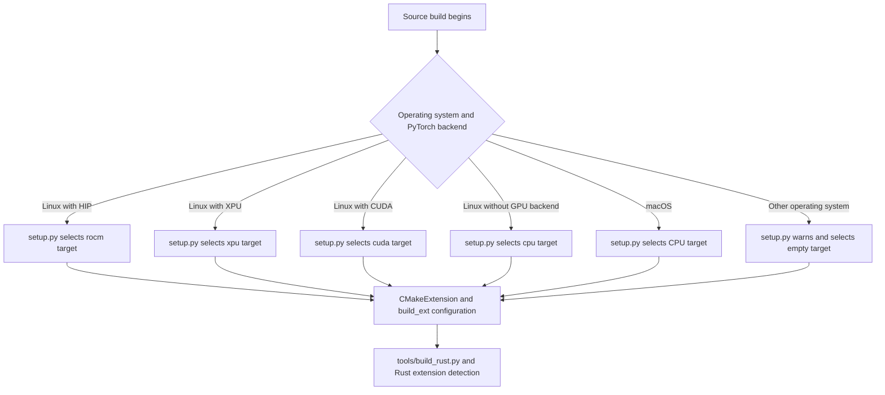
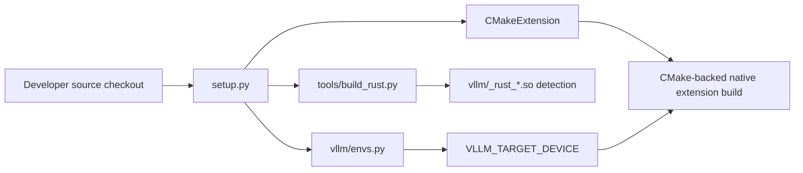
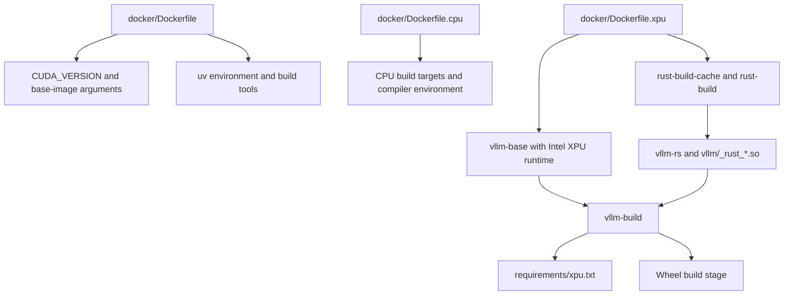
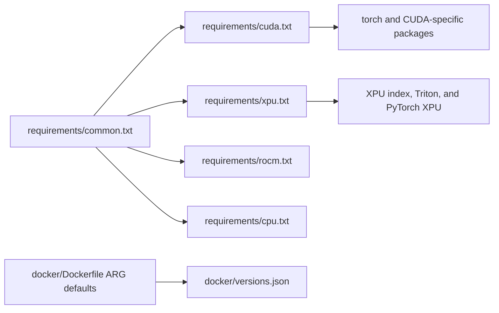
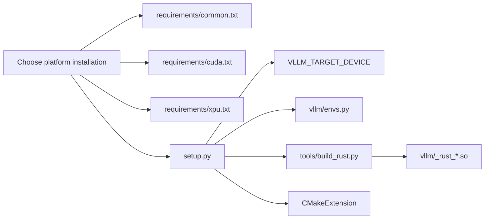
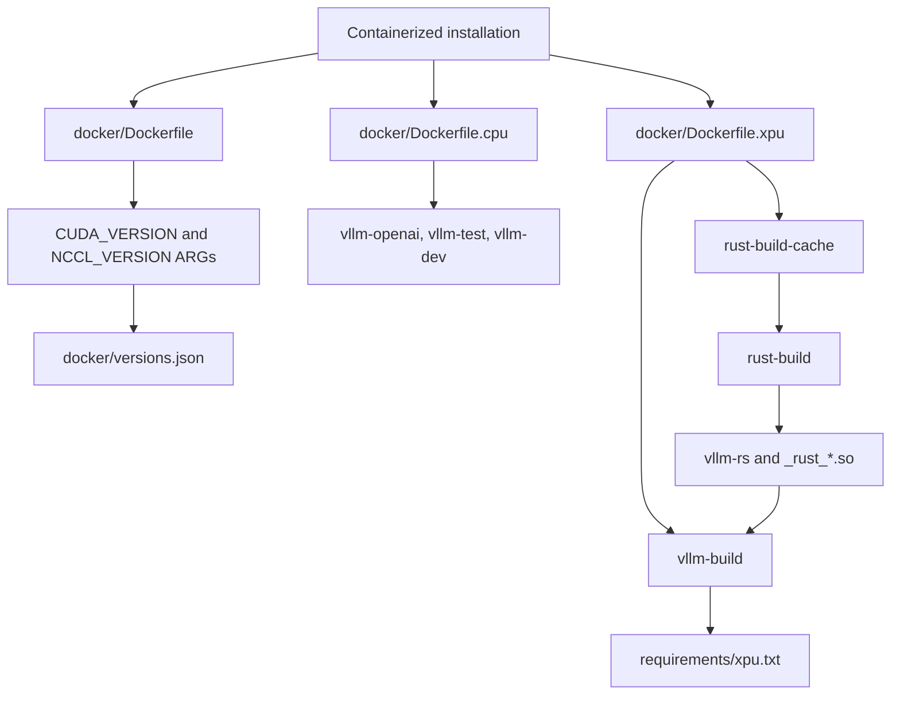

<!-- source: DeepWiki mcp.deepwiki.com · repo vllm-project/vllm · page 1.1 Getting Started and Installation · fetched 2026-10-28 -->

# Getting Started and Installation

Relevant source files

The following files were used as context for generating this wiki page:

- [.buildkite/ci_config_intel.yaml](.buildkite/ci_config_intel.yaml)
- [.buildkite/image_build/image_build.sh](.buildkite/image_build/image_build.sh)
- [.buildkite/image_build/image_build.yaml](.buildkite/image_build/image_build.yaml)
- [.buildkite/image_build/image_build_arm64.sh](.buildkite/image_build/image_build_arm64.sh)
- [.buildkite/image_build/image_build_cpu.sh](.buildkite/image_build/image_build_cpu.sh)
- [.buildkite/image_build/image_build_cpu_arm64.sh](.buildkite/image_build/image_build_cpu_arm64.sh)
- [.buildkite/image_build/image_build_hpu.sh](.buildkite/image_build/image_build_hpu.sh)
- [.buildkite/image_build/image_build_torch_nightly.sh](.buildkite/image_build/image_build_torch_nightly.sh)
- [.buildkite/image_build/image_build_xpu.sh](.buildkite/image_build/image_build_xpu.sh)
- [.buildkite/image_build/zstd.hcl](.buildkite/image_build/zstd.hcl)
- [.buildkite/release-pipeline.yaml](.buildkite/release-pipeline.yaml)
- [.buildkite/scripts/annotate-image-build.sh](.buildkite/scripts/annotate-image-build.sh)
- [.buildkite/scripts/docker-build-metadata-args.sh](.buildkite/scripts/docker-build-metadata-args.sh)
- [.buildkite/scripts/hardware_ci/run-intel-test.sh](.buildkite/scripts/hardware_ci/run-intel-test.sh)
- [.buildkite/scripts/publish-release-images.sh](.buildkite/scripts/publish-release-images.sh)
- [.buildkite/scripts/publish-zstd-image.sh](.buildkite/scripts/publish-zstd-image.sh)
- [.buildkite/scripts/push-nightly-builds-cpu.sh](.buildkite/scripts/push-nightly-builds-cpu.sh)
- [.buildkite/scripts/upload-release-wheels-pypi.sh](.buildkite/scripts/upload-release-wheels-pypi.sh)
- [.buildkite/scripts/xpu/push-nightly-builds-xpu.sh](.buildkite/scripts/xpu/push-nightly-builds-xpu.sh)
- [README.md](README.md)
- [docker/Dockerfile](docker/Dockerfile)
- [docker/Dockerfile.cpu](docker/Dockerfile.cpu)
- [docker/Dockerfile.xpu](docker/Dockerfile.xpu)
- [docker/docker-bake.hcl](docker/docker-bake.hcl)
- [docker/entrypoints/test_vllm_nonroot_entrypoint.sh](docker/entrypoints/test_vllm_nonroot_entrypoint.sh)
- [docker/entrypoints/vllm-nonroot-entrypoint.sh](docker/entrypoints/vllm-nonroot-entrypoint.sh)
- [docker/versions.json](docker/versions.json)
- [docs/assets/contributing/dockerfile-stages-dependency.png](docs/assets/contributing/dockerfile-stages-dependency.png)
- [docs/assets/models/pooling_models/cheat_sheet.svg](docs/assets/models/pooling_models/cheat_sheet.svg)
- [docs/assets/models/pooling_models/pooling_types.svg](docs/assets/models/pooling_models/pooling_types.svg)
- [docs/assets/models/pooling_models/score_types.svg](docs/assets/models/pooling_models/score_types.svg)
- [docs/benchmarking/README.md](docs/benchmarking/README.md)
- [docs/configuration/README.md](docs/configuration/README.md)
- [docs/configuration/serve_args.md](docs/configuration/serve_args.md)
- [docs/contributing/dockerfile/dockerfile.md](docs/contributing/dockerfile/dockerfile.md)
- [docs/deployment/docker.md](docs/deployment/docker.md)
- [docs/features/structured_outputs.md](docs/features/structured_outputs.md)
- [docs/getting_started/installation/README.md](docs/getting_started/installation/README.md)
- [docs/getting_started/installation/gpu.apple.inc.md](docs/getting_started/installation/gpu.apple.inc.md)
- [docs/getting_started/installation/gpu.cuda.inc.md](docs/getting_started/installation/gpu.cuda.inc.md)
- [docs/getting_started/installation/gpu.md](docs/getting_started/installation/gpu.md)
- [docs/getting_started/installation/gpu.rocm.inc.md](docs/getting_started/installation/gpu.rocm.inc.md)
- [docs/getting_started/installation/gpu.xpu.inc.md](docs/getting_started/installation/gpu.xpu.inc.md)
- [docs/getting_started/quickstart.md](docs/getting_started/quickstart.md)
- [docs/models/generative_models.md](docs/models/generative_models.md)
- [docs/usage/troubleshooting.md](docs/usage/troubleshooting.md)
- [requirements/common.txt](requirements/common.txt)
- [requirements/cuda.txt](requirements/cuda.txt)
- [requirements/rocm.txt](requirements/rocm.txt)
- [requirements/rubin-prerelease.txt](requirements/rubin-prerelease.txt)
- [requirements/test/cpu.txt](requirements/test/cpu.txt)
- [requirements/test/cuda.in](requirements/test/cuda.in)
- [requirements/test/cuda.txt](requirements/test/cuda.txt)
- [requirements/test/nightly-torch.txt](requirements/test/nightly-torch.txt)
- [requirements/test/rocm.in](requirements/test/rocm.in)
- [requirements/test/rocm.txt](requirements/test/rocm.txt)
- [requirements/test/xpu.in](requirements/test/xpu.in)
- [requirements/test/xpu.txt](requirements/test/xpu.txt)
- [requirements/xpu.txt](requirements/xpu.txt)
- [setup.py](setup.py)
- [tests/cuda/test_cuda_compatibility_path.py](tests/cuda/test_cuda_compatibility_path.py)
- [tests/evals/gpt_oss/configs/gpt-oss-20b-sm120.yaml](tests/evals/gpt_oss/configs/gpt-oss-20b-sm120.yaml)
- [tests/evals/gpt_oss/configs/models-spark.txt](tests/evals/gpt_oss/configs/models-spark.txt)
- [tests/samplers/conftest.py](tests/samplers/conftest.py)
- [tools/build_nixl_with_torch215_for_rubin.py](tools/build_nixl_with_torch215_for_rubin.py)
- [tools/build_triton_from_source.sh](tools/build_triton_from_source.sh)
- [tools/ci/kernel_symbol_map.py](tools/ci/kernel_symbol_map.py)
- [tools/flashinfer-build.sh](tools/flashinfer-build.sh)
- [tools/install_triton_from_source.sh](tools/install_triton_from_source.sh)
- [tools/pre_commit/update-dockerfile-graph.sh](tools/pre_commit/update-dockerfile-graph.sh)

## Purpose and Scope

This page describes the installation options represented in the supplied build and dependency files: platform-specific Python dependencies, source-build configuration, and Docker build inputs. It also identifies what those files do—and do not—establish about hardware requirements, quickstart usage, and platform-specific instructions. [setup.py:61-121](), [requirements/common.txt:1-59](), [requirements/cuda.txt:1-33](), [requirements/xpu.txt:1-23](), [docker/Dockerfile:25-46](), [docker/Dockerfile.cpu:1-18]()

Sources: `setup.py`, `requirements/common.txt`, `requirements/cuda.txt`, `requirements/xpu.txt`, `docker/Dockerfile`, `docker/Dockerfile.cpu`

## Hardware Requirements and Platform Matrix

The installation configuration distinguishes CUDA, ROCm, XPU, and CPU targets. On Linux, `setup.py` detects the target from the installed PyTorch build when `VLLM_TARGET_DEVICE` is unset: it checks HIP, XPU, and CUDA in that order, and otherwise selects CPU. On macOS, it changes a non-CPU target to CPU; on other operating systems it warns that support may be incomplete and selects the `empty` target. [setup.py:99-121]()

| Target | Evidence in the supplied files | Installation considerations |
|---|---|---|
| CUDA | `requirements/cuda.txt` includes a pinned PyTorch stack and CUDA-oriented packages, including `flashinfer-python`, `apache-tvm-ffi`, and NVIDIA CUTLASS DSL packages. [requirements/cuda.txt:1-33]() | Use the CUDA-specific dependency set; the supplied file does not specify minimum GPU compute capability. |
| ROCm | `setup.py` recognizes a HIP-enabled PyTorch installation as `rocm`. [setup.py:110-115]() | A ROCm requirements file is referenced elsewhere in the repository listing, but its contents are not included here. |
| XPU | `requirements/xpu.txt` selects an XPU Triton wheel, PyTorch’s XPU index, and XPU-specific packages. [requirements/xpu.txt:1-23]() | XPU runtime components are also installed in `docker/Dockerfile.xpu`. [docker/Dockerfile.xpu:42-86]() |
| CPU | `setup.py` selects CPU when no GPU backend is detected; the CPU Dockerfile documents `linux/amd64` and `linux/arm64` as supported build platforms. [setup.py:110-121](), [docker/Dockerfile.cpu:1-18]() | The supplied CPU Dockerfile provisions compilers and system packages for its build environment. [docker/Dockerfile.cpu:87-128]() |
| macOS | `setup.py` forces the target to CPU when running on macOS and a non-CPU target was selected. [setup.py:99-101]() | The available release-pipeline excerpt shows a macOS arm64 CPU wheel build job. [.buildkite/release-pipeline.yaml:76-92]() |

The files provided do not establish GPU memory requirements, supported GPU compute-capability floors, or detailed ROCm and Apple installation procedures. Consult the platform installation documentation for those details; those document contents were not supplied for this page.

Sources: `setup.py`, `requirements/cuda.txt`, `requirements/xpu.txt`, `docker/Dockerfile.xpu`, `docker/Dockerfile.cpu`, `.buildkite/release-pipeline.yaml`

## Installation Paths

### 1. Pre-Compiled Wheels and Platform Dependencies

The requirements files divide dependencies into a shared set and device-specific sets. `requirements/common.txt` contains shared Python dependencies, including Transformers, FastAPI, tokenizers, and multimodal-related libraries. The CUDA requirements include the common file and specify CUDA-targeted dependencies and PyTorch versions. The XPU requirements likewise include common dependencies, then add XPU package indexes, Triton, and PyTorch XPU packages. [requirements/common.txt:1-59](), [requirements/cuda.txt:1-33](), [requirements/xpu.txt:1-23]()

The provided files show how platform dependency sets are composed, but do not include the platform installation documentation or wheel-install commands. In particular, no specific `uv` or `pip` command, wheel index URL, or stable-versus-nightly installation procedure can be verified from the supplied file contents.

Sources: `requirements/common.txt`, `requirements/cuda.txt`, `requirements/xpu.txt`

### 2. Building from Source

`setup.py` loads `vllm/envs.py` directly to determine `VLLM_TARGET_DEVICE` before the package is installed. It also loads `tools/build_rust.py`, reads the precompiled-extension settings, and provides helpers to detect whether the required Rust extension modules are already present. The build configuration defines `CMakeExtension` for CMake-backed native extensions. [setup.py:38-66](), [setup.py:69-92](), [setup.py:202-208]()

Platform selection affects which target the build uses. Linux builds infer the device from the installed PyTorch runtime unless `VLLM_TARGET_DEVICE` is set; the target can therefore be selected explicitly or inferred as ROCm, XPU, CUDA, or CPU. macOS selects CPU, and unsupported operating systems receive a warning and use the `empty` target. [setup.py:99-121]()

The supplied `setup.py` excerpt establishes the target-detection and extension-build entry points, but does not show the complete build commands or all compilation steps. The supplied Dockerfile excerpts show that Docker wheel-build flows install platform dependencies, copy source into the build stage, and use `setup.py`-detected precompiled Rust artifacts in the XPU build. [docker/Dockerfile.xpu:142-165]()

#### Source-build selection flow

Sources: `setup.py:38-66`, `setup.py:69-121`, `setup.py:202-208`

#### Source-build implementation map

Sources: `setup.py:38-66`, `setup.py:69-92`, `setup.py:202-208`

### 3. Containerized Deployment (Docker)

The CUDA-oriented `docker/Dockerfile` uses build arguments to set CUDA, Python, Ubuntu, NCCL, and image defaults. It parameterizes the build and final base images, and includes arguments for package indexes and optional KV-connector and NIXL builds. Its initial `base` stage configures the `uv` environment and installs build tools. [docker/Dockerfile:25-46](), [docker/Dockerfile:66-98](), [docker/Dockerfile:100-156]()

The CPU Dockerfile documents `vllm-openai`, `vllm-test`, and `vllm-dev` build targets, with support for `linux/amd64` and `linux/arm64`. Its shared base provisions compilers, `uv`, and a virtual environment. The excerpt also describes optional `sccache` configuration. [docker/Dockerfile.cpu:1-18](), [docker/Dockerfile.cpu:21-53](), [docker/Dockerfile.cpu:80-128]()

The XPU Dockerfile builds the Rust frontend in separate stages, prepares an Ubuntu-based XPU environment, installs Intel graphics and compute-runtime packages, and defines a `vllm-build` stage that installs XPU requirements and copies Rust build artifacts into the source tree. [docker/Dockerfile.xpu:1-40](), [docker/Dockerfile.xpu:42-86](), [docker/Dockerfile.xpu:142-165]()

The supplied Dockerfile excerpts do not establish image registry names, published image tags, or complete `docker build` and `docker run` commands. Refer to the deployment documentation for supported image names and runtime instructions; its contents were not supplied here.

#### Docker build and artifact flow

Sources: `docker/Dockerfile:25-46`, `docker/Dockerfile:100-156`, `docker/Dockerfile.cpu:1-18`, `docker/Dockerfile.cpu:80-128`, `docker/Dockerfile.xpu:1-40`, `docker/Dockerfile.xpu:42-86`, `docker/Dockerfile.xpu:142-165`

## Dependency Management and Package Variants

Dependency files use a shared base plus platform-specific requirements. The CUDA and XPU files explicitly include `requirements/common.txt`; the CUDA file pins PyTorch-related packages and adds CUDA-oriented dependencies, while the XPU file configures XPU-specific package indexes and dependencies. [requirements/common.txt:1-59](), [requirements/cuda.txt:1-33](), [requirements/xpu.txt:1-23]()

| Requirements file | Role demonstrated by the supplied contents |
|---|---|
| `requirements/common.txt` | Shared runtime dependencies, including model, API, tokenizer, multimodal, and observability libraries. [requirements/common.txt:1-59]() |
| `requirements/cuda.txt` | Common dependencies plus CUDA-targeted PyTorch and kernel-related packages. [requirements/cuda.txt:1-33]() |
| `requirements/xpu.txt` | Common dependencies plus XPU indexes, Triton, PyTorch XPU packages, and XPU-specific packages. [requirements/xpu.txt:1-23]() |
| `requirements/rocm.txt` | Referenced in the supplied repository file listing, but its contents are not available here. |
| `requirements/cpu.txt` | Referenced in the supplied repository file listing, but its contents are not available here. |

The Docker CUDA build arguments are documented as the source of truth for pinned Docker versions, with `docker/versions.json` described as generated for `docker buildx bake`. The supplied `versions.json` records defaults including CUDA 13.0.3, Python 3.12, Ubuntu 24.04, and NCCL 2.30.7. [docker/Dockerfile:9-22](), [docker/Dockerfile:25-34](), [docker/versions.json:1-23]()

#### Dependency and platform mapping

Sources: `requirements/common.txt:1-60`, `requirements/cuda.txt:1-34`, `requirements/xpu.txt:1-24`, `docker/Dockerfile:9-22`, `docker/Dockerfile:25-34`, `docker/versions.json:1-23`

## Quickstart Example

A quickstart command and Python inference example are not present in the supplied file contents. The repository listing includes `docs/getting_started/quickstart.md`, but its contents were not provided, so this page does not reproduce or infer its instructions. The supplied Dockerfile comment does identify the CUDA Dockerfile as intended to construct an image usable for the OpenAI-compatible server. [docker/Dockerfile:1-6]()

Sources: `docker/Dockerfile`

## Summary

- The supplied dependency files demonstrate shared, CUDA-specific, and XPU-specific requirement sets. [requirements/common.txt:1-59](), [requirements/cuda.txt:1-33](), [requirements/xpu.txt:1-23]()
- `setup.py` selects a build target using platform and PyTorch backend detection, and configures CMake-backed extensions and Rust extension detection. [setup.py:38-66](), [setup.py:69-121](), [setup.py:202-208]()
- The provided Dockerfiles illustrate CUDA, CPU, and XPU build-environment configuration; the excerpts do not establish published image names or full deployment commands. [docker/Dockerfile:25-46](), [docker/Dockerfile.cpu:1-18](), [docker/Dockerfile.xpu:1-40]()
- Detailed hardware thresholds and quickstart instructions require the corresponding documentation contents, which were not supplied for this page.

Sources: `setup.py`, `requirements/common.txt`, `requirements/cuda.txt`, `requirements/xpu.txt`, `docker/Dockerfile`, `docker/Dockerfile.cpu`, `docker/Dockerfile.xpu`

---

## Mapping Natural Language Systems to Code Entities

The diagrams below map installation concepts to the concrete configuration and build entities shown in the supplied files. They are intended as code-navigation aids, not as a complete description of undocumented wheel-install commands or runtime deployment procedures. [setup.py:38-66](), [setup.py:69-121](), [docker/Dockerfile:25-46](), [docker/Dockerfile.xpu:142-165]()

Sources: `setup.py`, `docker/Dockerfile`, `docker/Dockerfile.xpu`

### Installation concepts and setup entities

Sources: `requirements/common.txt:1-60`, `requirements/cuda.txt:1-34`, `requirements/xpu.txt:1-24`, `setup.py:38-66`, `setup.py:69-92`, `setup.py:99-121`, `setup.py:202-208`

### Container build concepts and Docker entities

Sources: `docker/Dockerfile:25-46`, `docker/versions.json:1-23`, `docker/Dockerfile.cpu:1-18`, `docker/Dockerfile.xpu:1-40`, `docker/Dockerfile.xpu:142-165`, `requirements/xpu.txt:1-24`

---

