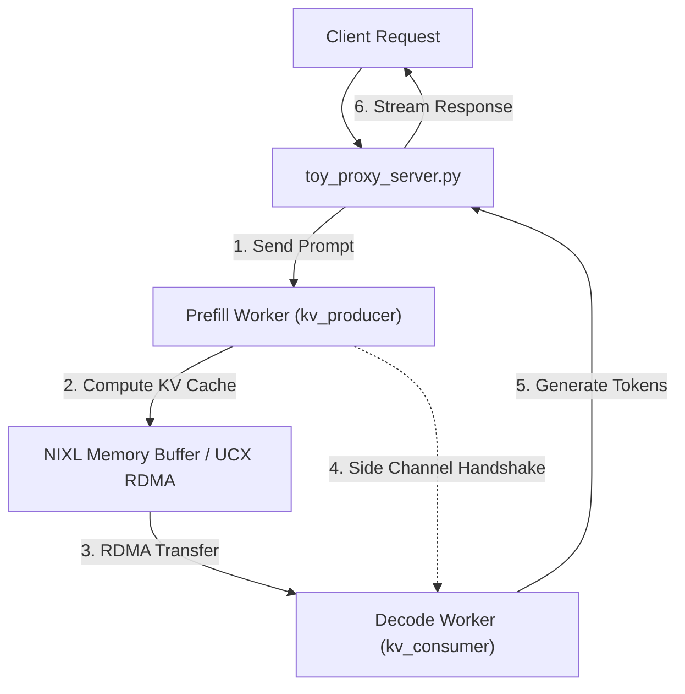
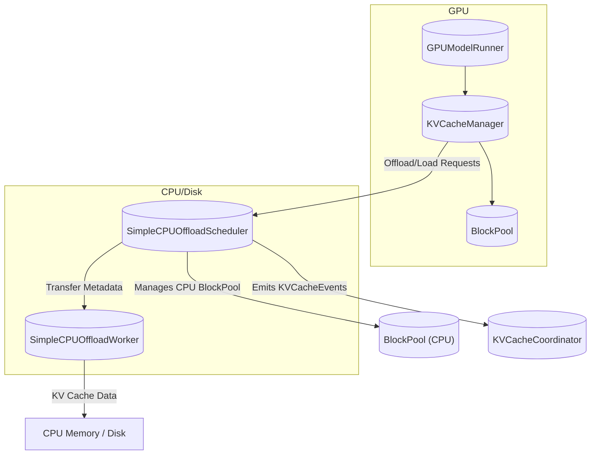
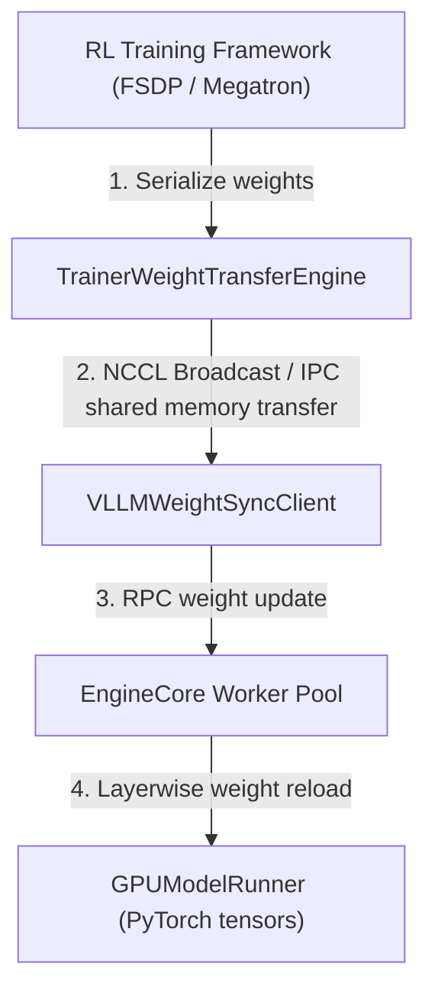

<!-- source: DeepWiki mcp.deepwiki.com · repo vllm-project/vllm · page 1.2 Examples and Usage Patterns · fetched 2026-10-28 -->

# Examples and Usage Patterns

<details>
<summary>Relevant source files</summary>

The following files were used as context for generating this wiki page:

- [docs/models/pooling_models/README.md](docs/models/pooling_models/README.md)
- [docs/models/pooling_models/reward.md](docs/models/pooling_models/reward.md)
- [docs/models/pooling_models/scoring.md](docs/models/pooling_models/scoring.md)
- [docs/models/pooling_models/specific_models.md](docs/models/pooling_models/specific_models.md)
- [docs/models/pooling_models/token_embed.md](docs/models/pooling_models/token_embed.md)
- [docs/training/async_rl.md](docs/training/async_rl.md)
- [docs/training/weight_transfer/README.md](docs/training/weight_transfer/README.md)
- [docs/training/weight_transfer/base.md](docs/training/weight_transfer/base.md)
- [docs/training/weight_transfer/ipc.md](docs/training/weight_transfer/ipc.md)
- [docs/training/weight_transfer/nccl.md](docs/training/weight_transfer/nccl.md)
- [examples/rl/rlhf_http_ipc.py](examples/rl/rlhf_http_ipc.py)
- [examples/rl/rlhf_http_nccl.py](examples/rl/rlhf_http_nccl.py)
- [examples/rl/rlhf_ipc_fsdp_ep.py](examples/rl/rlhf_ipc_fsdp_ep.py)
- [examples/rl/rlhf_sparse_nccl.py](examples/rl/rlhf_sparse_nccl.py)
- [tests/distributed/test_packed_tensor.py](tests/distributed/test_packed_tensor.py)
- [tests/distributed/test_weight_transfer.py](tests/distributed/test_weight_transfer.py)
- [tests/entrypoints/launchers/api_server/test_api_server_process_manager.py](tests/entrypoints/launchers/api_server/test_api_server_process_manager.py)
- [tests/entrypoints/pooling/scoring/test_bi_encoder_online.py](tests/entrypoints/pooling/scoring/test_bi_encoder_online.py)
- [tests/entrypoints/pooling/scoring/test_cross_encoder_offline.py](tests/entrypoints/pooling/scoring/test_cross_encoder_offline.py)
- [tests/entrypoints/pooling/scoring/test_cross_encoder_online.py](tests/entrypoints/pooling/scoring/test_cross_encoder_online.py)
- [tests/entrypoints/pooling/scoring/test_cross_encoder_online_vision.py](tests/entrypoints/pooling/scoring/test_cross_encoder_online_vision.py)
- [tests/entrypoints/pooling/scoring/test_io_processor_unit.py](tests/entrypoints/pooling/scoring/test_io_processor_unit.py)
- [tests/entrypoints/pooling/scoring/test_jina_ranking_io_processor_unit.py](tests/entrypoints/pooling/scoring/test_jina_ranking_io_processor_unit.py)
- [tests/entrypoints/pooling/scoring/test_late_interaction_online_vision.py](tests/entrypoints/pooling/scoring/test_late_interaction_online_vision.py)
- [tests/entrypoints/pooling/scoring/test_utils.py](tests/entrypoints/pooling/scoring/test_utils.py)
- [tests/entrypoints/serve/utils/test_api_utils.py](tests/entrypoints/serve/utils/test_api_utils.py)
- [tests/models/language/pooling_mteb_test/test_nemotron.py](tests/models/language/pooling_mteb_test/test_nemotron.py)
- [tests/models/multimodal/pooling/test_colultravbert.py](tests/models/multimodal/pooling/test_colultravbert.py)
- [tests/v1/core/test_kv_sharing.py](tests/v1/core/test_kv_sharing.py)
- [tests/v1/distributed/test_async_llm_dp.py](tests/v1/distributed/test_async_llm_dp.py)
- [tests/v1/engine/test_core_engine_actor_manager.py](tests/v1/engine/test_core_engine_actor_manager.py)
- [tests/v1/engine/test_dp_world_group_port.py](tests/v1/engine/test_dp_world_group_port.py)
- [tests/v1/engine/test_engine_core.py](tests/v1/engine/test_engine_core.py)
- [tests/v1/engine/test_engine_core_client.py](tests/v1/engine/test_engine_core_client.py)
- [tests/v1/engine/test_startup_watch_processes.py](tests/v1/engine/test_startup_watch_processes.py)
- [vllm/config/weight_transfer.py](vllm/config/weight_transfer.py)
- [vllm/distributed/weight_transfer/__init__.py](vllm/distributed/weight_transfer/__init__.py)
- [vllm/distributed/weight_transfer/base.py](vllm/distributed/weight_transfer/base.py)
- [vllm/distributed/weight_transfer/factory.py](vllm/distributed/weight_transfer/factory.py)
- [vllm/distributed/weight_transfer/ipc_engine.py](vllm/distributed/weight_transfer/ipc_engine.py)
- [vllm/distributed/weight_transfer/nccl_engine.py](vllm/distributed/weight_transfer/nccl_engine.py)
- [vllm/distributed/weight_transfer/packed_tensor.py](vllm/distributed/weight_transfer/packed_tensor.py)
- [vllm/distributed/weight_transfer/sparse_nccl_engine.py](vllm/distributed/weight_transfer/sparse_nccl_engine.py)
- [vllm/engine/protocol.py](vllm/engine/protocol.py)
- [vllm/entrypoints/cli/serve.py](vllm/entrypoints/cli/serve.py)
- [vllm/entrypoints/llm.py](vllm/entrypoints/llm.py)
- [vllm/entrypoints/pooling/offline.py](vllm/entrypoints/pooling/offline.py)
- [vllm/entrypoints/pooling/scoring/io_processor.py](vllm/entrypoints/pooling/scoring/io_processor.py)
- [vllm/entrypoints/pooling/scoring/protocol.py](vllm/entrypoints/pooling/scoring/protocol.py)
- [vllm/entrypoints/pooling/scoring/utils.py](vllm/entrypoints/pooling/scoring/utils.py)
- [vllm/entrypoints/serve/utils/api_utils.py](vllm/entrypoints/serve/utils/api_utils.py)
- [vllm/model_executor/models/colultravbert.py](vllm/model_executor/models/colultravbert.py)
- [vllm/transformers_utils/configs/colultravbert.py](vllm/transformers_utils/configs/colultravbert.py)
- [vllm/v1/core/sched/interface.py](vllm/v1/core/sched/interface.py)
- [vllm/v1/engine/__init__.py](vllm/v1/engine/__init__.py)
- [vllm/v1/engine/async_llm.py](vllm/v1/engine/async_llm.py)
- [vllm/v1/engine/coordinator.py](vllm/v1/engine/coordinator.py)
- [vllm/v1/engine/core.py](vllm/v1/engine/core.py)
- [vllm/v1/engine/core_client.py](vllm/v1/engine/core_client.py)
- [vllm/v1/engine/llm_engine.py](vllm/v1/engine/llm_engine.py)
- [vllm/v1/engine/utils.py](vllm/v1/engine/utils.py)
- [vllm/v1/utils.py](vllm/v1/utils.py)

</details>


## Purpose and Scope

This section provides a comprehensive technical tour of the `examples/` directory and key usage patterns in the vLLM codebase. It bridges user workflows such as batch offline inference, online API serving, disaggregated prefill-decode serving, pooling/embedding, RL weight transfer, speech-to-text, tool calling, and observability dashboards with their corresponding code entities, classes, and data flows.

---

## 1. Offline Inference

Offline inference supports high-throughput, batch processing of prompts without running a persistent API server. It uses the synchronous `LLM` engine interface to manage GPU resources, batching, and token generation.

- Inputs support multimodal data including images, audio, and video via prompt dictionaries containing `multi_modal_data` fields compatible with `vllm.inputs.MultiModalDataDict`.
- Multi-modal data can include raw PIL images, URLs, or precomputed embeddings.
- Examples instantiate an `LLM` object with a model and then call `.generate()` with prompt text and multimodal attachments.

Example snippet:

```python
from vllm import LLM
import PIL.Image

llm = LLM(model="llava-hf/llava-1.5-7b-hf")
image = PIL.Image.open("example.jpg")

outputs = llm.generate({
    "prompt": "USER: <image>\nWhat is in the image?\nASSISTANT:",
    "multi_modal_data": {"image": image},
})

for output in outputs:
    print(output.outputs[0].text)
```

This uses the offline engine's batching, GPU execution, and handles multimodal prompt parsing internally.

Sources: [docs/features/multimodal_inputs.md:16-69]()

---

## 2. Online Serving and OpenAI-Compatible API

vLLM supports an asynchronous FastAPI-based online serving application exposing APIs compatible with OpenAI endpoints:

- Endpoints include `/v1/chat/completions`, `/v1/completions`, `/v1/embeddings`, plus multimodal and pooling routers.
- The server runs an `AsyncLLM` backed by a pool of `EngineCore` workers.
- Requests are processed asynchronously with streaming token responses delivered via Server-Sent Events (SSE).

Invoke:

```bash
vllm serve Qwen/Qwen3-0.6B --port 8000 --max-model-len 2048 --tensor-parallel-size 1
```

Internal key classes:

- `AsyncLLM` [vllm/v1/engine/async_llm.py:93-111]() manages the engine lifecycle and concurrency. It uses `EngineCoreClient` [vllm/v1/engine/async_llm.py:58]() to communicate with the `EngineCore`.
- `EngineCore` [vllm/v1/engine/core.py:117-127]() executes requests on GPUs.
- FastAPI route registration binds HTTP routes to engine handlers in files like `vllm/entrypoints/cli/serve.py` [vllm/entrypoints/cli/serve.py:19]().

Sources: [vllm/entrypoints/cli/serve.py:19](), [vllm/v1/engine/async_llm.py:93-111](), [vllm/v1/engine/async_llm.py:58](), [vllm/v1/engine/core.py:117-127]()

---

## 3. Disaggregated Serving (Prefill-Decode Split)

Disaggregated serving separates the prompt "prefill" (key-value cache computation) and token "decode" (auto-regressive generation) phases across distinct GPU sets. This architecture mitigates GPU memory bottlenecks and balances throughput.

### Data Flow



#### Configuration

Producer and consumer are configured with matching KV transfer settings, e.g.:

```bash
# Prefill worker command
vllm serve Qwen/Qwen3-0.6B --port 8100 --kv-transfer-config '{"kv_connector":"NixlConnector","kv_role":"kv_producer"}'

# Decode worker command
vllm serve Qwen/Qwen3-0.6B --port 8200 --kv-transfer-config '{"kv_connector":"NixlConnector","kv_role":"kv_consumer"}'
```

This sets up a zero-copy, RDMA-based KV cache transfer over UCX or NIXL, enabling memory sharing for KV decoded states.

Sources: [docs/features/nixl_connector_usage.md:1-124](), [tests/v1/kv_connector/nixl_integration/run_accuracy_test.sh:40-64]()

---

### Simple CPU Offload Connector

The `SimpleCPUOffloadConnector` provides a basic mechanism for offloading KV cache blocks to CPU memory or disk. This is primarily used for prefix caching to reduce GPU memory footprint for frequently used prefixes.

#### Architecture



#### Implementation Details

The `SimpleCPUOffloadConnector` acts as the entry point, initializing either a `SimpleCPUOffloadScheduler` or a `SimpleCPUOffloadWorker`.
The `SimpleCPUOffloadScheduler` is responsible for:
- Deriving a CPU `KVCacheConfig` from the GPU configuration.
- Managing a `BlockPool` for CPU-resident KV cache blocks.
- Tracking `BlockStoreMeta` for events.
- Handling `_StoreAdmission` logic for offloading decisions.
- Emitting `KVCacheEvent`s for observability.

The `SimpleCPUOffloadWorker` (not fully shown in provided content) would handle the actual data transfer and storage on the CPU/disk.

Sources: [vllm/v1/simple_kv_offload/manager.py:1-198](), [vllm/distributed/kv_transfer/kv_connector/v1/simple_cpu_offload_connector.py:1-180](), [tests/v1/simple_kv_offload/test_scheduler.py:1-219]()

---

## 4. Pooling and Embedding Models

vLLM supports specialized pooling models for embedding generation, sequence classification, and reranking use cases.

- Use `PoolerConfig` and `PoolingParams` [vllm/pooling_params.py:1-100]() to specify the pooling strategy (e.g., CLS, LAST, MEAN, token-wise).
- Pooler runners extract fixed-size embeddings or classification logits.
- Supported tasks include embedding, classification, token classification, and scoring in retrieval pipelines.

Example usage:

```python
from vllm import LLM, PoolingParams

llm = LLM(model="BAAI/bge-large-en-v1.5", task="embed")
prompts = ["vLLM is a high-throughput LLM serving engine."]
results = llm.embed(prompts)

for r in results:
    print(r.outputs.embedding)
```

Pooling models work by applying sequence-wise or token-wise aggregation layers on model last hidden states, returning vectors suitable for similarity search or classification. The `ScoringIOProcessor` [vllm/entrypoints/pooling/scoring/io_processor.py:98-110]() is a key component for handling input and output for scoring models.

Sources: [vllm/multimodal/parse.py:163-200](), [docs/models/pooling_models/README.md:1-98](), [vllm/pooling_params.py:1-100](), [vllm/entrypoints/pooling/scoring/io_processor.py:98-110]()

---

## 5. RL Weight Transfer and Training Integration

vLLM supports hot weight transfer integration with RLHF and training frameworks enabling weight swapping without restarting inference engines.

### Weight Transfer Architecture



Key points:

- Implements backends for NCCL, shared memory IPC, and sparse weight transfers.
- `WeightTransferConfig` [vllm/config/weight_transfer.py:9-15]() specifies the backend (`"nccl"`, `"ipc"`, `"sparse_nccl"`, etc.).
- `TrainerWeightTransferEngine` [vllm/distributed/weight_transfer/base.py:36-40]() manages serialization and broadcasting.
- `VLLMWeightSyncClient` [vllm/distributed/weight_transfer/base.py:18-29]() receives weight updates and applies them on inference workers.
- Layerwise reload adapts model weights incrementally to maintain stability.

Example factory usage:

```python
from vllm.distributed.weight_transfer import WeightTransferEngineFactory

transfer_engine = WeightTransferEngineFactory.create_engine(vllm_config)
transfer_engine.poll_and_apply_updates()
```

#### NCCL Weight Transfer

The `NCCLWeightTransferEngine` [vllm/distributed/weight_transfer/nccl_engine.py:1-178]() uses NCCL for collective communication.
- `NCCLTrainerInitInfo` [vllm/distributed/weight_transfer/nccl_engine.py:18-24]() contains rendezvous information (`master_address`, `master_port`, `world_size`) and wire parameters (`packed`, `packed_buffer_size_bytes`, `packed_num_buffers`).
- `NCCLWeightTransferUpdateInfo` [vllm/distributed/weight_transfer/nccl_engine.py:27-31]() carries metadata (`names`, `dtype_names`, `shapes`) for the weights being updated.
- The `init_transfer_engine` method initializes the NCCL process group.
- `start_weight_update` and `finish_weight_update` manage the layerwise reload lifecycle.
- `receive_weights` performs the actual NCCL broadcast.

#### IPC Weight Transfer

The `IPCWeightTransferEngine` [vllm/distributed/weight_transfer/ipc_engine.py:1-174]() uses CUDA IPC for shared memory communication.
- `IPCTrainerInitInfo` [vllm/distributed/weight_transfer/ipc_engine.py:18-21]() specifies the `packed` mode and `packed_buffer_size_bytes`.
- `IPCWeightTransferUpdateInfo` [vllm/distributed/weight_transfer/ipc_engine.py:24-27]() includes `ipc_handles` (or `ipc_handles_pickled` for HTTP transport) and `tensor_sizes` for packed transfers.
- `init_transfer_engine` records the `packed` setting.
- `start_weight_update` and `finish_weight_update` manage layerwise reload.
- The `receive_weights` method (not fully shown) would reconstruct tensors from IPC handles.

Sources: [tests/distributed/test_weight_transfer.py:20-68](), [vllm/distributed/weight_transfer/base.py:36-40](), [vllm/distributed/weight_transfer/base.py:18-29](), [vllm/distributed/weight_transfer/ipc_engine.py:1-174](), [vllm/distributed/weight_transfer/ipc_engine.py:18-21](), [vllm/distributed/weight_transfer/ipc_engine.py:24-27](), [vllm/distributed/weight_transfer/nccl_engine.py:1-178](), [vllm/distributed/weight_transfer/nccl_engine.py:18-24](), [vllm/distributed/weight_transfer/nccl_engine.py:27-31](), [vllm/config/weight_transfer.py:9-15](), [examples/rl/rlhf_http_ipc.py](), [examples/rl/rlhf_http_nccl.py](), [examples/rl/rlhf_sparse_nccl.py](), [examples/rl/rlhf_ipc_fsdp_ep.py](), [examples/rl/rlhf_m2n.py]()

---

## 6. Speech-to-Text and Multimodal Integration

vLLM handles multimodal inputs including audio for speech-to-text transcription, images, and video through a unified ingestion pipeline.

- `MediaConnector` manages remote data retrieval, domain allowlists, download size limits, and format decoding.
- Audio inputs can be speech transcripts handled by whisper-like models.
- Multi-modal data is integrated into generation requests using `multi_modal_data` payloads.

Example:

```python
from vllm import LLM
from vllm.assets.audio import AudioAsset  # utility for audio loading

llm = LLM(model="openai/whisper-large-v3")
audio_asset = AudioAsset("winning_ticket")

outputs = llm.generate({
    "prompt": "<|startoftranscript|><|transcribe|><|notimestamps|><|endoftext|>",
    "multi_modal_data": {"audio": audio_asset.audio_and_sample_rate},
})
```

The connector enforces security against SSRF by `--allowed-media-domains` and file size constraints, and delegates decoded content to Hugging Face processors.

Sources: [vllm/multimodal/media/connector.py:35-181](), [docs/features/multimodal_inputs.md:10-15](), [vllm/multimodal/parse.py:163-200]()

---

## 7. Tool Calling and Structured Output

vLLM supports advanced tool/function calling and structured output generation directly within the OpenAI-compatible `/v1/chat/completions` API.

- The request processing pipeline parses and validates tool call schemas.
- `parse_chat_messages` normalizes messages, tools, and inserts required special tokens.
- Grammar-backed structured outputs enable JSON-schema constrained generation.

This functionality is tested in compliance with OpenAI schema conformance checks. The `before_generate_case` hook [tests/entrypoints/openai/test_openai_schema.py:80-117]() in the `test_openai_schema.py` ensures that `tool_calls` generated by Schemathesis have the correct `"type": "function"` and do not contain invalid `"custom"` fields.

Sources: [tests/entrypoints/openai/test_openai_schema.py:80-117](), [vllm/entrypoints/chat_utils.py:1-48]()

---

## 8. Observability and Benchmarking Dashboards

vLLM exposes Prometheus-compatible metrics and structured logs:

- Metrics include request latency, Time-To-First-Token (TTFT), Time Per Output Token (TPOT), KV cache utilization, and request queue lengths.
- Benchmarks such as `benchmark_serving.py` and `benchmark_serving_multi_turn.py` enable performance evaluation.

Use `vllm bench serve` to run throughput benchmarks against deployed models:

```bash
python benchmarks/multi_turn/benchmark_serving_multi_turn.py \
  --url http://localhost:8000/v1 \
  --model Qwen/Qwen3-0.6B \
  --num-clients 50 \
  --max-turns 5
```

#### Metrics Overview

vLLM provides a rich set of metrics for monitoring and capacity planning, primarily exposed via a Prometheus-compatible `/metrics` endpoint. These metrics are categorized into server-level (Gauges, Counters) and request-level (Histograms).

Key metrics include:
- `vllm:num_requests_running`: Number of requests currently in the RUNNING state.
- `vllm:kv_cache_usage_perc`: Fraction of used KV cache blocks.
- `vllm:prefix_cache_queries`, `vllm:prefix_cache_hits`: Counters for prefix cache activity.
- `vllm:prompt_tokens_total`, `vllm:generation_tokens_total`: Total tokens processed.
- `vllm:request_success_total`: Number of finished requests by reason.
- `vllm:request_prompt_tokens`, `vllm:request_generation_tokens`: Histograms for token counts.
- `vllm:time_to_first_token_seconds`: Histogram for TTFT.
- `vllm:inter_token_latency_seconds`: Histogram for inter-token latency.
- `vllm:request_time_per_output_token_seconds`: Histogram for per-request TPOT.
- `vllm:e2e_request_latency_seconds`: Histogram for end-to-end latency.

A reference Grafana dashboard is provided in `examples/observability/prometheus_grafana/README.md` and `examples/observability/prometheus_grafana/grafana.json` to visualize these metrics. The dashboard highlights critical metrics such as `vllm:e2e_request_latency_seconds_bucket`, `vllm:inter_token_latency_seconds`, and `vllm:kv_cache_usage_perc`.

The Prometheus client library `prometheus_client` is used for metric collection. Metrics are collected in the API server process, with multiprocess mode used when `--api-server-count > 1` for scale-out.

Sources: [benchmarks/multi_turn/benchmark_serving_multi_turn.py:47-70](), [vllm/benchmarks/serve.py:1-191](), [docs/design/metrics.md:1-106](), [docs/usage/metrics.md]()

---

# Diagrams Bridging Natural Language and Code Entity Spaces

### Disaggregated Serving Architecture — Code Entities

```mermaid
graph TD
    "ClientRequest" --> "toy_proxy_server.py"
    "toy_proxy_server.py" --> "PrefillWorker"["AsyncLLM (kv_producer)"]
    "PrefillWorker" --> "NixlMemoryBuffer"["KVBuffer (NIXL/UCX)"]
    "NixlMemoryBuffer" --> "DecodeWorker"["AsyncLLM (kv_consumer)"]
    "PrefillWorker" -.->|Handshake| "DecodeWorker"
    "DecodeWorker" --> "toy_proxy_server.py"
    "toy_proxy_server.py" --> "ClientResponse"
```
Sources: [vllm/v1/engine/async_llm.py:93-111]()

### RL Weight Transfer Pipeline — Code Entities

```mermaid
graph TD
    "RLTrainer" --> "WeightTransferTrainerEngine"["TrainerWeightTransferEngine (RLHF)"]
    "WeightTransferTrainerEngine" -->|NCCL Broadcast or IPC| "VLLMWeightSyncClient"
    "VLLMWeightSyncClient" --> "EngineCore"["EngineCore Worker Pool"]
    "EngineCore" --> "GPUModelRunner"["GPUModelRunner (PyTorch Tensor Model)"]
    "GPUModelRunner" --> "InferenceResults"
```
Sources: [vllm/distributed/weight_transfer/base.py:36-40](), [vllm/distributed/weight_transfer/base.py:18-29](), [vllm/v1/engine/core.py:117-127]()

---

# Summary Table of Example Categories and Key Code Entities

| Example Category | Key Code Entities | Example Dir/Files |
|---|---|---|
| Offline Inference | `LLM` [vllm/entrypoints/llm.py:62-64](), `SamplingParams` [vllm/sampling_params.py:1-100]() | `examples/generate/multimodal/vision_language_offline.py`, `examples/basic/offline_inference/basic.py` |
| Online Serving | `AsyncLLM` [vllm/v1/engine/async_llm.py:93-111](), `EngineCore` [vllm/v1/engine/core.py:117-127](), FastAPI routers | `vllm/entrypoints/cli/serve.py` |
| Disaggregated Serving | `kv_connector.NixlConnector`, `SimpleCPUOffloadConnector` | `examples/scale_out/`, `docs/features/nixl_connector_usage.md` |
| Pooling & Embedding Models | `PoolerConfig`, `PoolingParams` [vllm/pooling_params.py:1-100](), `ScoringIOProcessor` [vllm/entrypoints/pooling/scoring/io_processor.py:98-110]() | `examples/pooling/` |
| RL Weight Transfer | `WeightTransferTrainerEngine` [vllm/distributed/weight_transfer/base.py:36-40](), `VLLMWeightSyncClient` [vllm/distributed/weight_transfer/base.py:18-29](), `WeightTransferConfig` [vllm/config/weight_transfer.py:9-15]() | `examples/rl/rlhf_http_ipc.py`, `examples/rl/rlhf_http_nccl.py` |
| Speech-to-Text & Multimodal | `MediaConnector`, `AudioAsset` | `examples/multimodal/`, `examples/speech_to_text/` |
| Tool Calling & Structured Output | `parse_chat_messages`, `/v1/chat/completions` API | `tests/entrypoints/openai/test_openai_schema.py` |
| Observability & Benchmarking | `benchmarks/benchmark_serving.py`, `benchmarks/serve.py`, Prometheus metrics | `benchmarks/`, `examples/observability/prometheus_grafana/` |

---

This comprehensive tour exemplifies how vLLM’s examples and code modules map closely to its architectural components and usage scenarios, from batch inference and multimodal pipelines to scalable serving and RL integration.

Sources:
[vllm/benchmarks/serve.py:1-191](),
[tests/entrypoints/openai/test_openai_schema.py:32-49, 80-117](),
[docs/features/nixl_connector_usage.md:1-124](),
[tests/v1/kv_connector/nixl_integration/run_accuracy_test.sh:40-64](),
[vllm/multimodal/media/connector.py:35-181](),
[vllm/multimodal/parse.py:163-200](),
[vllm/distributed/weight_transfer/base.py:27-105](),
[vllm/distributed/weight_transfer/ipc_engine.py:1-174](),
[vllm/distributed/weight_transfer/nccl_engine.py:1-178](),
[vllm/config/weight_transfer.py:9-15](),
[benchmarks/multi_turn/benchmark_serving_multi_turn.py:47-70](),
[vllm/v1/simple_kv_offload/manager.py:1-198](),
[vllm/distributed/kv_transfer/kv_connector/v1/simple_cpu_offload_connector.py:1-180](),
[tests/v1/simple_kv_offload/test_scheduler.py:1-219](),
[docs/design/metrics.md:1-106](),
[docs/usage/metrics.md](),
[vllm/entrypoints/llm.py:62-64](),
[vllm/sampling_params.py:1-100](),
[vllm/v1/engine/async_llm.py:93-111](),
[vllm/v1/engine/core.py:117-127](),
[vllm/entrypoints/cli/serve.py:19](),
[vllm/v1/engine/async_llm.py:58](),
[vllm/pooling_params.py:1-100](),
[vllm/entrypoints/pooling/scoring/io_processor.py:98-110](),
[vllm/distributed/weight_transfer/base.py:36-40](),
[vllm/distributed/weight_transfer/base.py:18-29](),
[vllm/distributed/weight_transfer/ipc_engine.py:18-21](),
[vllm/distributed/weight_transfer/ipc_engine.py:24-27](),
[vllm/distributed/weight_transfer/nccl_engine.py:18-24](),
[vllm/distributed/weight_transfer/nccl_engine.py:27-31]()

---

