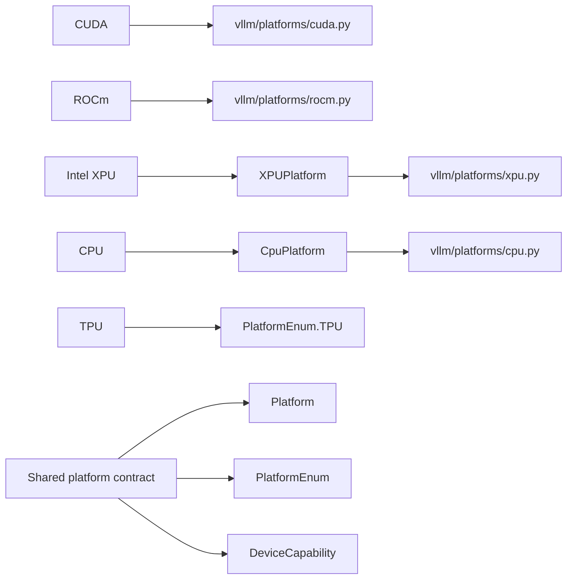
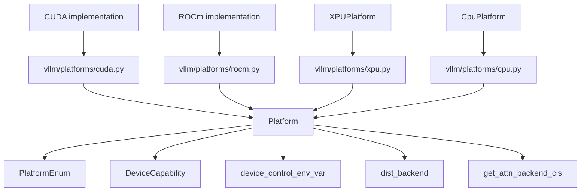
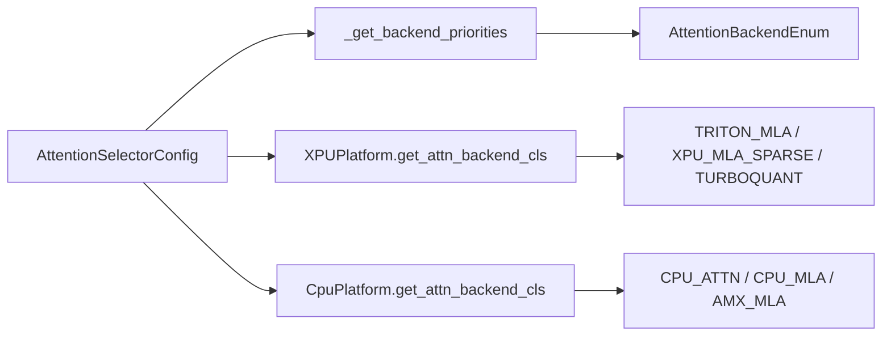

<!-- source: DeepWiki mcp.deepwiki.com · repo vllm-project/vllm · page 10 Platform Support · fetched 2026-10-28 -->

# Platform Support

Relevant source files

The following files were used as context for generating this wiki page:

- [.buildkite/hardware_tests/cpu.yaml](.buildkite/hardware_tests/cpu.yaml)
- [.buildkite/scripts/hardware_ci/run-cpu-distributed-smoke-test.sh](.buildkite/scripts/hardware_ci/run-cpu-distributed-smoke-test.sh)
- [.buildkite/scripts/hardware_ci/run-cpu-test-arm.sh](.buildkite/scripts/hardware_ci/run-cpu-test-arm.sh)
- [csrc/cpu/sgl-kernels/conv.cpp](csrc/cpu/sgl-kernels/conv.cpp)
- [csrc/cpu/sgl-kernels/fla.cpp](csrc/cpu/sgl-kernels/fla.cpp)
- [csrc/cpu/sgl-kernels/gemm.cpp](csrc/cpu/sgl-kernels/gemm.cpp)
- [csrc/cpu/utils.cpp](csrc/cpu/utils.cpp)
- [tests/kernels/mamba/cpu/test_cpu_gdn_ops.py](tests/kernels/mamba/cpu/test_cpu_gdn_ops.py)
- [tests/kernels/mamba/test_cpu_short_conv.py](tests/kernels/mamba/test_cpu_short_conv.py)
- [tests/platforms/test_cpu.py](tests/platforms/test_cpu.py)
- [tests/utils_/test_cpu_resource_utils.py](tests/utils_/test_cpu_resource_utils.py)
- [tests/v1/attention/test_mamba_metadata_builder.py](tests/v1/attention/test_mamba_metadata_builder.py)
- [tests/v1/e2e/test_cpu_linear_attn_chunked_prefix.py](tests/v1/e2e/test_cpu_linear_attn_chunked_prefix.py)
- [tests/v1/worker/test_cpu_worker_kv_budget.py](tests/v1/worker/test_cpu_worker_kv_budget.py)
- [vllm/model_executor/layers/mamba/ops/cpu/gdn_attention.py](vllm/model_executor/layers/mamba/ops/cpu/gdn_attention.py)
- [vllm/platforms/cpu.py](vllm/platforms/cpu.py)
- [vllm/platforms/cuda.py](vllm/platforms/cuda.py)
- [vllm/platforms/interface.py](vllm/platforms/interface.py)
- [vllm/platforms/rocm.py](vllm/platforms/rocm.py)
- [vllm/platforms/xpu.py](vllm/platforms/xpu.py)
- [vllm/utils/cpu_resource_utils.py](vllm/utils/cpu_resource_utils.py)
- [vllm/utils/ompmultiprocessing.py](vllm/utils/ompmultiprocessing.py)
- [vllm/v1/worker/cpu_worker.py](vllm/v1/worker/cpu_worker.py)

## Purpose and Scope

vLLM’s platform layer provides a shared `Platform` interface alongside hardware-specific implementations. The interface represents platform identity and common runtime properties, including device type, dispatch key, device-control environment variable, distributed backend, supported data types, and supported quantization methods [vllm/platforms/interface.py:138-180](). Platform implementations specialize behavior such as device queries and attention-backend selection [vllm/platforms/cuda.py:57-92]()[vllm/platforms/xpu.py:103-149]()[vllm/platforms/cpu.py:103-179]().

This page summarizes how the abstraction relates to the hardware implementations. For details, see [Platform Abstraction Layer](#10.1), [CUDA Platform](#10.2), [ROCm Platform](#10.3), and [XPU, CPU, and TPU Platforms](#10.4).

Sources: [vllm/platforms/interface.py:138-180](), [vllm/platforms/cuda.py:57-92](), [vllm/platforms/xpu.py:103-149](), [vllm/platforms/cpu.py:103-179]()

---

## Platform Abstraction Architecture

`PlatformEnum` names the platform categories represented in the abstraction, while `CpuArchEnum` distinguishes CPU architecture families. `DeviceCapability` provides an ordered major/minor capability value; platform-specific code can use such hardware information when making implementation choices [vllm/platforms/interface.py:72-136](). The shared interface is complemented by concrete platform classes, which supply platform-specific values and behavior [vllm/platforms/interface.py:138-180]().

### Platform Categories and Code Entities

**Hardware names mapped to platform symbols**

The platform names above map to the platform enum and implementation files visible in this source set. The shared `Platform` contract is the common point of reference; hardware-specific behavior remains in the corresponding implementations [vllm/platforms/interface.py:72-180]()[vllm/platforms/cuda.py:33-45]()[vllm/platforms/rocm.py:20-33]()[vllm/platforms/xpu.py:19-28]()[vllm/platforms/cpu.py:24-36]().

Sources: [vllm/platforms/interface.py:72-180](), [vllm/platforms/cuda.py:33-45](), [vllm/platforms/rocm.py:20-33](), [vllm/platforms/xpu.py:19-28](), [vllm/platforms/cpu.py:24-36]()

### Shared Interface and Specializations

The following diagram connects shared interface concepts to representative platform-specific symbols. It is an overview, not a complete inheritance or initialization sequence [vllm/platforms/interface.py:138-180]()[vllm/platforms/xpu.py:103-131]()[vllm/platforms/cpu.py:103-110]().

**Shared interface mapped to platform implementations**

Platform-specific implementations set or specialize shared properties. For example, `XPUPlatform` identifies its device type and dispatch key and specifies `xccl` as its distributed backend; `CpuPlatform` identifies CPU and uses `gloo` [vllm/platforms/xpu.py:103-112]()[vllm/platforms/cpu.py:103-110]().

Sources: [vllm/platforms/interface.py:138-180](), [vllm/platforms/xpu.py:103-112](), [vllm/platforms/cpu.py:103-110]()

---

## Hardware-Specific Implementations Overview

### CUDA Platform

The CUDA module is intended for CUDA-specific code and explicitly notes that importing it should not initialize a CUDA context [vllm/platforms/cuda.py:3-5](). It imports NVML utilities and contains device-count and attention-backend priority logic; backend priorities can depend on inputs including device capability and attention configuration [vllm/platforms/cuda.py:22-31]()[vllm/platforms/cuda.py:50-92](). For details, see [CUDA Platform](#10.2).

Sources: [vllm/platforms/cuda.py:3-5](), [vllm/platforms/cuda.py:22-31](), [vllm/platforms/cuda.py:50-92]()

### ROCm Platform

The ROCm implementation uses AMD SMI (`amdsmi`) for hardware queries, including a helper that reads the GPU ASIC’s `target_graphics_version` as its GCN architecture identifier [vllm/platforms/rocm.py:39-53]()[vllm/platforms/rocm.py:166-189](). It also checks consistency between `HIP_VISIBLE_DEVICES` and `CUDA_VISIBLE_DEVICES` at import time [vllm/platforms/rocm.py:138-157](). For details on ROCm capabilities and AMD-specific features, see [ROCm Platform](#10.3).

Sources: [vllm/platforms/rocm.py:39-53](), [vllm/platforms/rocm.py:138-157](), [vllm/platforms/rocm.py:166-189]()

### XPU, CPU, and TPU Platforms

`XPUPlatform` defines XPU device properties, uses `xccl` for distributed communication, and includes platform-specific attention selection logic [vllm/platforms/xpu.py:103-112]()[vllm/platforms/xpu.py:143-188](). `CpuPlatform` defines CPU device properties and chooses CPU attention backends, including handling for MLA and sparse attention [vllm/platforms/cpu.py:103-110]()[vllm/platforms/cpu.py:143-179]().

The CPU worker initializes CPU memory and distributed execution and constructs a CPU model runner [vllm/v1/worker/cpu_worker.py:32-40]()[vllm/v1/worker/cpu_worker.py:70-103]()[vllm/v1/worker/cpu_worker.py:147-178](). CPU support and limitations vary across kernels and configurations; for example, CPU attention selection explicitly rejects sparse attention [vllm/platforms/cpu.py:143-151](). The shared enum includes TPU, but TPU implementation details are covered by the child page [vllm/platforms/interface.py:72-82](). For details, see [XPU, CPU, and TPU Platforms](#10.4).

Sources: [vllm/platforms/interface.py:72-82](), [vllm/platforms/xpu.py:103-112](), [vllm/platforms/xpu.py:143-188](), [vllm/platforms/cpu.py:103-110](), [vllm/platforms/cpu.py:143-179](), [vllm/v1/worker/cpu_worker.py:32-40](), [vllm/v1/worker/cpu_worker.py:70-103](), [vllm/v1/worker/cpu_worker.py:147-178]()

---

## Attention Backend Selection and Routing

Platform-specific attention selection connects the common attention configuration to implementations suitable for a given device. CUDA defines backend priorities using hardware and attention parameters [vllm/platforms/cuda.py:83-92](). XPU and CPU provide their own `get_attn_backend_cls` implementations, with distinct branches for configurations such as sparse attention and MLA [vllm/platforms/xpu.py:143-188]()[vllm/platforms/cpu.py:143-179]().

**Platform methods mapped to attention backend symbols**

This diagram shows representative code entities rather than a universal backend-selection sequence. The platform methods and their conditions are implemented separately; consult the platform child pages for the detailed selection rules [vllm/platforms/cuda.py:83-176]()[vllm/platforms/xpu.py:143-188]()[vllm/platforms/cpu.py:143-179]().

Sources: [vllm/platforms/cuda.py:83-176](), [vllm/platforms/xpu.py:143-188](), [vllm/platforms/cpu.py:143-179]()

---

## Summary

The platform layer separates shared hardware-facing concepts from platform-specific implementation choices. `Platform`, `PlatformEnum`, and `DeviceCapability` provide common vocabulary, while CUDA, ROCm, XPU, and CPU modules supply their own device handling and backend behavior [vllm/platforms/interface.py:72-180]()[vllm/platforms/cuda.py:57-92]()[vllm/platforms/rocm.py:138-189]()[vllm/platforms/xpu.py:103-188]()[vllm/platforms/cpu.py:103-179]().

For code-level details, see [Platform Abstraction Layer](#10.1), [CUDA Platform](#10.2), [ROCm Platform](#10.3), and [XPU, CPU, and TPU Platforms](#10.4).

Sources: [vllm/platforms/interface.py:72-180](), [vllm/platforms/cuda.py:57-92](), [vllm/platforms/rocm.py:138-189](), [vllm/platforms/xpu.py:103-188](), [vllm/platforms/cpu.py:103-179]()

---

