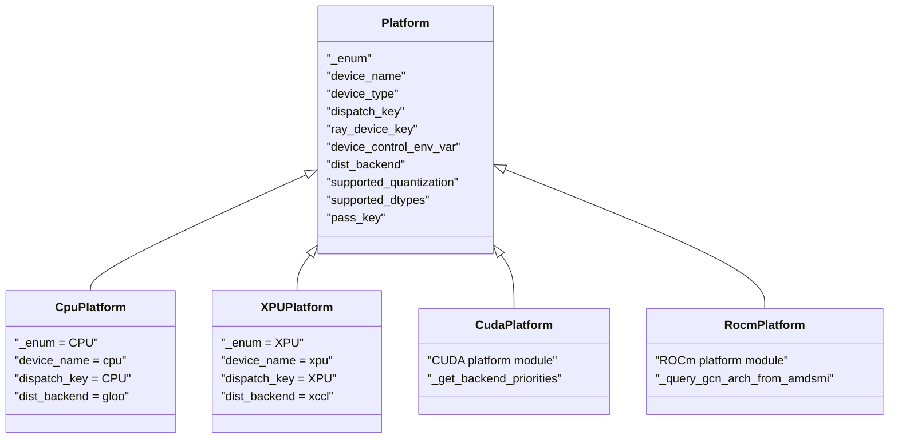
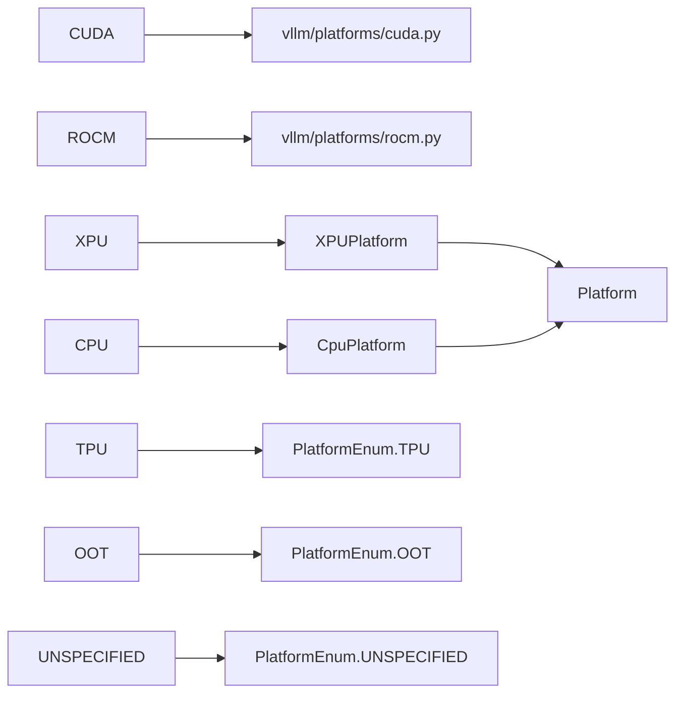
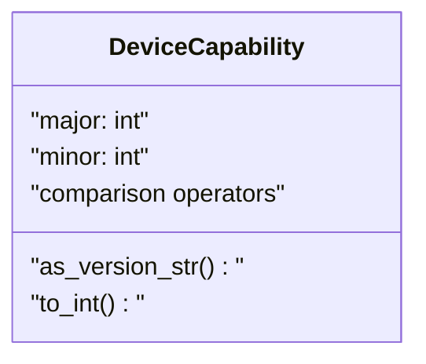
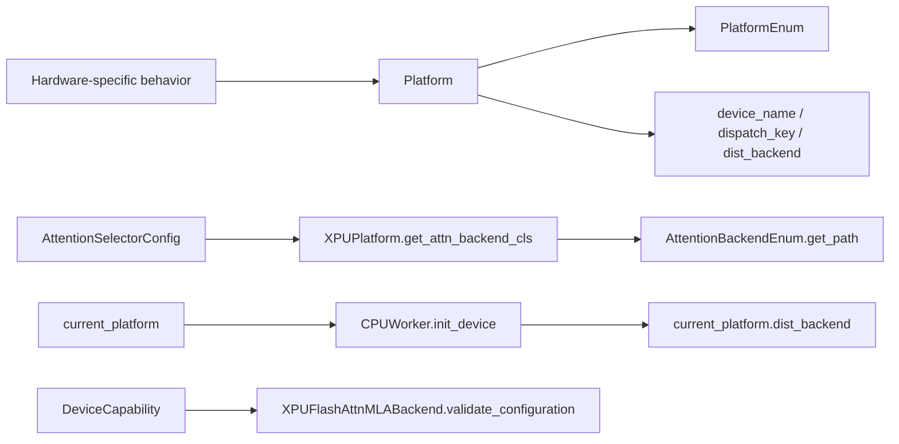
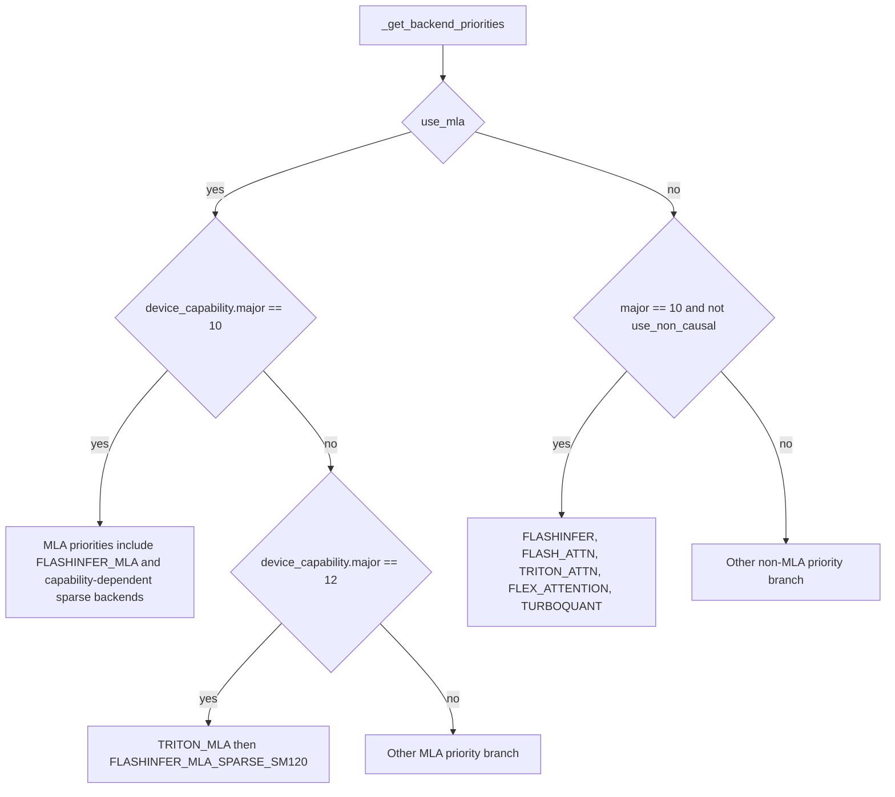
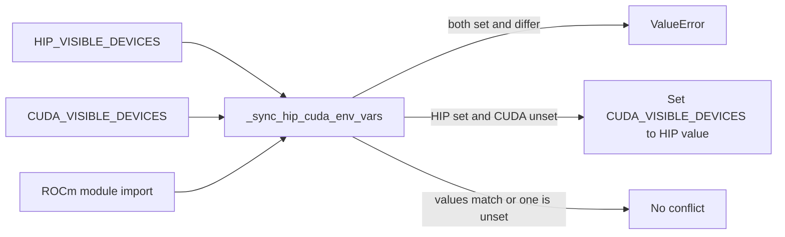
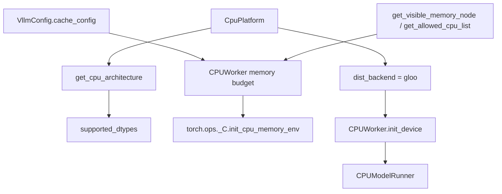
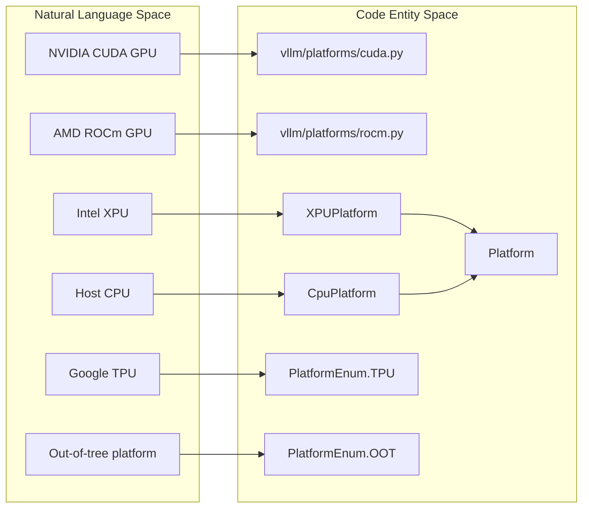

<!-- source: DeepWiki mcp.deepwiki.com · repo vllm-project/vllm · page 10.1 Platform Abstraction Layer · fetched 2026-10-28 -->

# Platform Abstraction Layer

Relevant source files

The following files were used as context for generating this wiki page:

- [.buildkite/hardware_tests/cpu.yaml](.buildkite/hardware_tests/cpu.yaml)
- [.buildkite/scripts/hardware_ci/run-cpu-distributed-smoke-test.sh](.buildkite/scripts/hardware_ci/run-cpu-distributed-smoke-test.sh)
- [.buildkite/scripts/hardware_ci/run-cpu-test-arm.sh](.buildkite/scripts/hardware_ci/run-cpu-test-arm.sh)
- [csrc/cpu/sgl-kernels/conv.cpp](csrc/cpu/sgl-kernels/conv.cpp)
- [csrc/cpu/sgl-kernels/fla.cpp](csrc/cpu/sgl-kernels/fla.cpp)
- [csrc/cpu/sgl-kernels/gemm.cpp](csrc/cpu/sgl-kernels/gemm.cpp)
- [csrc/cpu/utils.cpp](csrc/cpu/utils.cpp)
- [tests/kernels/mamba/cpu/test_cpu_gdn_ops.py](tests/kernels/mamba/cpu/test_cpu_gdn_ops.py)
- [tests/kernels/mamba/test_cpu_short_conv.py](tests/kernels/mamba/test_cpu_short_conv.py)
- [tests/platforms/test_cpu.py](tests/platforms/test_cpu.py)
- [tests/utils_/test_cpu_resource_utils.py](tests/utils_/test_cpu_resource_utils.py)
- [tests/v1/attention/test_mamba_metadata_builder.py](tests/v1/attention/test_mamba_metadata_builder.py)
- [tests/v1/e2e/test_cpu_linear_attn_chunked_prefix.py](tests/v1/e2e/test_cpu_linear_attn_chunked_prefix.py)
- [tests/v1/worker/test_cpu_worker_kv_budget.py](tests/v1/worker/test_cpu_worker_kv_budget.py)
- [vllm/model_executor/layers/mamba/ops/cpu/gdn_attention.py](vllm/model_executor/layers/mamba/ops/cpu/gdn_attention.py)
- [vllm/platforms/cpu.py](vllm/platforms/cpu.py)
- [vllm/platforms/cuda.py](vllm/platforms/cuda.py)
- [vllm/platforms/interface.py](vllm/platforms/interface.py)
- [vllm/platforms/rocm.py](vllm/platforms/rocm.py)
- [vllm/platforms/xpu.py](vllm/platforms/xpu.py)
- [vllm/utils/cpu_resource_utils.py](vllm/utils/cpu_resource_utils.py)
- [vllm/utils/ompmultiprocessing.py](vllm/utils/ompmultiprocessing.py)
- [vllm/v1/worker/cpu_worker.py](vllm/v1/worker/cpu_worker.py)

## Purpose and scope

The Platform Abstraction Layer provides a shared `Platform` type and platform-specific implementations for hardware-dependent behavior. This page describes the interface and capability types visible in the supplied source, plus the CUDA, ROCm, XPU, and CPU implementation details shown. The supplied excerpts do not include the platform package initializer or plugin-loading implementation, so runtime detection order and plugin-registration mechanics cannot be documented here. [vllm/platforms/interface.py:72-193]()

Sources: `vllm/platforms/interface.py:72-193`()

---

## Architecture Overview

`Platform` defines shared attributes for platform identity, PyTorch dispatch, Ray device naming, device control, compilation, distributed communication, quantization, and supported dtypes. Concrete implementations specify platform-specific values and behavior; for example, `CpuPlatform` uses the `CPU` dispatch key and `gloo`, while `XPUPlatform` uses `XPU` and `xccl`. [vllm/platforms/interface.py:138-193]()[vllm/platforms/cpu.py:103-109]()[vllm/platforms/xpu.py:103-112]()

### Platform Class Hierarchy

**Diagram: Platform interface and implementations shown in the supplied excerpts**

The `Platform` declaration and common class attributes are in `vllm/platforms/interface.py`; the excerpt identifies `CpuPlatform` and `XPUPlatform` as subclasses and imports the shared interface in the CUDA and ROCm modules. [vllm/platforms/interface.py:138-193]()[vllm/platforms/cpu.py:103-109]()[vllm/platforms/xpu.py:19-20]()[vllm/platforms/xpu.py:103-112]()[vllm/platforms/cuda.py:33-33]()[vllm/platforms/rocm.py:20-20]()

**Key entities**

| Entity | Role |
|---|---|
| `PlatformEnum` | Enumerates `CUDA`, `ROCM`, `TPU`, `XPU`, `CPU`, `OOT`, and `UNSPECIFIED`. [vllm/platforms/interface.py:72-82]() |
| `Platform` | Holds common platform attributes and default-facing properties such as `pass_key` and `supported_dtypes`. [vllm/platforms/interface.py:138-193]() |
| `DeviceCapability` | Represents a major/minor capability pair with comparison and formatting helpers. [vllm/platforms/interface.py:94-135]() |
| `CpuPlatform` | Defines CPU platform identity and selects CPU attention backends based on selector configuration. [vllm/platforms/cpu.py:103-109]()[vllm/platforms/cpu.py:142-179]() |
| `XPUPlatform` | Defines XPU identity and supplies XPU-specific memory and attention behavior. [vllm/platforms/xpu.py:31-100]()[vllm/platforms/xpu.py:103-112]()[vllm/platforms/xpu.py:143-188]() |

Sources: `vllm/platforms/interface.py:72-193`; `vllm/platforms/cpu.py:103-179`; `vllm/platforms/xpu.py:19-188`; `vllm/platforms/cuda.py:33-33`; `vllm/platforms/rocm.py:20-20`

---

## Platform Enumeration and Detection

### `PlatformEnum`

`PlatformEnum` includes built-in platform values and two general states: `OOT` for out-of-tree platforms and `UNSPECIFIED`. The enum alone does not define how a platform is detected or registered. [vllm/platforms/interface.py:72-82]()

| Enum value | Meaning supported by the supplied code |
|---|---|
| `CUDA` | CUDA platform identity. [vllm/platforms/interface.py:72-82]() |
| `ROCM` | ROCm platform identity. [vllm/platforms/interface.py:72-82]() |
| `TPU` | TPU platform identity. [vllm/platforms/interface.py:72-82]() |
| `XPU` | XPU platform identity. [vllm/platforms/interface.py:72-82]() |
| `CPU` | CPU platform identity. [vllm/platforms/interface.py:72-82]() |
| `OOT` | Out-of-tree platform category. [vllm/platforms/interface.py:72-82]() |
| `UNSPECIFIED` | Unspecified platform state. [vllm/platforms/interface.py:72-82]() |

### Detection and plugin registration boundary

The supplied source excerpts define `PlatformEnum` and show platform classes assigning `_enum` to their platform value, including `CpuPlatform._enum = PlatformEnum.CPU` and `XPUPlatform._enum = PlatformEnum.XPU`. They do not include `vllm/platforms/__init__.py`, entry-point declarations, plugin group constants, or platform-selection code. Consequently, this page does not assert a detection sequence, precedence, or registration API. [vllm/platforms/interface.py:72-82]()[vllm/platforms/cpu.py:103-109]()[vllm/platforms/xpu.py:103-112]()

**Diagram: Platform identity values associated with implementation entities**

The enum values are defined in `PlatformEnum`; `CpuPlatform` and `XPUPlatform` explicitly bind `_enum` to `CPU` and `XPU`. The CUDA and ROCm excerpts import the shared `Platform` interface, but the supplied lines do not show their class declarations. [vllm/platforms/interface.py:72-82]()[vllm/platforms/cpu.py:103-109]()[vllm/platforms/xpu.py:103-112]()[vllm/platforms/cuda.py:33-33]()[vllm/platforms/rocm.py:20-20]()

Sources: `vllm/platforms/interface.py:72-82`; `vllm/platforms/cpu.py:103-109`; `vllm/platforms/xpu.py:103-112`; `vllm/platforms/cuda.py:33-33`; `vllm/platforms/rocm.py:20-20`

---

## Device Capability System

`DeviceCapability` is a `NamedTuple` containing integer `major` and `minor` fields. It implements ordering and equality by comparing the pair, formats the pair as a dotted version through `as_version_str()`, and converts it to `major * 10 + minor` through `to_int()`; the latter assumes a single-digit minor version. [vllm/platforms/interface.py:94-135]()

| Member | Behavior |
|---|---|
| `major`, `minor` | The two integer components of the capability value. [vllm/platforms/interface.py:94-97]() |
| Comparison operators | Compare `(major, minor)` pairs; non-`DeviceCapability` operands return `NotImplemented`. [vllm/platforms/interface.py:98-124]() |
| `as_version_str()` | Returns a dotted string such as `major.minor`. [vllm/platforms/interface.py:126-128]() |
| `to_int()` | Returns `major * 10 + minor`, asserting `0 <= minor < 10`. [vllm/platforms/interface.py:129-135]() |

**Diagram: Capability value representation**

Sources: `vllm/platforms/interface.py:94-135`

---

## Platform Interface and Data Flow

`Platform` declares class-level metadata used to describe device naming, dispatch keys, Ray integration, device-control environment variables, compilation, distributed communication, and quantization support. Its `supported_dtypes` property documents that ordering matters because the first dtype is the default fallback. `pass_key` supplies the Inductor custom-pass configuration key. [vllm/platforms/interface.py:138-193]()

The supplied implementation excerpts also show platform-specific work at different layers: `XPUPlatform.get_attn_backend_cls()` selects an attention backend from the selector configuration, while the CPU worker uses `current_platform.dist_backend` to initialize the distributed environment. [vllm/platforms/xpu.py:143-188]()[vllm/v1/worker/cpu_worker.py:153-160]()

**Diagram: Platform metadata and backend selection from system concept to code entity**

The base metadata and `DeviceCapability` type are defined in `interface.py`. The XPU backend path uses `get_attn_backend_cls()` and passes `get_device_capability()` to `XPUFlashAttnMLABackend.validate_configuration()`; the CPU worker reads `current_platform.dist_backend` during distributed initialization. [vllm/platforms/interface.py:94-193]()[vllm/platforms/xpu.py:143-188]()[vllm/v1/worker/cpu_worker.py:153-160]()

Sources: `vllm/platforms/interface.py:94-193`; `vllm/platforms/xpu.py:143-188`; `vllm/v1/worker/cpu_worker.py:153-160`

---

## CUDA Platform Details

The CUDA module states that its code can assume the CUDA platform and may import `pynvml`, but should not initialize a CUDA context. It imports stable LibTorch custom ops and obtains `pynvml` through `import_pynvml()`. [vllm/platforms/cuda.py:1-5]()[vllm/platforms/cuda.py:22-50]()

### Device counting

`_cuda_device_count_stateless()` is an LRU-cached helper whose cache key includes the supplied `cuda_visible_devices` string. It returns zero if PyTorch was not compiled with CUDA; otherwise it tries `_device_count_nvml()` and falls back to `_cuda_getDeviceCount()` when the NVML result is negative. [vllm/platforms/cuda.py:57-80]()

### Attention backend priorities

`_get_backend_priorities()` selects priority lists using `use_mla`, `DeviceCapability`, and other selector inputs. The shown branches distinguish capability major versions 10 and 12 for MLA and use different backend ordering for non-MLA operation; the exact priority list also depends on KV-cache quantization, head count, and other inputs. [vllm/platforms/cuda.py:82-175]()

**Diagram: CUDA priority selection branches shown in the excerpt**

The diagram summarizes branch conditions and representative priorities in `_get_backend_priorities()`; the full branch logic includes additional alternatives and configuration-dependent ordering. [vllm/platforms/cuda.py:82-175]()

Sources: `vllm/platforms/cuda.py:1-5`; `vllm/platforms/cuda.py:22-80`; `vllm/platforms/cuda.py:82-175`

---

## ROCm Platform Details

The ROCm module imports the common `DeviceCapability`, `Platform`, `PlatformEnum`, and `in_wsl` symbols. It attempts to import `amdsmi` functions for device and topology information, and logs a warning if that import fails. [vllm/platforms/rocm.py:20-20]()[vllm/platforms/rocm.py:39-53]()

### Device visibility synchronization

`_sync_hip_cuda_env_vars()` treats empty visibility variables as unset. If both `HIP_VISIBLE_DEVICES` and `CUDA_VISIBLE_DEVICES` are set to different values, it raises `ValueError`; if only HIP visibility is set, it copies that value to `CUDA_VISIBLE_DEVICES`. The function is called at module import time. [vllm/platforms/rocm.py:138-157]()

**Diagram: ROCm visibility environment-variable flow**

Sources: `vllm/platforms/rocm.py:138-157`

### Architecture query

`_query_gcn_arch_from_amdsmi()` initializes and shuts down AMDSMI through the `with_amdsmi_context` decorator. It reads the first processor handle’s ASIC information and returns `target_graphics_version` when present; otherwise it raises `RuntimeError`. [vllm/platforms/rocm.py:166-190]()

Sources: `vllm/platforms/rocm.py:39-53`; `vllm/platforms/rocm.py:166-190`

---

## CPU Platform Details

`CpuPlatform` identifies the CPU platform with `PlatformEnum.CPU`, device type and name `cpu`, dispatch key `CPU`, and distributed backend `gloo`. Its `supported_dtypes` property varies by architecture: PowerPC returns BF16, FP32, and FP16; the shown Darwin ARM branch checks the `FEAT_BF16` sysctl feature; other listed architectures return BF16, FP16, and FP32. [vllm/platforms/cpu.py:103-132]()

### Attention backend selection

`CpuPlatform.get_attn_backend_cls()` rejects sparse attention. For MLA, it prefers `AMX_MLA` when the architecture is x86 and AMX tile support is available, except when `CPU_MLA` was explicitly selected; otherwise it uses the CPU MLA backend. For non-MLA attention it returns `CPU_ATTN`. [vllm/platforms/cpu.py:142-179]()

### Memory locality and CPU worker initialization

`CPUWorker` obtains visible memory nodes and allowed CPUs, chooses a memory node based on the first allowed CPU’s NUMA node, and initializes the CPU memory environment. It calculates the requested CPU memory budget from `cache_config.gpu_memory_utilization`; on this backend that setting controls the fraction of CPU memory reserved, as the error message explains. [vllm/v1/worker/cpu_worker.py:32-95]()

During `init_device()`, the worker sets its device to `torch.device("cpu")`, checks for preloaded libraries on Linux, initializes the distributed environment using `current_platform.dist_backend`, and constructs a CPU model runner. [vllm/v1/worker/cpu_worker.py:107-178]()

**Diagram: CPU platform configuration flowing into worker setup**

`CpuPlatform` defines the CPU metadata, and `CPUWorker` performs the memory-node setup, reads the platform distributed backend, and constructs the runner. [vllm/platforms/cpu.py:103-132]()[vllm/v1/worker/cpu_worker.py:32-103]()[vllm/v1/worker/cpu_worker.py:153-178]()

Sources: `vllm/platforms/cpu.py:103-179`; `vllm/v1/worker/cpu_worker.py:32-178`

---

## XPU Platform Details

`XPUPlatform` identifies the XPU device as `xpu`, uses dispatch key `XPU`, sets Ray’s device key to `GPU`, uses `xccl` for distributed communication, and uses `ZE_AFFINITY_MASK` for device control. Its class also lists supported quantization names. [vllm/platforms/xpu.py:103-131]()

### Memory information

`get_mem_info_wrapper()` accepts `None`, integer indices, strings such as `xpu:0`, and `torch.device` values. It resolves the device index, validates the device type and index range, then calls `torch.ops._C_cache_ops.getMemoryInfo()` and returns free and total memory. The function is assigned to `torch.accelerator.get_memory_info`. [vllm/platforms/xpu.py:31-100]()

### Attention backend selection

`XPUPlatform.get_attn_backend_cls()` routes TurboQuant KV-cache types to `TURBOQUANT` and sparse attention to `XPU_MLA_SPARSE`. For MLA, it accepts the Triton MLA selection directly; otherwise it validates `XPUFlashAttnMLABackend` using the current device capability and selector configuration. The shown invalid-configuration path raises when FlashAttention MLA was explicitly selected and otherwise falls back to Triton MLA. [vllm/platforms/xpu.py:143-188]()

Sources: `vllm/platforms/xpu.py:31-100`; `vllm/platforms/xpu.py:103-188`

---

## Platform Property and Capability Access Summary

| Concern | Code entity shown | Purpose |
|---|---|---|
| Platform identity | `PlatformEnum`, `_enum` | Identifies platform categories; CPU and XPU implementations bind their `_enum` values. [vllm/platforms/interface.py:72-82]()[vllm/platforms/cpu.py:103-109]()[vllm/platforms/xpu.py:103-112]() |
| Device capability value | `DeviceCapability` | Stores and compares major/minor capability components. [vllm/platforms/interface.py:94-135]() |
| Device metadata | `device_name`, `device_type`, `dispatch_key`, `dist_backend` | Describes platform-specific device and runtime integration. [vllm/platforms/interface.py:138-180]()[vllm/platforms/cpu.py:103-109]()[vllm/platforms/xpu.py:103-112]() |
| Supported dtypes | `Platform.supported_dtypes`, `CpuPlatform.supported_dtypes` | Exposes platform dtype support; CPU specializes the property by architecture. [vllm/platforms/interface.py:184-193]()[vllm/platforms/cpu.py:111-132]() |
| Attention backend choice | `CpuPlatform.get_attn_backend_cls`, `XPUPlatform.get_attn_backend_cls` | Selects platform-specific attention implementations. [vllm/platforms/cpu.py:142-179]()[vllm/platforms/xpu.py:143-188]() |
| Device memory query | `get_mem_info_wrapper` | Provides XPU free/total memory through the accelerator API wrapper. [vllm/platforms/xpu.py:31-100]() |
| CPU worker initialization | `CPUWorker.init_device` | Uses the current platform distributed backend and creates the CPU model runner. [vllm/v1/worker/cpu_worker.py:107-178]() |

Sources: `vllm/platforms/interface.py:72-193`; `vllm/platforms/cpu.py:103-179`; `vllm/platforms/xpu.py:31-188`; `vllm/v1/worker/cpu_worker.py:107-178`

---

## Summary Diagram: Natural-Language Platforms to Code Entities

The CUDA and ROCm module excerpts identify their platform-specific modules and imports; the CPU and XPU class declarations explicitly subclass `Platform`; the enum defines the TPU and OOT categories. The supplied excerpts do not show the TPU implementation or plugin registration mechanism. [vllm/platforms/cuda.py:33-33]()[vllm/platforms/rocm.py:20-20]()[vllm/platforms/cpu.py:103-109]()[vllm/platforms/xpu.py:103-112]()[vllm/platforms/interface.py:72-82]()

Sources: `vllm/platforms/interface.py:72-82`; `vllm/platforms/cpu.py:103-109`; `vllm/platforms/xpu.py:103-112`; `vllm/platforms/cuda.py:33-33`; `vllm/platforms/rocm.py:20-20`

---

## Sources and further reading

- `vllm/platforms/interface.py` — `PlatformEnum`, `CpuArchEnum`, `DeviceCapability`, and shared `Platform` attributes. [vllm/platforms/interface.py:72-193]()
- `vllm/platforms/cuda.py` — CUDA device counting and attention priority selection. [vllm/platforms/cuda.py:57-175]()
- `vllm/platforms/rocm.py` — ROCm visibility synchronization and AMDSMI architecture query. [vllm/platforms/rocm.py:138-190]()
- `vllm/platforms/cpu.py` — CPU platform metadata, dtype support, and attention selection. [vllm/platforms/cpu.py:103-179]()
- `vllm/platforms/xpu.py` — XPU metadata, memory query wrapper, and attention selection. [vllm/platforms/xpu.py:31-188]()
- `vllm/v1/worker/cpu_worker.py` — CPU worker memory and device initialization. [vllm/v1/worker/cpu_worker.py:32-178]()

Sources: `vllm/platforms/interface.py:72-193`; `vllm/platforms/cuda.py:57-175`; `vllm/platforms/rocm.py:138-190`; `vllm/platforms/cpu.py:103-179`; `vllm/platforms/xpu.py:31-188`; `vllm/v1/worker/cpu_worker.py:32-178`

---

