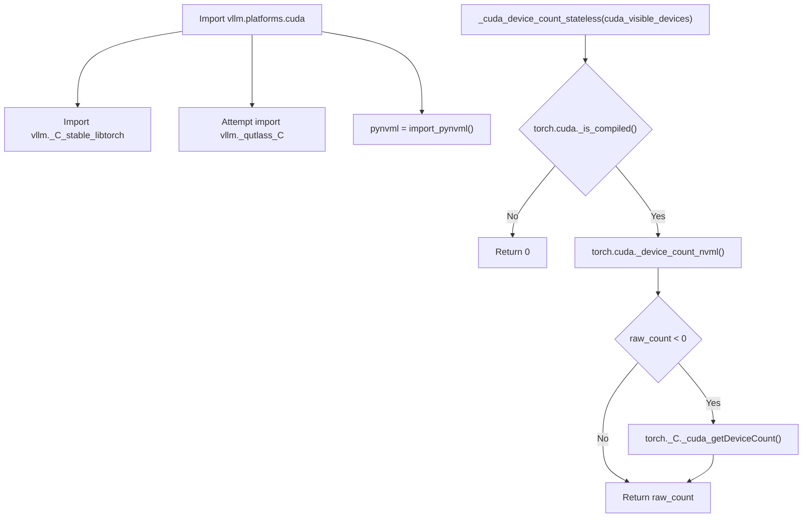
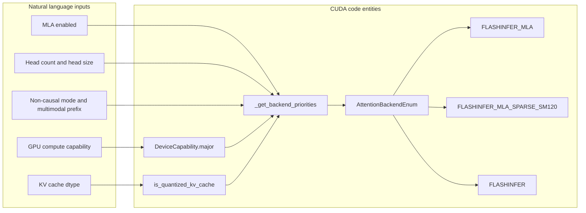
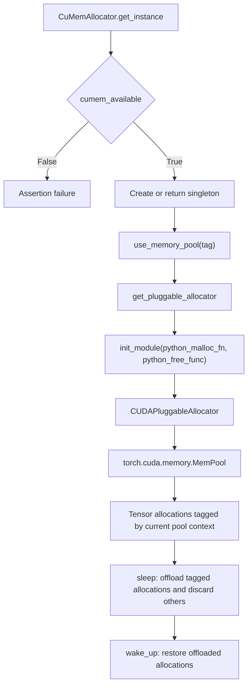
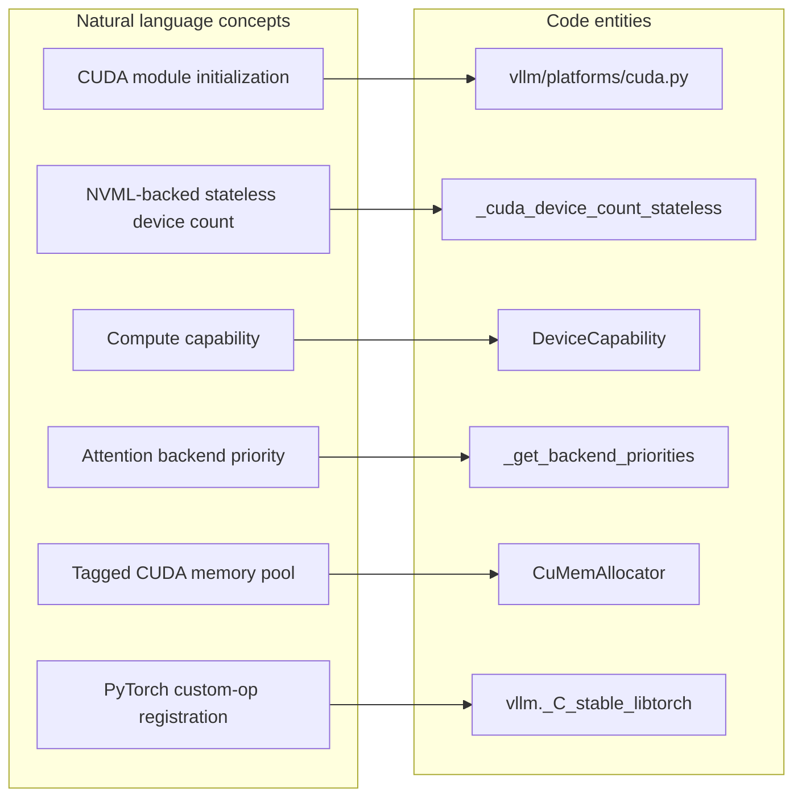

<!-- source: DeepWiki mcp.deepwiki.com · repo vllm-project/vllm · page 10.2 CUDA Platform · fetched 2026-10-28 -->

# CUDA Platform

Relevant source files

The following files were used as context for generating this wiki page:

- [.buildkite/hardware_tests/cpu.yaml](.buildkite/hardware_tests/cpu.yaml)
- [.buildkite/scripts/hardware_ci/run-cpu-distributed-smoke-test.sh](.buildkite/scripts/hardware_ci/run-cpu-distributed-smoke-test.sh)
- [.buildkite/scripts/hardware_ci/run-cpu-test-arm.sh](.buildkite/scripts/hardware_ci/run-cpu-test-arm.sh)
- [csrc/cpu/sgl-kernels/conv.cpp](csrc/cpu/sgl-kernels/conv.cpp)
- [csrc/cpu/sgl-kernels/fla.cpp](csrc/cpu/sgl-kernels/fla.cpp)
- [csrc/cpu/sgl-kernels/gemm.cpp](csrc/cpu/sgl-kernels/gemm.cpp)
- [csrc/cpu/utils.cpp](csrc/cpu/utils.cpp)
- [csrc/cumem_allocator.cpp](csrc/cumem_allocator.cpp)
- [docs/features/sleep_mode.md](docs/features/sleep_mode.md)
- [examples/features/sharded_state/save_sharded_state_offline.py](examples/features/sharded_state/save_sharded_state_offline.py)
- [tests/basic_correctness/memory/cumem/test_cumem.py](tests/basic_correctness/memory/cumem/test_cumem.py)
- [tests/basic_correctness/memory/sleep_mode/test_sleep_mode.py](tests/basic_correctness/memory/sleep_mode/test_sleep_mode.py)
- [tests/kernels/mamba/cpu/test_cpu_gdn_ops.py](tests/kernels/mamba/cpu/test_cpu_gdn_ops.py)
- [tests/kernels/mamba/test_cpu_short_conv.py](tests/kernels/mamba/test_cpu_short_conv.py)
- [tests/model_executor/model_loader/test_sharded_state_loader.py](tests/model_executor/model_loader/test_sharded_state_loader.py)
- [tests/models/language/generation/test_gdn_sleep_wake.py](tests/models/language/generation/test_gdn_sleep_wake.py)
- [tests/platforms/test_cpu.py](tests/platforms/test_cpu.py)
- [tests/utils_/test_cpu_resource_utils.py](tests/utils_/test_cpu_resource_utils.py)
- [tests/v1/attention/test_mamba_metadata_builder.py](tests/v1/attention/test_mamba_metadata_builder.py)
- [tests/v1/e2e/test_cpu_linear_attn_chunked_prefix.py](tests/v1/e2e/test_cpu_linear_attn_chunked_prefix.py)
- [tests/v1/worker/test_cpu_worker_kv_budget.py](tests/v1/worker/test_cpu_worker_kv_budget.py)
- [tests/v1/worker/test_gpu_worker.py](tests/v1/worker/test_gpu_worker.py)
- [tests/v1/worker/test_gpu_worker_weight_transfer.py](tests/v1/worker/test_gpu_worker_weight_transfer.py)
- [tests/v1/worker/test_sleep_mode_backend.py](tests/v1/worker/test_sleep_mode_backend.py)
- [vllm/device_allocator/__init__.py](vllm/device_allocator/__init__.py)
- [vllm/device_allocator/cumem.py](vllm/device_allocator/cumem.py)
- [vllm/device_allocator/sleep_mode_backend.py](vllm/device_allocator/sleep_mode_backend.py)
- [vllm/device_allocator/xpumem.py](vllm/device_allocator/xpumem.py)
- [vllm/model_executor/layers/mamba/ops/cpu/gdn_attention.py](vllm/model_executor/layers/mamba/ops/cpu/gdn_attention.py)
- [vllm/model_executor/model_loader/sharded_state_loader.py](vllm/model_executor/model_loader/sharded_state_loader.py)
- [vllm/platforms/cpu.py](vllm/platforms/cpu.py)
- [vllm/platforms/cuda.py](vllm/platforms/cuda.py)
- [vllm/platforms/interface.py](vllm/platforms/interface.py)
- [vllm/platforms/rocm.py](vllm/platforms/rocm.py)
- [vllm/platforms/xpu.py](vllm/platforms/xpu.py)
- [vllm/utils/cpu_resource_utils.py](vllm/utils/cpu_resource_utils.py)
- [vllm/utils/ompmultiprocessing.py](vllm/utils/ompmultiprocessing.py)
- [vllm/v1/worker/cpu_worker.py](vllm/v1/worker/cpu_worker.py)
- [vllm/v1/worker/gpu_worker.py](vllm/v1/worker/gpu_worker.py)
- [vllm/v1/worker/lora_model_runner_mixin.py](vllm/v1/worker/lora_model_runner_mixin.py)
- [vllm/v1/worker/startup_plan.py](vllm/v1/worker/startup_plan.py)

## Purpose and Scope

This page describes the CUDA-specific implementation visible in `vllm/platforms/cuda.py`, including NVML setup, stateless device counting, compute-capability-dependent attention backend priorities, and the CUDA-oriented `CuMemAllocator` used for tagged memory pools. It also explains how the GPU worker imports the allocator interface. The supplied source excerpts do not include the rest of the CUDA platform class implementation, so this page does not infer additional platform methods or configuration behavior. [vllm/platforms/cuda.py:1-175](), [vllm/device_allocator/cumem.py:1-110](), [vllm/v1/worker/gpu_worker.py:18-28]()

For the common platform interface, see [Platform Abstraction Layer](). For AMD-specific platform behavior, see [ROCm Platform]().

Sources: [vllm/platforms/cuda.py:1-175](), [vllm/device_allocator/cumem.py:1-110](), [vllm/v1/worker/gpu_worker.py:18-28]()

---

## CUDA Module Setup and NVML Integration

`vllm/platforms/cuda.py` states that code in the module may assume a CUDA platform and import CUDA-specific dependencies such as `pynvml`, but must not initialize a CUDA context. The module imports the stable LibTorch extension to trigger custom-op registration, attempts to import `_qutlass_C` while suppressing `ImportError`, and obtains `pynvml` through `import_pynvml()`. [vllm/platforms/cuda.py:1-5](), [vllm/platforms/cuda.py:22-30](), [vllm/platforms/cuda.py:50]()

The shown code does not include the `CudaPlatform` class definition or its individual NVML query methods. Therefore, the module’s NVML integration can be described here only at the import and device-count level; the available excerpt does not establish a separate NVML-backed versus non-NVML class hierarchy. [vllm/platforms/cuda.py:1-50]()

### Module setup and device-count flow

Sources: [vllm/platforms/cuda.py:22-30](), [vllm/platforms/cuda.py:50](), [vllm/platforms/cuda.py:57-80]()

### Stateless CUDA device count

`_cuda_device_count_stateless(cuda_visible_devices)` is cached with an LRU cache of up to eight entries. The `cuda_visible_devices` argument is retained as a cache key; the function body does not use its value. It imports `torch.cuda`, returns `0` if the PyTorch build is not CUDA-compiled, and otherwise asks PyTorch for an NVML device count. If that count is negative, it falls back to `torch._C._cuda_getDeviceCount()`. [vllm/platforms/cuda.py:57-80]()

This function is documented as an alternative to `torch.accelerator.device_count()` when the desired `CUDA_VISIBLE_DEVICES` value has not already been set. The excerpt does not show its callers, so it does not establish how or when vLLM invokes it. [vllm/platforms/cuda.py:57-68]()

Sources: [vllm/platforms/cuda.py:57-80]()

---

## Compute Capability and Attention Backend Priorities

`DeviceCapability` is a `NamedTuple` containing integer `major` and `minor` fields. It defines ordering comparisons, equality, hashing, a `major.minor` string representation, and conversion to an integer encoded as `major * 10 + minor`; that conversion asserts that the minor component is a single digit. [vllm/platforms/interface.py:94-135]()

In the CUDA module, `_get_backend_priorities` is cached and accepts `use_mla`, `device_capability`, and optional attention configuration inputs such as head count, KV-cache dtype, non-causal mode, head size, and multimodal-prefix use. The shown implementation branches on `device_capability.major`, and its priority lists vary with MLA mode and those inputs. These are priority lists, not proof that a backend will ultimately be selected: the excerpt shows list construction but not the backend-validation or selection caller. [vllm/platforms/cuda.py:83-93](), [vllm/platforms/cuda.py:94-175]()

### Priority behavior visible in the excerpt

| Mode and condition | Priority behavior shown |
|---|---|
| MLA, major 10, quantized KV cache | Sparse tail prefers `FLASHINFER_MLA_SPARSE`, then `FLASHMLA_SPARSE`; the main list starts with `FLASHINFER_MLA`. [vllm/platforms/cuda.py:96-107](), [vllm/platforms/cuda.py:122-133]() |
| MLA, major 10, non-quantized KV cache, at most 16 heads | Sparse tail orders `FLASH_ATTN_MLA_SPARSE_FA4`, `FLASHINFER_MLA_SPARSE`, then `FLASHMLA_SPARSE`. [vllm/platforms/cuda.py:107-115]() |
| MLA, major 10, non-quantized KV cache, more than 16 heads or unspecified | Sparse tail orders `FLASHMLA_SPARSE`, then `FLASHINFER_MLA_SPARSE`. [vllm/platforms/cuda.py:107-120]() |
| MLA, major 12 | Returns `TRITON_MLA` followed by `FLASHINFER_MLA_SPARSE_SM120`. [vllm/platforms/cuda.py:134-138]() |
| MLA, other major versions | Returns a list beginning with `FLASH_ATTN_MLA`, `FLASHMLA`, `FLASHINFER_MLA`, and `TRITON_MLA`; the placement of `FLASHINFER_MLA_SPARSE_SM90` in the sparse tail depends on whether `head_size == 512`. [vllm/platforms/cuda.py:139-155]() |
| Non-MLA, major 10, causal mode | Returns a list beginning with `FLASHINFER`; `TRITON_FLASHINFER` is added first when `use_mm_prefix` is true. [vllm/platforms/cuda.py:156-168]() |
| Non-MLA, other shown cases | The excerpt begins a separate priority-list branch, including a conditional `TRITON_FLASH_ATTN` entry for major 9 with multimodal prefix; the remainder of this branch is not included. [vllm/platforms/cuda.py:169-175]() |

For major 10 MLA, the code checks whether the KV-cache dtype is quantized using `is_quantized_kv_cache`. For non-MLA major 10, the code distinguishes causal from non-causal attention and comments that the Blackwell non-causal CUTLASS path has known problems. [vllm/platforms/cuda.py:94-107](), [vllm/platforms/cuda.py:156-160]()

### From capability and attention inputs to code entities

Sources: [vllm/platforms/interface.py:94-135](), [vllm/platforms/cuda.py:83-93](), [vllm/platforms/cuda.py:94-175]()

Sources: [vllm/platforms/interface.py:94-135](), [vllm/platforms/cuda.py:83-175]()

---

## CUDA Custom Operations and Allocator Registration

At CUDA platform module import, `vllm._C_stable_libtorch` is imported to trigger custom-op registration. The excerpt also shows an optional import of `vllm._qutlass_C`. It does not include the operator definitions or bindings, so individual custom operators cannot be enumerated from the supplied source. [vllm/platforms/cuda.py:22-26]()

The V1 GPU worker imports `get_mem_allocator_instance` from `vllm.device_allocator`. The shown worker excerpt does not include a call to this function, so it establishes the dependency but not the worker’s allocator selection or lifecycle. [vllm/v1/worker/gpu_worker.py:18-28]()

Sources: [vllm/platforms/cuda.py:22-26](), [vllm/v1/worker/gpu_worker.py:18-28]()

---

## `CuMemAllocator` and Tagged Memory Pools

`vllm/device_allocator/cumem.py` implements `CuMemAllocator`, a singleton manager for a CUDA-tensor memory pool. Its documented sleep/wake model uses tags: tensors allocated inside `use_memory_pool(tag)` receive that tag; `sleep` offloads tensors with selected tags and discards the rest; `wake_up` restores offloaded tensors, while other tensors have empty memory (zeroed on ROCm). [vllm/device_allocator/cumem.py:88-110]()

The module attempts to import `init_module`, `python_create_and_map`, and `python_unmap_and_release` from `vllm.cumem_allocator`, along with `CudaRTLibrary`. If those imports succeed, it locates the loaded `cumem_allocator` library, creates the CUDA runtime wrapper, and sets `cumem_available = True`. If the imports raise `ModuleNotFoundError`, it sets the extension-dependent references to `None` and marks the allocator unavailable. [vllm/device_allocator/cumem.py:35-54]()

`get_pluggable_allocator` initializes the extension with Python allocation and free callbacks, then creates a `torch.cuda.memory.CUDAPluggableAllocator` using the library symbols `my_malloc` and `my_free`. `use_memory_pool_with_allocator` creates a `torch.cuda.memory.MemPool` from that allocator and yields it while `torch.cuda.memory.use_mem_pool` is active. [vllm/device_allocator/cumem.py:64-85]()

`CuMemAllocator.get_instance()` asserts that the extension is available, lazily creates the singleton, and registers `_shutdown_singleton` with `atexit`. The class retains callback references and tracks allocation metadata, the current tag, and allocator/pool references. The singleton is important because the C extension stores a global callback reference; constructing multiple instances could overwrite it. [vllm/device_allocator/cumem.py:88-147]()

### Tagged allocation and sleep/wake flow

Sources: [vllm/device_allocator/cumem.py:35-54](), [vllm/device_allocator/cumem.py:64-110](), [vllm/device_allocator/cumem.py:112-147]()

Sources: [vllm/device_allocator/cumem.py:35-54](), [vllm/device_allocator/cumem.py:64-147]()

### Allocation lifecycle and implementation notes

| Entity | Role |
|---|---|
| `create_and_map` | Forwards an allocation handle to `python_create_and_map`. [vllm/device_allocator/cumem.py:56-58]() |
| `unmap_and_release` | Forwards an allocation handle to `python_unmap_and_release`. [vllm/device_allocator/cumem.py:60-62]() |
| `get_pluggable_allocator` | Initializes the extension callbacks and constructs the PyTorch pluggable allocator. [vllm/device_allocator/cumem.py:64-72]() |
| `use_memory_pool_with_allocator` | Enters PyTorch’s memory-pool context and yields the pool and allocator. [vllm/device_allocator/cumem.py:75-85]() |
| `CuMemAllocator.get_instance` | Enforces extension availability and lazy singleton creation. [vllm/device_allocator/cumem.py:112-127]() |
| `CuMemAllocator.release_pools` | Clears retained allocator/pool references; the implementation explains that retained references are needed to avoid allocator lifetime and teardown hazards. [vllm/device_allocator/cumem.py:149-176]() |

The module comments explain why its allocator uses a C extension: earlier approaches using `cuda-python` or a custom `libcuda` `ctypes` wrapper failed because of CUDA context mismatch. [vllm/device_allocator/cumem.py:4-10]()

The GPU worker’s `_scoped_allocator_max_split` behavior is exercised by tests that check whether freed large native-allocator blocks remain releasable and whether allocator settings are preserved across profiling runs. These tests are guarded to require a CUDA-alike platform, an available accelerator, and PyTorch’s native allocator; they do not document `CuMemAllocator` behavior. [tests/v1/worker/test_gpu_worker.py:99-133](), [tests/v1/worker/test_gpu_worker.py:136-167]()

Sources: [vllm/device_allocator/cumem.py:4-10](), [vllm/device_allocator/cumem.py:56-85](), [vllm/device_allocator/cumem.py:112-176](), [tests/v1/worker/test_gpu_worker.py:99-167]()

---

## CUDA Platform Concepts Mapped to Code

The following diagram links platform-level concepts to the code entities visible in the supplied excerpts. It intentionally maps only to entities supported by those excerpts; it does not assert unshown NVML query methods, operator definitions, or platform-class behavior. [vllm/platforms/cuda.py:1-80](), [vllm/platforms/cuda.py:83-175](), [vllm/platforms/interface.py:94-135](), [vllm/device_allocator/cumem.py:35-110]()

Sources: [vllm/platforms/cuda.py:1-80](), [vllm/platforms/cuda.py:83-175](), [vllm/platforms/interface.py:94-135](), [vllm/device_allocator/cumem.py:88-110]()

Sources: [vllm/platforms/cuda.py:1-80](), [vllm/platforms/cuda.py:83-175](), [vllm/platforms/interface.py:94-135](), [vllm/device_allocator/cumem.py:88-110]()

---

## Summary

The supplied CUDA platform excerpt establishes a CUDA-specific module setup that imports the stable LibTorch extension, optionally imports `_qutlass_C`, obtains `pynvml` through `import_pynvml()`, and provides a cached stateless device-count helper that prefers PyTorch’s NVML count with a fallback. [vllm/platforms/cuda.py:1-30](), [vllm/platforms/cuda.py:50-80]()

`DeviceCapability` represents ordered major/minor capability values, and `_get_backend_priorities` uses capability and attention configuration inputs to construct backend preference lists, including distinct behavior for major versions 10 and 12. [vllm/platforms/interface.py:94-135](), [vllm/platforms/cuda.py:83-175]()

The CUDA-oriented `CuMemAllocator` provides singleton-managed, tagged PyTorch memory pools backed by a pluggable allocator extension; the GPU worker imports the general allocator accessor, but the shown worker excerpt does not expose its allocator call path. [vllm/device_allocator/cumem.py:35-54](), [vllm/device_allocator/cumem.py:64-147](), [vllm/v1/worker/gpu_worker.py:18-28]()

Sources: [vllm/platforms/cuda.py:1-80](), [vllm/platforms/cuda.py:83-175](), [vllm/platforms/interface.py:94-135](), [vllm/device_allocator/cumem.py:35-147](), [vllm/v1/worker/gpu_worker.py:18-28]()

---

