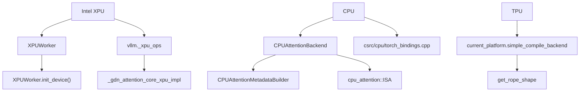
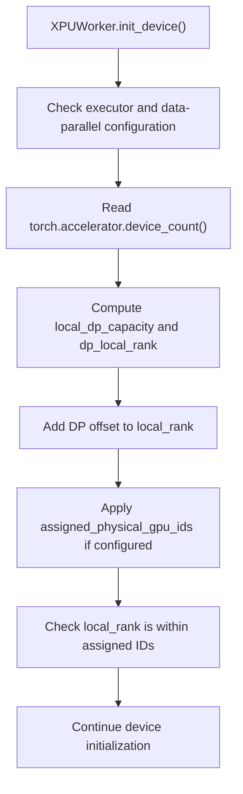
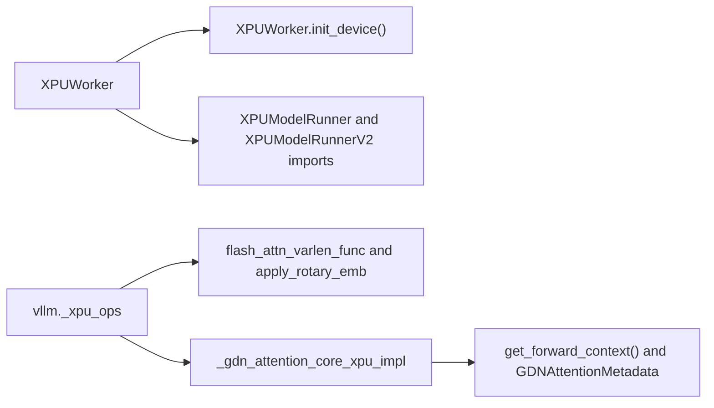
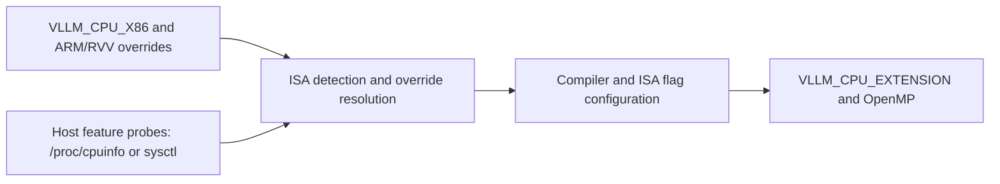
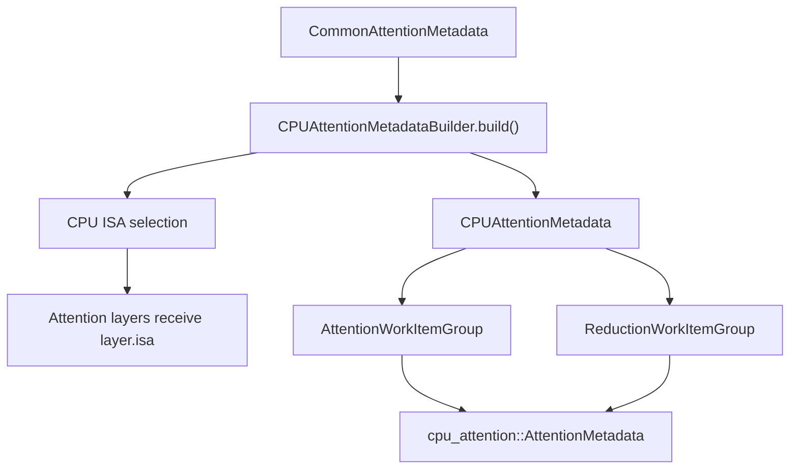
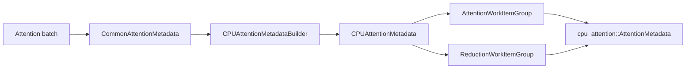
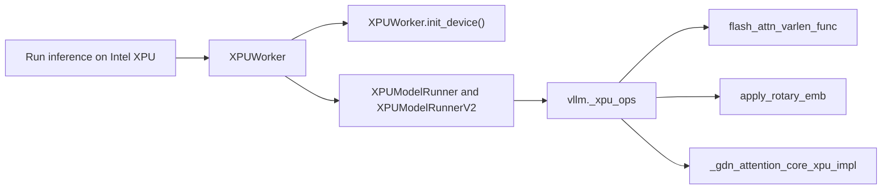
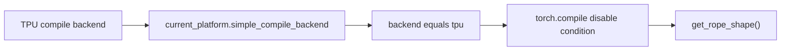

<!-- source: DeepWiki mcp.deepwiki.com · repo vllm-project/vllm · page 10.4 XPU, CPU, and TPU Platforms · fetched 2026-10-28 -->

# XPU, CPU, and TPU Platforms

Relevant source files

The following files were used as context for generating this wiki page:

- [.buildkite/scripts/hardware_ci/run-xpu-batch-invariance.sh](.buildkite/scripts/hardware_ci/run-xpu-batch-invariance.sh)
- [benchmarks/kernels/cpu/benchmark_cpu_attn.py](benchmarks/kernels/cpu/benchmark_cpu_attn.py)
- [cmake/cpu_extension.cmake](cmake/cpu_extension.cmake)
- [csrc/cpu/cpu_arch_macros.h](csrc/cpu/cpu_arch_macros.h)
- [csrc/cpu/cpu_attn.cpp](csrc/cpu/cpu_attn.cpp)
- [csrc/cpu/cpu_attn_amx.hpp](csrc/cpu/cpu_attn_amx.hpp)
- [csrc/cpu/cpu_attn_fp8.hpp](csrc/cpu/cpu_attn_fp8.hpp)
- [csrc/cpu/cpu_attn_impl.hpp](csrc/cpu/cpu_attn_impl.hpp)
- [csrc/cpu/cpu_attn_neon.hpp](csrc/cpu/cpu_attn_neon.hpp)
- [csrc/cpu/cpu_attn_neon_bfmmla.hpp](csrc/cpu/cpu_attn_neon_bfmmla.hpp)
- [csrc/cpu/cpu_attn_rvv.hpp](csrc/cpu/cpu_attn_rvv.hpp)
- [csrc/cpu/cpu_attn_vec.hpp](csrc/cpu/cpu_attn_vec.hpp)
- [csrc/cpu/cpu_attn_vec16.hpp](csrc/cpu/cpu_attn_vec16.hpp)
- [csrc/cpu/cpu_attn_vsx.hpp](csrc/cpu/cpu_attn_vsx.hpp)
- [csrc/cpu/cpu_attn_vxe.hpp](csrc/cpu/cpu_attn_vxe.hpp)
- [csrc/cpu/cpu_types.hpp](csrc/cpu/cpu_types.hpp)
- [csrc/cpu/cpu_types_arm.hpp](csrc/cpu/cpu_types_arm.hpp)
- [csrc/cpu/cpu_types_riscv.hpp](csrc/cpu/cpu_types_riscv.hpp)
- [csrc/cpu/cpu_types_riscv_defs.hpp](csrc/cpu/cpu_types_riscv_defs.hpp)
- [csrc/cpu/cpu_types_riscv_impl.hpp](csrc/cpu/cpu_types_riscv_impl.hpp)
- [csrc/cpu/cpu_types_scalar.hpp](csrc/cpu/cpu_types_scalar.hpp)
- [csrc/cpu/cpu_types_vsx.hpp](csrc/cpu/cpu_types_vsx.hpp)
- [csrc/cpu/cpu_types_vxe.hpp](csrc/cpu/cpu_types_vxe.hpp)
- [csrc/cpu/cpu_types_x86.hpp](csrc/cpu/cpu_types_x86.hpp)
- [csrc/cpu/dnnl_helper.cpp](csrc/cpu/dnnl_helper.cpp)
- [csrc/cpu/dnnl_helper.h](csrc/cpu/dnnl_helper.h)
- [csrc/cpu/dnnl_kernels.cpp](csrc/cpu/dnnl_kernels.cpp)
- [csrc/cpu/float_convert.hpp](csrc/cpu/float_convert.hpp)
- [csrc/cpu/generate_cpu_attn_dispatch.py](csrc/cpu/generate_cpu_attn_dispatch.py)
- [csrc/cpu/micro_gemm/cpu_micro_gemm_vec.hpp](csrc/cpu/micro_gemm/cpu_micro_gemm_vec.hpp)
- [csrc/cpu/mla_decode.cpp](csrc/cpu/mla_decode.cpp)
- [csrc/cpu/pos_encoding.cpp](csrc/cpu/pos_encoding.cpp)
- [csrc/cpu/torch_bindings.cpp](csrc/cpu/torch_bindings.cpp)
- [docker/Dockerfile.s390x](docker/Dockerfile.s390x)
- [docs/configuration/conserving_memory.md](docs/configuration/conserving_memory.md)
- [docs/getting_started/installation/cpu.md](docs/getting_started/installation/cpu.md)
- [docs/getting_started/installation/cpu.s390x.inc.md](docs/getting_started/installation/cpu.s390x.inc.md)
- [examples/pooling/token_embed/jina_reranker_v3_online.py](examples/pooling/token_embed/jina_reranker_v3_online.py)
- [pyproject.toml](pyproject.toml)
- [requirements/build/cpu.txt](requirements/build/cpu.txt)
- [requirements/build/cuda.txt](requirements/build/cuda.txt)
- [requirements/cpu.txt](requirements/cpu.txt)
- [tests/compile/passes/test_functionalization.py](tests/compile/passes/test_functionalization.py)
- [tests/compile/passes/test_scatter_split_replace.py](tests/compile/passes/test_scatter_split_replace.py)
- [tests/compile/test_rotary_embedding_compile.py](tests/compile/test_rotary_embedding_compile.py)
- [tests/kernels/attention/test_cpu_attn.py](tests/kernels/attention/test_cpu_attn.py)
- [tests/kernels/core/test_apply_rotary_emb.py](tests/kernels/core/test_apply_rotary_emb.py)
- [tests/kernels/core/test_mrope.py](tests/kernels/core/test_mrope.py)
- [tests/kernels/test_onednn.py](tests/kernels/test_onednn.py)
- [tests/model_executor/layers/test_conv.py](tests/model_executor/layers/test_conv.py)
- [tests/models/language/pooling/test_all_pooling_plus_chunked_prefill.py](tests/models/language/pooling/test_all_pooling_plus_chunked_prefill.py)
- [tests/models/language/pooling/test_classification.py](tests/models/language/pooling/test_classification.py)
- [tests/models/language/pooling/test_embedding.py](tests/models/language/pooling/test_embedding.py)
- [tests/models/language/pooling/test_jina_reranker_v3.py](tests/models/language/pooling/test_jina_reranker_v3.py)
- [tests/models/language/pooling/test_reward.py](tests/models/language/pooling/test_reward.py)
- [tests/models/language/pooling/test_splade_sparse_pooler.py](tests/models/language/pooling/test_splade_sparse_pooler.py)
- [tests/models/language/pooling/test_token_classification.py](tests/models/language/pooling/test_token_classification.py)
- [tests/models/multimodal/generation/test_memory_leak.py](tests/models/multimodal/generation/test_memory_leak.py)
- [tests/test_zentorch_version_pin.py](tests/test_zentorch_version_pin.py)
- [tests/utils_/test_mem_utils.py](tests/utils_/test_mem_utils.py)
- [tests/v1/attention/test_group_head_counts.py](tests/v1/attention/test_group_head_counts.py)
- [tests/v1/determinism/test_xpu_batch_invariant_ut.py](tests/v1/determinism/test_xpu_batch_invariant_ut.py)
- [tests/v1/worker/test_xpu_model_runner.py](tests/v1/worker/test_xpu_model_runner.py)
- [tools/pre_commit/check_torch_cuda.py](tools/pre_commit/check_torch_cuda.py)
- [vllm/_xpu_ops.py](vllm/_xpu_ops.py)
- [vllm/compilation/passes/fx_utils.py](vllm/compilation/passes/fx_utils.py)
- [vllm/compilation/passes/utility/scatter_split_replace.py](vllm/compilation/passes/utility/scatter_split_replace.py)
- [vllm/distributed/device_communicators/cpu_communicator.py](vllm/distributed/device_communicators/cpu_communicator.py)
- [vllm/distributed/device_communicators/xpu_communicator.py](vllm/distributed/device_communicators/xpu_communicator.py)
- [vllm/distributed/kv_transfer/kv_connector/v1/lmcache_integration/utils.py](vllm/distributed/kv_transfer/kv_connector/v1/lmcache_integration/utils.py)
- [vllm/model_executor/kernels/linear/cute_dsl/skinny_gemm.py](vllm/model_executor/kernels/linear/cute_dsl/skinny_gemm.py)
- [vllm/model_executor/layers/rotary_embedding/__init__.py](vllm/model_executor/layers/rotary_embedding/__init__.py)
- [vllm/model_executor/layers/rotary_embedding/base.py](vllm/model_executor/layers/rotary_embedding/base.py)
- [vllm/model_executor/layers/rotary_embedding/common.py](vllm/model_executor/layers/rotary_embedding/common.py)
- [vllm/model_executor/layers/rotary_embedding/deepseek_scaling_rope.py](vllm/model_executor/layers/rotary_embedding/deepseek_scaling_rope.py)
- [vllm/model_executor/layers/rotary_embedding/mrope.py](vllm/model_executor/layers/rotary_embedding/mrope.py)
- [vllm/model_executor/layers/rotary_embedding/mrope_vit_setup.py](vllm/model_executor/layers/rotary_embedding/mrope_vit_setup.py)
- [vllm/model_executor/layers/rotary_embedding/packed_qk_rope.py](vllm/model_executor/layers/rotary_embedding/packed_qk_rope.py)
- [vllm/model_executor/layers/rotary_embedding/yarn_scaling_rope.py](vllm/model_executor/layers/rotary_embedding/yarn_scaling_rope.py)
- [vllm/model_executor/models/kanana_v.py](vllm/model_executor/models/kanana_v.py)
- [vllm/model_executor/models/kimi_k25.py](vllm/model_executor/models/kimi_k25.py)
- [vllm/model_executor/models/kimi_k25_vit.py](vllm/model_executor/models/kimi_k25_vit.py)
- [vllm/model_executor/models/kimi_vl.py](vllm/model_executor/models/kimi_vl.py)
- [vllm/model_executor/models/mimo_v2_omni.py](vllm/model_executor/models/mimo_v2_omni.py)
- [vllm/models/inkling/amd/ops/gluon/rel_mha_decode_gfx950.py](vllm/models/inkling/amd/ops/gluon/rel_mha_decode_gfx950.py)
- [vllm/models/inkling/amd/ops/gluon/utils.py](vllm/models/inkling/amd/ops/gluon/utils.py)
- [vllm/models/minimax_m3/common/encoder_cudagraph.py](vllm/models/minimax_m3/common/encoder_cudagraph.py)
- [vllm/models/minimax_m3/common/vision_tower.py](vllm/models/minimax_m3/common/vision_tower.py)
- [vllm/utils/hpc.py](vllm/utils/hpc.py)
- [vllm/utils/mem_constants.py](vllm/utils/mem_constants.py)
- [vllm/utils/mem_utils.py](vllm/utils/mem_utils.py)
- [vllm/v1/attention/backends/cpu_attn.py](vllm/v1/attention/backends/cpu_attn.py)
- [vllm/v1/attention/backends/mla/cpu_mla.py](vllm/v1/attention/backends/mla/cpu_mla.py)
- [vllm/v1/worker/gpu/pool/pooling_runner.py](vllm/v1/worker/gpu/pool/pooling_runner.py)
- [vllm/v1/worker/xpu_model_runner.py](vllm/v1/worker/xpu_model_runner.py)
- [vllm/v1/worker/xpu_worker.py](vllm/v1/worker/xpu_worker.py)

This page covers Intel XPU execution, CPU platform kernels and worker-related infrastructure across supported processor architectures, and the available TPU code pointers. It focuses on the implementation details evidenced by the cited code: XPU worker device assignment and kernel integration, CPU build-time ISA configuration and attention execution, and the TPU-specific compile-backend condition visible in model code.

Sources: [vllm/v1/worker/xpu_worker.py:25-41](), [vllm/_xpu_ops.py:7-15](), [cmake/cpu_extension.cmake:14-24](), [vllm/model_executor/models/kimi_k25_vit.py:79-95]()

## 1. Overview and Platform Architecture

The supplied implementation excerpts show distinct execution paths for XPU and CPU: `XPUWorker` is a worker subclass that validates XPU configuration and handles device assignment, while `CPUAttentionBackend` defines CPU attention capabilities and supplies a metadata builder. CPU native operators are exposed through declarations in `csrc/cpu/torch_bindings.cpp`. The excerpts do not include the platform-class definitions or a TPU worker implementation, so they do not establish the full platform hierarchy or platform-detection order. [vllm/v1/worker/xpu_worker.py:25-41](), [vllm/v1/attention/backends/cpu_attn.py:49-107](), [csrc/cpu/torch_bindings.cpp:1-58]()

| Area | Code entities visible in the supplied excerpts | What the excerpts establish |
|---|---|---|
| XPU worker | `XPUWorker`, `XPUWorker.init_device()` | The worker requires an XPU device configuration and active XPU platform; device assignment accounts for data-parallel topology and visible devices. [vllm/v1/worker/xpu_worker.py:25-41](), [vllm/v1/worker/xpu_worker.py:43-117]() |
| XPU operators | `vllm._xpu_ops`, `_gdn_attention_core_xpu_impl` | The module imports XPU attention and rotary functions, registers fake implementations for available quantized GEMM operators, and defines a custom-op implementation that reads forward-context GDN metadata. [vllm/_xpu_ops.py:7-15](), [vllm/_xpu_ops.py:29-115](), [vllm/_xpu_ops.py:178-210]() |
| CPU build and kernels | `cmake/cpu_extension.cmake`, `csrc/cpu/torch_bindings.cpp` | CMake enables OpenMP and configures architecture-specific compiler options; the binding declaration file lists CPU matrix, attention, MoE, quantization, and shared-memory operations. [cmake/cpu_extension.cmake:4-24](), [cmake/cpu_extension.cmake:132-175](), [csrc/cpu/torch_bindings.cpp:11-58](), [csrc/cpu/torch_bindings.cpp:59-139]() |
| CPU attention | `CPUAttentionBackend`, `CPUAttentionMetadataBuilder`, `cpu_attention::AttentionMetadata` | Python backend metadata is paired with C++ work-item and reduction metadata for CPU attention execution. [vllm/v1/attention/backends/cpu_attn.py:49-107](), [csrc/cpu/cpu_attn_impl.hpp:35-48](), [csrc/cpu/cpu_attn_impl.hpp:90-173]() |
| TPU code pointer | `current_platform.simple_compile_backend` | `kimi_k25_vit.py` disables the decorated `get_rope_shape` compilation path when the simple compile backend is `"tpu"`; this is a code-level TPU condition, not a complete TPU platform implementation description. [vllm/model_executor/models/kimi_k25_vit.py:79-95]() |

### Platform Names and Code Entities

The diagram associates the platform names used in the question with code entities present in the supplied excerpts. It does not imply that the excerpt set contains all platform classes or worker implementations.

Sources: [vllm/v1/worker/xpu_worker.py:25-41](), [vllm/v1/worker/xpu_worker.py:43-117](), [vllm/_xpu_ops.py:178-210](), [vllm/v1/attention/backends/cpu_attn.py:49-107](), [csrc/cpu/cpu_attn_impl.hpp:15-33](), [vllm/model_executor/models/kimi_k25_vit.py:79-95]()

## 2. XPU Platform (Intel GPUs)

### Worker and Device Assignment

`XPUWorker` subclasses the common `Worker`. Its constructor invokes the parent constructor and asserts both that the configured device type is `"xpu"` and that `current_platform.is_xpu()` is true. [vllm/v1/worker/xpu_worker.py:25-41]()

`XPUWorker.init_device()` adjusts `local_rank` for selected data-parallel configurations. For eligible executor and data-parallel backends, it derives a local data-parallel rank, obtains the visible-device count, and uses replica topology to determine the rank offset. When external load balancing spans nodes, it checks whether the local replica fits and raises `ValueError` if the configured topology is inconsistent with the visible XPU count. It then adds the selected data-parallel offset to `self.local_rank`. [vllm/v1/worker/xpu_worker.py:43-117]()

When physical device IDs are configured, `init_device()` applies them using `set_assigned_physical_gpu_ids` and checks that the computed local rank is in range. The code comments distinguish the rank-bound validation needed for `ray` and `external_launcher` from checks that depend on `local_world_size`. [vllm/v1/worker/xpu_worker.py:119-145]()

| Concern | Implementation detail |
|---|---|
| Platform validation | `XPUWorker.__init__()` requires `device_config.device_type == "xpu"` and `current_platform.is_xpu()`. [vllm/v1/worker/xpu_worker.py:25-41]() |
| Data-parallel mapping | `init_device()` considers executor backend, data-parallel backend, external load balancing, node count, and visible XPU count before changing the local rank. [vllm/v1/worker/xpu_worker.py:43-117]() |
| Invalid topology | The implementation raises `ValueError` when the replica cannot fit the visible devices under the configured single-node or multi-node topology. [vllm/v1/worker/xpu_worker.py:62-107]() |
| Physical device mapping | `assigned_physical_gpu_ids`, when present, are registered before the local-rank bounds assertion. [vllm/v1/worker/xpu_worker.py:119-145]() |

### XPU Worker Device-Assignment Flow

Sources: [vllm/v1/worker/xpu_worker.py:43-117](), [vllm/v1/worker/xpu_worker.py:119-145]()

### XPU Operator Integration

`vllm/_xpu_ops.py` imports `flash_attn_varlen_func` and `apply_rotary_emb` from `vllm_xpu_kernels`, along with vLLM compilation, platform, Triton, and custom-op utilities. [vllm/_xpu_ops.py:7-17]()

The module conditionally registers fake implementations for `_xpu_C` operators when those operators are present. The visible cases include `fp8_gemm`, `fp8_gemm_w8a16`, `fp4_gemm`, `int4_gemm_w4a8`, and `int4_gemm_w4a16`. These fake implementations construct output tensors with inferred shapes and dtypes, supporting operator metadata handling without asserting that the corresponding runtime kernels are universally available. [vllm/_xpu_ops.py:29-115]()

`_gdn_attention_core_xpu_impl` is described in the source as a custom-op wrapper for an XPU SYCL GDN kernel and `torch.compile`. It obtains the forward context, finds the layer by `layer_name` in `no_compile_layers`, reads attention metadata, returns when metadata is absent, and otherwise validates and extracts GDN metadata and scheduling fields. [vllm/_xpu_ops.py:178-210]()

| Operator or function | Role shown by the source |
|---|---|
| `flash_attn_varlen_func` | Imported from `vllm_xpu_kernels.flash_attn_interface`. [vllm/_xpu_ops.py:7-9]() |
| `apply_rotary_emb` | Imported from `vllm_xpu_kernels.rotary`. [vllm/_xpu_ops.py:7-9]() |
| `_fp8_gemm_fake` | Registered only if `_xpu_C::fp8_gemm` exists; infers a two-dimensional output shape from input and weight. [vllm/_xpu_ops.py:29-44]() |
| `_int4_gemm_w4a8_fake` | Registered only if `_xpu_C::int4_gemm_w4a8` exists; supplies a fake FP16 output of inferred shape. [vllm/_xpu_ops.py:79-97]() |
| `_gdn_attention_core_xpu_impl` | Resolves the layer and GDN attention metadata from the forward context for the XPU SYCL custom-op path. [vllm/_xpu_ops.py:178-210]() |

### XPU Code Path: Worker and Operators

Sources: [vllm/v1/worker/xpu_worker.py:13-18](), [vllm/v1/worker/xpu_worker.py:25-41](), [vllm/v1/worker/xpu_worker.py:43-145](), [vllm/_xpu_ops.py:7-15](), [vllm/_xpu_ops.py:178-210]()

## 3. CPU Platform and Multi-Architecture Kernels

### Build Configuration and ISA Selection

`cmake/cpu_extension.cmake` sets the C++ standard to C++20, enables compile-command export, includes the CPU source directory, and enables NUMA by default. It enables OpenMP and defines `VLLM_CPU_EXTENSION`; on non-macOS builds it prepares or locates a GNU OpenMP runtime. [cmake/cpu_extension.cmake:4-24](), [cmake/cpu_extension.cmake:29-59]()

The build reads environment overrides for x86 ISA, ARM BF16, ARM I8MM, and RISC-V vector BF16. On non-macOS systems, it probes `/proc/cpuinfo`; on Apple Silicon, it uses `sysctl` to check NEON, BF16, and I8MM features. The detected and overridden features feed later compiler-option decisions. [cmake/cpu_extension.cmake:14-21](), [cmake/cpu_extension.cmake:61-68](), [cmake/cpu_extension.cmake:95-129]()

For x86, the visible CMake configuration requires GCC/G++ 12.3 or later, adds `-mf16c`, and defines AVX-512 and AVX2 flag groups. It also defines an AVX-512 AMX flag group and probes compiler support for `-mamx-fp8` when AMX-FP8 is enabled. [cmake/cpu_extension.cmake:132-175]()

| Architecture or build target | Evidence in the supplied configuration |
|---|---|
| x86 / AMD64 | `CMAKE_SYSTEM_PROCESSOR` matching `x86_64|amd64` or `VLLM_CPU_X86` enables the x86 path. The path requires GCC/G++ 12.3 or later and configures AVX2, AVX-512, and AMX-related flags. [cmake/cpu_extension.cmake:132-175]() |
| ARM | Apple Silicon checks NEON, BF16, and I8MM using `sysctl`; other systems look for `asimd`, `bf16`, and `i8mm` in CPU information. The `VLLM_CPU_ARM_BF16` and `VLLM_CPU_ARM_I8MM` variables can override detection. [cmake/cpu_extension.cmake:95-108](), [cmake/cpu_extension.cmake:113-122]() |
| RISC-V | CPU information is checked for `zvfhmin` and `zvfbfmin`; `VLLM_CPU_RVV_BF16` can override BF16 detection. [cmake/cpu_extension.cmake:109-129]() |
| S390 | The shown probe searches for `"S390"` in CPU information. [cmake/cpu_extension.cmake:103-111]() |
| PowerPC | The shown probe searches for `"Power11"`, `"POWER10"`, and `"POWER9"`. [cmake/cpu_extension.cmake:103-105]() |

The CPU installation guide lists Intel/AMD x86, ARM AArch64, Apple silicon, and IBM Z (S390X) as CPU variants. The shown guide excerpt does not provide a RISC-V installation subsection. [docs/getting_started/installation/cpu.md:5-23]()

### CPU Build Feature Flow

Sources: [cmake/cpu_extension.cmake:14-24](), [cmake/cpu_extension.cmake:61-78](), [cmake/cpu_extension.cmake:95-129](), [cmake/cpu_extension.cmake:132-175]()

### CPU Native Operators and Bindings

`csrc/cpu/torch_bindings.cpp` declares the CPU operators exposed to the PyTorch extension layer. The supplied excerpt includes oneDNN matrix multiplication handler and execution functions; shared-memory manager and collective functions; packed linear and fused-expert kernels; quantized INT8 and FP8 matrix multiplication; and CPU MLA attention and cache operations. These are declarations in the shown excerpt, not evidence that every operation is available on every CPU architecture. [csrc/cpu/torch_bindings.cpp:11-58](), [csrc/cpu/torch_bindings.cpp:59-139]()

| Operator family | Example code entities |
|---|---|
| oneDNN matrix multiplication | `create_onednn_scaled_mm_handler`, `onednn_scaled_mm`, `create_onednn_mm_handler`, `onednn_mm`. [csrc/cpu/torch_bindings.cpp:13-31]() |
| Shared-memory communication | `init_shm_manager`, `join_shm_manager`, `shm_allreduce`, `shm_gather`, `shm_all_gather`, `shm_send_tensor_list`, `shm_recv_tensor_list`. [csrc/cpu/torch_bindings.cpp:39-58]() |
| Packed linear and MoE | `weight_packed_linear`, `convert_weight_packed`, `convert_scale_packed`, `fused_experts_cpu`. [csrc/cpu/torch_bindings.cpp:59-81]() |
| Quantized matrix multiplication | `int8_scaled_mm_with_quant`, `fp8_scaled_mm_cpu`, `fp8_scaled_mm_with_quant`, `quantize_fp8e4m3_vec`. [csrc/cpu/torch_bindings.cpp:83-105]() |
| MLA and cache operations | `mla_decode_kvcache`, `decode_attention_cpu`, `extend_attention_cpu`, `concat_and_cache_mla_cpu`. [csrc/cpu/torch_bindings.cpp:35-37](), [csrc/cpu/torch_bindings.cpp:107-138]() |

The binding declarations also identify `concat_and_cache_mla_cpu` as a CPU cache-write operation for MLA’s single-latent-buffer KV cache. [csrc/cpu/torch_bindings.cpp:134-138]()

### CPU Attention Backend and Data Flow

`CPUAttentionBackend` advertises support for FP16, BF16, and FP32 tensors; `auto`, FP8, FP8-E4M3, and FP8-E5M2 KV-cache types; head sizes from 32 through 512 in the listed set; and the `LBHNC` KV-cache layout. It reports support for non-causal attention, sliding windows, and decoder, encoder, encoder-only, and encoder-decoder attention types. [vllm/v1/attention/backends/cpu_attn.py:49-98]()

`CPUAttentionMetadata` carries batch-level execution information including actual token count, query boundaries, sequence lengths, block tables, slot mappings, scheduler metadata, causal flags, optional SDPA state, and an optional encoder cache. [vllm/v1/attention/backends/cpu_attn.py:109-128]()

`CPUAttentionMetadataBuilder` initializes its head count from the layers in the attention group when possible, then derives head size, model dtype, sliding-window information, block size, KV-cache dtype, and an attention ISA. It writes the selected ISA to the attention layers and records whether the cache specification is cross-attention or encoder-only. [vllm/v1/attention/backends/cpu_attn.py:131-176]()

At the C++ layer, `cpu_attention::AttentionWorkItemGroup` describes per-request work, including query heads and tokens and a KV split range. `ReductionWorkItemGroup` describes reduction work and scratch offsets. `AttentionMetadata` stores the ISA, work-item counts, thread count, scratchpad sizes, and pointers to the grouped work arrays; it obtains the thread count through `cpu_utils::get_max_threads()`. [csrc/cpu/cpu_attn_impl.hpp:15-33](), [csrc/cpu/cpu_attn_impl.hpp:35-48](), [csrc/cpu/cpu_attn_impl.hpp:90-107](), [csrc/cpu/cpu_attn_impl.hpp:129-173]()

Sources: [vllm/v1/attention/backends/cpu_attn.py:109-128](), [vllm/v1/attention/backends/cpu_attn.py:131-176](), [vllm/v1/attention/backends/cpu_attn.py:199-205](), [csrc/cpu/cpu_attn_impl.hpp:35-48](), [csrc/cpu/cpu_attn_impl.hpp:90-107](), [csrc/cpu/cpu_attn_impl.hpp:129-173]()

### CPU ISA and RISC-V Vector Types

The C++ attention implementation defines ISA tags for AMX, vector paths, NEON, VXE, RVV, VSX, and AMX-FP8. These are dispatch labels in the shared attention implementation; the supplied excerpt does not describe the full dispatch-selection function. [csrc/cpu/cpu_attn_impl.hpp:15-23]()

The RISC-V vector wrapper implementation is documented as VLEN-independent and uses semantic vector type names and RVV intrinsic macros. Its shown dispatch macros include float, half, and bfloat16 scalar types. The source comments state that BF16 is supported natively when `__riscv_zvfbfmin` is defined and otherwise through an FP32 simulation fallback. [csrc/cpu/cpu_types_riscv_impl.hpp:4-8](), [csrc/cpu/cpu_types_riscv_impl.hpp:22-39]()

The same file explicitly states that FP8 KV cache is not supported on RISC-V; FP8 tag types and stub constructors exist to allow templates to compile, but are not instantiated by CPU attention dispatch on `__riscv`. [csrc/cpu/cpu_types_riscv_impl.hpp:22-28]()

### CPU Runtime Configuration and Limitations

The CPU installation guide documents `VLLM_CPU_KVCACHE_SPACE` for setting KV-cache size, `VLLM_CPU_OMP_THREADS_BIND` for thread binding, `VLLM_CPU_NUM_OF_RESERVED_CPU` for reserving cores under automatic binding, and `CPU_VISIBLE_MEMORY_NODES` for controlling visible NUMA memory nodes under automatic binding. It also documents `VLLM_ZENTORCH_WEIGHT_PREPACK` for AMD Zen weight prepacking. [docs/getting_started/installation/cpu.md:149-155]()

The guide recommends explicitly using `bfloat16` if CPU FP16 behavior causes performance or accuracy problems. It notes that AMD Zen FP16 requires AVX512-FP16 and that on Turin and earlier, declared FP16 models are automatically downcast to BF16 at model load time. [docs/getting_started/installation/cpu.md:157-162]()

| Limitation or operational constraint | Code or documentation evidence |
|---|---|
| x86 compiler requirement | The shown x86 build path fails unless the compiler is GNU and at least version 12.3. [cmake/cpu_extension.cmake:132-137]() |
| RISC-V FP8 KV cache | The RISC-V vector implementation explicitly says FP8 KV cache is unsupported. [csrc/cpu/cpu_types_riscv_impl.hpp:22-28]() |
| CPU FP16 caveat | The installation guide recommends BF16 if CPU FP16 causes performance or accuracy problems. [docs/getting_started/installation/cpu.md:159-162]() |
| CPU feature overrides | ARM BF16, ARM I8MM, and RISC-V vector BF16 detection can be overridden at build time through the named environment variables. [cmake/cpu_extension.cmake:113-129]() |
| CPU KV-cache allocation | `VLLM_CPU_KVCACHE_SPACE` controls the configured CPU KV-cache space; the guide describes the value in GiB. [docs/getting_started/installation/cpu.md:149-152]() |

Sources: [cmake/cpu_extension.cmake:132-137](), [cmake/cpu_extension.cmake:113-129](), [csrc/cpu/cpu_types_riscv_impl.hpp:22-28](), [docs/getting_started/installation/cpu.md:149-162]()

## 4. TPU Platform

The supplied code excerpts do not include the TPU platform class, TPU worker, or TPU model runner implementation, so they are insufficient to document TPU device initialization, scheduling, execution, or runtime limitations.

A concrete TPU-specific behavior is visible in `vllm/model_executor/models/kimi_k25_vit.py`: `get_rope_shape` is decorated with `torch.compile` using `current_platform.simple_compile_backend`, and compilation is disabled when that backend equals `"tpu"`. The function interpolates a positional-embedding tensor to a requested shape, then flattens the spatial dimensions. [vllm/model_executor/models/kimi_k25_vit.py:79-95]()

| Code entity | TPU-related behavior visible in the excerpt |
|---|---|
| `get_rope_shape` | Uses the platform’s `simple_compile_backend` as its compile backend. [vllm/model_executor/models/kimi_k25_vit.py:79-85]() |
| `disable=current_platform.simple_compile_backend == "tpu"` | Disables this `torch.compile` decoration when the simple compile backend is `"tpu"`. [vllm/model_executor/models/kimi_k25_vit.py:79-85]() |
| Positional embedding interpolation | Uses `F.interpolate` and reshapes the result to a flattened spatial sequence. [vllm/model_executor/models/kimi_k25_vit.py:85-95]() |

Sources: [vllm/model_executor/models/kimi_k25_vit.py:79-95]()

## 5. Code-to-Natural-Language Bridging

### Natural Language to CPU Attention Execution

This diagram connects a CPU attention batch’s common metadata to the Python backend metadata builder and then to the C++ work-item structures. The supplied excerpts establish these entities and their metadata fields, but do not show the complete engine request path into the backend. [vllm/v1/attention/backends/cpu_attn.py:109-128](), [vllm/v1/attention/backends/cpu_attn.py:131-176](), [csrc/cpu/cpu_attn_impl.hpp:35-48](), [csrc/cpu/cpu_attn_impl.hpp:90-107]()

Sources: [vllm/v1/attention/backends/cpu_attn.py:109-128](), [vllm/v1/attention/backends/cpu_attn.py:131-176](), [csrc/cpu/cpu_attn_impl.hpp:35-48](), [csrc/cpu/cpu_attn_impl.hpp:90-107](), [csrc/cpu/cpu_attn_impl.hpp:129-173]()

### Natural Language to XPU Worker Execution

This diagram maps an XPU worker’s device-assignment task to the worker and operator symbols visible in the source. `XPUWorker` imports the XPU model-runner classes, while `vllm._xpu_ops` provides the shown kernel imports and GDN custom-op implementation. [vllm/v1/worker/xpu_worker.py:13-18](), [vllm/v1/worker/xpu_worker.py:43-145](), [vllm/_xpu_ops.py:7-15](), [vllm/_xpu_ops.py:178-210]()

Sources: [vllm/v1/worker/xpu_worker.py:13-18](), [vllm/v1/worker/xpu_worker.py:25-41](), [vllm/v1/worker/xpu_worker.py:43-145](), [vllm/_xpu_ops.py:7-15](), [vllm/_xpu_ops.py:178-210]()

### Natural Language to TPU Compile Behavior

This diagram links the TPU compile-backend condition to the exact model function it affects. It is a narrow code pointer, not a representation of the full TPU inference pipeline. [vllm/model_executor/models/kimi_k25_vit.py:79-95]()

Sources: [vllm/model_executor/models/kimi_k25_vit.py:79-95]()

## References

The following references point to the implementation areas covered in this page. The cited line ranges above are the evidence for the specific behavior described.

- XPU worker and device assignment: [vllm/v1/worker/xpu_worker.py:13-18](), [vllm/v1/worker/xpu_worker.py:25-41](), [vllm/v1/worker/xpu_worker.py:43-145]()
- XPU operator integration: [vllm/_xpu_ops.py:7-17](), [vllm/_xpu_ops.py:29-115](), [vllm/_xpu_ops.py:178-210]()
- CPU build configuration: [cmake/cpu_extension.cmake:4-24](), [cmake/cpu_extension.cmake:61-78](), [cmake/cpu_extension.cmake:95-129](), [cmake/cpu_extension.cmake:132-175]()
- CPU operator declarations: [csrc/cpu/torch_bindings.cpp:11-58](), [csrc/cpu/torch_bindings.cpp:59-139]()
- CPU attention backend and metadata: [vllm/v1/attention/backends/cpu_attn.py:49-107](), [vllm/v1/attention/backends/cpu_attn.py:109-176]()
- CPU attention work structures: [csrc/cpu/cpu_attn_impl.hpp:15-33](), [csrc/cpu/cpu_attn_impl.hpp:35-48](), [csrc/cpu/cpu_attn_impl.hpp:90-107](), [csrc/cpu/cpu_attn_impl.hpp:129-173]()
- RISC-V vector types and FP8 limitation: [csrc/cpu/cpu_types_riscv_impl.hpp:4-39]()
- CPU installation and runtime configuration: [docs/getting_started/installation/cpu.md:5-23](), [docs/getting_started/installation/cpu.md:149-162]()
- TPU compile-backend condition: [vllm/model_executor/models/kimi_k25_vit.py:79-95]()

---

