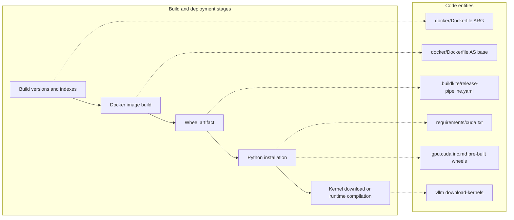
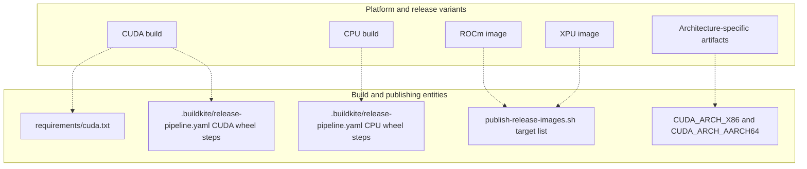

<!-- source: DeepWiki mcp.deepwiki.com · repo vllm-project/vllm · page 11 Build System and Deployment · fetched 2026-10-28 -->

# Build System and Deployment

Relevant source files

The following files were used as context for generating this wiki page:

- [.buildkite/ci_config_intel.yaml](.buildkite/ci_config_intel.yaml)
- [.buildkite/image_build/image_build.sh](.buildkite/image_build/image_build.sh)
- [.buildkite/image_build/image_build_arm64.sh](.buildkite/image_build/image_build_arm64.sh)
- [.buildkite/image_build/image_build_cpu.sh](.buildkite/image_build/image_build_cpu.sh)
- [.buildkite/image_build/image_build_cpu_arm64.sh](.buildkite/image_build/image_build_cpu_arm64.sh)
- [.buildkite/image_build/image_build_hpu.sh](.buildkite/image_build/image_build_hpu.sh)
- [.buildkite/image_build/image_build_torch_nightly.sh](.buildkite/image_build/image_build_torch_nightly.sh)
- [.buildkite/image_build/image_build_xpu.sh](.buildkite/image_build/image_build_xpu.sh)
- [.buildkite/image_build/zstd.hcl](.buildkite/image_build/zstd.hcl)
- [.buildkite/release-pipeline.yaml](.buildkite/release-pipeline.yaml)
- [.buildkite/scripts/annotate-image-build.sh](.buildkite/scripts/annotate-image-build.sh)
- [.buildkite/scripts/docker-build-metadata-args.sh](.buildkite/scripts/docker-build-metadata-args.sh)
- [.buildkite/scripts/hardware_ci/run-intel-test.sh](.buildkite/scripts/hardware_ci/run-intel-test.sh)
- [.buildkite/scripts/publish-release-images.sh](.buildkite/scripts/publish-release-images.sh)
- [.buildkite/scripts/publish-zstd-image.sh](.buildkite/scripts/publish-zstd-image.sh)
- [.buildkite/scripts/push-nightly-builds-cpu.sh](.buildkite/scripts/push-nightly-builds-cpu.sh)
- [.buildkite/scripts/upload-release-wheels-pypi.sh](.buildkite/scripts/upload-release-wheels-pypi.sh)
- [.buildkite/scripts/xpu/push-nightly-builds-xpu.sh](.buildkite/scripts/xpu/push-nightly-builds-xpu.sh)
- [docker/Dockerfile](docker/Dockerfile)
- [docker/docker-bake.hcl](docker/docker-bake.hcl)
- [docker/versions.json](docker/versions.json)
- [docs/assets/contributing/dockerfile-stages-dependency.png](docs/assets/contributing/dockerfile-stages-dependency.png)
- [docs/contributing/dockerfile/dockerfile.md](docs/contributing/dockerfile/dockerfile.md)
- [docs/getting_started/installation/gpu.cuda.inc.md](docs/getting_started/installation/gpu.cuda.inc.md)
- [requirements/cuda.txt](requirements/cuda.txt)
- [requirements/rubin-prerelease.txt](requirements/rubin-prerelease.txt)
- [tests/evals/gpt_oss/configs/gpt-oss-20b-sm120.yaml](tests/evals/gpt_oss/configs/gpt-oss-20b-sm120.yaml)
- [tests/evals/gpt_oss/configs/models-spark.txt](tests/evals/gpt_oss/configs/models-spark.txt)
- [tests/samplers/conftest.py](tests/samplers/conftest.py)
- [tools/build_nixl_with_torch215_for_rubin.py](tools/build_nixl_with_torch215_for_rubin.py)
- [tools/build_triton_from_source.sh](tools/build_triton_from_source.sh)
- [tools/ci/kernel_symbol_map.py](tools/ci/kernel_symbol_map.py)
- [tools/flashinfer-build.sh](tools/flashinfer-build.sh)
- [tools/install_triton_from_source.sh](tools/install_triton_from_source.sh)
- [tools/pre_commit/update-dockerfile-graph.sh](tools/pre_commit/update-dockerfile-graph.sh)

This page gives a high-level overview of how vLLM is built, packaged, installed, and published. It connects the Docker build, dependency and platform variants, installation paths, and runtime kernel preparation; detailed explanations are in the child pages below. [docker/Dockerfile:1-6](), [docs/getting_started/installation/gpu.cuda.inc.md:17-27]()

For runtime environment variables, see [Environment Variables System](#2.3). For `torch.compile` configuration, see [Compilation Configuration and Optimization Levels](#2.4). For hardware-specific runtime behavior, see [Platform Support](#10).

Sources: [docker/Dockerfile:1-6](), [docs/getting_started/installation/gpu.cuda.inc.md:17-27]()

---

## Overview

Build and deployment span several connected stages: platform-specific dependencies and build arguments shape the artifact; Docker can build and package vLLM; installation can use precompiled wheels or a source checkout; and some kernels may be installed or compiled at runtime. The Dockerfile exposes configurable base images and package indexes, while the CUDA requirements file pins a platform-specific dependency set. [docker/Dockerfile:25-46](), [docker/Dockerfile:66-80](), [requirements/cuda.txt:1-18](), [docs/getting_started/installation/gpu.cuda.inc.md:17-27](), [docs/getting_started/installation/gpu.cuda.inc.md:36-48]()

### Build and deployment concepts mapped to code

Sources: [docker/Dockerfile:25-46](), [docker/Dockerfile:66-80](), [docker/Dockerfile:100-103](), [requirements/cuda.txt:1-18](), [.buildkite/release-pipeline.yaml:21-48](), [docs/getting_started/installation/gpu.cuda.inc.md:22-48]()

### Build variants mapped to code entities

Sources: [requirements/cuda.txt:1-18](), [.buildkite/release-pipeline.yaml:1-12](), [.buildkite/release-pipeline.yaml:21-48](), [.buildkite/release-pipeline.yaml:57-75](), [.buildkite/scripts/publish-release-images.sh:11-18](), [.buildkite/scripts/publish-release-images.sh:96-144]()

---

## 11.1 Docker Multi-Stage Build

`docker/Dockerfile` defines build arguments for versions, base images, package indexes, and optional build features, then begins its staged pipeline with a `base` stage. Release automation invokes Docker builds for wheel artifacts, while separate image publishing automation handles platform-specific image families. [docker/Dockerfile:25-46](), [docker/Dockerfile:66-98](), [docker/Dockerfile:100-103](), [.buildkite/release-pipeline.yaml:21-48](), [.buildkite/scripts/publish-release-images.sh:11-18]()

For details on stage dependencies, image variants, and optimization, see [Docker Multi-Stage Build](#11.1).

Sources: [docker/Dockerfile:25-46](), [docker/Dockerfile:66-98](), [docker/Dockerfile:100-103](), [.buildkite/release-pipeline.yaml:21-48](), [.buildkite/scripts/publish-release-images.sh:11-18]()

---

## 11.2 Dependency Management

Dependencies are organized by platform: `requirements/cuda.txt` includes shared requirements and NVIDIA-specific packages, including pinned PyTorch and related CUDA ecosystem dependencies. The Docker build exposes configurable package indexes, and the CUDA installation documentation describes prebuilt-wheel installation as well as source-based and Python-only development paths. [requirements/cuda.txt:1-18](), [docker/Dockerfile:66-80](), [docs/getting_started/installation/gpu.cuda.inc.md:22-27](), [docs/getting_started/installation/gpu.cuda.inc.md:101-120]()

For requirements-file structure, PyTorch version handling, precompiled wheels, and setup/CMake/Rust integration, see [Dependency Management](#11.2).

Sources: [requirements/cuda.txt:1-18](), [docker/Dockerfile:66-80](), [docs/getting_started/installation/gpu.cuda.inc.md:22-27](), [docs/getting_started/installation/gpu.cuda.inc.md:101-120]()

---

## 11.3 Build Variants and Configuration

The repository’s release automation builds CUDA wheels for `x86_64` and `aarch64`, and includes CPU wheel jobs for multiple targets. Release image publishing recognizes CUDA, ROCm, XPU, and CPU targets; the Dockerfile’s arguments and version metadata provide configurable build inputs. [docker/Dockerfile:25-46](), [docker/versions.json:1-23](), [.buildkite/release-pipeline.yaml:1-12](), [.buildkite/release-pipeline.yaml:21-48](), [.buildkite/release-pipeline.yaml:57-75](), [.buildkite/scripts/publish-release-images.sh:11-18]()

For CUDA, ROCm, XPU, and CPU configurations, nightly PyTorch builds, architecture targets, and build-time options, see [Build Variants and Configuration](#11.3).

Sources: [docker/Dockerfile:25-46](), [docker/versions.json:1-23](), [.buildkite/release-pipeline.yaml:1-12](), [.buildkite/release-pipeline.yaml:21-48](), [.buildkite/release-pipeline.yaml:57-75](), [.buildkite/scripts/publish-release-images.sh:11-18]()

---

## 11.4 Runtime JIT Compilation

Installation and runtime setup can involve kernel artifacts in addition to the vLLM package. The CUDA installation documentation recommends `vllm download-kernels` for FlashInfer precompiled kernels and explains that, without them, kernels may be downloaded and compiled at startup. The Dockerfile describes its final base image as including minimal dependencies for JIT compilation. [docs/getting_started/installation/gpu.cuda.inc.md:22-48](), [docker/Dockerfile:43-46]()

For FlashInfer, DeepGemm, Triton, warmup, and runtime kernel generation details, see [Runtime JIT Compilation](#11.4).

Sources: [docs/getting_started/installation/gpu.cuda.inc.md:22-48](), [docker/Dockerfile:43-46]()

---

## Related child pages

| Child page | Focus |
|---|---|
| [Docker Multi-Stage Build](#11.1) | Docker stages, dependencies, image variants, and optimization |
| [Dependency Management](#11.2) | Requirements, PyTorch versions, wheels, and native/Rust build integration |
| [Build Variants and Configuration](#11.3) | Platform targets, architecture support, and build-time options |
| [Runtime JIT Compilation](#11.4) | Runtime kernel compilation, warmup, and generated kernels |

Sources: [docker/Dockerfile:25-46](), [requirements/cuda.txt:1-18](), [.buildkite/release-pipeline.yaml:1-12](), [docs/getting_started/installation/gpu.cuda.inc.md:36-48]()

---

