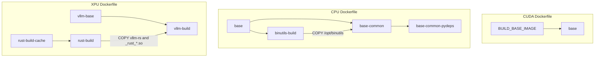
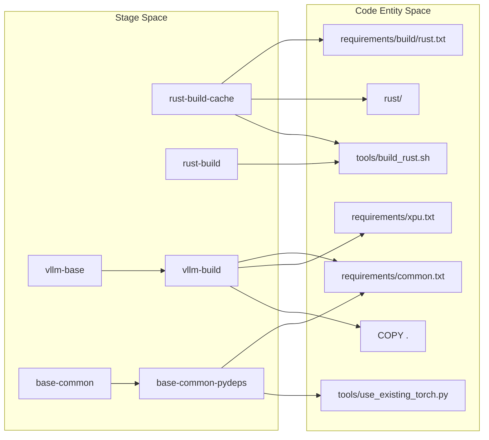
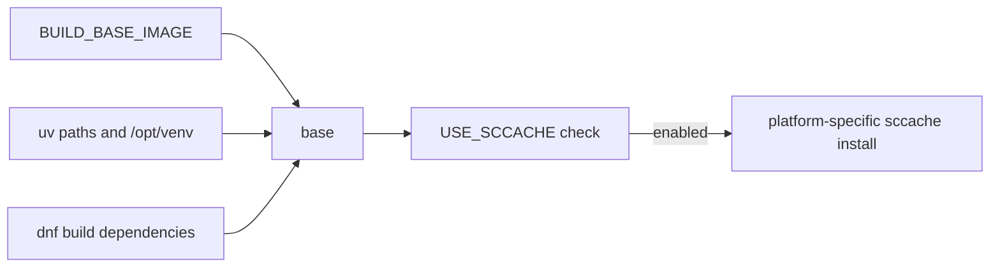
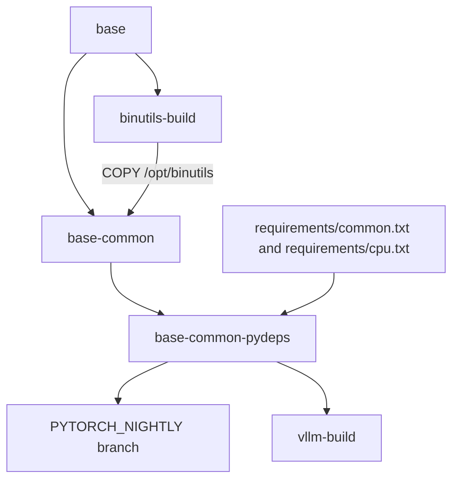
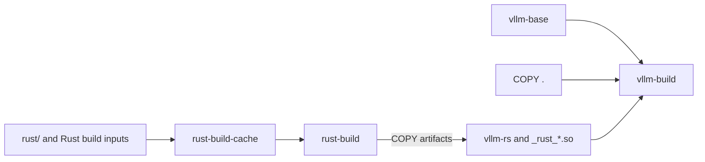

<!-- source: DeepWiki mcp.deepwiki.com · repo vllm-project/vllm · page 11.1 Docker Multi-Stage Build · fetched 2026-10-28 -->

# Docker Multi-Stage Build

Relevant source files

The following files were used as context for generating this wiki page:

- [.buildkite/ci_config_intel.yaml](.buildkite/ci_config_intel.yaml)
- [.buildkite/image_build/image_build.sh](.buildkite/image_build/image_build.sh)
- [.buildkite/image_build/image_build.yaml](.buildkite/image_build/image_build.yaml)
- [.buildkite/image_build/image_build_arm64.sh](.buildkite/image_build/image_build_arm64.sh)
- [.buildkite/image_build/image_build_cpu.sh](.buildkite/image_build/image_build_cpu.sh)
- [.buildkite/image_build/image_build_cpu_arm64.sh](.buildkite/image_build/image_build_cpu_arm64.sh)
- [.buildkite/image_build/image_build_hpu.sh](.buildkite/image_build/image_build_hpu.sh)
- [.buildkite/image_build/image_build_torch_nightly.sh](.buildkite/image_build/image_build_torch_nightly.sh)
- [.buildkite/image_build/image_build_xpu.sh](.buildkite/image_build/image_build_xpu.sh)
- [.buildkite/image_build/zstd.hcl](.buildkite/image_build/zstd.hcl)
- [.buildkite/release-pipeline.yaml](.buildkite/release-pipeline.yaml)
- [.buildkite/scripts/annotate-image-build.sh](.buildkite/scripts/annotate-image-build.sh)
- [.buildkite/scripts/docker-build-metadata-args.sh](.buildkite/scripts/docker-build-metadata-args.sh)
- [.buildkite/scripts/hardware_ci/run-intel-test.sh](.buildkite/scripts/hardware_ci/run-intel-test.sh)
- [.buildkite/scripts/publish-release-images.sh](.buildkite/scripts/publish-release-images.sh)
- [.buildkite/scripts/publish-zstd-image.sh](.buildkite/scripts/publish-zstd-image.sh)
- [.buildkite/scripts/push-nightly-builds-cpu.sh](.buildkite/scripts/push-nightly-builds-cpu.sh)
- [.buildkite/scripts/upload-release-wheels-pypi.sh](.buildkite/scripts/upload-release-wheels-pypi.sh)
- [.buildkite/scripts/xpu/push-nightly-builds-xpu.sh](.buildkite/scripts/xpu/push-nightly-builds-xpu.sh)
- [README.md](README.md)
- [docker/Dockerfile](docker/Dockerfile)
- [docker/Dockerfile.cpu](docker/Dockerfile.cpu)
- [docker/Dockerfile.xpu](docker/Dockerfile.xpu)
- [docker/docker-bake.hcl](docker/docker-bake.hcl)
- [docker/entrypoints/test_vllm_nonroot_entrypoint.sh](docker/entrypoints/test_vllm_nonroot_entrypoint.sh)
- [docker/entrypoints/vllm-nonroot-entrypoint.sh](docker/entrypoints/vllm-nonroot-entrypoint.sh)
- [docker/versions.json](docker/versions.json)
- [docs/assets/contributing/dockerfile-stages-dependency.png](docs/assets/contributing/dockerfile-stages-dependency.png)
- [docs/assets/models/pooling_models/cheat_sheet.svg](docs/assets/models/pooling_models/cheat_sheet.svg)
- [docs/assets/models/pooling_models/pooling_types.svg](docs/assets/models/pooling_models/pooling_types.svg)
- [docs/assets/models/pooling_models/score_types.svg](docs/assets/models/pooling_models/score_types.svg)
- [docs/benchmarking/README.md](docs/benchmarking/README.md)
- [docs/configuration/README.md](docs/configuration/README.md)
- [docs/configuration/serve_args.md](docs/configuration/serve_args.md)
- [docs/contributing/dockerfile/dockerfile.md](docs/contributing/dockerfile/dockerfile.md)
- [docs/deployment/docker.md](docs/deployment/docker.md)
- [docs/features/structured_outputs.md](docs/features/structured_outputs.md)
- [docs/getting_started/installation/README.md](docs/getting_started/installation/README.md)
- [docs/getting_started/installation/gpu.apple.inc.md](docs/getting_started/installation/gpu.apple.inc.md)
- [docs/getting_started/installation/gpu.cuda.inc.md](docs/getting_started/installation/gpu.cuda.inc.md)
- [docs/getting_started/installation/gpu.md](docs/getting_started/installation/gpu.md)
- [docs/getting_started/installation/gpu.rocm.inc.md](docs/getting_started/installation/gpu.rocm.inc.md)
- [docs/getting_started/installation/gpu.xpu.inc.md](docs/getting_started/installation/gpu.xpu.inc.md)
- [docs/getting_started/quickstart.md](docs/getting_started/quickstart.md)
- [docs/models/generative_models.md](docs/models/generative_models.md)
- [docs/usage/troubleshooting.md](docs/usage/troubleshooting.md)
- [requirements/cuda.txt](requirements/cuda.txt)
- [requirements/rubin-prerelease.txt](requirements/rubin-prerelease.txt)
- [requirements/xpu.txt](requirements/xpu.txt)
- [tests/cuda/test_cuda_compatibility_path.py](tests/cuda/test_cuda_compatibility_path.py)
- [tests/evals/gpt_oss/configs/gpt-oss-20b-sm120.yaml](tests/evals/gpt_oss/configs/gpt-oss-20b-sm120.yaml)
- [tests/evals/gpt_oss/configs/models-spark.txt](tests/evals/gpt_oss/configs/models-spark.txt)
- [tests/samplers/conftest.py](tests/samplers/conftest.py)
- [tools/build_nixl_with_torch215_for_rubin.py](tools/build_nixl_with_torch215_for_rubin.py)
- [tools/build_triton_from_source.sh](tools/build_triton_from_source.sh)
- [tools/ci/kernel_symbol_map.py](tools/ci/kernel_symbol_map.py)
- [tools/flashinfer-build.sh](tools/flashinfer-build.sh)
- [tools/install_triton_from_source.sh](tools/install_triton_from_source.sh)
- [tools/pre_commit/update-dockerfile-graph.sh](tools/pre_commit/update-dockerfile-graph.sh)

## Purpose and Scope

This page describes the Docker build structure visible in the supplied repository files: the CUDA-oriented `docker/Dockerfile`, the CPU `docker/Dockerfile.cpu`, and the XPU `docker/Dockerfile.xpu`. It focuses on named stages, artifact handoffs, image variants, and build-time optimization. The supplied CUDA Dockerfile excerpt covers only its global arguments and `base` stage, so details of its later stages cannot be established here. [docker/Dockerfile:1-156]()

Sources: [docker/Dockerfile:1-156](), [docker/Dockerfile.cpu:1-165](), [docker/Dockerfile.xpu:1-165]()

---

## Build Stage Overview

The Dockerfiles use named stages to separate shared setup, compilation, wheel production, and serving or development images. Some stages branch from a common base and can be built independently; artifact dependencies are made explicit with `COPY --from`. For example, the CPU Dockerfile builds binutils before copying it into `base-common`, while the XPU Dockerfile builds Rust artifacts in a separate branch and copies them into `vllm-build`. [docker/Dockerfile.cpu:55-85](), [docker/Dockerfile.xpu:1-40](), [docker/Dockerfile.xpu:142-159]()

### High-Level Pipeline and Stage Dependencies

The diagram shows only stage relationships established by the provided excerpts. The CUDA Dockerfile’s visible portion establishes `base`; its later stage graph is not shown. [docker/Dockerfile:100-156]()

**Diagram: visible Docker stage and artifact relationships**

Sources: [docker/Dockerfile:100-102](), [docker/Dockerfile.cpu:30-35](), [docker/Dockerfile.cpu:55-85](), [docker/Dockerfile.cpu:138-165](), [docker/Dockerfile.xpu:1-42](), [docker/Dockerfile.xpu:142-159]()

---

## Code Entity Build Mapping

This mapping connects stage names to scripts, requirements files, and build inputs that appear in the supplied excerpts. In the XPU pipeline, `rust-build-cache` and `rust-build` run separately from `vllm-base`/`vllm-build`; the wheel-build stage then receives the Rust outputs. In the CPU pipeline, dependency installation is staged separately from the later source-dependent build steps. [docker/Dockerfile.cpu:138-165](), [docker/Dockerfile.xpu:17-40](), [docker/Dockerfile.xpu:142-165]()

**Diagram: Docker stages mapped to build entities**

Sources: [docker/Dockerfile.cpu:138-165](), [docker/Dockerfile.xpu:14-40](), [docker/Dockerfile.xpu:142-165]()

---

## CUDA `base` Stage

The visible CUDA Dockerfile begins from the parameterized `BUILD_BASE_IMAGE`, whose default is a PyTorch manylinux builder. The file says this builder is selected to build wheels against the same glibc floor as PyTorch’s published wheels. The `base` stage installs common build tools and configures `uv` paths and the virtual environment. [docker/Dockerfile:36-46](), [docker/Dockerfile:100-142]()

The stage sets `UV_PYTHON_INSTALL_DIR`, `UV_CACHE_DIR`, and `UV_INSTALL_DIR` under `/opt/uv`, and places `/opt/venv/bin` and `/opt/uv/bin` on `PATH`. The Dockerfile comments explain that this layout is intended to keep the environment usable by descendant stages rather than relying on root-local paths. [docker/Dockerfile:115-130]()

System build dependencies include `ccache`, `git`, `curl`, `sudo`, `elfutils-devel`, and `rdma-core-devel`. If `USE_SCCACHE=1`, the stage selects a binary for the target platform and installs `sccache`; the shown excerpt ends during that installation logic. [docker/Dockerfile:132-156]()

**Diagram: CUDA `base` setup flow**

Sources: [docker/Dockerfile:36-46](), [docker/Dockerfile:100-156]()

---

## CPU Dockerfile Stages

The CPU Dockerfile documents support for `linux/amd64` and `linux/arm64`, and describes `vllm-openai`, `vllm-test`, and `vllm-dev` as its build targets. The excerpt shows the early stages and the beginning of `vllm-build`; it does not show the complete definitions of those targets. [docker/Dockerfile.cpu:1-18]()

### `base`, `binutils-build`, and `base-common`

`base` starts from Ubuntu 22.04 and installs a small set of foundational packages. It can optionally install `sccache`, selecting an architecture-specific binary using `TARGETARCH`. [docker/Dockerfile.cpu:21-53]()

`binutils-build` derives from `base` and builds binutils 2.47 under `/opt/binutils`; its comment identifies the newer assembler as necessary for the AMX-FP8 instruction set. `base-common` also derives from `base`, copies `/opt/binutils` from `binutils-build`, and installs common build dependencies, GCC/G++ 15, `uv`, and a Python virtual environment. [docker/Dockerfile.cpu:55-85](), [docker/Dockerfile.cpu:87-128]()

### `base-common-pydeps`

`base-common-pydeps` derives from `base-common`. It copies `requirements/common.txt`, `requirements/cpu.txt`, and `tools/use_existing_torch.py`, then installs Python dependencies. The `PYTORCH_NIGHTLY` argument selects a nightly CPU PyTorch installation path; the visible excerpt shows the nightly branch installing PyTorch packages before invoking `tools/use_existing_torch.py`. [docker/Dockerfile.cpu:138-165]()

**Diagram: CPU shared dependencies and wheel-build entry**

Sources: [docker/Dockerfile.cpu:30-35](), [docker/Dockerfile.cpu:55-85](), [docker/Dockerfile.cpu:138-165]()

---

## XPU Rust and Wheel-Build Stages

The XPU Dockerfile builds Rust components in dedicated stages. `rust-build-cache` installs Rust build prerequisites, copies `requirements/build/rust.txt` and the Rust build inputs, sets `CARGO_BUILD_JOBS=4`, and runs `tools/build_rust.sh` with a stable placeholder version. `rust-build` derives from that stage and reruns the script with Git-derived version metadata, binding `.git` into the build. [docker/Dockerfile.xpu:1-40]()

`vllm-base` establishes the XPU system and Python environment. `vllm-build` derives from `vllm-base`, installs XPU requirements, copies the project source, and copies `vllm-rs` and `_rust_*.so` artifacts from `rust-build`. The Dockerfile comments state that these prebuilt artifacts let `setup.py` package them instead of building Rust locally. [docker/Dockerfile.xpu:42-71](), [docker/Dockerfile.xpu:117-130](), [docker/Dockerfile.xpu:142-159]()

The visible wheel-build steps install `grpcio-tools`, `protobuf`, and `nanobind`, then install `requirements/xpu.txt`. A repository check can be enabled with `GIT_REPO_CHECK`; the supplied excerpt ends before the wheel-producing command. [docker/Dockerfile.xpu:142-165]()

**Diagram: XPU Rust artifact flow**

Sources: [docker/Dockerfile.xpu:14-40](), [docker/Dockerfile.xpu:142-159]()

---

## Build Optimization and Caching

The Dockerfiles use several mechanisms to reduce repeated work:

| Mechanism | Role in the visible build |
|---|---|
| BuildKit cache mounts | The CPU Dockerfile mounts apt caches during package installation and a `uv` cache during Python dependency installation. [docker/Dockerfile.cpu:32-35](), [docker/Dockerfile.cpu:93-105](), [docker/Dockerfile.cpu:158-165]() |
| `ccache` | Installed in the CUDA base and CPU common base; the CPU Dockerfile sets `CMAKE_CXX_COMPILER_LAUNCHER=ccache`. [docker/Dockerfile:132-142](), [docker/Dockerfile.cpu:96-105](), [docker/Dockerfile.cpu:118-123]() |
| `sccache` | Optional installation is controlled by `USE_SCCACHE`; the CPU Dockerfile comments explain that its S3-backed cache can persist across builders where local BuildKit cache mounts do not. [docker/Dockerfile:144-156](), [docker/Dockerfile.cpu:26-29](), [docker/Dockerfile.cpu:37-53]() |
| Rust cache mounts | XPU Rust stages mount Cargo registry and Git caches, with locked sharing. [docker/Dockerfile.xpu:30-40]() |
| Late source copy | The XPU wheel stage comments that source-dependent layers are kept near the end so code-only changes do not invalidate heavier dependency layers. [docker/Dockerfile.xpu:146-154]() |
| Separate Rust build | XPU Rust compilation is isolated from the main image so the main image does not need the Rust toolchain. [docker/Dockerfile.xpu:1-4]() |

Sources: [docker/Dockerfile:132-156](), [docker/Dockerfile.cpu:26-29](), [docker/Dockerfile.cpu:32-53](), [docker/Dockerfile.cpu:93-128](), [docker/Dockerfile.xpu:1-40](), [docker/Dockerfile.xpu:146-159]()

---

## Image Variants and Build Entry Points

The supplied files establish several platform-specific build paths, but do not show all final image definitions:

| Build path or target | What the supplied files establish |
|---|---|
| CUDA `build` target | The release pipeline invokes `docker build` on `docker/Dockerfile` with `--target build` to produce wheel artifacts for CUDA x86_64 and arm64 jobs. [`.buildkite/release-pipeline.yaml:21-46`]() |
| CPU `vllm-openai` | The CPU Dockerfile identifies it as the default target for serving deployment. [docker/Dockerfile.cpu:10-14]() |
| CPU `vllm-test` | The CPU Dockerfile identifies it as a target for CI tests. [docker/Dockerfile.cpu:10-14]() |
| CPU `vllm-dev` | The CPU Dockerfile identifies it as a development target. [docker/Dockerfile.cpu:10-14]() |
| XPU `vllm-build` | The XPU Dockerfile describes this stage as producing a standalone `dist/*.whl` artifact for the release pipeline. [docker/Dockerfile.xpu:136-150]() |
| XPU deployment image | Installation documentation names the published image `vllm/vllm-openai-xpu` and identifies stable and nightly tags. [docs/getting_started/installation/gpu.xpu.inc.md:93-112]() |

Do not infer that similarly named targets have identical contents across platform Dockerfiles. The supplied excerpts show platform-specific build environments and artifact flows. [docker/Dockerfile.cpu:1-18](), [docker/Dockerfile.xpu:1-4](), [docs/getting_started/installation/gpu.xpu.inc.md:93-112]()

Sources: [.buildkite/release-pipeline.yaml:21-46](), [docker/Dockerfile.cpu:1-18](), [docker/Dockerfile.xpu:136-150](), [docs/getting_started/installation/gpu.xpu.inc.md:93-112]()

---

## Build Arguments and Version Management

The CUDA Dockerfile declares version defaults as build arguments and describes those defaults as the source of truth; `docker/versions.json` is generated for `docker buildx bake`, rather than edited directly. The documented update process is to modify the Dockerfile arguments and run `tools/generate_versions_json.py`. [docker/Dockerfile:8-23]()

| Argument | Default visible in supplied files | Purpose or context |
|---|---:|---|
| `CUDA_VERSION` | `13.0.3` | Used to parameterize CUDA-related base image selection. [docker/Dockerfile:25-27](), [docker/Dockerfile:45-46]() |
| `PYTHON_VERSION` | `3.12` | Python version build argument. [docker/Dockerfile:25-27]() |
| `UBUNTU_VERSION` | `24.04` | Used in the default final CUDA base image name. [docker/Dockerfile:25-27](), [docker/Dockerfile:45-46]() |
| `BUILD_BASE_IMAGE` | PyTorch manylinux CUDA 13 builder | Parameterizes the build image. [docker/Dockerfile:36-46]() |
| `FINAL_BASE_IMAGE` | NVIDIA CUDA base on Ubuntu 24.04 | Parameterizes the runtime base image. [docker/Dockerfile:43-46](), [docker/versions.json:19-24]() |
| `NCCL_VERSION` | `2.30.7` | Declared with a comment explaining CUDA 12+ compatibility with DeepEP’s NCCL requirement. [docker/Dockerfile:31-34]() |
| `INSTALL_KV_CONNECTORS` | `false` | Flag for including built-in KV-connector dependency libraries. [docker/Dockerfile:92-94]() |
| `BUILD_NIXL` | `false` | Flag for building NIXL and its PyTorch extension from source. [docker/Dockerfile:95-99]() |

The versions file includes generated defaults for additional variables such as `TORCH_CUDA_ARCH_LIST`, `MAX_JOBS`, and `NVCC_THREADS`. [docker/versions.json:52-70]()

Sources: [docker/Dockerfile:8-23](), [docker/Dockerfile:25-46](), [docker/Dockerfile:92-99](), [docker/versions.json:19-70]()

---

## Dependency Inputs

Platform dependency files make the hardware-specific Python stack explicit. `requirements/cuda.txt` includes `requirements/common.txt`, pins the PyTorch CUDA packages, and lists NVIDIA-oriented packages such as FlashInfer and CUDA-specific kernel dependencies. [requirements/cuda.txt:1-33]()

`requirements/xpu.txt` also includes `requirements/common.txt`, adds the XPU wheel index, and pins XPU-specific Triton, PyTorch, and kernel packages. The XPU Dockerfile configures the XPU package index and installs `requirements/xpu.txt` in `vllm-build`. [requirements/xpu.txt:1-23](), [docker/Dockerfile.xpu:121-130](), [docker/Dockerfile.xpu:142-150]()

The CPU Dockerfile copies `requirements/common.txt` and `requirements/cpu.txt` into its dependency stage. The provided excerpt shows the nightly-versus-release PyTorch installation logic but does not include the complete CPU dependency installation command. [docker/Dockerfile.cpu:143-165]()

Sources: [requirements/cuda.txt:1-33](), [requirements/xpu.txt:1-23](), [docker/Dockerfile.cpu:143-165](), [docker/Dockerfile.xpu:121-150]()

---

## Summary

The visible Docker build design separates platform foundations, expensive toolchain work, dependency installation, and wheel assembly into named stages. CPU builds use a binutils branch and a shared Python-dependency stage; XPU builds isolate Rust compilation and transfer its outputs into `vllm-build`; the CUDA excerpt establishes a parameterized manylinux-based `base` stage and its build environment. BuildKit mounts, `ccache`, optional `sccache`, and late source copying reduce repeated work. The supplied excerpts do not expose the full CUDA stage graph or complete final-stage definitions, so those details are intentionally not inferred here. [docker/Dockerfile:36-156](), [docker/Dockerfile.cpu:21-165](), [docker/Dockerfile.xpu:1-165]()

Sources: [docker/Dockerfile:36-156](), [docker/Dockerfile.cpu:21-165](), [docker/Dockerfile.xpu:1-165]()

---

